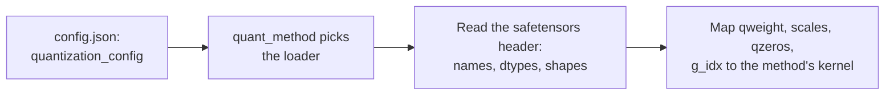

# Leçon 23. Checkpoints quantifiés

**Lien avec la mission :** Chaque méthode de ce parcours finit en fichiers sur disque, et pour relire le « modèle 4 bits » de quelqu'un, vous devez pouvoir ouvrir le checkpoint et dire ce qu'il contient, sans faire confiance à la fiche de modèle.
**Source primaire :** [Doc : "Safetensors", Hugging Face](https://huggingface.co/docs/safetensors/index)
**Prérequis :** [Leçon 22](0022-an-honest-quantization-eval.md), [Taille de groupe](../GLOSSARY.md), [Bits effectifs par poids](../GLOSSARY.md), [Zero-point](../GLOSSARY.md)

## Échauffement

1. ▢ Un schéma en 4 bits stocke un scale de 16 bits par groupe de 128 poids. Quels sont ses bits effectifs par poids, en ne comptant que le scale ?

<details markdown="1"><summary>Vérifier</summary>

4.125 : le scale ajoute 16 / 128 = 0.125 bit par poids (leçons 1 et 6).

</details>

2. ▢ Comment retransformez-vous un entier stocké `q` en une valeur réelle approchée quand le quantificateur a un scale `s` et un zero-point `z` ?

<details markdown="1"><summary>Vérifier</summary>

`x ≈ s * (q - z)` : soustrayez le zero-point, puis multipliez par le scale (leçon 4). Avec un quantificateur symétrique, `z` est nul.

</details>

3. ▢ En une phrase, que fait GPTQ après avoir arrondi une colonne des poids d'une couche ?

<details markdown="1"><summary>Vérifier</summary>

Il met à jour les colonnes pas encore quantifiées pour compenser l'erreur d'arrondi qu'il vient de faire, avec l'information du second ordre tirée des activations de calibration (leçon 10).

</details>

## À savoir

### Ce que stocke safetensors

Un fichier **safetensors** contient des tenseurs nommés et rien d'autre dont le format se soucie. Selon la [description du format](https://github.com/huggingface/safetensors), il a trois parties, dans cet ordre :

```text
| 8 bytes: N | N bytes: JSON header | byte buffer: tensor data |
```

`N` est un entier non signé de 64 bits en little-endian qui donne la taille de l'en-tête. L'en-tête est un objet JSON qui fait correspondre à chaque nom de tenseur son `dtype`, sa `shape` et ses `data_offsets`, une position de début et de fin dans le tampon d'octets. Il peut aussi contenir une clé `__metadata__` avec des paires chaîne-vers-chaîne libres. Les données sont en ordre ligne par ligne, en little-endian, et entièrement indexées sans trou. La [doc](https://huggingface.co/docs/safetensors/index) le présente comme une alternative sûre à pickle qui reste rapide, avec un chargement sans copie, et montre comment charger une tranche d'un tenseur.

Deux conséquences comptent ici. Vous pouvez lire l'en-tête seul, sans les gigaoctets de données qui le suivent, et apprendre le nom, le dtype et la forme de chaque tenseur. Et un tenseur de dtype `I32` ne dit pas s'il contient des entiers de 32 bits ou huit valeurs de 4 bits empaquetées. Le fichier porte les octets. Ce qu'ils signifient doit être consigné ailleurs.

### Ce que stocke une couche linéaire GPTQ en 4 bits

Voici une vraie couche, lue dans l'en-tête d'un checkpoint GPTQ public en 4 bits de TinyLlama 1.1B Chat, dont le `q_proj` relie 2048 entrées à 2048 sorties avec une taille de groupe de 128 :

| Tenseur | Dtype et forme | Ce qu'il contient |
|---|---|---|
| `qweight` | I32 `[256, 2048]` | Les poids, empaquetés : 256 x 2048 x 8 = 4,194,304 valeurs de quatre bits, toute la matrice 2048 x 2048 |
| `scales` | F16 `[16, 2048]` | Un scale par groupe et par canal de sortie : 2048 / 128 = 16 groupes |
| `qzeros` | I32 `[16, 256]` | Les zero-points, eux aussi empaquetés, 8 par entier : 2048 / 8 = 256 |
| `g_idx` | I32 `[2048]` | Pour chaque canal d'entrée, le numéro du groupe auquel il appartient |
| `bias` | F16 `[2048]` | Le biais de la couche, laissé en 16 bits |

Le tenseur `g_idx` existe à cause de l'act-order. Le dépôt des auteurs de GPTQ décrit l'option comme quantifiant les colonnes par taille d'activation décroissante, et note que son option `--static-groups` évite des « changements d'inférence (qui peuvent causer un ralentissement) » (« inference changes (that may cause slowdown) »). Une fois les colonnes quantifiées dans cet ordre, les canaux d'un même groupe ne sont plus voisins, donc le chargeur a besoin d'une correspondance entre canal et groupe. La fiche de modèle de ce checkpoint appelle l'option `desc_act` et dit qu'elle donne une meilleure précision. Un checkpoint quantifié sans act-order a des groupes contigus, donc sa correspondance compterait simplement de 0 à 15 par blocs de 128.

L'empaquetage est une famille d'agencements, pas un standard. Un checkpoint FP8 [compressed-tensors](https://huggingface.co/docs/transformers/main/en/quantization/compressed_tensors), par exemple, stocke `weight` en `F8_E4M3` avec la forme `[4096, 14336]` et un `weight_scale` de forme `[1]` : un seul scale pour tout le tenseur, sans matrice de groupes du tout. La même bibliothèque couvre aussi une forme pack-quantized, des poids int4 ou int8 empaquetés dans des entiers de 32 bits.

### Comment la config indique à un chargeur ce que signifient les octets

Le schéma est consigné dans le `config.json` du modèle, sous `quantization_config`. Un chargeur lit d'abord cette clé, choisit la méthode correspondante d'après son `quant_method`, et seulement ensuite relie les noms de tenseurs aux kernels :



La doc de Transformers dit d'identifier un modèle AWQ par la clé `quant_method` de `config.json`. Les trois familles que vous rencontrerez portent des clés différentes :

| Méthode | Clés dans `quantization_config` | Source |
|---|---|---|
| GPTQ | `quant_method: "gptq"`, `bits: 4`, `group_size: 128`, `desc_act: true`, `sym: true`, `damp_percent: 0.1`, `true_sequential: true`, `static_groups: false` | la config du checkpoint ci-dessus |
| AWQ | `quant_method: "awq"`, `bits: 4`, `group_size: 128`, `zero_point: true`, `version: "gemm"` | exemple des [docs AWQ de Transformers](https://huggingface.co/docs/transformers/main/en/quantization/awq) |
| compressed-tensors | `quant_method: "compressed-tensors"`, `config_groups` contenant `weights` et `input_activations` (chacun avec `num_bits`, `strategy`, `type`) et `targets`, plus `ignore`, `format`, `quantization_status` | exemple des [docs de Transformers](https://huggingface.co/docs/transformers/main/en/quantization/compressed_tensors) |

Dans compressed-tensors, un **groupe de config** nomme les modules auxquels il s'applique (`targets`, comme `["Linear"]`) et comment quantifier leurs poids et, en option, leurs activations. La liste `ignore` nomme les modules laissés tels quels, comme `lm_head`. Dans l'exemple FP8 de la doc, poids et activations sont des flottants de 8 bits avec une stratégie par tenseur, et `lm_head` est sauté.

Les tenseurs et la config peuvent aussi être en désaccord. Le fichier GPTQ ci-dessus répète `gptq_bits`, `gptq_group_size` et `gptq_desc_act` dans son `__metadata__` safetensors comme dans `config.json`. Quand un fichier et sa config divergent, ce sont les formes des tenseurs que le kernel doit réellement lire, donc vérifiez-les en premier.

## Pratique

1. ▢ Un fichier safetensors commence par les octets `d8 5c 01 00 00 00 00 00`. Quelle est la longueur de l'en-tête JSON, et à quel décalage d'octets du fichier les données des tenseurs commencent-elles ?

<details markdown="1"><summary>Vérifier</summary>

Les huit premiers octets sont un entier en little-endian, donc `N = 0xd8 + 0x5c * 256 + 0x01 * 65536 = 216 + 23,552 + 65,536 = 89,304` octets d'en-tête. Les données commencent au décalage 8 + 89,304 = 89,312. Ce sont les vrais octets du checkpoint de l'exercice suivant.

</details>

2. ▢ Où un chargeur apprend-il quelle méthode de quantification un checkpoint utilise ?

    - a) La clé quant_method dans la quantization_config du config.json du modèle
    - b) La quantité globale de tenseurs enregistrée dans l'en-tête safetensors
    - c) Les positions des tenseurs dans le tampon binaire safetensors
    - d) L'extension du nom de fichier principal des poids du checkpoint

<details markdown="1"><summary>Vérifier</summary>

**a)** La doc de Transformers identifie un modèle AWQ par cette clé, et compressed-tensors et GPTQ utilisent la même. (b) est faux parce qu'un nombre de tenseurs est un fait sur la taille, pas sur la méthode. (c) est faux parce que les positions dans le tampon sont déjà indexées par l'en-tête et ne disent rien de la méthode. (d) est faux parce que les checkpoints GPTQ, AWQ et compressed-tensors se terminent tous en `.safetensors`.

</details>

3. ▢ Prédisez, puis exécutez. Le script ci-dessous ne lit que l'en-tête d'un checkpoint GPTQ en 4 bits via une requête HTTP par plage, puis le tenseur `g_idx`, environ 8 KB. Le fichier de poids du modèle fait des centaines de mégaoctets. Prédisez les cinq tenseurs stockés pour `q_proj` de la couche 0, avec dtypes et formes, et si `g_idx` est trié. Il demande un accès réseau et aucun paquet supplémentaire.

    ```python
    import json
    import struct
    import urllib.request

    URL = "https://huggingface.co/TheBloke/TinyLlama-1.1B-Chat-v1.0-GPTQ/resolve/main/model.safetensors"


    def fetch(start, end):
        req = urllib.request.Request(URL, headers={"Range": f"bytes={start}-{end}", "User-Agent": "Mozilla/5.0"})
        with urllib.request.urlopen(req) as response:
            return response.read()


    (n,) = struct.unpack("<Q", fetch(0, 7))  # first 8 bytes: header length, little-endian
    header = json.loads(fetch(8, 8 + n - 1))  # next n bytes: the JSON header
    print("header bytes:", n, "| tensors:", len(header) - 1)
    print("metadata:", header.pop("__metadata__"))

    layer = "model.layers.0.self_attn.q_proj."
    for name, tensor in header.items():
        if name.startswith(layer):
            print(name, tensor["dtype"], tensor["shape"])

    begin, end = header[layer + "g_idx"]["data_offsets"]  # offsets are relative to the data buffer
    raw = fetch(8 + n + begin, 8 + n + end - 1)
    g_idx = struct.unpack(f"<{len(raw) // 4}i", raw)
    print("first 12 g_idx values:", g_idx[:12])
    print("g_idx sorted:", list(g_idx) == sorted(g_idx))
    print("distinct groups:", len(set(g_idx)))
    ```

<details markdown="1"><summary>Indice</summary>

Huit valeurs de 4 bits tiennent dans un entier de 32 bits, et une taille de groupe de 128 sur 2048 entrées donne 16 groupes. Si `desc_act` était activé, demandez-vous si les canaux d'un même groupe se trouvent côte à côte.

</details>

<details markdown="1"><summary>Vérifier</summary>

Sur le fichier tel qu'il était à l'écriture de cette leçon, il affiche un en-tête de 89304 octets et 817 tenseurs, des métadonnées avec `gptq_bits` 4, `gptq_group_size` 128 et `gptq_desc_act` True, et ces tenseurs dans cet ordre : `g_idx` I32 `[2048]`, `qweight` I32 `[256, 2048]`, `qzeros` I32 `[16, 256]`, `bias` F16 `[2048]`, `scales` F16 `[16, 2048]`. Les premières valeurs de g_idx sont `(13, 7, 0, 1, 6, 1, 12, 12, 13, 5, 6, 11)`, donc il n'est pas trié, et il y a 16 groupes distincts. Le canal 0 appartient au groupe 13, ce qui est la correspondance canal-groupe brouillée de l'act-order. Un fichier hébergé peut changer, donc traitez les chiffres exacts comme un instantané.

</details>

4. ▢ Avec les formes de l'exercice précédent, quels sont les bits effectifs par poids de ce `q_proj`, en comptant `qweight`, `scales`, `qzeros` et `g_idx` mais pas le biais ? Est-ce plus proche de 4.0, de 4.125 ou de 4.17 ?

<details markdown="1"><summary>Vérifier</summary>

Environ 4.17. Les octets sont 256 x 2048 x 4 = 2,097,152 pour `qweight`, 16 x 2048 x 2 = 65,536 pour `scales`, 16 x 256 x 4 = 16,384 pour `qzeros` et 2048 x 4 = 8,192 pour `g_idx`, soit 2,187,264 au total. Multiplié par 8 bits et divisé par 2048 x 2048 = 4,194,304 poids, cela donne 4.171875. Le scale seul donne 4.125, et les zero-points empaquetés et la correspondance des groupes ajoutent le reste. Un checkpoint « 4 bits » n'est jamais exactement à 4 bits par poids.

</details>

5. ▢ Une fiche de modèle dit taille de groupe 128 et `config.json` concorde. Le tenseur `scales` d'une couche à 2048 entrées a la forme `[64, 2048]`. Quelle taille de groupe a réellement été utilisée, et que cela vous apprend-il ?

<details markdown="1"><summary>Indice</summary>

La première dimension de `scales` est le nombre de groupes le long des canaux d'entrée.

</details>

<details markdown="1"><summary>Vérifier</summary>

La taille de groupe est 2048 / 64 = 32, pas 128. Les formes de l'en-tête safetensors sont ce que lit le kernel et ne peuvent pas se tromper sur l'agencement, alors qu'une config ou une fiche de modèle est une affirmation qui peut être copiée d'une autre exécution. Ni un chargeur ni un relecteur ne devrait croire l'affirmation plutôt que les tenseurs.

</details>

6. ▢ Voici une `quantization_config` tirée de la doc de Transformers. Que quantifie-t-elle, comment, et que laisse-t-elle intact ?

    ```json
    "quantization_config": {
      "config_groups": {
        "group_0": {
          "input_activations": {"num_bits": 8, "strategy": "tensor", "type": "float"},
          "targets": ["Linear"],
          "weights": {"num_bits": 8, "strategy": "tensor", "type": "float"}
        }
      },
      "format": "naive-quantized",
      "ignore": ["lm_head"],
      "quant_method": "compressed-tensors",
      "quantization_status": "frozen"
    }
    ```

<details markdown="1"><summary>Vérifier</summary>

Elle quantifie chaque module `Linear` : à la fois les poids et les activations d'entrée en virgule flottante sur 8 bits (fp8), avec un scale par tenseur (`strategy: "tensor"`). Cela en fait un schéma W8A8, et la liste de tenseurs de la doc pour ce modèle montre un `weight_scale` de forme `[1]`. Le `lm_head` est laissé dans sa précision d'origine par la liste `ignore`.

</details>

## Exercices en situation réelle

- [ ] Ouvrez la page d'un modèle quantifié sur le Hugging Face Hub, trouvez son `config.json`, et notez `quant_method`, `bits` et `group_size`. Ouvrez ensuite sa liste de tenseurs depuis la visionneuse de fichiers et confirmez que la forme de `scales` d'une couche correspond à la taille de groupe.
- [ ] Exécutez le script de l'exercice 3 sur un second checkpoint quantifié public, comme un AWQ, et listez en quoi ses noms de tenseurs diffèrent de ceux de GPTQ.
- [ ] Demain : sans notes, nommez dans l'ordre les trois parties d'un fichier safetensors, et les quatre tenseurs qu'une couche linéaire GPTQ en 4 bits stocke en plus de son biais.

## Pour aller plus loin

- [Mesurer et stocker](../reference/measuring-and-storing.md)
- [Doc : "Safetensors", Hugging Face](https://huggingface.co/docs/safetensors/index)
- [Dépôt : safetensors, Hugging Face](https://github.com/huggingface/safetensors), pour le format au niveau de l'octet
- [Doc : "compressed-tensors", Hugging Face Transformers](https://huggingface.co/docs/transformers/main/en/quantization/compressed_tensors)
- [Ressources](../RESOURCES.md)

---

Ça ne passe pas ? Relisez la source primaire en haut de page, car cette leçon la condense et c'est dans la condensation que la compréhension s'échappe. Consultez le [glossaire](../GLOSSARY.md) pour tout terme qui vous a paru glissant.

Si c'est la leçon elle-même qui n'est pas claire plutôt que la matière, c'est un défaut : [ouvrez une issue](https://github.com/TokenCemetery/teach/issues).
