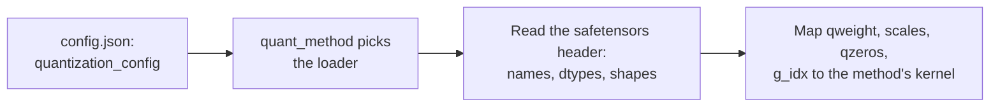

# पाठ 23. Quantized Checkpoints

**मिशन से संबंध:** इस track का हर method अंत में disk पर files के रूप में ख़त्म होता है, और किसी के "4-bit model" की समीक्षा करने के लिए आपको checkpoint खोलकर बताना आना चाहिए कि उसमें क्या है, model card पर भरोसा किए बिना।
**मुख्य स्रोत:** [दस्तावेज़: "Safetensors", Hugging Face](https://huggingface.co/docs/safetensors/index)
**पूर्व-आवश्यकताएँ:** [पाठ 22](0022-an-honest-quantization-eval.md), [Group size](../GLOSSARY.md), [Effective bits per weight](../GLOSSARY.md), [Zero point](../GLOSSARY.md)

## वार्म-अप

1. ▢ एक 4-bit scheme हर 128 weights के group पर एक 16-bit scale store करती है। सिर्फ़ scale गिनकर, उसके effective bits per weight क्या हैं?

<details markdown="1"><summary>जाँचें</summary>

4.125: scale प्रति weight 16 / 128 = 0.125 bits जोड़ता है (पाठ 1 और 6)।

</details>

2. ▢ जब quantizer में scale `s` और zero point `z` हों, तो store किए गए integer `q` को वापस अनुमानित real value में कैसे बदलते हैं?

<details markdown="1"><summary>जाँचें</summary>

`x ≈ s * (q - z)`: zero point घटाएँ, फिर scale से गुणा करें (पाठ 4)। Symmetric quantizer में `z` zero है।

</details>

3. ▢ एक वाक्य में, GPTQ किसी layer के weights का एक column round करने के बाद क्या करता है?

<details markdown="1"><summary>जाँचें</summary>

वह अभी quantize न हुए columns को अभी की गई rounding error की भरपाई के लिए update करता है, calibration activations की second-order जानकारी से (पाठ 10)।

</details>

## यह जानें

### Safetensors क्या store करता है

**Safetensors** file नामित tensors रखती है और उसके अलावा कुछ नहीं जिसकी format को परवाह हो। [format विवरण](https://github.com/huggingface/safetensors) के अनुसार उसके तीन हिस्से हैं, इसी क्रम में:

```text
| 8 bytes: N | N bytes: JSON header | byte buffer: tensor data |
```

`N` unsigned little-endian 64-bit integer है जो header का आकार देता है। Header एक JSON object है जो हर tensor के नाम को उसके `dtype`, उसके `shape`, और `data_offsets` से map करता है, यानी byte buffer के भीतर शुरू और अंत की जगह। उसमें `__metadata__` key भी हो सकती है जिसमें मुक्त-रूप string-से-string जोड़े होते हैं। Data row-major, little-endian है, और बिना किसी ख़ाली जगह के पूरी तरह indexed है। [दस्तावेज़](https://huggingface.co/docs/safetensors/index) इसे pickle के सुरक्षित विकल्प के रूप में पेश करते हैं जो फिर भी तेज़ है, zero-copy loading के साथ, और एक tensor का slice load करना दिखाते हैं।

यहाँ दो नतीजे मायने रखते हैं। आप सिर्फ़ header पढ़ सकते हैं, उसके बाद के gigabytes के data के बिना, और हर tensor का नाम, dtype और shape जान सकते हैं। और dtype `I32` का tensor यह नहीं बताता कि उसमें 32-bit integers हैं या आठ packed 4-bit values। File bytes ढोती है। उनका क्या मतलब है यह कहीं और दर्ज होना चाहिए।

### 4-bit GPTQ linear layer क्या store करती है

यह एक असली layer है, TinyLlama 1.1B Chat के सार्वजनिक 4-bit GPTQ checkpoint के header से पढ़ी गई, जिसकी `q_proj` 2048 inputs को 128 के group size के साथ 2048 outputs पर map करती है:

| Tensor | Dtype और shape | क्या रखता है |
|---|---|---|
| `qweight` | I32 `[256, 2048]` | Weights, packed: 256 x 2048 x 8 = 4,194,304 चार-bit values, पूरी 2048 x 2048 matrix |
| `scales` | F16 `[16, 2048]` | हर output channel के लिए हर group का एक scale: 2048 / 128 = 16 groups |
| `qzeros` | I32 `[16, 256]` | Zero points, वे भी packed, हर integer में 8: 2048 / 8 = 256 |
| `g_idx` | I32 `[2048]` | हर input channel के लिए, उस group की संख्या जिसका वह हिस्सा है |
| `bias` | F16 `[2048]` | Layer का bias, 16 bits में छोड़ा गया |

`g_idx` tensor act-order की वजह से है। GPTQ लेखकों का repository इस option का वर्णन columns को activation के घटते आकार के क्रम में quantize करने के रूप में करता है, और ध्यान दिलाता है कि उसका `--static-groups` option "inference में बदलावों (जो धीमापन ला सकते हैं)" से बचाता है। एक बार columns उस क्रम में quantize हो जाएँ, तो एक group के channels अब पड़ोसी नहीं रहते, इसलिए loader को channel से group तक का map चाहिए। इस checkpoint का model card इस option को `desc_act` कहता है और कहता है कि यह बेहतर accuracy देता है। Act-order के बिना quantize किए checkpoint में groups लगातार होते हैं, इसलिए उसका map बस 128 के blocks में 0 से 15 गिनता।

Packing layouts का एक परिवार है, मानक नहीं। उदाहरण के लिए [compressed-tensors](https://huggingface.co/docs/transformers/main/en/quantization/compressed_tensors) FP8 checkpoint `weight` को shape `[4096, 14336]` के साथ `F8_E4M3` के रूप में store करता है और `weight_scale` का shape `[1]` है: पूरे tensor के लिए एक अकेला scale, बिना किसी group matrix के। वही library एक pack-quantized रूप भी कवर करती है, 32-bit integers में packed int4 या int8 weights।

### Config loader को कैसे बताता है कि bytes का क्या मतलब है

Scheme model के `config.json` में `quantization_config` के नीचे दर्ज होती है। Loader पहले वह key पढ़ता है, उसकी `quant_method` से मेल खाता method चुनता है, और उसके बाद ही tensor names को kernels से map करता है:



Transformers दस्तावेज़ बताते हैं कि AWQ model को `config.json` की `quant_method` key से पहचानें। जो तीन परिवार आपको मिलेंगे उनकी keys अलग हैं:

| Method | `quantization_config` में keys | स्रोत |
|---|---|---|
| GPTQ | `quant_method: "gptq"`, `bits: 4`, `group_size: 128`, `desc_act: true`, `sym: true`, `damp_percent: 0.1`, `true_sequential: true`, `static_groups: false` | ऊपर के checkpoint का config |
| AWQ | `quant_method: "awq"`, `bits: 4`, `group_size: 128`, `zero_point: true`, `version: "gemm"` | [Transformers AWQ दस्तावेज़](https://huggingface.co/docs/transformers/main/en/quantization/awq) का उदाहरण |
| compressed-tensors | `quant_method: "compressed-tensors"`, `config_groups` जिसमें `weights` और `input_activations` (हर एक में `num_bits`, `strategy`, `type`) और `targets` हैं, साथ में `ignore`, `format`, `quantization_status` | [Transformers दस्तावेज़](https://huggingface.co/docs/transformers/main/en/quantization/compressed_tensors) का उदाहरण |

compressed-tensors में **config group** उन modules के नाम बताता है जिन पर वह लागू होता है (`targets`, जैसे `["Linear"]`) और उनके weights को और, वैकल्पिक रूप से, उनकी activations को कैसे quantize करना है। `ignore` सूची उन modules के नाम बताती है जिन्हें अकेला छोड़ा गया है, जैसे `lm_head`। दस्तावेज़ों के FP8 उदाहरण में, weights और activations दोनों 8-bit floats हैं, per-tensor strategy के साथ, और `lm_head` छोड़ दिया गया है।

Tensors और config असहमत भी हो सकते हैं। ऊपर की GPTQ file `gptq_bits`, `gptq_group_size` और `gptq_desc_act` को अपने safetensors `__metadata__` में भी दोहराती है और `config.json` में भी। जब कोई file और उसका config असहमत हों, तो tensor shapes ही वह हैं जो kernel को असल में पढ़ना है, इसलिए उन्हें पहले जाँचें।

## अभ्यास

1. ▢ Safetensors file bytes `d8 5c 01 00 00 00 00 00` से शुरू होती है। JSON header कितना लंबा है, और file में किस byte offset पर tensor data शुरू होता है?

<details markdown="1"><summary>जाँचें</summary>

पहले आठ bytes little-endian integer हैं, इसलिए `N = 0xd8 + 0x5c * 256 + 0x01 * 65536 = 216 + 23,552 + 65,536 = 89,304` bytes का header। Data offset 8 + 89,304 = 89,312 पर शुरू होता है। ये अगले सवाल वाले checkpoint के असली bytes हैं।

</details>

2. ▢ Loader को कहाँ पता चलता है कि checkpoint कौन-सा quantization method इस्तेमाल करता है?

    - a) Model के config.json के quantization_config के भीतर की quant_method key
    - b) Safetensors header में दर्ज tensors की कुल संख्या
    - c) Safetensors binary buffer के भीतर tensors की जगहें
    - d) Checkpoint की मुख्य weights file के नाम का extension ही

<details markdown="1"><summary>जाँचें</summary>

**a)** Transformers दस्तावेज़ AWQ model को उसी key से पहचानते हैं, और compressed-tensors और GPTQ वही इस्तेमाल करते हैं। (b) ग़लत है क्योंकि tensor की गिनती आकार के बारे में तथ्य है, method के बारे में नहीं। (c) ग़लत है क्योंकि buffer में जगहें पहले से header से indexed हैं और method के बारे में कुछ नहीं बतातीं। (d) ग़लत है क्योंकि GPTQ, AWQ और compressed-tensors checkpoints सब `.safetensors` पर ख़त्म होते हैं।

</details>

3. ▢ पहले अनुमान लगाएँ, फिर चलाएँ। नीचे की script 4-bit GPTQ checkpoint का सिर्फ़ header एक HTTP range request से पढ़ती है, फिर `g_idx` tensor, लगभग 8 KB। Model की weight file सैकड़ों megabytes की है। Layer 0 में `q_proj` के लिए store पाँच tensors, dtypes और shapes के साथ, अनुमानित करें, और बताएँ कि क्या `g_idx` sorted है। इसे network access चाहिए और कोई अतिरिक्त packages नहीं।

    ```python
    import json
    import struct
    import urllib.request

    URL = "https://huggingface.co/TheBloke/TinyLlama-1.1B-Chat-v1.0-GPTQ/resolve/main/model.safetensors"


    def fetch(start, end):
        req = urllib.request.Request(URL, headers={"Range": f"bytes={start}-{end}", "User-Agent": "Mozilla/5.0"})
        with urllib.request.urlopen(req) as response:
            return response.read()


    (n,) = struct.unpack("<Q", fetch(0, 7))  # first 8 bytes: header length, little-endian
    header = json.loads(fetch(8, 8 + n - 1))  # next n bytes: the JSON header
    print("header bytes:", n, "| tensors:", len(header) - 1)
    print("metadata:", header.pop("__metadata__"))

    layer = "model.layers.0.self_attn.q_proj."
    for name, tensor in header.items():
        if name.startswith(layer):
            print(name, tensor["dtype"], tensor["shape"])

    begin, end = header[layer + "g_idx"]["data_offsets"]  # offsets are relative to the data buffer
    raw = fetch(8 + n + begin, 8 + n + end - 1)
    g_idx = struct.unpack(f"<{len(raw) // 4}i", raw)
    print("first 12 g_idx values:", g_idx[:12])
    print("g_idx sorted:", list(g_idx) == sorted(g_idx))
    print("distinct groups:", len(set(g_idx)))
    ```

<details markdown="1"><summary>संकेत</summary>

आठ 4-bit values एक 32-bit integer में समाती हैं, और 2048 inputs पर group size 128 से 16 groups मिलते हैं। अगर `desc_act` चालू था, तो सोचें कि क्या एक group के channels एक-दूसरे के बग़ल में बैठते हैं।

</details>

<details markdown="1"><summary>जाँचें</summary>

जैसी file इस पाठ को लिखते समय थी उस पर, यह 89304 bytes का header और 817 tensors छापता है, `gptq_bits` 4, `gptq_group_size` 128 और `gptq_desc_act` True के साथ metadata, और ये tensors इसी क्रम में: `g_idx` I32 `[2048]`, `qweight` I32 `[256, 2048]`, `qzeros` I32 `[16, 256]`, `bias` F16 `[2048]`, `scales` F16 `[16, 2048]`। पहली g_idx values `(13, 7, 0, 1, 6, 1, 12, 12, 13, 5, 6, 11)` हैं, इसलिए वह sorted नहीं है, और 16 अलग groups हैं। Channel 0 group 13 का है, जो act-order का उलझा हुआ channel-से-group map है। Hosted file बदल सकती है, इसलिए सटीक संख्याओं को एक snapshot मानें।

</details>

4. ▢ पिछले सवाल के shapes का इस्तेमाल करके, इस `q_proj` के effective bits per weight क्या हैं, `qweight`, `scales`, `qzeros` और `g_idx` गिनकर पर bias नहीं? क्या वह 4.0, 4.125 या 4.17 के ज़्यादा क़रीब है?

<details markdown="1"><summary>जाँचें</summary>

लगभग 4.17। Bytes हैं `qweight` के लिए 256 x 2048 x 4 = 2,097,152, `scales` के लिए 16 x 2048 x 2 = 65,536, `qzeros` के लिए 16 x 256 x 4 = 16,384 और `g_idx` के लिए 2048 x 4 = 8,192, कुल 2,187,264। 8 bits से गुणा करके और 2048 x 2048 = 4,194,304 weights से भाग देने पर 4.171875 मिलता है। अकेला scale 4.125 देता है, और packed zero points और group map बाक़ी जोड़ते हैं। "4-bit" checkpoint कभी ठीक प्रति weight 4 bits नहीं होता।

</details>

5. ▢ Model card कहता है group size 128 और `config.json` सहमत है। 2048 inputs वाली layer के लिए `scales` tensor का shape `[64, 2048]` है। असल में कौन-सा group size इस्तेमाल हुआ था, और यह आपको क्या बताता है?

<details markdown="1"><summary>संकेत</summary>

`scales` का पहला dimension input channels पर groups की संख्या है।

</details>

<details markdown="1"><summary>जाँचें</summary>

Group size 2048 / 64 = 32 है, 128 नहीं। Safetensors header के shapes वही हैं जो kernel पढ़ता है और layout के बारे में ग़लत नहीं हो सकते, जबकि config या model card एक दावा है जिसे किसी दूसरे run से नक़ल किया जा सकता है। न loader और न समीक्षक को tensors के मुक़ाबले दावे पर विश्वास करना चाहिए।

</details>

6. ▢ यह Transformers दस्तावेज़ों का एक `quantization_config` है। यह क्या quantize करता है, कैसे, और किसे अकेला छोड़ता है?

    ```json
    "quantization_config": {
      "config_groups": {
        "group_0": {
          "input_activations": {"num_bits": 8, "strategy": "tensor", "type": "float"},
          "targets": ["Linear"],
          "weights": {"num_bits": 8, "strategy": "tensor", "type": "float"}
        }
      },
      "format": "naive-quantized",
      "ignore": ["lm_head"],
      "quant_method": "compressed-tensors",
      "quantization_status": "frozen"
    }
    ```

<details markdown="1"><summary>जाँचें</summary>

यह हर `Linear` module को quantize करता है: weights और input activations दोनों को 8-bit floating point (fp8) में, प्रति tensor एक scale के साथ (`strategy: "tensor"`)। इससे यह W8A8 scheme बनती है, और इस model के लिए दस्तावेज़ों की tensor सूची `weight_scale` का shape `[1]` दिखाती है। `lm_head` को `ignore` सूची अपनी मूल precision में छोड़ देती है।

</details>

## असली दुनिया का अभ्यास

- [ ] Hugging Face Hub पर किसी भी quantized model का पन्ना खोलें, उसका `config.json` खोजें, और `quant_method`, `bits` और `group_size` लिखें। फिर file viewer से उसकी tensor सूची खोलें और पुष्टि करें कि एक layer के `scales` का shape group size से मेल खाता है।
- [ ] सवाल 3 की script को किसी दूसरे सार्वजनिक quantized checkpoint पर चलाएँ, जैसे AWQ वाला, और सूची बनाएँ कि उसके tensor names GPTQ के नामों से कैसे अलग हैं।
- [ ] कल: बिना नोट्स के safetensors file के तीन हिस्से क्रम से बताएँ, और वे चार tensors जो 4-bit GPTQ linear layer अपने bias के अलावा store करती है।

## आगे बढ़ने के लिए

- [मापना और Store करना शीट](../reference/measuring-and-storing.md)
- [दस्तावेज़: "Safetensors", Hugging Face](https://huggingface.co/docs/safetensors/index)
- [Repo: safetensors, Hugging Face](https://github.com/huggingface/safetensors), byte-स्तर के format के लिए
- [दस्तावेज़: "compressed-tensors", Hugging Face Transformers](https://huggingface.co/docs/transformers/main/en/quantization/compressed_tensors)
- [संसाधन](../RESOURCES.md)

---

बात नहीं बन रही? ऊपर दिए मुख्य स्रोत को दोबारा पढ़ें, क्योंकि यह पाठ उसे संक्षिप्त करता है और समझ संक्षेप में ही रिसती है। जो शब्द फिसलन भरा लगे, उसके लिए [शब्दावली](../GLOSSARY.md) देखें।

अगर दिक़्क़त सामग्री की नहीं बल्कि पाठ की ही है, तो वह एक खोट है: [issue खोलें](https://github.com/TokenCemetery/teach/issues)।
