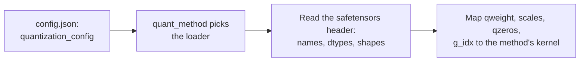

# Lesson 23. Quantized Checkpoints

**Mission link:** Every method in this track ends as files on disk, and to review someone's "4-bit model" you must be able to open the checkpoint and say what is in it, not trust the model card.
**Primary source:** [Docs: "Safetensors", Hugging Face](https://huggingface.co/docs/safetensors/index)
**Prerequisites:** [Lesson 22](0022-an-honest-quantization-eval.md), [Group size](../GLOSSARY.md), [Effective bits per weight](../GLOSSARY.md), [Zero point](../GLOSSARY.md)

## Warm-up

1. ▢ A 4-bit scheme stores a 16-bit scale per group of 128 weights. What are its effective bits per weight, counting the scale only?

<details markdown="1"><summary>Check</summary>

It is 4.125: the scale adds 16 / 128 = 0.125 bits per weight (lessons 1 and 6).

</details>

2. ▢ How do you turn a stored integer `q` back into an approximate real value when the quantizer has a scale `s` and a zero point `z`?

<details markdown="1"><summary>Check</summary>

`x ≈ s * (q - z)`: subtract the zero point, then multiply by the scale (lesson 4). With a symmetric quantizer `z` is zero.

</details>

3. ▢ In one sentence, what does GPTQ do after it rounds one column of a layer's weights?

<details markdown="1"><summary>Check</summary>

It updates the columns not yet quantized to compensate for the rounding error just made, using second-order information from calibration activations (lesson 10).

</details>

## Know this

### What safetensors stores

A **safetensors** file holds named tensors and nothing else the format cares about. Per the [format description](https://github.com/huggingface/safetensors) it has three parts, in this order:

```text
| 8 bytes: N | N bytes: JSON header | byte buffer: tensor data |
```

`N` is an unsigned little-endian 64-bit integer giving the header's size. The header is a JSON object that maps each tensor name to its `dtype`, its `shape`, and `data_offsets`, a begin and end position inside the byte buffer. It may also hold a `__metadata__` key with free-form string-to-string pairs. The data is row-major, little-endian, and fully indexed with no holes. The [docs](https://huggingface.co/docs/safetensors/index) present it as a safe alternative to pickle that is still fast, with zero-copy loading, and show how to load a slice of one tensor.

Two consequences matter here. You can read the header alone, without the gigabytes of data after it, and learn every tensor's name, dtype and shape. And a tensor of dtype `I32` says nothing about whether it holds 32-bit integers or eight packed 4-bit values. The file carries the bytes. What they mean has to be recorded somewhere else.

### What a 4-bit GPTQ linear layer stores

Here is one real layer, read from the header of a public 4-bit GPTQ checkpoint of TinyLlama 1.1B Chat, whose `q_proj` maps 2048 inputs to 2048 outputs with group size 128:

| Tensor | Dtype and shape | What it holds |
|---|---|---|
| `qweight` | I32 `[256, 2048]` | The weights, packed: 256 x 2048 x 8 = 4,194,304 four-bit values, the whole 2048 x 2048 matrix |
| `scales` | F16 `[16, 2048]` | One scale per group per output channel: 2048 / 128 = 16 groups |
| `qzeros` | I32 `[16, 256]` | The zero points, also packed, 8 to an integer: 2048 / 8 = 256 |
| `g_idx` | I32 `[2048]` | For each input channel, the number of the group it belongs to |
| `bias` | F16 `[2048]` | The layer's bias, left in 16 bits |

The `g_idx` tensor exists because of act-order. The GPTQ authors' repository describes the option as quantizing columns in order of decreasing activation size, and notes that its `--static-groups` option avoids "inference changes (that may cause slowdown)". Once columns are quantized in that order, the channels of one group are no longer neighbours, so the loader needs a map from channel to group. The model card for this checkpoint calls the option `desc_act` and says it gives better accuracy. A checkpoint quantized without act-order has contiguous groups, so its map would just count 0 to 15 in blocks of 128.

The packing is one family of layouts, not a standard. A [compressed-tensors](https://huggingface.co/docs/transformers/main/en/quantization/compressed_tensors) FP8 checkpoint, for example, stores `weight` as `F8_E4M3` with shape `[4096, 14336]` and a `weight_scale` of shape `[1]`: a single scale for the whole tensor, with no group matrix at all. The same library also covers a pack-quantized form, int4 or int8 weights packed into 32-bit integers.

### How the config tells a loader what the bytes mean

The scheme is recorded in the model's `config.json`, under `quantization_config`. A loader reads that key first, picks the matching method by its `quant_method`, and only then maps tensor names to kernels:



The Transformers docs tell you to identify an AWQ model by the `quant_method` key in `config.json`. The three families you will meet carry different keys:

| Method | Keys in `quantization_config` | Source |
|---|---|---|
| GPTQ | `quant_method: "gptq"`, `bits: 4`, `group_size: 128`, `desc_act: true`, `sym: true`, `damp_percent: 0.1`, `true_sequential: true`, `static_groups: false` | the config of the checkpoint above |
| AWQ | `quant_method: "awq"`, `bits: 4`, `group_size: 128`, `zero_point: true`, `version: "gemm"` | [Transformers AWQ docs](https://huggingface.co/docs/transformers/main/en/quantization/awq) example |
| compressed-tensors | `quant_method: "compressed-tensors"`, `config_groups` holding `weights` and `input_activations` (each with `num_bits`, `strategy`, `type`) and `targets`, plus `ignore`, `format`, `quantization_status` | [Transformers docs](https://huggingface.co/docs/transformers/main/en/quantization/compressed_tensors) example |

In compressed-tensors a **config group** names the modules it applies to (`targets`, such as `["Linear"]`) and how to quantize their weights and, optionally, their activations. The `ignore` list names modules left alone, such as `lm_head`. In the docs' FP8 example, both weights and activations are 8-bit floats with a per-tensor strategy, and the `lm_head` is skipped.

The tensors and the config can also disagree. The GPTQ file above repeats `gptq_bits`, `gptq_group_size` and `gptq_desc_act` in its safetensors `__metadata__` as well as in `config.json`. When a file and its config disagree, the tensor shapes are what the kernel actually has to read, so check them first.

## Practice

1. ▢ A safetensors file starts with the bytes `d8 5c 01 00 00 00 00 00`. How long is the JSON header, and at which byte offset in the file does the tensor data begin?

<details markdown="1"><summary>Check</summary>

The first eight bytes are a little-endian integer, so `N = 0xd8 + 0x5c * 256 + 0x01 * 65536 = 216 + 23,552 + 65,536 = 89,304` bytes of header. The data begins at offset 8 + 89,304 = 89,312. These are the real bytes of the checkpoint in the next item.

</details>

2. ▢ Where does a loader find out which quantization method a checkpoint uses?

    - a) The quant_method key inside the model's config.json quantization_config
    - b) Aggregate tensor quantity recorded inside the safetensors header
    - c) Positions of tensors within the safetensors binary buffer
    - d) Extension of the checkpoint's primary weights filename itself

<details markdown="1"><summary>Check</summary>

**a)** The Transformers docs identify an AWQ model by that key, and compressed-tensors and GPTQ use the same one. (b) is wrong because a tensor count is a fact about size, not method. (c) is wrong because positions in the buffer are already indexed by the header and say nothing about method. (d) is wrong because GPTQ, AWQ and compressed-tensors checkpoints all end in `.safetensors`.

</details>

3. ▢ Predict, then run. The script below reads only the header of a 4-bit GPTQ checkpoint over an HTTP range request, then the `g_idx` tensor, about 8 KB. The model's weight file is hundreds of megabytes. Predict the five tensors stored for `q_proj` in layer 0, with dtypes and shapes, and whether `g_idx` is sorted. It needs network access and no extra packages.

    ```python
    import json
    import struct
    import urllib.request

    URL = "https://huggingface.co/TheBloke/TinyLlama-1.1B-Chat-v1.0-GPTQ/resolve/main/model.safetensors"


    def fetch(start, end):
        req = urllib.request.Request(URL, headers={"Range": f"bytes={start}-{end}", "User-Agent": "Mozilla/5.0"})
        with urllib.request.urlopen(req) as response:
            return response.read()


    (n,) = struct.unpack("<Q", fetch(0, 7))  # first 8 bytes: header length, little-endian
    header = json.loads(fetch(8, 8 + n - 1))  # next n bytes: the JSON header
    print("header bytes:", n, "| tensors:", len(header) - 1)
    print("metadata:", header.pop("__metadata__"))

    layer = "model.layers.0.self_attn.q_proj."
    for name, tensor in header.items():
        if name.startswith(layer):
            print(name, tensor["dtype"], tensor["shape"])

    begin, end = header[layer + "g_idx"]["data_offsets"]  # offsets are relative to the data buffer
    raw = fetch(8 + n + begin, 8 + n + end - 1)
    g_idx = struct.unpack(f"<{len(raw) // 4}i", raw)
    print("first 12 g_idx values:", g_idx[:12])
    print("g_idx sorted:", list(g_idx) == sorted(g_idx))
    print("distinct groups:", len(set(g_idx)))
    ```

<details markdown="1"><summary>Hint</summary>

Eight 4-bit values fit in one 32-bit integer, and group size 128 over 2048 inputs gives 16 groups. If `desc_act` was on, think about whether channels of one group sit next to each other.

</details>

<details markdown="1"><summary>Check</summary>

On the file as it stood when this lesson was written, it prints a header of 89304 bytes and 817 tensors, metadata with `gptq_bits` 4, `gptq_group_size` 128 and `gptq_desc_act` True, and these tensors in this order: `g_idx` I32 `[2048]`, `qweight` I32 `[256, 2048]`, `qzeros` I32 `[16, 256]`, `bias` F16 `[2048]`, `scales` F16 `[16, 2048]`. The first g_idx values are `(13, 7, 0, 1, 6, 1, 12, 12, 13, 5, 6, 11)`, so it is not sorted, and there are 16 distinct groups. Channel 0 belongs to group 13, which is act-order's scrambled channel-to-group map. A hosted file can change, so treat the exact numbers as a snapshot.

</details>

4. ▢ Using the shapes from the previous item, what are the effective bits per weight of this `q_proj`, counting `qweight`, `scales`, `qzeros` and `g_idx` but not the bias? Is it closer to 4.0, 4.125 or 4.17?

<details markdown="1"><summary>Check</summary>

About 4.17. The bytes are 256 x 2048 x 4 = 2,097,152 for `qweight`, 16 x 2048 x 2 = 65,536 for `scales`, 16 x 256 x 4 = 16,384 for `qzeros` and 2048 x 4 = 8,192 for `g_idx`, 2,187,264 in all. Times 8 bits and divided by 2048 x 2048 = 4,194,304 weights gives 4.171875. The scale alone gives 4.125, and the packed zero points and the group map add the rest. A "4-bit" checkpoint is never exactly 4 bits per weight.

</details>

5. ▢ A model card says group size 128 and `config.json` agrees. The `scales` tensor for a layer with 2048 inputs has shape `[64, 2048]`. What group size was really used, and what does this tell you?

<details markdown="1"><summary>Hint</summary>

The first dimension of `scales` is the number of groups along the input channels.

</details>

<details markdown="1"><summary>Check</summary>

The group size is 2048 / 64 = 32, not 128. The shapes in the safetensors header are what the kernel reads and cannot be wrong about the layout, while a config or model card is a claim that can be copied from another run. Neither a loader nor a reviewer should believe the claim over the tensors.

</details>

6. ▢ Here is a `quantization_config` from the Transformers docs. What does it quantize, how, and what does it leave alone?

    ```json
    "quantization_config": {
      "config_groups": {
        "group_0": {
          "input_activations": {"num_bits": 8, "strategy": "tensor", "type": "float"},
          "targets": ["Linear"],
          "weights": {"num_bits": 8, "strategy": "tensor", "type": "float"}
        }
      },
      "format": "naive-quantized",
      "ignore": ["lm_head"],
      "quant_method": "compressed-tensors",
      "quantization_status": "frozen"
    }
    ```

<details markdown="1"><summary>Check</summary>

It quantizes every `Linear` module: both the weights and the input activations to 8-bit floating point (fp8), with one scale per tensor (`strategy: "tensor"`). That makes it a W8A8 scheme, and the docs' tensor listing for this model shows `weight_scale` of shape `[1]`. The `lm_head` is left in its original precision by the `ignore` list.

</details>

## Real-world reps

- [ ] Open the model page of any quantized model on the Hugging Face Hub, find its `config.json`, and write down `quant_method`, `bits` and `group_size`. Then open its tensor listing from the file viewer and confirm one layer's `scales` shape matches the group size.
- [ ] Run the item 3 script against a second public quantized checkpoint, such as an AWQ one, and list how its tensor names differ from GPTQ's.
- [ ] Tomorrow: without notes, name the three parts of a safetensors file in order, and the four tensors a 4-bit GPTQ linear layer stores besides its bias.

## Going further

- [Measuring and Storing](../reference/measuring-and-storing.md)
- [Docs: "Safetensors", Hugging Face](https://huggingface.co/docs/safetensors/index)
- [Repo: safetensors, Hugging Face](https://github.com/huggingface/safetensors), for the byte-level format
- [Docs: "compressed-tensors", Hugging Face Transformers](https://huggingface.co/docs/transformers/main/en/quantization/compressed_tensors)
- [Resources](../RESOURCES.md)

---

Not landing? Reread the primary source at the top, since this lesson compresses it and compression is where understanding leaks. Check the [glossary](../GLOSSARY.md) for any term that felt slippery.

If the lesson itself is unclear rather than the material, that is a defect: [open an issue](https://github.com/TokenCemetery/teach/issues).
