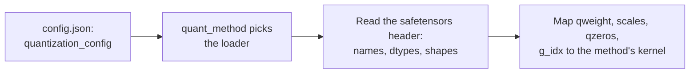

# Lição 23. Checkpoints quantizados

**Ligação com a missão:** Todo método desta trilha termina como arquivos em disco, e para revisar o "modelo de 4 bits" de alguém você precisa ser capaz de abrir o checkpoint e dizer o que há nele, não confiar no model card.
**Fonte principal:** [Docs: "Safetensors", Hugging Face](https://huggingface.co/docs/safetensors/index)
**Pré-requisitos:** [Lição 22](0022-an-honest-quantization-eval.md), [Tamanho do grupo](../GLOSSARY.md), [Bits efetivos por peso](../GLOSSARY.md), [Zero-point](../GLOSSARY.md)

## Aquecimento

1. ▢ Um esquema de 4 bits armazena uma scale de 16 bits por grupo de 128 pesos. Quais são os seus bits efetivos por peso, contando só a scale?

<details markdown="1"><summary>Verificação</summary>

São 4.125: a scale acrescenta 16 / 128 = 0.125 bit por peso (lições 1 e 6).

</details>

2. ▢ Como você transforma um inteiro armazenado `q` de volta em um valor real aproximado quando o quantizador tem uma scale `s` e um zero-point `z`?

<details markdown="1"><summary>Verificação</summary>

`x ≈ s * (q - z)`: subtraia o zero-point e depois multiplique pela scale (lição 4). Com um quantizador simétrico, `z` é zero.

</details>

3. ▢ Em uma frase, o que o GPTQ faz depois de arredondar uma coluna dos pesos de uma camada?

<details markdown="1"><summary>Verificação</summary>

Ele atualiza as colunas ainda não quantizadas para compensar o erro de arredondamento que acabou de cometer, usando informação de segunda ordem das ativações de calibração (lição 10).

</details>

## Saiba isto

### O que o safetensors armazena

Um arquivo **safetensors** guarda tensores nomeados e nada mais com que o formato se importe. Segundo a [descrição do formato](https://github.com/huggingface/safetensors), ele tem três partes, nesta ordem:

```text
| 8 bytes: N | N bytes: JSON header | byte buffer: tensor data |
```

`N` é um inteiro de 64 bits sem sinal e little-endian que dá o tamanho do cabeçalho. O cabeçalho é um objeto JSON que mapeia o nome de cada tensor para o seu `dtype`, o seu `shape` e `data_offsets`, uma posição de início e de fim dentro do byte buffer. Ele também pode conter uma chave `__metadata__` com pares string-para-string livres. Os dados são row-major, little-endian e totalmente indexados, sem buracos. A [documentação](https://huggingface.co/docs/safetensors/index) o apresenta como uma alternativa segura ao pickle que ainda é rápida, com carregamento zero-copy, e mostra como carregar uma fatia de um tensor.

Duas consequências importam aqui. Você pode ler só o cabeçalho, sem os gigabytes de dados depois dele, e descobrir o nome, o dtype e o shape de todo tensor. E um tensor de dtype `I32` não diz nada sobre se ele guarda inteiros de 32 bits ou oito valores de 4 bits empacotados. O arquivo carrega os bytes. O que eles significam precisa ser registrado em outro lugar.

### O que uma camada linear GPTQ de 4 bits armazena

Aqui está uma camada real, lida do cabeçalho de um checkpoint GPTQ público de 4 bits do TinyLlama 1.1B Chat, cujo `q_proj` mapeia 2048 entradas para 2048 saídas com tamanho de grupo 128:

| Tensor | Dtype e shape | O que guarda |
|---|---|---|
| `qweight` | I32 `[256, 2048]` | Os pesos, empacotados: 256 x 2048 x 8 = 4.194.304 valores de quatro bits, a matriz inteira de 2048 x 2048 |
| `scales` | F16 `[16, 2048]` | Uma scale por grupo por canal de saída: 2048 / 128 = 16 grupos |
| `qzeros` | I32 `[16, 256]` | Os zero-points, também empacotados, 8 por inteiro: 2048 / 8 = 256 |
| `g_idx` | I32 `[2048]` | Para cada canal de entrada, o número do grupo a que ele pertence |
| `bias` | F16 `[2048]` | O bias da camada, deixado em 16 bits |

O tensor `g_idx` existe por causa do act-order. O repositório dos autores do GPTQ descreve a opção como quantizar as colunas em ordem decrescente de tamanho da ativação e observa que a sua opção `--static-groups` evita "mudanças na inferência (que podem causar lentidão)". Quando as colunas são quantizadas nessa ordem, os canais de um grupo deixam de ser vizinhos, então o loader precisa de um mapa de canal para grupo. O model card desse checkpoint chama a opção de `desc_act` e diz que ela dá melhor acurácia. Um checkpoint quantizado sem act-order tem grupos contíguos, então o seu mapa apenas contaria de 0 a 15 em blocos de 128.

O empacotamento é uma família de layouts, não um padrão. Um checkpoint FP8 [compressed-tensors](https://huggingface.co/docs/transformers/main/en/quantization/compressed_tensors), por exemplo, armazena `weight` como `F8_E4M3` com shape `[4096, 14336]` e um `weight_scale` de shape `[1]`: uma única scale para o tensor inteiro, sem nenhuma matriz de grupos. A mesma biblioteca também cobre uma forma pack-quantized, pesos int4 ou int8 empacotados em inteiros de 32 bits.

### Como a configuração diz a um loader o que os bytes significam

O esquema é registrado no `config.json` do modelo, em `quantization_config`. Um loader lê essa chave primeiro, escolhe o método correspondente pelo seu `quant_method` e só então mapeia os nomes dos tensores para kernels:



A documentação do Transformers diz para identificar um modelo AWQ pela chave `quant_method` no `config.json`. As três famílias que você vai encontrar carregam chaves diferentes:

| Método | Chaves em `quantization_config` | Fonte |
|---|---|---|
| GPTQ | `quant_method: "gptq"`, `bits: 4`, `group_size: 128`, `desc_act: true`, `sym: true`, `damp_percent: 0.1`, `true_sequential: true`, `static_groups: false` | a configuração do checkpoint acima |
| AWQ | `quant_method: "awq"`, `bits: 4`, `group_size: 128`, `zero_point: true`, `version: "gemm"` | exemplo da [documentação de AWQ do Transformers](https://huggingface.co/docs/transformers/main/en/quantization/awq) |
| compressed-tensors | `quant_method: "compressed-tensors"`, `config_groups` contendo `weights` e `input_activations` (cada um com `num_bits`, `strategy`, `type`) e `targets`, mais `ignore`, `format`, `quantization_status` | exemplo da [documentação do Transformers](https://huggingface.co/docs/transformers/main/en/quantization/compressed_tensors) |

No compressed-tensors, um **config group** nomeia os módulos aos quais se aplica (`targets`, como `["Linear"]`) e como quantizar os seus pesos e, opcionalmente, as suas ativações. A lista `ignore` nomeia módulos deixados em paz, como o `lm_head`. No exemplo de FP8 da documentação, tanto os pesos quanto as ativações são floats de 8 bits com uma estratégia per-tensor, e o `lm_head` é pulado.

Os tensores e a configuração também podem discordar. O arquivo GPTQ acima repete `gptq_bits`, `gptq_group_size` e `gptq_desc_act` no `__metadata__` do seu safetensors, além de no `config.json`. Quando um arquivo e a sua configuração discordam, os shapes dos tensores são o que o kernel realmente precisa ler, então confira-os primeiro.

## Prática

1. ▢ Um arquivo safetensors começa com os bytes `d8 5c 01 00 00 00 00 00`. Qual é o comprimento do cabeçalho JSON, e em qual offset de byte no arquivo os dados dos tensores começam?

<details markdown="1"><summary>Verificação</summary>

Os primeiros oito bytes são um inteiro little-endian, então `N = 0xd8 + 0x5c * 256 + 0x01 * 65536 = 216 + 23.552 + 65.536 = 89.304` bytes de cabeçalho. Os dados começam no offset 8 + 89.304 = 89.312. Esses são os bytes reais do checkpoint do próximo item.

</details>

2. ▢ Onde um loader descobre qual método de quantização um checkpoint usa?

    - a) A chave quant_method dentro de quantization_config no config.json do modelo
    - b) A quantidade total de tensores registrada dentro do cabeçalho do safetensors
    - c) As posições dos tensores dentro do buffer binário do safetensors
    - d) A extensão do nome do arquivo principal de pesos do checkpoint

<details markdown="1"><summary>Verificação</summary>

**a)** A documentação do Transformers identifica um modelo AWQ por essa chave, e o compressed-tensors e o GPTQ usam a mesma. (b) está errada porque uma contagem de tensores é um fato sobre tamanho, não sobre método. (c) está errada porque as posições no buffer já são indexadas pelo cabeçalho e não dizem nada sobre o método. (d) está errada porque os checkpoints GPTQ, AWQ e compressed-tensors terminam todos em `.safetensors`.

</details>

3. ▢ Preveja e depois execute. O script abaixo lê só o cabeçalho de um checkpoint GPTQ de 4 bits por uma HTTP range request e depois o tensor `g_idx`, cerca de 8 KB. O arquivo de pesos do modelo tem centenas de megabytes. Preveja os cinco tensores armazenados para o `q_proj` da camada 0, com dtypes e shapes, e se o `g_idx` está ordenado. Ele precisa de acesso à rede e nenhum pacote extra.

    ```python
    import json
    import struct
    import urllib.request

    URL = "https://huggingface.co/TheBloke/TinyLlama-1.1B-Chat-v1.0-GPTQ/resolve/main/model.safetensors"


    def fetch(start, end):
        req = urllib.request.Request(URL, headers={"Range": f"bytes={start}-{end}", "User-Agent": "Mozilla/5.0"})
        with urllib.request.urlopen(req) as response:
            return response.read()


    (n,) = struct.unpack("<Q", fetch(0, 7))  # first 8 bytes: header length, little-endian
    header = json.loads(fetch(8, 8 + n - 1))  # next n bytes: the JSON header
    print("header bytes:", n, "| tensors:", len(header) - 1)
    print("metadata:", header.pop("__metadata__"))

    layer = "model.layers.0.self_attn.q_proj."
    for name, tensor in header.items():
        if name.startswith(layer):
            print(name, tensor["dtype"], tensor["shape"])

    begin, end = header[layer + "g_idx"]["data_offsets"]  # offsets are relative to the data buffer
    raw = fetch(8 + n + begin, 8 + n + end - 1)
    g_idx = struct.unpack(f"<{len(raw) // 4}i", raw)
    print("first 12 g_idx values:", g_idx[:12])
    print("g_idx sorted:", list(g_idx) == sorted(g_idx))
    print("distinct groups:", len(set(g_idx)))
    ```

<details markdown="1"><summary>Dica</summary>

Oito valores de 4 bits cabem em um inteiro de 32 bits, e o tamanho de grupo 128 sobre 2048 entradas dá 16 grupos. Se `desc_act` estava ligado, pense se os canais de um grupo ficam um ao lado do outro.

</details>

<details markdown="1"><summary>Verificação</summary>

No arquivo como estava quando esta lição foi escrita, ele imprime um cabeçalho de 89304 bytes e 817 tensores, metadados com `gptq_bits` 4, `gptq_group_size` 128 e `gptq_desc_act` True, e estes tensores nesta ordem: `g_idx` I32 `[2048]`, `qweight` I32 `[256, 2048]`, `qzeros` I32 `[16, 256]`, `bias` F16 `[2048]`, `scales` F16 `[16, 2048]`. Os primeiros valores de g_idx são `(13, 7, 0, 1, 6, 1, 12, 12, 13, 5, 6, 11)`, então ele não está ordenado, e há 16 grupos distintos. O canal 0 pertence ao grupo 13, que é o mapa embaralhado de canal para grupo do act-order. Um arquivo hospedado pode mudar, então trate os números exatos como um instantâneo.

</details>

4. ▢ Usando os shapes do item anterior, quais são os bits efetivos por peso deste `q_proj`, contando `qweight`, `scales`, `qzeros` e `g_idx`, mas não o bias? Fica mais perto de 4.0, 4.125 ou 4.17?

<details markdown="1"><summary>Verificação</summary>

Cerca de 4.17. Os bytes são 256 x 2048 x 4 = 2.097.152 para `qweight`, 16 x 2048 x 2 = 65.536 para `scales`, 16 x 256 x 4 = 16.384 para `qzeros` e 2048 x 4 = 8.192 para `g_idx`, 2.187.264 no total. Vezes 8 bits e dividido por 2048 x 2048 = 4.194.304 pesos dá 4.171875. A scale sozinha dá 4.125, e os zero-points empacotados e o mapa de grupos acrescentam o resto. Um checkpoint de "4 bits" nunca tem exatamente 4 bits por peso.

</details>

5. ▢ Um model card diz tamanho de grupo 128 e o `config.json` concorda. O tensor `scales` de uma camada com 2048 entradas tem shape `[64, 2048]`. Qual tamanho de grupo foi realmente usado, e o que isso diz a você?

<details markdown="1"><summary>Dica</summary>

A primeira dimensão de `scales` é o número de grupos ao longo dos canais de entrada.

</details>

<details markdown="1"><summary>Verificação</summary>

O tamanho do grupo é 2048 / 64 = 32, não 128. Os shapes no cabeçalho do safetensors são o que o kernel lê e não podem estar errados sobre o layout, enquanto uma configuração ou um model card é uma afirmação que pode ser copiada de outra execução. Nem um loader nem um revisor devem acreditar na afirmação em vez de nos tensores.

</details>

6. ▢ Aqui está um `quantization_config` da documentação do Transformers. O que ele quantiza, como e o que deixa em paz?

    ```json
    "quantization_config": {
      "config_groups": {
        "group_0": {
          "input_activations": {"num_bits": 8, "strategy": "tensor", "type": "float"},
          "targets": ["Linear"],
          "weights": {"num_bits": 8, "strategy": "tensor", "type": "float"}
        }
      },
      "format": "naive-quantized",
      "ignore": ["lm_head"],
      "quant_method": "compressed-tensors",
      "quantization_status": "frozen"
    }
    ```

<details markdown="1"><summary>Verificação</summary>

Ele quantiza todo módulo `Linear`: tanto os pesos quanto as ativações de entrada para ponto flutuante de 8 bits (fp8), com uma scale por tensor (`strategy: "tensor"`). Isso o torna um esquema W8A8, e a listagem de tensores da documentação para esse modelo mostra `weight_scale` de shape `[1]`. O `lm_head` é deixado na sua precisão original pela lista `ignore`.

</details>

## Prática no mundo real

- [ ] Abra a página de modelo de qualquer modelo quantizado no Hugging Face Hub, encontre o seu `config.json` e anote `quant_method`, `bits` e `group_size`. Depois abra a sua listagem de tensores no visualizador de arquivos e confirme que o shape de `scales` de uma camada coincide com o tamanho do grupo.
- [ ] Execute o script do item 3 contra um segundo checkpoint quantizado público, como um AWQ, e liste como os nomes dos tensores dele diferem dos do GPTQ.
- [ ] Amanhã: sem consultar anotações, nomeie as três partes de um arquivo safetensors em ordem e os quatro tensores que uma camada linear GPTQ de 4 bits armazena além do seu bias.

## Para ir além

- [Medindo e Armazenando](../reference/measuring-and-storing.md)
- [Docs: "Safetensors", Hugging Face](https://huggingface.co/docs/safetensors/index)
- [Repositório: safetensors, Hugging Face](https://github.com/huggingface/safetensors), para o formato em nível de byte
- [Docs: "compressed-tensors", Hugging Face Transformers](https://huggingface.co/docs/transformers/main/en/quantization/compressed_tensors)
- [Recursos](../RESOURCES.md)

---

Não ficou claro? Releia a fonte principal no topo, já que esta lição a comprime e é na compressão que o entendimento escapa. Consulte o [glossário](../GLOSSARY.md) para qualquer termo que pareceu escorregadio.

Se o problema é a lição em si, e não o material, isso é um defeito: [abra uma issue](https://github.com/TokenCemetery/teach/issues).
