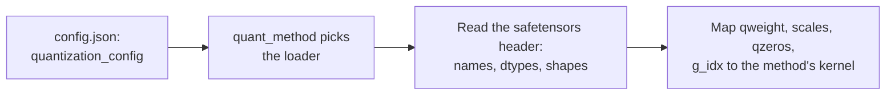

# Урок 23. Квантизованные чекпоинты

**Связь с целью курса:** Каждый метод этого курса заканчивается файлами на диске, и чтобы проверить чью-то «4-битную модель», нужно уметь открыть чекпоинт и сказать, что в нём лежит, а не доверять карточке модели.
**Первоисточник:** [Документация: "Safetensors", Hugging Face](https://huggingface.co/docs/safetensors/index)
**Предварительные требования:** [Урок 22](0022-an-honest-quantization-eval.md), [Размер группы](../GLOSSARY.md), [Эффективное число бит на вес](../GLOSSARY.md), [Нулевая точка](../GLOSSARY.md)

## Разминка

1. ▢ 4-битная схема хранит 16-битный масштаб на группу из 128 весов. Каково её эффективное число бит на вес, если считать только масштаб?

<details markdown="1"><summary>Проверка</summary>

4,125: масштаб добавляет 16 / 128 = 0,125 бита на вес (уроки 1 и 6).

</details>

2. ▢ Как превратить хранимое целое число `q` обратно в приближённое вещественное значение, если у квантизатора есть масштаб `s` и нулевая точка `z`?

<details markdown="1"><summary>Проверка</summary>

`x ≈ s * (q - z)`: вычесть нулевую точку, затем умножить на масштаб (урок 4). У симметричного квантизатора `z` равно нулю.

</details>

3. ▢ Одним предложением, что делает GPTQ после округления одного столбца весов слоя?

<details markdown="1"><summary>Проверка</summary>

Он обновляет ещё не квантизованные столбцы, компенсируя только что допущенную ошибку округления, с помощью информации второго порядка из калибровочных активаций (урок 10).

</details>

## Что нужно знать

### Что хранит safetensors

Файл **safetensors** содержит именованные тензоры и больше ничего, о чём заботится формат. По [описанию формата](https://github.com/huggingface/safetensors) в нём три части, в таком порядке:

```text
| 8 bytes: N | N bytes: JSON header | byte buffer: tensor data |
```

`N` это беззнаковое 64-битное целое в порядке little-endian, задающее размер заголовка. Заголовок это JSON-объект, отображающий имя каждого тензора в его `dtype`, его `shape` и `data_offsets`, начальную и конечную позицию внутри буфера байт. Он может также содержать ключ `__metadata__` со свободными парами строка-строка. Данные хранятся по строкам, в порядке little-endian и полностью индексированы, без дыр. [Документация](https://huggingface.co/docs/safetensors/index) представляет его как безопасную альтернативу pickle, которая при этом остаётся быстрой, с загрузкой без копирования, и показывает, как загрузить срез одного тензора.

Здесь важны два следствия. Можно прочитать один только заголовок, без гигабайтов данных после него, и узнать имя, тип и форму каждого тензора. А тензор типа `I32` ничего не говорит о том, хранит ли он 32-битные целые или восемь упакованных 4-битных значений. Файл несёт байты. Что они значат, нужно записывать где-то ещё.

### Что хранит 4-битный линейный слой GPTQ

Вот один настоящий слой, прочитанный из заголовка публичного 4-битного чекпоинта GPTQ для TinyLlama 1.1B Chat, у которого `q_proj` отображает 2048 входов в 2048 выходов с размером группы 128:

| Тензор | Тип и форма | Что в нём |
|---|---|---|
| `qweight` | I32 `[256, 2048]` | Веса в упакованном виде: 256 x 2048 x 8 = 4 194 304 четырёхбитных значения, вся матрица 2048 x 2048 |
| `scales` | F16 `[16, 2048]` | Один масштаб на группу на выходной канал: 2048 / 128 = 16 групп |
| `qzeros` | I32 `[16, 256]` | Нулевые точки, тоже упакованные, по 8 в целое: 2048 / 8 = 256 |
| `g_idx` | I32 `[2048]` | Для каждого входного канала номер группы, которой он принадлежит |
| `bias` | F16 `[2048]` | Смещение слоя, оставленное в 16 битах |

Тензор `g_idx` существует из-за act-order. Репозиторий авторов GPTQ описывает опцию как квантизацию столбцов в порядке убывания размера активаций и отмечает, что его опция `--static-groups` избегает «изменений инференса (которые могут вызвать замедление)». Когда столбцы квантизуются в таком порядке, каналы одной группы больше не соседи, поэтому загрузчику нужна карта от канала к группе. Карточка модели этого чекпоинта называет опцию `desc_act` и говорит, что она даёт лучшую точность. У чекпоинта, квантизованного без act-order, группы непрерывны, так что его карта просто считала бы от 0 до 15 блоками по 128.

Упаковка это одно семейство раскладок, а не стандарт. Чекпоинт FP8 [compressed-tensors](https://huggingface.co/docs/transformers/main/en/quantization/compressed_tensors), например, хранит `weight` как `F8_E4M3` формы `[4096, 14336]` и `weight_scale` формы `[1]`: один масштаб на весь тензор, вообще без матрицы групп. Та же библиотека охватывает и pack-quantized форму, веса int4 или int8, упакованные в 32-битные целые.

### Как конфигурация говорит загрузчику, что значат байты

Схема записана в `config.json` модели, под `quantization_config`. Загрузчик сначала читает этот ключ, выбирает подходящий метод по его `quant_method` и только затем сопоставляет имена тензоров с ядрами:



Документация Transformers советует определять модель AWQ по ключу `quant_method` в `config.json`. Три семейства, которые вы встретите, несут разные ключи:

| Метод | Ключи в `quantization_config` | Источник |
|---|---|---|
| GPTQ | `quant_method: "gptq"`, `bits: 4`, `group_size: 128`, `desc_act: true`, `sym: true`, `damp_percent: 0.1`, `true_sequential: true`, `static_groups: false` | конфигурация чекпоинта выше |
| AWQ | `quant_method: "awq"`, `bits: 4`, `group_size: 128`, `zero_point: true`, `version: "gemm"` | пример из [документации Transformers по AWQ](https://huggingface.co/docs/transformers/main/en/quantization/awq) |
| compressed-tensors | `quant_method: "compressed-tensors"`, `config_groups`, содержащие `weights` и `input_activations` (в каждом `num_bits`, `strategy`, `type`) и `targets`, плюс `ignore`, `format`, `quantization_status` | пример из [документации Transformers](https://huggingface.co/docs/transformers/main/en/quantization/compressed_tensors) |

В compressed-tensors **группа конфигурации** называет модули, к которым она применяется (`targets`, например `["Linear"]`), и то, как квантизовать их веса и, необязательно, активации. Список `ignore` называет модули, оставленные в покое, например `lm_head`. В примере FP8 из документации и веса, и активации это 8-битные числа с плавающей точкой со стратегией per-tensor, а `lm_head` пропускается.

Тензоры и конфигурация также могут расходиться. Файл GPTQ выше повторяет `gptq_bits`, `gptq_group_size` и `gptq_desc_act` в своих `__metadata__` safetensors, а также в `config.json`. Когда файл и его конфигурация расходятся, ядру на самом деле приходится читать формы тензоров, поэтому проверяйте их первыми.

## Практика

1. ▢ Файл safetensors начинается с байт `d8 5c 01 00 00 00 00 00`. Какой длины заголовок JSON и с какого байтового смещения в файле начинаются данные тензоров?

<details markdown="1"><summary>Проверка</summary>

Первые восемь байт это целое в порядке little-endian, поэтому `N = 0xd8 + 0x5c * 256 + 0x01 * 65536 = 216 + 23 552 + 65 536 = 89 304` байта заголовка. Данные начинаются со смещения 8 + 89 304 = 89 312. Это настоящие байты чекпоинта из следующего упражнения.

</details>

2. ▢ Где загрузчик узнаёт, какой метод квантизации использует чекпоинт?

    - a) В ключе `quant_method` внутри `quantization_config` в `config.json` модели
    - b) В суммарном числе тензоров, записанном в заголовке safetensors
    - c) В позициях тензоров внутри двоичного буфера safetensors
    - d) В расширении имени основного файла весов чекпоинта

<details markdown="1"><summary>Проверка</summary>

**a)** Документация Transformers определяет модель AWQ по этому ключу, а compressed-tensors и GPTQ используют тот же. (b) неверно, потому что число тензоров это факт о размере, а не о методе. (c) неверно, потому что позиции в буфере уже индексированы заголовком и ничего не говорят о методе. (d) неверно, потому что чекпоинты GPTQ, AWQ и compressed-tensors все заканчиваются на `.safetensors`.

</details>

3. ▢ Предскажите, затем запустите. Скрипт ниже читает через HTTP-запрос с диапазоном только заголовок 4-битного чекпоинта GPTQ, а затем тензор `g_idx`, около 8 КБ. Файл весов модели занимает сотни мегабайт. Предскажите пять тензоров, хранимых для `q_proj` в слое 0, с типами и формами, и отсортирован ли `g_idx`. Нужен доступ к сети и никаких дополнительных пакетов.

    ```python
    import json
    import struct
    import urllib.request

    URL = "https://huggingface.co/TheBloke/TinyLlama-1.1B-Chat-v1.0-GPTQ/resolve/main/model.safetensors"


    def fetch(start, end):
        req = urllib.request.Request(URL, headers={"Range": f"bytes={start}-{end}", "User-Agent": "Mozilla/5.0"})
        with urllib.request.urlopen(req) as response:
            return response.read()


    (n,) = struct.unpack("<Q", fetch(0, 7))  # first 8 bytes: header length, little-endian
    header = json.loads(fetch(8, 8 + n - 1))  # next n bytes: the JSON header
    print("header bytes:", n, "| tensors:", len(header) - 1)
    print("metadata:", header.pop("__metadata__"))

    layer = "model.layers.0.self_attn.q_proj."
    for name, tensor in header.items():
        if name.startswith(layer):
            print(name, tensor["dtype"], tensor["shape"])

    begin, end = header[layer + "g_idx"]["data_offsets"]  # offsets are relative to the data buffer
    raw = fetch(8 + n + begin, 8 + n + end - 1)
    g_idx = struct.unpack(f"<{len(raw) // 4}i", raw)
    print("first 12 g_idx values:", g_idx[:12])
    print("g_idx sorted:", list(g_idx) == sorted(g_idx))
    print("distinct groups:", len(set(g_idx)))
    ```

<details markdown="1"><summary>Подсказка</summary>

Восемь 4-битных значений умещаются в одно 32-битное целое, а размер группы 128 на 2048 входов даёт 16 групп. Если `desc_act` был включён, подумайте, находятся ли каналы одной группы рядом.

</details>

<details markdown="1"><summary>Проверка</summary>

На файле в том виде, в каком он был при написании этого урока, он печатает заголовок в 89304 байта и 817 тензоров, метаданные с `gptq_bits` 4, `gptq_group_size` 128 и `gptq_desc_act` True и эти тензоры в таком порядке: `g_idx` I32 `[2048]`, `qweight` I32 `[256, 2048]`, `qzeros` I32 `[16, 256]`, `bias` F16 `[2048]`, `scales` F16 `[16, 2048]`. Первые значения g_idx равны `(13, 7, 0, 1, 6, 1, 12, 12, 13, 5, 6, 11)`, так что он не отсортирован, а различных групп 16. Канал 0 принадлежит группе 13, а это перемешанная карта канала в группу, свойственная act-order. Размещённый файл может измениться, поэтому считайте точные числа снимком.

</details>

4. ▢ По формам из предыдущего упражнения каково эффективное число бит на вес у этого `q_proj`, если считать `qweight`, `scales`, `qzeros` и `g_idx`, но не смещение? Ближе ли оно к 4,0, 4,125 или 4,17?

<details markdown="1"><summary>Проверка</summary>

Около 4,17. Байты: 256 x 2048 x 4 = 2 097 152 для `qweight`, 16 x 2048 x 2 = 65 536 для `scales`, 16 x 256 x 4 = 16 384 для `qzeros` и 2048 x 4 = 8192 для `g_idx`, всего 2 187 264. Умножив на 8 бит и разделив на 2048 x 2048 = 4 194 304 веса, получаем 4,171875. Один только масштаб даёт 4,125, а упакованные нулевые точки и карта групп добавляют остальное. «4-битный» чекпоинт никогда не бывает ровно 4 бита на вес.

</details>

5. ▢ Карточка модели говорит, что размер группы 128, и `config.json` с ней согласен. Тензор `scales` для слоя с 2048 входами имеет форму `[64, 2048]`. Какой размер группы использовался на самом деле и что это вам говорит?

<details markdown="1"><summary>Подсказка</summary>

Первое измерение `scales` это число групп вдоль входных каналов.

</details>

<details markdown="1"><summary>Проверка</summary>

Размер группы равен 2048 / 64 = 32, а не 128. Формы в заголовке safetensors это то, что читает ядро, и они не могут ошибаться в раскладке, тогда как конфигурация или карточка модели это утверждение, которое можно скопировать из другого запуска. Ни загрузчику, ни ревьюеру не следует верить утверждению больше, чем тензорам.

</details>

6. ▢ Вот `quantization_config` из документации Transformers. Что она квантизует, как и что оставляет в покое?

    ```json
    "quantization_config": {
      "config_groups": {
        "group_0": {
          "input_activations": {"num_bits": 8, "strategy": "tensor", "type": "float"},
          "targets": ["Linear"],
          "weights": {"num_bits": 8, "strategy": "tensor", "type": "float"}
        }
      },
      "format": "naive-quantized",
      "ignore": ["lm_head"],
      "quant_method": "compressed-tensors",
      "quantization_status": "frozen"
    }
    ```

<details markdown="1"><summary>Проверка</summary>

Она квантизует каждый модуль `Linear`: и веса, и входные активации в 8-битные числа с плавающей точкой (fp8), с одним масштабом на тензор (`strategy: "tensor"`). Это делает её схемой W8A8, а перечень тензоров этой модели в документации показывает `weight_scale` формы `[1]`. `lm_head` остаётся в исходной точности благодаря списку `ignore`.

</details>

## Практика в реальной работе

- [ ] Откройте страницу любой квантизованной модели на Hugging Face Hub, найдите её `config.json` и запишите `quant_method`, `bits` и `group_size`. Затем откройте её перечень тензоров в просмотрщике файлов и убедитесь, что форма `scales` одного слоя соответствует размеру группы.
- [ ] Запустите скрипт из упражнения 3 на втором публичном квантизованном чекпоинте, например AWQ, и перечислите, чем имена его тензоров отличаются от GPTQ.
- [ ] Завтра, без заметок, назовите три части файла safetensors по порядку и четыре тензора, которые хранит 4-битный линейный слой GPTQ помимо смещения.

## Что почитать дальше

- [Измерение и хранение](../reference/measuring-and-storing.md)
- [Документация: "Safetensors", Hugging Face](https://huggingface.co/docs/safetensors/index)
- [Репозиторий: safetensors, Hugging Face](https://github.com/huggingface/safetensors), о формате на уровне байтов
- [Документация: "compressed-tensors", Hugging Face Transformers](https://huggingface.co/docs/transformers/main/en/quantization/compressed_tensors)
- [Ресурсы](../RESOURCES.md)

---

Не доходит? Перечитайте первоисточник в начале: этот урок его сжимает, а при сжатии понимание как раз и теряется. Загляните в [глоссарий](../GLOSSARY.md), если какой-то термин показался скользким.

Если неясен сам урок, а не материал, это дефект: [откройте issue](https://github.com/TokenCemetery/teach/issues).
