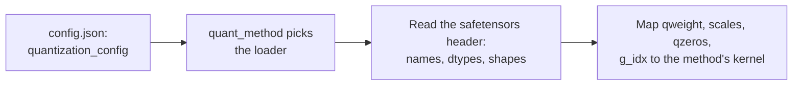

# 第 23 课：量化检查点

**使命关联:** 本系列里的每一种方法，最终都落成磁盘上的文件，要评审某人的“4 位模型”，你必须能打开检查点，说出里面有什么，而不是去信模型卡。
**主要来源:** [文档：“Safetensors”，Hugging Face](https://huggingface.co/docs/safetensors/index)
**前置知识:** [第 22 课](0022-an-honest-quantization-eval.md)、[分组大小](../GLOSSARY.md)、[每个权重的有效位数](../GLOSSARY.md)、[零点](../GLOSSARY.md)

## 热身

1. ▢ 一个 4 位方案为每组 128 个权重存一个 16 位缩放因子。只算缩放因子的话，它的每个权重的有效位数是多少？

<details markdown="1"><summary>检查</summary>

是 4.125：缩放因子使每个权重多出 16 / 128 = 0.125 位（第 1 和第 6 课）。

</details>

2. ▢ 当量化器带有缩放因子 `s` 和零点 `z` 时，怎样把存储的整数 `q` 还原成一个近似的实数值？

<details markdown="1"><summary>检查</summary>

`x ≈ s * (q - z)`：先减去零点，再乘以缩放因子（第 4 课）。对称量化器的 `z` 是零。

</details>

3. ▢ 用一句话说，GPTQ 在对一层权重的一列做完舍入之后做什么？

<details markdown="1"><summary>检查</summary>

它利用校准激活值带来的二阶信息，更新尚未量化的列，来补偿刚刚产生的舍入误差（第 10 课）。

</details>

## 要点

### safetensors 存储什么

一个 **safetensors** 文件存放的是有名字的张量，除此之外，格式不关心任何别的东西。据[格式说明](https://github.com/huggingface/safetensors)，它有三个部分，按这个顺序：

```text
| 8 bytes: N | N bytes: JSON header | byte buffer: tensor data |
```

`N` 是一个无符号的小端 64 位整数，给出头部的大小。头部是一个 JSON 对象，把每个张量的名字映射到它的 `dtype`、`shape` 和 `data_offsets`，后者是字节缓冲区内的起止位置。它还可以带一个 `__metadata__` 键，里面是自由形式的字符串到字符串的键值对。数据按行主序、小端存放，完全有索引，没有空洞。[文档](https://huggingface.co/docs/safetensors/index)把它呈现为 pickle 的一个安全替代品，同时仍然很快，支持零拷贝加载，并展示了如何加载一个张量的切片。

有两个结论在这里要紧。你可以只读头部，而不必读它后面的好几个 GB 的数据，就能知道每个张量的名字、dtype 和形状。而一个 dtype 为 `I32` 的张量，并不说明它装的是 32 位整数，还是八个打包在一起的 4 位值。文件携带的是字节。它们是什么意思，得记录在别的地方。

### 一个 4 位 GPTQ 线性层存什么

下面是一个真实的层，读自 TinyLlama 1.1B Chat 的一个公开的 4 位 GPTQ 检查点的头部，它的 `q_proj` 把 2048 个输入映射到 2048 个输出，分组大小为 128：

| 张量 | dtype 与形状 | 它存的是什么 |
|---|---|---|
| `qweight` | I32 `[256, 2048]` | 权重，已打包：256 x 2048 x 8 = 4,194,304 个四位值，也就是整个 2048 x 2048 的矩阵 |
| `scales` | F16 `[16, 2048]` | 每个输出通道每组一个缩放因子：2048 / 128 = 16 组 |
| `qzeros` | I32 `[16, 256]` | 零点，同样已打包，每个整数 8 个：2048 / 8 = 256 |
| `g_idx` | I32 `[2048]` | 对每个输入通道，它所属的组的编号 |
| `bias` | F16 `[2048]` | 这一层的偏置，保留 16 位 |

`g_idx` 张量的存在，是因为 act-order。GPTQ 作者的仓库把这个选项描述为按激活值从大到小的顺序量化各列，并指出它的 `--static-groups` 选项避免了“推理改动（可能造成减速）”。一旦各列按那个顺序量化，同一组的通道就不再相邻，所以加载器需要一张从通道到组的映射。这个检查点的模型卡把这个选项叫作 `desc_act`，并说它带来更好的精度。没有用 act-order 量化的检查点，组是连续的，所以它的映射只是按 128 一块，从 0 数到 15。

这种打包只是布局中的一类，不是标准。例如，一个 [compressed-tensors](https://huggingface.co/docs/transformers/main/en/quantization/compressed_tensors) 的 FP8 检查点，把 `weight` 存成形状为 `[4096, 14336]` 的 `F8_E4M3`，另有一个形状为 `[1]` 的 `weight_scale`：整个张量只有一个缩放因子，根本没有分组矩阵。同一个库还涵盖一种打包量化的形式，即把 int4 或 int8 权重打包进 32 位整数。

### 配置如何告诉加载器这些字节是什么意思

方案记录在模型的 `config.json` 里，位于 `quantization_config` 之下。加载器先读这个键，根据它的 `quant_method` 挑出匹配的方法，然后才把张量名字映射到内核：



Transformers 文档告诉你，通过 `config.json` 里的 `quant_method` 键来识别一个 AWQ 模型。你会遇到的三个家族带有不同的键：

| 方法 | `quantization_config` 里的键 | 来源 |
|---|---|---|
| GPTQ | `quant_method: "gptq"`、`bits: 4`、`group_size: 128`、`desc_act: true`、`sym: true`、`damp_percent: 0.1`、`true_sequential: true`、`static_groups: false` | 上面那个检查点的配置 |
| AWQ | `quant_method: "awq"`、`bits: 4`、`group_size: 128`、`zero_point: true`、`version: "gemm"` | [Transformers AWQ 文档](https://huggingface.co/docs/transformers/main/en/quantization/awq)中的示例 |
| compressed-tensors | `quant_method: "compressed-tensors"`、`config_groups`（里面有 `weights` 和 `input_activations`，各带 `num_bits`、`strategy`、`type`）和 `targets`，外加 `ignore`、`format`、`quantization_status` | [Transformers 文档](https://huggingface.co/docs/transformers/main/en/quantization/compressed_tensors)中的示例 |

在 compressed-tensors 里，一个**配置组**指明它适用的模块（`targets`，例如 `["Linear"]`），以及如何量化它们的权重，还可以选择量化它们的激活值。`ignore` 列表指明不去动的模块，例如 `lm_head`。在文档的 FP8 示例中，权重和激活值都是 8 位浮点，采用逐张量的策略，并且跳过了 `lm_head`。

张量和配置也可能不一致。上面那个 GPTQ 文件，在它的 safetensors `__metadata__` 里重复了 `gptq_bits`、`gptq_group_size` 和 `gptq_desc_act`，在 `config.json` 里也有。当文件和它的配置不一致时，内核实际上必须去读的是张量的形状，所以先核对它们。

## 练习

1. ▢ 一个 safetensors 文件以字节 `d8 5c 01 00 00 00 00 00` 开头。JSON 头部有多长？张量数据从文件中的哪个字节偏移处开始？

<details markdown="1"><summary>检查</summary>

前八个字节是一个小端整数，所以 `N = 0xd8 + 0x5c * 256 + 0x01 * 65536 = 216 + 23,552 + 65,536 = 89,304` 字节的头部。数据从偏移 8 + 89,304 = 89,312 处开始。这些就是下一题那个检查点的真实字节。

</details>

2. ▢ 加载器从哪里得知一个检查点用的是哪种量化方法？

    - a) 模型 config.json 的 quantization_config 里的 quant_method 键
    - b) 记录在 safetensors 头部里的张量总数
    - c) 张量在 safetensors 二进制缓冲区中的位置
    - d) 检查点主权重文件名本身的扩展名

<details markdown="1"><summary>检查</summary>

**a)** Transformers 文档通过那个键来识别 AWQ 模型，compressed-tensors 和 GPTQ 用的是同一个键。(b) 是错的，因为张量的个数是关于大小的事实，不是关于方法的。(c) 是错的，因为缓冲区中的位置已经由头部索引了，对方法什么也没说。(d) 是错的，因为 GPTQ、AWQ 和 compressed-tensors 的检查点都以 `.safetensors` 结尾。

</details>

3. ▢ 先预测，再运行。下面的脚本通过 HTTP 范围请求，只读取一个 4 位 GPTQ 检查点的头部，再读取 `g_idx` 张量，约 8 KB。该模型的权重文件有几百 MB。预测第 0 层 `q_proj` 所存的五个张量及其 dtype 和形状，以及 `g_idx` 是否已排序。它需要网络访问，不需要额外的包。

    ```python
    import json
    import struct
    import urllib.request

    URL = "https://huggingface.co/TheBloke/TinyLlama-1.1B-Chat-v1.0-GPTQ/resolve/main/model.safetensors"


    def fetch(start, end):
        req = urllib.request.Request(URL, headers={"Range": f"bytes={start}-{end}", "User-Agent": "Mozilla/5.0"})
        with urllib.request.urlopen(req) as response:
            return response.read()


    (n,) = struct.unpack("<Q", fetch(0, 7))  # first 8 bytes: header length, little-endian
    header = json.loads(fetch(8, 8 + n - 1))  # next n bytes: the JSON header
    print("header bytes:", n, "| tensors:", len(header) - 1)
    print("metadata:", header.pop("__metadata__"))

    layer = "model.layers.0.self_attn.q_proj."
    for name, tensor in header.items():
        if name.startswith(layer):
            print(name, tensor["dtype"], tensor["shape"])

    begin, end = header[layer + "g_idx"]["data_offsets"]  # offsets are relative to the data buffer
    raw = fetch(8 + n + begin, 8 + n + end - 1)
    g_idx = struct.unpack(f"<{len(raw) // 4}i", raw)
    print("first 12 g_idx values:", g_idx[:12])
    print("g_idx sorted:", list(g_idx) == sorted(g_idx))
    print("distinct groups:", len(set(g_idx)))
    ```

<details markdown="1"><summary>提示</summary>

八个 4 位值正好装进一个 32 位整数，2048 个输入按分组大小 128 分，得到 16 组。如果 `desc_act` 是开着的，想想同一组的通道是否彼此相邻。

</details>

<details markdown="1"><summary>检查</summary>

按写这一课时文件的状态，它打印出的头部是 89304 字节、817 个张量，元数据里 `gptq_bits` 为 4，`gptq_group_size` 为 128，`gptq_desc_act` 为 True，并且这些张量按这个顺序：`g_idx` I32 `[2048]`、`qweight` I32 `[256, 2048]`、`qzeros` I32 `[16, 256]`、`bias` F16 `[2048]`、`scales` F16 `[16, 2048]`。最前面的 g_idx 值是 `(13, 7, 0, 1, 6, 1, 12, 12, 13, 5, 6, 11)`，所以它没有排序，并且有 16 个不同的组。通道 0 属于第 13 组，这就是 act-order 打乱后的通道到组的映射。托管的文件可能变化，所以请把确切的数字当作一个快照。

</details>

4. ▢ 用上一题的形状，算出这个 `q_proj` 的每个权重的有效位数，计入 `qweight`、`scales`、`qzeros` 和 `g_idx`，但不计偏置。它更接近 4.0、4.125 还是 4.17？

<details markdown="1"><summary>检查</summary>

约 4.17。字节数分别是：`qweight` 为 256 x 2048 x 4 = 2,097,152，`scales` 为 16 x 2048 x 2 = 65,536，`qzeros` 为 16 x 256 x 4 = 16,384，`g_idx` 为 2048 x 4 = 8,192，总共 2,187,264。乘以 8 位，再除以 2048 x 2048 = 4,194,304 个权重，得到 4.171875。光是缩放因子给出 4.125，打包的零点和分组映射加上了其余的部分。一个“4 位”检查点，每个权重从来不会恰好是 4 位。

</details>

5. ▢ 一张模型卡说分组大小是 128，`config.json` 也一致。一个有 2048 个输入的层，它的 `scales` 张量的形状是 `[64, 2048]`。真正用的分组大小是多少？这说明了什么？

<details markdown="1"><summary>提示</summary>

`scales` 的第一维，是沿输入通道方向的组数。

</details>

<details markdown="1"><summary>检查</summary>

分组大小是 2048 / 64 = 32，而不是 128。safetensors 头部里的形状，是内核实际去读的东西，对布局不可能说错，而配置或模型卡只是一个声明，可能是从别的运行那里抄来的。不管是加载器还是评审者，都不该相信声明胜过张量。

</details>

6. ▢ 下面是 Transformers 文档里的一份 `quantization_config`。它量化什么、怎么量化，又把什么放着不动？

    ```json
    "quantization_config": {
      "config_groups": {
        "group_0": {
          "input_activations": {"num_bits": 8, "strategy": "tensor", "type": "float"},
          "targets": ["Linear"],
          "weights": {"num_bits": 8, "strategy": "tensor", "type": "float"}
        }
      },
      "format": "naive-quantized",
      "ignore": ["lm_head"],
      "quant_method": "compressed-tensors",
      "quantization_status": "frozen"
    }
    ```

<details markdown="1"><summary>检查</summary>

它量化每一个 `Linear` 模块：权重和输入激活值都量化到 8 位浮点（fp8），每个张量一个缩放因子（`strategy: "tensor"`）。这使它成为一种 W8A8 方案，文档中对这个模型的张量清单显示 `weight_scale` 的形状是 `[1]`。`lm_head` 因为 `ignore` 列表而保留原来的精度。

</details>

## 实战练习

- [ ] 打开 Hugging Face Hub 上任意一个量化模型的页面，找到它的 `config.json`，写下 `quant_method`、`bits` 和 `group_size`。然后从文件查看器打开它的张量清单，确认某一层的 `scales` 形状与分组大小相符。
- [ ] 针对第二个公开的量化检查点，例如一个 AWQ 的，运行第 3 题的脚本，并列出它的张量名字与 GPTQ 的有什么不同。
- [ ] 明天：不看笔记，按顺序说出 safetensors 文件的三个部分，以及一个 4 位 GPTQ 线性层除偏置之外所存的四个张量。

## 延伸阅读

- [度量与存储](../reference/measuring-and-storing.md)
- [文档：“Safetensors”，Hugging Face](https://huggingface.co/docs/safetensors/index)
- [仓库：safetensors，Hugging Face](https://github.com/huggingface/safetensors)，字节级的格式
- [文档：“compressed-tensors”，Hugging Face Transformers](https://huggingface.co/docs/transformers/main/en/quantization/compressed_tensors)
- [资源](../RESOURCES.md)

---

没学明白？请重读顶部的主要来源，因为本课是对它的压缩，而理解正是在压缩中流失的。如果有哪个术语觉得含糊，可以查看[术语表](../GLOSSARY.md)。

如果问题出在课程本身，而不是学习材料，那就是一个缺陷：[提交 issue](https://github.com/TokenCemetery/teach/issues)。
