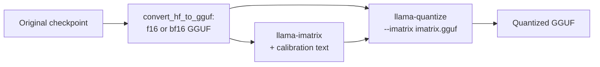

# Lección 24. Tipos de cuantización de GGUF

**Vínculo con la misión:** GGUF es el otro checkpoint que te van a entregar, y los nombres de sus tipos son una descripción comprimida de un esquema de cuantización, así que leer uno correctamente es la manera de comprobar qué es de verdad un archivo "Q4".
**Fuente principal:** [Docs: "GGUF", Hugging Face Hub](https://huggingface.co/docs/hub/gguf)
**Requisitos previos:** [Lección 23](0023-quantized-checkpoints.md), [GGUF](../GLOSSARY.md), [Matriz de importancia](../GLOSSARY.md), [Formato con scale por bloque](../GLOSSARY.md), [Bits efectivos por peso](../GLOSSARY.md)

## Calentamiento

1. ▢ ¿Qué intercambia el tamaño de grupo entre sí?

<details markdown="1"><summary>Comprobación</summary>

Los grupos más pequeños siguen mejor el rango local de los pesos y por tanto pierden menos accuracy, pero cada grupo almacena su propio scale, lo que sube los bits efectivos por peso (lección 6).

</details>

2. ▢ ¿Qué usa round-to-nearest para elegir cada valor cuantizado, y qué no usa?

<details markdown="1"><summary>Comprobación</summary>

Usa solo el propio peso y el scale de su grupo. No usa datos ni hace compensación de errores (lección 9).

</details>

3. ▢ En una capa GPTQ de 4 bits en safetensors, ¿qué tensor contiene el scale por grupo, y en qué dtype?

<details markdown="1"><summary>Comprobación</summary>

`scales`, almacenado como F16 con una fila por cada grupo de canales de entrada (lección 23).

</details>

## Qué debes saber

Un archivo GGUF reúne los tensores con los metadatos del modelo, y muchos de sus tensores usan los tipos por bloque propios de llama.cpp. Esta lección trata de leer los nombres de esos tipos. Para el archivo como formato de ejecución, incluido por qué se puede mapear en memoria, consulta la hoja [llama.cpp](../../inference/reference/llama-cpp.md) del track de inference.

### Tipos heredados: Q4_0, Q8_0 y compañía

La [tabla de tipos](https://huggingface.co/docs/hub/gguf) del Hub lista los tipos heredados bajo su propio encabezado. Cada uno es cuantización round-to-nearest con bloques de 32 pesos: `Q4_0` es de 4 bits, `Q5_0` de 5 bits, `Q8_0` de 8 bits, con los pesos recuperados como `w = q * block_scale`. Los tipos `_1` añaden un mínimo por bloque, `w = q * block_scale + block_minimum`. El pull request de los k-quants llama a estos "tipo 0" y "tipo 1". La tabla señala que los métodos heredados "no se usan mucho hoy en día".

El costo del scale por bloque es la aritmética de la lección 6, leída de los structs de C de [`ggml-common.h`](https://github.com/ggml-org/llama.cpp/blob/master/ggml/src/ggml-common.h) de llama.cpp: un bloque `Q4_0` es un scale de 2 bytes más 32 valores de cuatro bits, 18 bytes por cada 32 pesos, así que 4.5 bits por peso. `Q8_0` es un scale de 2 bytes más 32 bytes, 8.5 bits por peso.

### k-quants: super-bloques

Los k-quants ([pull request #1684](https://github.com/ggml-org/llama.cpp/pull/1684)) añaden un segundo nivel. Un super-bloque contiene 256 pesos, divididos en sub-bloques que tienen cada uno su propio scale, y esos scales se cuantizan a su vez para ahorrar espacio. En `Q4_K`, un super-bloque tiene 8 sub-bloques de 32 pesos, con el scale y el mínimo de cada sub-bloque almacenados en 6 bits, y un par de valores de 16 bits que los escalan. La tabla del Hub da `w = q * block_scale(6-bit) + block_min(6-bit)` y 4.5 bits por peso. La misma tabla da `Q5_K` a 5.5 y `Q6_K` a 6.5625, que usa 16 sub-bloques de 16 pesos con scales de 8 bits. `Q4_K` cuesta los mismos 4.5 bits que `Q4_0` pero los gasta de otra manera, y las propias mediciones de llama.cpp muestran la diferencia: para Llama 3 8B la tabla de resultados del README da a `q5_K_S` y a `q5_0` los mismos 5.21 GiB, con divergencia KL de 0.0166 frente a 0.0222 ([README de perplexity](https://github.com/ggml-org/llama.cpp/blob/master/tools/perplexity/README.md)).

### Los sufijos: mezclas entre tensores

`S`, `M` y `L` significan small, medium y large, y describen una receta, no otro formato de bloque. Cuando el pull request los introdujo, `Q4_K_S` usaba `Q4_K` para todos los tensores, mientras que `Q4_K_M` usaba `Q6_K` para la mitad de los tensores `attention.wv` y `feed_forward.w2` y `Q4_K` para el resto. `Q3_K_L` usaba `Q5_K` para `attention.wv`, `attention.wo` y `feed_forward.w2`, y `Q3_K` en el resto. Todas las variantes usaban además cuantización de 6 bits para `output.weight`. Así que la mezcla es entre tensores: cada tensor tiene un tipo, y la receta dice qué tensores reciben el mejor. Las recetas se han reajustado desde entonces (el README de quantize enlaza pull requests de ajustes posteriores), así que trata esas listas como la idea, y lee los tipos de tensores de tu propio archivo con el [visor de GGUF](https://huggingface.co/docs/hub/gguf) del Hub, que muestra el nombre, la forma y la precisión de cada tensor. La opción `--pure` de `llama-quantize` desactiva las mezclas y usa un solo tipo para todos los tensores.

Eso hace que los bits efectivos por peso de un archivo difieran de los de su tipo principal. Para Llama 3.1 8B el [README de quantize](https://github.com/ggml-org/llama.cpp/blob/master/tools/quantize/README.md) mide estas cifras de archivo completo:

| Nombre | Bits por tipo (tabla del Hub) | Bits por peso de todo el archivo | Tamaño del archivo, GiB |
|---|---|---|---|
| Q8_0 | 8.5 (del struct) | 8.5008 | 7.95 |
| Q6_K | 6.5625 | 6.5633 | 6.14 |
| Q5_K_S, Q5_K_M | 5.5 | 5.5704, 5.7036 | 5.21, 5.33 |
| Q4_K_S, Q4_K_M | 4.5 | 4.6672, 4.8944 | 4.36, 4.58 |
| IQ4_XS | 4.25 | 4.4597 | 4.17 |
| IQ1_S | 1.56 | 2.0042 | 1.87 |
| F16 | 16 | 16.0005 | 14.96 |

### i-quants

Los tipos `IQ`, como `IQ4_XS`, `IQ3_S`, `IQ2_XXS` e `IQ1_S`, apuntan a los anchos de bits más bajos. La tabla del Hub lista costos nominales de 4.25 a 1.56 bits por peso y describe sus pesos como obtenidos a partir de un scale de super-bloque y una matriz de importancia. La tabla de resultados muestra lo que cuesta el extremo bajo: para Llama 3 8B, `iq1_S` tiene perplexity 60.69 y divergencia KL 2.25, frente a 6.23 y 0.0006 de f16. Elegir entre estos es trabajo de la lección 25.

### La matriz de importancia

La **matriz de importancia**, o imatrix, le dice al cuantizador qué pesos importan más. El pull request que la añadió ([#4861](https://github.com/ggml-org/llama.cpp/pull/4861)) la deriva de un argumento simple. La cantidad que hay que mantener pequeña es el error en la salida de una capa, `(sum_j (q_j - w_j) * a_j)^2` para pesos `w_j`, valores cuantizados `q_j` y activaciones `a_j`. Promediado sobre el texto de calibración y con los términos cruzados ignorados, eso se reduce a ponderar el error cuadrático de cada columna de entrada por su activación cuadrática media, `<a_j^2>`. La herramienta almacena un número así por cada columna de entrada, y la cuantización minimiza entonces un error ponderado. `llama-imatrix` la calcula a partir de un archivo de texto, y `llama-quantize` la toma con `--imatrix`:



El [README de imatrix](https://github.com/ggml-org/llama.cpp/blob/master/tools/imatrix/README.md) dice que por defecto no se recogen datos para `output.weight` ni para `token_embd.weight`, porque según el README suele ser mejor no usarlos en esos tensores. Cambia cómo se gastan los mismos bits, no cuántos: la tabla de resultados tiene `q4_K_M` en 4.58 GiB tanto sin imatrix como con ella. Lo que compra es un error menor con el mismo tamaño. Para Llama 3 8B en `q4_K_M`, la perplexity baja de 6.407 a 6.383 y la divergencia KL de 0.0313 a 0.0282 con una imatrix que el README etiqueta como "WT 10m", construida con tokens de WikiText. El mismo README dice que no hay una ganancia consistente al usar más tokens.

Una imatrix es un calibration set (lección 12), así que se aplican las cautelas de la lección 12. Aquí el texto de la imatrix y el texto de evaluación vienen ambos de WikiText, lo que probablemente favorece la ganancia, y una imatrix hecha con un texto distinto del de tu despliegue puede ponderar las columnas equivocadas.

## Práctica

1. ▢ Clasifica estos en heredados, k-quant e i-quant: `Q8_0`, `Q5_K_S`, `IQ4_XS`, `Q4_1`, `Q6_K`, `IQ2_S`.

<details markdown="1"><summary>Comprobación</summary>

Heredados: `Q8_0` y `Q4_1`, que la tabla del Hub lista bajo su encabezado de heredados. k-quants: `Q5_K_S` y `Q6_K`, nombrados con `K`. i-quants: `IQ4_XS` e `IQ2_S`, nombrados con `IQ`. El sufijo `S` de `Q5_K_S` es un sufijo de receta y `XS` en `IQ4_XS` es parte del propio nombre del tipo.

</details>

2. ▢ ¿Qué significa la `M` de `Q4_K_M`?

    - a) Mezcla media: algunos tensores reciben un tipo de mayor precisión que otros
    - b) Precisión mixta aplicada dentro de los bloques de pesos de cada tensor
    - c) Solo Metal: el archivo corre únicamente en el hardware de un proveedor
    - d) Bits mínimos: cada peso se almacena en exactamente cuatro bits

<details markdown="1"><summary>Comprobación</summary>

**a)** El sufijo elige una receta media, que gasta bits extra en tensores seleccionados, como la mitad de `attention.wv` y `feed_forward.w2` cuando se introdujo. (b) es incorrecta porque cada tensor tiene un tipo, y la mezcla es entre tensores. (c) inventa una restricción de hardware que ningún sufijo lleva. (d) es incorrecta porque la cifra de archivo completo es 4.8944 bits por peso para Llama 3.1 8B.

</details>

3. ▢ Predice y luego ejecuta. Usando las disposiciones de bloques de `ggml-common.h`, predice los bits por peso de `Q4_0`, `Q8_0`, `Q4_K` y `Q6_K`, y luego ejecútalo.

    ```python
    # bytes per block, from the C struct layouts in ggml-common.h (half = 2 bytes)
    layouts = {
        "Q4_0": (32, 2 + 32 // 2),
        "Q8_0": (32, 2 + 32),
        "Q4_K": (256, 2 * 2 + 12 + 256 // 2),
        "Q6_K": (256, 256 // 2 + 256 // 4 + 256 // 16 + 2),
    }
    for name, (weights, nbytes) in layouts.items():
        print(f"{name}: {nbytes} bytes per {weights} weights = {nbytes * 8 / weights} bits per weight")
    ```

<details markdown="1"><summary>Pista</summary>

Cada número es bytes por bloque por 8, dividido entre pesos por bloque. Para `Q4_K`, 12 bytes contienen los scales y los mínimos de los sub-bloques, y los dos valores de 2 bytes son los scales del super-bloque.

</details>

<details markdown="1"><summary>Comprobación</summary>

Imprime `Q4_0: 18 bytes per 32 weights = 4.5`, `Q8_0: 34 bytes per 32 weights = 8.5`, `Q4_K: 144 bytes per 256 weights = 4.5` y `Q6_K: 210 bytes per 256 weights = 6.5625` bits por peso. Coinciden con el `Q4_K` y el `Q6_K` de la tabla del Hub, y `Q4_0` y `Q4_K` cuestan lo mismo.

</details>

4. ▢ El README de quantize lista Llama 3.1 8B en F16 como 14.96 GiB y 16.0005 bits por peso. Estima el tamaño del archivo `Q4_K_M` a 4.8944 bits por peso, y el de `Q4_K_S` a 4.6672.

<details markdown="1"><summary>Comprobación</summary>

El tamaño escala con los bits por peso: 14.96 x 4.8944 / 16.0005 son unos 4.58 GiB para `Q4_K_M`, y 14.96 x 4.6672 / 16.0005 son unos 4.36 GiB para `Q4_K_S`. Ambos coinciden con las cifras del README. Dimensiona siempre un archivo GGUF a partir de su cifra de archivo completo, no del 4 de su nombre.

</details>

5. ▢ `Q4_K` cuesta 4.5 bits por peso, pero `Q4_K_M` mide 4.8944 para el mismo modelo. ¿De dónde salen los bits extra?

<details markdown="1"><summary>Comprobación</summary>

De tensores que la receta almacena en un tipo de mayor precisión que `Q4_K`. La receta `M` pone `Q6_K` en parte de `attention.wv` y `feed_forward.w2`, y, como describe el pull request, `output.weight` se almacena en 6 bits en todas las variantes. Los bits extra van a los tensores juzgados más sensibles.

</details>

6. ▢ Predice y luego ejecuta. Un bloque de 32 pesos se redondea a 4 bits con un scale. Dos columnas de entrada llevan activaciones 10 veces mayores que el resto. Predice si elegir el scale por error ponderado por importancia reduce el error de salida promedio en comparación con elegirlo por error simple, y luego ejecútalo. Esto ilustra el principio del pull request de la imatrix, no el código real de llama.cpp.

    ```python
    import numpy as np

    rng = np.random.default_rng(0)
    block, n_blocks = 32, 2000
    scales_grid = np.linspace(0.6, 1.2, 61)  # candidate scales, relative to max|w| / 7

    # Calibration activations: two input columns carry much larger values than the rest.
    col_gain = np.ones(block)
    col_gain[[3, 17]] = 10.0
    calib = rng.normal(size=(512, block)) * col_gain
    test = rng.normal(size=(512, block)) * col_gain
    importance = (calib ** 2).mean(axis=0)  # mean squared activation per input column


    def quantize(w, scale):
        return np.clip(np.round(w / scale), -8, 7) * scale


    def best_scale(w, weights):
        base = np.abs(w).max() / 7
        errs = [np.sum(weights * (w - quantize(w, base * s)) ** 2) for s in scales_grid]
        return base * scales_grid[int(np.argmin(errs))]


    plain, weighted = [], []
    for _ in range(n_blocks):
        w = rng.normal(size=block)
        for scale, out in ((best_scale(w, np.ones(block)), plain), (best_scale(w, importance), weighted)):
            err = test @ (w - quantize(w, scale))
            out.append(np.sqrt(np.mean(err ** 2)))

    print("mean output error, plain scale search:      ", round(float(np.mean(plain)), 3))
    print("mean output error, importance-weighted scale:", round(float(np.mean(weighted)), 3))
    print("blocks where weighting helped:", int(np.sum(np.array(weighted) < np.array(plain))), "of", n_blocks)
    ```

<details markdown="1"><summary>Pista</summary>

El error que importa es el error en la salida de la capa, así que un error de redondeo en una columna que se encuentra con activaciones grandes cuenta más.

</details>

<details markdown="1"><summary>Comprobación</summary>

Ponderar ayuda: el error de salida promedio es 1.202 con la búsqueda de scale simple y 0.794 con la ponderada por importancia, y el scale ponderado gana en 1881 de 2000 bloques. La búsqueda ponderada acepta más error en las columnas ordinarias para mantener precisas las dos columnas muy usadas, y a la salida le importan más esas dos. El tamaño del archivo es idéntico en ambos casos, ya que solo cambió la elección del scale.

</details>

7. ▢ Construyes una imatrix a partir de texto de enciclopedia en inglés, cuantizas un modelo que escribirá sobre todo código y informas de una ganancia de perplexity medida en ese mismo texto de enciclopedia. ¿Qué debería preguntar un revisor?

<details markdown="1"><summary>Comprobación</summary>

Si la evaluación se parece al despliegue. La imatrix es un calibration set: pondera las columnas por las activaciones que produce el texto de enciclopedia, y el código puede activar otras. Una ganancia medida en el dominio del propio texto de calibración es el mejor caso, así que el revisor debería pedir una eval sobre tareas de código (lección 22) y que el texto de calibración coincida con ellas.

</details>

## Prácticas en el mundo real

- [ ] Abre un modelo GGUF en el Hugging Face Hub, elige un archivo `Q4_K_M`, abre su visor de tensores y lista qué tensores no son `Q4_K`. Compáralo con la receta de arriba.
- [ ] Si tienes llama.cpp, cuantiza un GGUF pequeño en bf16 o f16 a `Q4_K_S` y `Q4_K_M` con `llama-quantize` y comprueba que la razón de tamaños de archivo coincide con la razón de bits por peso de la tabla.
- [ ] Mañana: sin apuntes, di qué significa cada parte de `Q4_K_M`, y qué cambia una matriz de importancia y qué deja sin cambiar.

## Para profundizar

- [Medir y almacenar](../reference/measuring-and-storing.md)
- [Docs: "GGUF", Hugging Face Hub](https://huggingface.co/docs/hub/gguf)
- [Docs: llama.cpp quantize tool README, ggml-org](https://github.com/ggml-org/llama.cpp/blob/master/tools/quantize/README.md)
- [Docs: llama.cpp imatrix tool README, ggml-org](https://github.com/ggml-org/llama.cpp/blob/master/tools/imatrix/README.md)
- Inferencia: [llama.cpp](../../inference/reference/llama-cpp.md), para GGUF como formato de ejecución
- [Recursos](../RESOURCES.md)

---

¿No termina de quedar claro? Vuelve a leer la fuente primaria de arriba, ya que esta lección la comprime y en la compresión es donde se escapa la comprensión. Consulta el [glosario](../GLOSSARY.md) por si algún término te resultó resbaladizo.

Si lo poco claro es la propia lección y no el material, eso es un defecto: [abre un issue](https://github.com/TokenCemetery/teach/issues).
