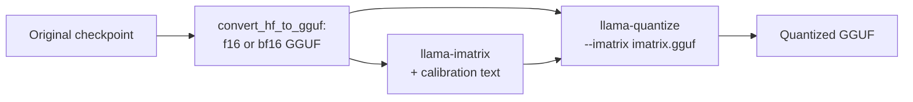

# Leçon 24. Types de quantification GGUF

**Lien avec la mission :** GGUF est l'autre checkpoint qu'on vous remettra, et ses noms de type sont une description compressée d'un schéma de quantification, donc savoir en lire un correctement est la façon de vérifier ce qu'est vraiment un fichier « Q4 ».
**Source primaire :** [Doc : "GGUF", Hugging Face Hub](https://huggingface.co/docs/hub/gguf)
**Prérequis :** [Leçon 23](0023-quantized-checkpoints.md), [GGUF](../GLOSSARY.md), [Matrice d'importance](../GLOSSARY.md), [Format à échelle par bloc](../GLOSSARY.md), [Bits effectifs par poids](../GLOSSARY.md)

## Échauffement

1. ▢ Qu'est-ce que la taille de groupe met en balance ?

<details markdown="1"><summary>Vérifier</summary>

Des groupes plus petits suivent mieux la plage locale des poids et perdent donc moins de précision, mais chaque groupe stocke son propre scale, ce qui augmente les bits effectifs par poids (leçon 6).

</details>

2. ▢ Qu'utilise l'arrondi au plus proche pour choisir chaque valeur quantifiée, et que n'utilise-t-il pas ?

<details markdown="1"><summary>Vérifier</summary>

Il n'utilise que le poids lui-même et le scale de son groupe. Il n'utilise aucune donnée et ne fait aucune compensation d'erreur (leçon 9).

</details>

3. ▢ Dans une couche safetensors GPTQ en 4 bits, quel tenseur contient le scale par groupe, et dans quel dtype ?

<details markdown="1"><summary>Vérifier</summary>

`scales`, stocké en F16 avec une ligne par groupe de canaux d'entrée (leçon 23).

</details>

## À savoir

Un fichier GGUF réunit les tenseurs et les métadonnées du modèle, et beaucoup de ses tenseurs utilisent les propres types de blocs de llama.cpp. Cette leçon porte sur la lecture des noms de ces types. Pour le fichier comme format d'exécution, y compris pourquoi il peut être mappé en mémoire, voir la fiche [llama.cpp](../../inference/reference/llama-cpp.md) du parcours inférence.

### Types historiques : Q4_0, Q8_0 et compagnie

Le [tableau des types](https://huggingface.co/docs/hub/gguf) du Hub liste les types historiques sous leur propre intertitre. Chacun est une quantification par arrondi au plus proche avec des blocs de 32 poids : `Q4_0` est en 4 bits, `Q5_0` en 5 bits, `Q8_0` en 8 bits, avec des poids retrouvés par `w = q * block_scale`. Les types `_1` ajoutent un minimum de bloc, `w = q * block_scale + block_minimum`. La pull request des k-quants les appelle « type-0 » et « type-1 ». Le tableau note que les méthodes historiques ne sont « pas largement utilisées aujourd'hui » (« not used widely as of today »).

Le coût du scale de bloc est l'arithmétique de la leçon 6, lue dans les structs C du [`ggml-common.h`](https://github.com/ggml-org/llama.cpp/blob/master/ggml/src/ggml-common.h) de llama.cpp : un bloc `Q4_0` est un scale de 2 octets plus 32 valeurs de quatre bits, 18 octets pour 32 poids, donc 4.5 bits par poids. `Q8_0` est un scale de 2 octets plus 32 octets, 8.5 bits par poids.

### k-quants : les super-blocs

Les k-quants ([pull request #1684](https://github.com/ggml-org/llama.cpp/pull/1684)) ajoutent un second niveau. Un super-bloc contient 256 poids, divisés en sous-blocs qui ont chacun leur propre scale, et ces scales sont eux-mêmes quantifiés pour gagner de la place. Dans `Q4_K`, un super-bloc a 8 sous-blocs de 32 poids, avec le scale et le minimum de sous-bloc stockés chacun sur 6 bits, et une paire de valeurs de 16 bits qui les met à l'échelle. Le tableau du Hub donne `w = q * block_scale(6-bit) + block_min(6-bit)` et 4.5 bits par poids. Le même tableau donne `Q5_K` à 5.5 et `Q6_K` à 6.5625, qui utilise 16 sous-blocs de 16 poids avec des scales de 8 bits. `Q4_K` coûte les mêmes 4.5 bits que `Q4_0` mais les dépense autrement, et les propres mesures de llama.cpp montrent la différence : pour Llama 3 8B, le tableau de résultats du README donne à `q5_K_S` et `q5_0` les mêmes 5.21 GiB, avec une divergence KL de 0.0166 contre 0.0222 ([README de perplexity](https://github.com/ggml-org/llama.cpp/blob/master/tools/perplexity/README.md)).

### Les suffixes : des mélanges entre tenseurs

`S`, `M` et `L` signifient small, medium et large (petit, moyen et grand), et ils décrivent une recette, pas un autre format de bloc. Quand la pull request les a introduits, `Q4_K_S` utilisait `Q4_K` pour tous les tenseurs, tandis que `Q4_K_M` utilisait `Q6_K` pour la moitié des tenseurs `attention.wv` et `feed_forward.w2` et `Q4_K` pour le reste. `Q3_K_L` utilisait `Q5_K` pour `attention.wv`, `attention.wo` et `feed_forward.w2`, et `Q3_K` ailleurs. Chaque variante utilisait ensuite aussi une quantification sur 6 bits pour `output.weight`. Le mélange se fait donc entre tenseurs : chaque tenseur a un seul type, et la recette dit quels tenseurs reçoivent le meilleur. Les recettes ont été réglées de nouveau depuis (le README de quantize renvoie vers des pull requests de réglage ultérieures), donc traitez ces listes comme l'idée, et lisez les types de tenseurs de votre propre fichier avec le [visualiseur GGUF](https://huggingface.co/docs/hub/gguf) du Hub, qui montre le nom, la forme et la précision de chaque tenseur. L'option `--pure` de `llama-quantize` désactive les mélanges et utilise un seul type pour chaque tenseur.

Cela fait que les bits effectifs par poids d'un fichier diffèrent de ceux de son type principal. Pour Llama 3.1 8B, le [README de quantize](https://github.com/ggml-org/llama.cpp/blob/master/tools/quantize/README.md) mesure ces chiffres sur fichier entier :

| Nom | Bits par type (tableau du Hub) | Bits par poids sur fichier entier | Taille de fichier, GiB |
|---|---|---|---|
| Q8_0 | 8.5 (d'après le struct) | 8.5008 | 7.95 |
| Q6_K | 6.5625 | 6.5633 | 6.14 |
| Q5_K_S, Q5_K_M | 5.5 | 5.5704, 5.7036 | 5.21, 5.33 |
| Q4_K_S, Q4_K_M | 4.5 | 4.6672, 4.8944 | 4.36, 4.58 |
| IQ4_XS | 4.25 | 4.4597 | 4.17 |
| IQ1_S | 1.56 | 2.0042 | 1.87 |
| F16 | 16 | 16.0005 | 14.96 |

### i-quants

Les types `IQ`, comme `IQ4_XS`, `IQ3_S`, `IQ2_XXS` et `IQ1_S`, visent les largeurs en bits les plus basses. Le tableau du Hub liste des coûts nominaux de 4.25 jusqu'à 1.56 bit par poids et décrit leurs poids comme obtenus à partir d'un scale de super-bloc et d'une matrice d'importance. Le tableau de résultats montre ce que coûte le bas de la gamme : pour Llama 3 8B, `iq1_S` a une perplexity de 60.69 et une divergence KL de 2.25, contre 6.23 et 0.0006 pour f16. Choisir parmi eux est le travail de la leçon 25.

### La matrice d'importance

La **matrice d'importance**, ou imatrix, dit au quantificateur quels poids comptent le plus. La pull request qui l'a ajoutée ([#4861](https://github.com/ggml-org/llama.cpp/pull/4861)) la dérive d'un argument simple. La quantité à garder petite est l'erreur sur la sortie d'une couche, `(sum_j (q_j - w_j) * a_j)^2` pour des poids `w_j`, des valeurs quantifiées `q_j` et des activations `a_j`. Moyennée sur un texte de calibration et en ignorant les termes croisés, cela se réduit à pondérer l'erreur quadratique de chaque colonne d'entrée par son activation quadratique moyenne, `<a_j^2>`. L'outil stocke un tel nombre par colonne d'entrée, et la quantification minimise alors une erreur pondérée. `llama-imatrix` la calcule à partir d'un fichier texte, et `llama-quantize` la prend avec `--imatrix` :



Le [README d'imatrix](https://github.com/ggml-org/llama.cpp/blob/master/tools/imatrix/README.md) dit que les données ne sont pas collectées par défaut pour `output.weight` et `token_embd.weight`, parce que, dit le README, il vaut typiquement mieux ne pas les utiliser sur ces tenseurs. Elle change la façon de dépenser le même nombre de bits, pas leur nombre : le tableau de résultats met `q4_K_M` à 4.58 GiB avec comme sans imatrix. Ce qu'elle achète, c'est une erreur plus petite à taille égale. Pour Llama 3 8B en `q4_K_M`, la perplexity passe de 6.407 à 6.383 et la divergence KL de 0.0313 à 0.0282 avec un imatrix que le README étiquette « WT 10m », construit à partir de tokens WikiText. Le même README dit qu'il n'y a pas de gain constant à utiliser plus de tokens.

Un imatrix est un calibration set (leçon 12), donc les mises en garde de la leçon 12 s'appliquent. Ici, le texte de l'imatrix et le texte d'évaluation viennent tous deux de WikiText, ce qui flatte probablement le gain, et un imatrix fait à partir d'un texte différent de votre déploiement peut pondérer les mauvaises colonnes.

## Pratique

1. ▢ Rangez ceux-ci en historiques, k-quants et i-quants : `Q8_0`, `Q5_K_S`, `IQ4_XS`, `Q4_1`, `Q6_K`, `IQ2_S`.

<details markdown="1"><summary>Vérifier</summary>

Historiques : `Q8_0` et `Q4_1`, que le tableau du Hub liste sous son intertitre des historiques. k-quants : `Q5_K_S` et `Q6_K`, nommés avec `K`. i-quants : `IQ4_XS` et `IQ2_S`, nommés avec `IQ`. Le suffixe `S` de `Q5_K_S` est un suffixe de recette et le `XS` de `IQ4_XS` fait partie du nom propre du type.

</details>

2. ▢ Que signifie le `M` de `Q4_K_M` ?

    - a) Mélange moyen : certains tenseurs reçoivent un type de plus haute précision que d'autres
    - b) Précision mixte appliquée à l'intérieur des propres blocs de poids de chaque tenseur
    - c) Metal seulement : le fichier ne tourne que sur le matériel d'un seul fournisseur
    - d) Minimum de bits : chaque poids est stocké sur exactement quatre bits

<details markdown="1"><summary>Vérifier</summary>

**a)** Le suffixe sélectionne une recette moyenne, qui dépense des bits supplémentaires sur certains tenseurs comme la moitié de `attention.wv` et de `feed_forward.w2` à l'introduction. (b) est faux parce que chaque tenseur a un seul type, et que le mélange se fait entre tenseurs. (c) invente une restriction matérielle qu'aucun suffixe ne porte. (d) est faux parce que le chiffre sur fichier entier est de 4.8944 bits par poids pour Llama 3.1 8B.

</details>

3. ▢ Prédisez, puis exécutez. À partir des agencements de blocs de `ggml-common.h`, prédisez les bits par poids de `Q4_0`, `Q8_0`, `Q4_K` et `Q6_K`, puis exécutez.

    ```python
    # bytes per block, from the C struct layouts in ggml-common.h (half = 2 bytes)
    layouts = {
        "Q4_0": (32, 2 + 32 // 2),
        "Q8_0": (32, 2 + 32),
        "Q4_K": (256, 2 * 2 + 12 + 256 // 2),
        "Q6_K": (256, 256 // 2 + 256 // 4 + 256 // 16 + 2),
    }
    for name, (weights, nbytes) in layouts.items():
        print(f"{name}: {nbytes} bytes per {weights} weights = {nbytes * 8 / weights} bits per weight")
    ```

<details markdown="1"><summary>Indice</summary>

Chaque nombre est les octets par bloc fois 8, divisés par les poids par bloc. Pour `Q4_K`, 12 octets contiennent les scales et les minimums de sous-blocs, et les deux valeurs de 2 octets sont les scales de super-bloc.

</details>

<details markdown="1"><summary>Vérifier</summary>

Il affiche `Q4_0: 18 bytes per 32 weights = 4.5`, `Q8_0: 34 bytes per 32 weights = 8.5`, `Q4_K: 144 bytes per 256 weights = 4.5` et `Q6_K: 210 bytes per 256 weights = 6.5625` bits par poids. Ils correspondent à `Q4_K` et `Q6_K` du tableau du Hub, et `Q4_0` et `Q4_K` coûtent autant.

</details>

4. ▢ Le README de quantize liste Llama 3.1 8B en F16 à 14.96 GiB et 16.0005 bits par poids. Estimez la taille du fichier `Q4_K_M` à 4.8944 bits par poids, et celle de `Q4_K_S` à 4.6672.

<details markdown="1"><summary>Vérifier</summary>

La taille suit les bits par poids : 14.96 x 4.8944 / 16.0005 fait environ 4.58 GiB pour `Q4_K_M`, et 14.96 x 4.6672 / 16.0005 environ 4.36 GiB pour `Q4_K_S`. Les deux correspondent aux chiffres du README. Dimensionnez toujours un fichier GGUF d'après son chiffre sur fichier entier, pas d'après le 4 de son nom.

</details>

5. ▢ `Q4_K` coûte 4.5 bits par poids, et pourtant `Q4_K_M` mesure 4.8944 pour le même modèle. D'où viennent les bits supplémentaires ?

<details markdown="1"><summary>Vérifier</summary>

De tenseurs que la recette stocke dans un type de plus haute précision que `Q4_K`. La recette `M` met du `Q6_K` sur une partie de `attention.wv` et `feed_forward.w2`, et, comme le décrit la pull request, `output.weight` est stocké sur 6 bits pour chaque variante. Les bits supplémentaires vont aux tenseurs jugés les plus sensibles.

</details>

6. ▢ Prédisez, puis exécutez. Un bloc de 32 poids est arrondi sur 4 bits avec un seul scale. Deux colonnes d'entrée portent des activations 10 fois plus grandes que les autres. Prédisez si choisir le scale d'après l'erreur pondérée par l'importance réduit l'erreur de sortie moyenne par rapport à un choix d'après l'erreur simple, puis exécutez. Cela illustre le principe de la pull request de l'imatrix, pas le vrai code de llama.cpp.

    ```python
    import numpy as np

    rng = np.random.default_rng(0)
    block, n_blocks = 32, 2000
    scales_grid = np.linspace(0.6, 1.2, 61)  # candidate scales, relative to max|w| / 7

    # Calibration activations: two input columns carry much larger values than the rest.
    col_gain = np.ones(block)
    col_gain[[3, 17]] = 10.0
    calib = rng.normal(size=(512, block)) * col_gain
    test = rng.normal(size=(512, block)) * col_gain
    importance = (calib ** 2).mean(axis=0)  # mean squared activation per input column


    def quantize(w, scale):
        return np.clip(np.round(w / scale), -8, 7) * scale


    def best_scale(w, weights):
        base = np.abs(w).max() / 7
        errs = [np.sum(weights * (w - quantize(w, base * s)) ** 2) for s in scales_grid]
        return base * scales_grid[int(np.argmin(errs))]


    plain, weighted = [], []
    for _ in range(n_blocks):
        w = rng.normal(size=block)
        for scale, out in ((best_scale(w, np.ones(block)), plain), (best_scale(w, importance), weighted)):
            err = test @ (w - quantize(w, scale))
            out.append(np.sqrt(np.mean(err ** 2)))

    print("mean output error, plain scale search:      ", round(float(np.mean(plain)), 3))
    print("mean output error, importance-weighted scale:", round(float(np.mean(weighted)), 3))
    print("blocks where weighting helped:", int(np.sum(np.array(weighted) < np.array(plain))), "of", n_blocks)
    ```

<details markdown="1"><summary>Indice</summary>

L'erreur qui compte est l'erreur sur la sortie de la couche, donc une erreur d'arrondi sur une colonne qui rencontre de grandes activations compte davantage.

</details>

<details markdown="1"><summary>Vérifier</summary>

La pondération aide : l'erreur de sortie moyenne est 1.202 avec la recherche de scale simple et 0.794 avec celle pondérée par l'importance, et le scale pondéré gagne dans 1881 blocs sur 2000. La recherche pondérée accepte plus d'erreur sur les colonnes ordinaires pour garder précises les deux colonnes très utilisées, et la sortie se soucie davantage de ces deux-là. La taille de fichier est identique dans les deux cas, puisque seul le choix du scale a changé.

</details>

7. ▢ Vous construisez un imatrix à partir de texte encyclopédique anglais, quantifiez un modèle qui écrira surtout du code, et rapportez un gain de perplexity mesuré sur ce même texte encyclopédique. Que doit demander un relecteur ?

<details markdown="1"><summary>Vérifier</summary>

Si l'évaluation ressemble au déploiement. L'imatrix est un calibration set : il pondère les colonnes d'après les activations que produit le texte encyclopédique, et le code peut en activer d'autres. Un gain mesuré sur le domaine du texte de calibration lui-même est le meilleur cas, donc le relecteur devrait demander une eval sur des tâches de code (leçon 22) et un texte de calibration qui y corresponde.

</details>

## Exercices en situation réelle

- [ ] Ouvrez un modèle GGUF sur le Hugging Face Hub, choisissez un fichier `Q4_K_M`, ouvrez son visualiseur de tenseurs, et listez quels tenseurs ne sont pas en `Q4_K`. Comparez avec la recette ci-dessus.
- [ ] Si vous avez llama.cpp, quantifiez un petit GGUF en bf16 ou f16 en `Q4_K_S` et `Q4_K_M` avec `llama-quantize` et vérifiez que le rapport des tailles de fichier correspond au rapport des bits par poids du tableau.
- [ ] Demain : sans notes, dites ce que signifie chaque partie de `Q4_K_M`, et ce que change une matrice d'importance et ce qu'elle laisse inchangé.

## Pour aller plus loin

- [Mesurer et stocker](../reference/measuring-and-storing.md)
- [Doc : "GGUF", Hugging Face Hub](https://huggingface.co/docs/hub/gguf)
- [Doc : README de l'outil quantize de llama.cpp, ggml-org](https://github.com/ggml-org/llama.cpp/blob/master/tools/quantize/README.md)
- [Doc : README de l'outil imatrix de llama.cpp, ggml-org](https://github.com/ggml-org/llama.cpp/blob/master/tools/imatrix/README.md)
- Inférence : [llama.cpp](../../inference/reference/llama-cpp.md), pour GGUF comme format d'exécution
- [Ressources](../RESOURCES.md)

---

Ça ne passe pas ? Relisez la source primaire en haut de page, car cette leçon la condense et c'est dans la condensation que la compréhension s'échappe. Consultez le [glossaire](../GLOSSARY.md) pour tout terme qui vous a paru glissant.

Si c'est la leçon elle-même qui n'est pas claire plutôt que la matière, c'est un défaut : [ouvrez une issue](https://github.com/TokenCemetery/teach/issues).
