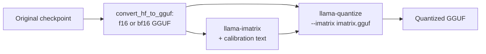

# पाठ 24. GGUF Quant Types

**मिशन से संबंध:** GGUF वह दूसरा checkpoint है जो आपको थमाया जाएगा, और उसके type names quantization scheme का संक्षिप्त वर्णन हैं, इसलिए उन्हें सही पढ़ना ही वह तरीक़ा है जिससे आप जाँचते हैं कि "Q4" file असल में क्या है।
**मुख्य स्रोत:** [दस्तावेज़: "GGUF", Hugging Face Hub](https://huggingface.co/docs/hub/gguf)
**पूर्व-आवश्यकताएँ:** [पाठ 23](0023-quantized-checkpoints.md), [GGUF](../GLOSSARY.md), [Importance matrix](../GLOSSARY.md), [Block-scaled format](../GLOSSARY.md), [Effective bits per weight](../GLOSSARY.md)

## वार्म-अप

1. ▢ Group size किन दो चीज़ों का आपस में सौदा करता है?

<details markdown="1"><summary>जाँचें</summary>

छोटे groups weights की स्थानीय range को बेहतर पकड़ते हैं और इसलिए कम accuracy खोते हैं, पर हर group अपना scale store करता है, जिससे effective bits per weight बढ़ते हैं (पाठ 6)।

</details>

2. ▢ Round-to-nearest हर quantized value चुनने के लिए क्या इस्तेमाल करता है, और क्या नहीं?

<details markdown="1"><summary>जाँचें</summary>

वह सिर्फ़ weight को ख़ुद और उसके group के scale को इस्तेमाल करता है। वह कोई data इस्तेमाल नहीं करता और कोई error की भरपाई नहीं करता (पाठ 9)।

</details>

3. ▢ 4-bit GPTQ safetensors layer में, कौन-सा tensor प्रति-group scale रखता है, और किस dtype में?

<details markdown="1"><summary>जाँचें</summary>

`scales`, F16 के रूप में store, input channels के हर group के लिए एक row के साथ (पाठ 23)।

</details>

## यह जानें

GGUF file tensors को model के metadata के साथ बाँधती है, और उसके कई tensors llama.cpp के अपने block types इस्तेमाल करते हैं। यह पाठ उन types के नाम पढ़ने के बारे में है। File को runtime format के रूप में देखने के लिए, यह भी कि उसे memory-map क्यों किया जा सकता है, inference track की [llama.cpp शीट](../../inference/reference/llama-cpp.md) देखें।

### Legacy types: Q4_0, Q8_0 और साथी

Hub की [type की table](https://huggingface.co/docs/hub/gguf) legacy types को अपने शीर्षक के नीचे सूचीबद्ध करती है। हर एक 32 weights के blocks के साथ round-to-nearest quantization है: `Q4_0` 4-bit है, `Q5_0` 5-bit, `Q8_0` 8-bit, weights `w = q * block_scale` से वापस पाए जाते हैं। `_1` types एक block minimum जोड़ते हैं, `w = q * block_scale + block_minimum`। k-quants का pull request इन्हें "type-0" और "type-1" कहता है। Table ध्यान दिलाती है कि legacy methods "आज की तारीख़ में व्यापक रूप से इस्तेमाल नहीं होते"।

Block scale की क़ीमत पाठ 6 का हिसाब है, जिसे llama.cpp के [`ggml-common.h`](https://github.com/ggml-org/llama.cpp/blob/master/ggml/src/ggml-common.h) के C structs से पढ़ा गया है: `Q4_0` block 2-byte scale और 32 चार-bit values है, प्रति 32 weights 18 bytes, यानी प्रति weight 4.5 bits। `Q8_0` 2-byte scale और 32 bytes है, प्रति weight 8.5 bits।

### k-quants: super-blocks

k-quants ([pull request #1684](https://github.com/ggml-org/llama.cpp/pull/1684)) दूसरा स्तर जोड़ते हैं। Super-block में 256 weights होते हैं, जो sub-blocks में बँटे हैं जिनमें से हर एक का अपना scale है, और उन scales को ही जगह बचाने के लिए quantize किया जाता है। `Q4_K` में, super-block में 32 weights के 8 sub-blocks हैं, sub-block का scale और minimum हर एक 6 bits में store है, और 16-bit values का एक जोड़ा उन्हें scale करता है। Hub table `w = q * block_scale(6-bit) + block_min(6-bit)` और प्रति weight 4.5 bits देती है। वही table `Q5_K` को 5.5 और `Q6_K` को 6.5625 देती है, जो 8-bit scales के साथ 16 weights के 16 sub-blocks इस्तेमाल करता है। `Q4_K` की लागत `Q4_0` जितने ही 4.5 bits है पर वह उन्हें अलग तरह ख़र्च करता है, और llama.cpp की अपनी मापें फ़र्क़ दिखाती हैं: Llama 3 8B के लिए README का scoreboard `q5_K_S` और `q5_0` को वही 5.21 GiB देता है, KL divergence 0.0166 बनाम 0.0222 के साथ ([perplexity README](https://github.com/ggml-org/llama.cpp/blob/master/tools/perplexity/README.md))।

### Suffixes: tensors के पार मिश्रण

`S`, `M` और `L` का मतलब small, medium और large है, और वे एक नुस्ख़े का वर्णन करते हैं, अलग block format का नहीं। जब pull request ने उन्हें पेश किया, `Q4_K_S` सभी tensors के लिए `Q4_K` इस्तेमाल करता था, जबकि `Q4_K_M` `attention.wv` और `feed_forward.w2` tensors के आधे के लिए `Q6_K` और बाक़ी के लिए `Q4_K` इस्तेमाल करता था। `Q3_K_L` `attention.wv`, `attention.wo` और `feed_forward.w2` के लिए `Q5_K` और बाक़ी जगह `Q3_K` इस्तेमाल करता था। हर variant फिर `output.weight` के लिए भी 6-bit quantization इस्तेमाल करता था। इसलिए मिश्रण tensors के पार है: हर tensor का एक type है, और नुस्ख़ा बताता है कि कौन-से tensors को बेहतर वाला मिलता है। नुस्ख़े तब से दोबारा tune हुए हैं (quantize README बाद के tuning pull requests से link करती है), इसलिए उन सूचियों को विचार मानें, और अपनी file के tensor types Hub के [GGUF viewer](https://huggingface.co/docs/hub/gguf) से पढ़ें, जो हर tensor का नाम, shape और precision दिखाता है। `llama-quantize` का `--pure` option मिश्रण बंद कर देता है और हर tensor के लिए एक ही type इस्तेमाल करता है।

इससे file के effective bits per weight उसके मुख्य type से अलग हो जाते हैं। Llama 3.1 8B के लिए [quantize README](https://github.com/ggml-org/llama.cpp/blob/master/tools/quantize/README.md) ये पूरी-file की संख्याएँ मापती है:

| नाम | Per-type bits (Hub table) | पूरी file के bits per weight | File का आकार, GiB |
|---|---|---|---|
| Q8_0 | 8.5 (struct से) | 8.5008 | 7.95 |
| Q6_K | 6.5625 | 6.5633 | 6.14 |
| Q5_K_S, Q5_K_M | 5.5 | 5.5704, 5.7036 | 5.21, 5.33 |
| Q4_K_S, Q4_K_M | 4.5 | 4.6672, 4.8944 | 4.36, 4.58 |
| IQ4_XS | 4.25 | 4.4597 | 4.17 |
| IQ1_S | 1.56 | 2.0042 | 1.87 |
| F16 | 16 | 16.0005 | 14.96 |

### i-quants

`IQ` types, जैसे `IQ4_XS`, `IQ3_S`, `IQ2_XXS` और `IQ1_S`, सबसे कम bit widths को लक्ष्य करते हैं। Hub table 4.25 से 1.56 bits per weight तक की नाममात्र लागतें सूचीबद्ध करती है और उनके weights को super-block scale और importance matrix से पाया हुआ बताती है। Scoreboard दिखाता है कि निचले सिरे की क़ीमत क्या है: Llama 3 8B के लिए, `iq1_S` की perplexity 60.69 और KL divergence 2.25 है, जबकि f16 के लिए 6.23 और 0.0006। इनमें से चुनना पाठ 25 का काम है।

### Importance matrix

**Importance matrix**, या imatrix, quantizer को बताती है कि कौन-से weights सबसे ज़्यादा मायने रखते हैं। उसे जोड़ने वाला pull request ([#4861](https://github.com/ggml-org/llama.cpp/pull/4861)) उसे एक सीधे तर्क से निकालता है। जिस राशि को छोटा रखना है वह layer के output की error है, weights `w_j`, quantized values `q_j` और activations `a_j` के लिए `(sum_j (q_j - w_j) * a_j)^2`। Calibration text पर औसत लेकर और cross terms को अनदेखा करके, वह हर input column की squared error को उसकी औसत squared activation, `<a_j^2>`, से वज़न देने तक सिमट जाता है। Tool ऐसी हर input column के लिए एक संख्या store करता है, और quantization फिर weighted error को न्यूनतम करता है। `llama-imatrix` उसे text file से compute करता है, और `llama-quantize` उसे `--imatrix` से लेता है:



[imatrix README](https://github.com/ggml-org/llama.cpp/blob/master/tools/imatrix/README.md) कहती है कि data default रूप से `output.weight` और `token_embd.weight` के लिए नहीं जुटाया जाता, क्योंकि README के अनुसार उन tensors पर उसे इस्तेमाल न करना आम तौर पर बेहतर है। वह बदलती है कि उतने ही bits कैसे ख़र्च होते हैं, कितने नहीं: scoreboard में `q4_K_M` बिना और imatrix के साथ दोनों में 4.58 GiB है। वह जो ख़रीदती है वह उसी आकार पर कम error है। Llama 3 8B के `q4_K_M` पर, imatrix के साथ, जिसे README "WT 10m" लेबल करती है, WikiText tokens से बनी, perplexity 6.407 से 6.383 और KL divergence 0.0313 से 0.0282 पर गिरती है। वही README कहती है कि ज़्यादा tokens इस्तेमाल करने से कोई एकसार फ़ायदा नहीं मिलता।

Imatrix एक calibration set है (पाठ 12), इसलिए पाठ 12 की सावधानियाँ लागू होती हैं। यहाँ imatrix का text और evaluation का text दोनों WikiText से हैं, जो संभवतः फ़ायदे को बढ़ाकर दिखाता है, और आपकी deployment से अलग text से बनी imatrix ग़लत columns को वज़न दे सकती है।

## अभ्यास

1. ▢ इन्हें legacy, k-quant और i-quant में छाँटें: `Q8_0`, `Q5_K_S`, `IQ4_XS`, `Q4_1`, `Q6_K`, `IQ2_S`।

<details markdown="1"><summary>जाँचें</summary>

Legacy: `Q8_0` और `Q4_1`, जिन्हें Hub table अपने legacy शीर्षक के नीचे सूचीबद्ध करती है। k-quants: `Q5_K_S` और `Q6_K`, जिनके नाम में `K` है। i-quants: `IQ4_XS` और `IQ2_S`, जिनके नाम में `IQ` है। `Q5_K_S` का suffix `S` नुस्ख़े का suffix है और `IQ4_XS` का `XS` type के अपने नाम का हिस्सा है।

</details>

2. ▢ `Q4_K_M` के `M` का क्या मतलब है?

    - a) Medium मिश्रण: कुछ tensors को दूसरों से ऊँची-precision वाला type मिलता है
    - b) Mixed precision जो हर tensor के अपने weight blocks के भीतर लगती है
    - c) Metal only: file सिर्फ़ एक vendor के hardware पर चलती है
    - d) Minimum bits: हर weight ठीक चार bits में store है

<details markdown="1"><summary>जाँचें</summary>

**a)** Suffix medium नुस्ख़ा चुनता है, जो चुने हुए tensors पर अतिरिक्त bits ख़र्च करता है, जैसे पेश किए जाने के समय `attention.wv` और `feed_forward.w2` का आधा। (b) ग़लत है क्योंकि हर tensor का एक type है, और मिश्रण tensors के पार है। (c) एक hardware पाबंदी गढ़ता है जो कोई suffix नहीं ढोता। (d) ग़लत है क्योंकि Llama 3.1 8B के लिए file की पूरी-file संख्या 4.8944 bits per weight है।

</details>

3. ▢ पहले अनुमान लगाएँ, फिर चलाएँ। `ggml-common.h` के block layouts का इस्तेमाल करके, `Q4_0`, `Q8_0`, `Q4_K` और `Q6_K` के bits per weight अनुमानित करें, फिर चलाएँ।

    ```python
    # bytes per block, from the C struct layouts in ggml-common.h (half = 2 bytes)
    layouts = {
        "Q4_0": (32, 2 + 32 // 2),
        "Q8_0": (32, 2 + 32),
        "Q4_K": (256, 2 * 2 + 12 + 256 // 2),
        "Q6_K": (256, 256 // 2 + 256 // 4 + 256 // 16 + 2),
    }
    for name, (weights, nbytes) in layouts.items():
        print(f"{name}: {nbytes} bytes per {weights} weights = {nbytes * 8 / weights} bits per weight")
    ```

<details markdown="1"><summary>संकेत</summary>

हर संख्या प्रति block bytes गुणा 8, भाग प्रति block weights है। `Q4_K` के लिए, 12 bytes sub-block scales और minimums रखते हैं, और दो 2-byte values super-block scales हैं।

</details>

<details markdown="1"><summary>जाँचें</summary>

यह `Q4_0: 18 bytes per 32 weights = 4.5`, `Q8_0: 34 bytes per 32 weights = 8.5`, `Q4_K: 144 bytes per 256 weights = 4.5` और `Q6_K: 210 bytes per 256 weights = 6.5625` bits per weight छापता है। वे Hub table के `Q4_K` और `Q6_K` से मेल खाते हैं, और `Q4_0` और `Q4_K` की लागत एक जैसी है।

</details>

4. ▢ Quantize README Llama 3.1 8B को F16 पर 14.96 GiB और 16.0005 bits per weight बताती है। 4.8944 bits per weight पर `Q4_K_M` file का आकार और 4.6672 पर `Q4_K_S` का आकार अनुमानित करें।

<details markdown="1"><summary>जाँचें</summary>

आकार bits per weight के साथ scale होता है: 14.96 x 4.8944 / 16.0005 लगभग 4.58 GiB है `Q4_K_M` के लिए, और 14.96 x 4.6672 / 16.0005 लगभग 4.36 GiB `Q4_K_S` के लिए। दोनों README की संख्याओं से मेल खाते हैं। GGUF file का आकार हमेशा उसकी पूरी-file संख्या से निकालें, उसके नाम के 4 से नहीं।

</details>

5. ▢ `Q4_K` की लागत 4.5 bits per weight है, फिर भी `Q4_K_M` उसी model के लिए 4.8944 मापता है। अतिरिक्त bits कहाँ से आते हैं?

<details markdown="1"><summary>जाँचें</summary>

उन tensors से जिन्हें नुस्ख़ा `Q4_K` से ऊँची-precision वाले type में store करता है। `M` नुस्ख़ा `attention.wv` और `feed_forward.w2` के एक हिस्से पर `Q6_K` रखता है, और, जैसा pull request बताता है, `output.weight` हर variant के लिए 6 bits में store होता है। अतिरिक्त bits उन tensors को जाते हैं जिन्हें सबसे संवेदनशील माना गया।

</details>

6. ▢ पहले अनुमान लगाएँ, फिर चलाएँ। 32 weights के block को एक scale के साथ 4 bits पर round किया जाता है। दो input columns पर बाक़ी से 10 गुना बड़ी activations हैं। अनुमान लगाएँ कि क्या importance-weighted error से scale चुनना सादी error से चुनने की तुलना में औसत output error घटाता है, फिर चलाएँ। यह imatrix pull request के सिद्धांत को दिखाता है, llama.cpp का असली code नहीं।

    ```python
    import numpy as np

    rng = np.random.default_rng(0)
    block, n_blocks = 32, 2000
    scales_grid = np.linspace(0.6, 1.2, 61)  # candidate scales, relative to max|w| / 7

    # Calibration activations: two input columns carry much larger values than the rest.
    col_gain = np.ones(block)
    col_gain[[3, 17]] = 10.0
    calib = rng.normal(size=(512, block)) * col_gain
    test = rng.normal(size=(512, block)) * col_gain
    importance = (calib ** 2).mean(axis=0)  # mean squared activation per input column


    def quantize(w, scale):
        return np.clip(np.round(w / scale), -8, 7) * scale


    def best_scale(w, weights):
        base = np.abs(w).max() / 7
        errs = [np.sum(weights * (w - quantize(w, base * s)) ** 2) for s in scales_grid]
        return base * scales_grid[int(np.argmin(errs))]


    plain, weighted = [], []
    for _ in range(n_blocks):
        w = rng.normal(size=block)
        for scale, out in ((best_scale(w, np.ones(block)), plain), (best_scale(w, importance), weighted)):
            err = test @ (w - quantize(w, scale))
            out.append(np.sqrt(np.mean(err ** 2)))

    print("mean output error, plain scale search:      ", round(float(np.mean(plain)), 3))
    print("mean output error, importance-weighted scale:", round(float(np.mean(weighted)), 3))
    print("blocks where weighting helped:", int(np.sum(np.array(weighted) < np.array(plain))), "of", n_blocks)
    ```

<details markdown="1"><summary>संकेत</summary>

जो error मायने रखती है वह layer के output की error है, इसलिए जिस column को बड़ी activations मिलती हैं उस पर rounding error ज़्यादा गिनी जाती है।

</details>

<details markdown="1"><summary>जाँचें</summary>

Weighting मदद करती है: सादे scale search के साथ औसत output error 1.202 है और importance-weighted के साथ 0.794, और weighted scale 2000 में से 1881 blocks में जीतता है। Weighted search सामान्य columns पर ज़्यादा error स्वीकार करता है ताकि बहुत इस्तेमाल होने वाले दो columns सटीक रहें, और output उन दो की ज़्यादा परवाह करता है। File का आकार दोनों तरह एक जैसा है, क्योंकि सिर्फ़ scale का चुनाव बदला।

</details>

7. ▢ आप अंग्रेज़ी encyclopedia text से imatrix बनाते हैं, ऐसा model quantize करते हैं जो ज़्यादातर code लिखेगा, और उसी encyclopedia text पर मापा गया perplexity का फ़ायदा बताते हैं। समीक्षक को क्या पूछना चाहिए?

<details markdown="1"><summary>जाँचें</summary>

क्या evaluation deployment से मिलता है। Imatrix एक calibration set है: वह columns को उन activations से वज़न देती है जो encyclopedia text बनाता है, और code दूसरों को सक्रिय कर सकता है। Calibration text के अपने domain पर मापा गया फ़ायदा सबसे अच्छी हालत है, इसलिए समीक्षक को code tasks पर eval (पाठ 22) और उनसे मेल खाते calibration text की माँग करनी चाहिए।

</details>

## असली दुनिया का अभ्यास

- [ ] Hugging Face Hub पर कोई GGUF model खोलें, एक `Q4_K_M` file चुनें, उसका tensor viewer खोलें, और सूची बनाएँ कि कौन-से tensors `Q4_K` नहीं हैं। ऊपर के नुस्ख़े से तुलना करें।
- [ ] अगर आपके पास llama.cpp है, तो एक छोटे bf16 या f16 GGUF को `llama-quantize` से `Q4_K_S` और `Q4_K_M` पर quantize करें और जाँचें कि file-आकार का अनुपात table के bits-per-weight अनुपात से मेल खाता है।
- [ ] कल: बिना नोट्स के बताएँ कि `Q4_K_M` का हर हिस्सा क्या मतलब रखता है, और importance matrix क्या बदलती है और क्या अपरिवर्तित छोड़ती है।

## आगे बढ़ने के लिए

- [मापना और Store करना शीट](../reference/measuring-and-storing.md)
- [दस्तावेज़: "GGUF", Hugging Face Hub](https://huggingface.co/docs/hub/gguf)
- [दस्तावेज़: llama.cpp quantize tool README, ggml-org](https://github.com/ggml-org/llama.cpp/blob/master/tools/quantize/README.md)
- [दस्तावेज़: llama.cpp imatrix tool README, ggml-org](https://github.com/ggml-org/llama.cpp/blob/master/tools/imatrix/README.md)
- [Inference: llama.cpp](../../inference/reference/llama-cpp.md), runtime format के रूप में GGUF के लिए
- [संसाधन](../RESOURCES.md)

---

बात नहीं बन रही? ऊपर दिए मुख्य स्रोत को दोबारा पढ़ें, क्योंकि यह पाठ उसे संक्षिप्त करता है और समझ संक्षेप में ही रिसती है। जो शब्द फिसलन भरा लगे, उसके लिए [शब्दावली](../GLOSSARY.md) देखें।

अगर दिक़्क़त सामग्री की नहीं बल्कि पाठ की ही है, तो वह एक खोट है: [issue खोलें](https://github.com/TokenCemetery/teach/issues)।
