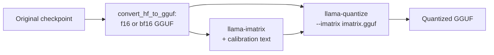

# Lesson 24. GGUF Quant Types

**Mission link:** GGUF is the other checkpoint you will be handed, and its type names are a compressed description of a quantization scheme, so reading one correctly is how you check what a "Q4" file really is.
**Primary source:** [Docs: "GGUF", Hugging Face Hub](https://huggingface.co/docs/hub/gguf)
**Prerequisites:** [Lesson 23](0023-quantized-checkpoints.md), [GGUF](../GLOSSARY.md), [Importance matrix](../GLOSSARY.md), [Block-scaled format](../GLOSSARY.md), [Effective bits per weight](../GLOSSARY.md)

## Warm-up

1. ▢ What does group size trade against each other?

<details markdown="1"><summary>Check</summary>

Smaller groups track the weights' local range better and so lose less accuracy, but each group stores its own scale, which raises the effective bits per weight (lesson 6).

</details>

2. ▢ What does round-to-nearest use to choose each quantized value, and what does it not use?

<details markdown="1"><summary>Check</summary>

It uses only the weight itself and the scale of its group. It uses no data and does no error compensation (lesson 9).

</details>

3. ▢ In a 4-bit GPTQ safetensors layer, which tensor holds the per-group scale, and in what dtype?

<details markdown="1"><summary>Check</summary>

`scales`, stored as F16 with one row per group of input channels (lesson 23).

</details>

## Know this

A GGUF file bundles the tensors with the model's metadata, and many of its tensors use llama.cpp's own block types. This lesson is about reading the names of those types. For the file as a runtime format, including why it can be memory-mapped, see the inference track's [llama.cpp sheet](../../inference/reference/llama-cpp.md).

### Legacy types: Q4_0, Q8_0 and friends

The Hub's [type table](https://huggingface.co/docs/hub/gguf) lists the legacy types under their own heading. Each is round-to-nearest quantization with blocks of 32 weights: `Q4_0` is 4-bit, `Q5_0` is 5-bit, `Q8_0` is 8-bit, with weights recovered as `w = q * block_scale`. The `_1` types add a block minimum, `w = q * block_scale + block_minimum`. The k-quants pull request calls these "type-0" and "type-1". The table notes the legacy methods are "not used widely as of today".

The cost of the block scale is the lesson 6 arithmetic, read from the C structs in llama.cpp's [`ggml-common.h`](https://github.com/ggml-org/llama.cpp/blob/master/ggml/src/ggml-common.h): a `Q4_0` block is a 2-byte scale plus 32 four-bit values, 18 bytes per 32 weights, so 4.5 bits per weight. `Q8_0` is a 2-byte scale plus 32 bytes, 8.5 bits per weight.

### k-quants: super-blocks

The k-quants ([pull request #1684](https://github.com/ggml-org/llama.cpp/pull/1684)) add a second level. A super-block holds 256 weights, divided into sub-blocks that each have their own scale, and those scales are themselves quantized to save space. In `Q4_K`, a super-block has 8 sub-blocks of 32 weights, with the sub-block scale and minimum each stored in 6 bits, and a pair of 16-bit values scaling them. The Hub table gives `w = q * block_scale(6-bit) + block_min(6-bit)` and 4.5 bits per weight. The same table gives `Q5_K` at 5.5 and `Q6_K` at 6.5625, which uses 16 sub-blocks of 16 weights with 8-bit scales. `Q4_K` costs the same 4.5 bits as `Q4_0` but spends them differently, and llama.cpp's own measurements show the difference: for Llama 3 8B the README scoreboard gives `q5_K_S` and `q5_0` the same 5.21 GiB, with KL divergence 0.0166 against 0.0222 ([perplexity README](https://github.com/ggml-org/llama.cpp/blob/master/tools/perplexity/README.md)).

### The suffixes: mixtures across tensors

`S`, `M` and `L` mean small, medium and large, and they describe a recipe, not another block format. When the pull request introduced them, `Q4_K_S` used `Q4_K` for all tensors, while `Q4_K_M` used `Q6_K` for half of the `attention.wv` and `feed_forward.w2` tensors and `Q4_K` for the rest. `Q3_K_L` used `Q5_K` for `attention.wv`, `attention.wo` and `feed_forward.w2`, and `Q3_K` elsewhere. Every variant then also used 6-bit quantization for `output.weight`. So the mixture is across tensors: each tensor has one type, and the recipe says which tensors get the better one. Recipes have been retuned since (the quantize README links later tuning pull requests), so treat those lists as the idea, and read your own file's tensor types with the Hub's [GGUF viewer](https://huggingface.co/docs/hub/gguf), which shows each tensor's name, shape and precision. The `--pure` option of `llama-quantize` turns the mixtures off and uses one type for every tensor.

That makes a file's effective bits per weight differ from its main type's. For Llama 3.1 8B the [quantize README](https://github.com/ggml-org/llama.cpp/blob/master/tools/quantize/README.md) measures these whole-file figures:

| Name | Per-type bits (Hub table) | Whole-file bits per weight | File size, GiB |
|---|---|---|---|
| Q8_0 | 8.5 (from the struct) | 8.5008 | 7.95 |
| Q6_K | 6.5625 | 6.5633 | 6.14 |
| Q5_K_S, Q5_K_M | 5.5 | 5.5704, 5.7036 | 5.21, 5.33 |
| Q4_K_S, Q4_K_M | 4.5 | 4.6672, 4.8944 | 4.36, 4.58 |
| IQ4_XS | 4.25 | 4.4597 | 4.17 |
| IQ1_S | 1.56 | 2.0042 | 1.87 |
| F16 | 16 | 16.0005 | 14.96 |

### i-quants

The `IQ` types, such as `IQ4_XS`, `IQ3_S`, `IQ2_XXS` and `IQ1_S`, aim at the lowest bit widths. The Hub table lists nominal costs from 4.25 down to 1.56 bits per weight and describes their weights as obtained from a super-block scale and an importance matrix. The scoreboard shows what the low end costs: for Llama 3 8B, `iq1_S` has perplexity 60.69 and KL divergence 2.25, against 6.23 and 0.0006 for f16. Choosing among these is lesson 25's job.

### The importance matrix

The **importance matrix**, or imatrix, tells the quantizer which weights matter most. The pull request that added it ([#4861](https://github.com/ggml-org/llama.cpp/pull/4861)) derives it from a simple argument. The quantity to keep small is the error in a layer's output, `(sum_j (q_j - w_j) * a_j)^2` for weights `w_j`, quantized values `q_j` and activations `a_j`. Averaged over calibration text and with cross terms ignored, that reduces to weighting each input column's squared error by its mean squared activation, `<a_j^2>`. The tool stores one such number per input column, and quantization then minimizes a weighted error. `llama-imatrix` computes it from a text file, and `llama-quantize` takes it with `--imatrix`:



The [imatrix README](https://github.com/ggml-org/llama.cpp/blob/master/tools/imatrix/README.md) says the data is not collected for `output.weight` and `token_embd.weight` by default, because the README says it is typically better not to use it on those tensors. It changes how the same number of bits is spent, not how many: the scoreboard has `q4_K_M` at 4.58 GiB both without and with an imatrix. What it buys is smaller error at the same size. For Llama 3 8B at `q4_K_M`, perplexity falls from 6.407 to 6.383 and KL divergence from 0.0313 to 0.0282 with an imatrix the README labels "WT 10m", built from WikiText tokens. The same README says there is no consistent gain from using more tokens.

An imatrix is a calibration set (lesson 12), so lesson 12's cautions apply. Here the imatrix text and the evaluation text both come from WikiText, which probably flatters the gain, and an imatrix made from text unlike your deployment may weight the wrong columns.

## Practice

1. ▢ Sort these into legacy, k-quant and i-quant: `Q8_0`, `Q5_K_S`, `IQ4_XS`, `Q4_1`, `Q6_K`, `IQ2_S`.

<details markdown="1"><summary>Check</summary>

Legacy: `Q8_0` and `Q4_1`, which the Hub table lists under its legacy heading. k-quants: `Q5_K_S` and `Q6_K`, named with `K`. i-quants: `IQ4_XS` and `IQ2_S`, named with `IQ`. The suffix `S` in `Q5_K_S` is a recipe suffix and `XS` in `IQ4_XS` is part of the type's own name.

</details>

2. ▢ What does the `M` in `Q4_K_M` mean?

    - a) Medium mixture: some tensors get a higher-precision type than others
    - b) Mixed precision applied inside every single tensor's own weight blocks
    - c) Metal only: the file runs solely on one vendor's hardware
    - d) Minimum bits: every weight is stored in exactly four bits

<details markdown="1"><summary>Check</summary>

**a)** The suffix selects a medium recipe, which spends extra bits on selected tensors such as half of `attention.wv` and `feed_forward.w2` when introduced. (b) is wrong because each tensor has one type, and the mixing is across tensors. (c) invents a hardware restriction that no suffix carries. (d) is wrong because the file's whole-file figure is 4.8944 bits per weight for Llama 3.1 8B.

</details>

3. ▢ Predict, then run. Using the block layouts in `ggml-common.h`, predict the bits per weight of `Q4_0`, `Q8_0`, `Q4_K` and `Q6_K`, then run it.

    ```python
    # bytes per block, from the C struct layouts in ggml-common.h (half = 2 bytes)
    layouts = {
        "Q4_0": (32, 2 + 32 // 2),
        "Q8_0": (32, 2 + 32),
        "Q4_K": (256, 2 * 2 + 12 + 256 // 2),
        "Q6_K": (256, 256 // 2 + 256 // 4 + 256 // 16 + 2),
    }
    for name, (weights, nbytes) in layouts.items():
        print(f"{name}: {nbytes} bytes per {weights} weights = {nbytes * 8 / weights} bits per weight")
    ```

<details markdown="1"><summary>Hint</summary>

Each number is bytes per block times 8, divided by weights per block. For `Q4_K`, 12 bytes hold the sub-block scales and minimums, and the two 2-byte values are the super-block scales.

</details>

<details markdown="1"><summary>Check</summary>

It prints `Q4_0: 18 bytes per 32 weights = 4.5`, `Q8_0: 34 bytes per 32 weights = 8.5`, `Q4_K: 144 bytes per 256 weights = 4.5` and `Q6_K: 210 bytes per 256 weights = 6.5625` bits per weight. They match the Hub table's `Q4_K` and `Q6_K`, and `Q4_0` and `Q4_K` cost the same.

</details>

4. ▢ The quantize README lists Llama 3.1 8B at F16 as 14.96 GiB and 16.0005 bits per weight. Estimate the `Q4_K_M` file size at 4.8944 bits per weight, and the `Q4_K_S` size at 4.6672.

<details markdown="1"><summary>Check</summary>

Size scales with bits per weight: 14.96 x 4.8944 / 16.0005 is about 4.58 GiB for `Q4_K_M`, and 14.96 x 4.6672 / 16.0005 is about 4.36 GiB for `Q4_K_S`. Both match the README's figures. Always size a GGUF file from its whole-file figure, not from the 4 in its name.

</details>

5. ▢ `Q4_K` costs 4.5 bits per weight, yet `Q4_K_M` measures 4.8944 for the same model. Where do the extra bits come from?

<details markdown="1"><summary>Check</summary>

From tensors that the recipe stores in a higher-precision type than `Q4_K`. The `M` recipe puts `Q6_K` on part of `attention.wv` and `feed_forward.w2`, and, as the pull request describes, `output.weight` is stored in 6 bits for every variant. The extra bits go to the tensors judged most sensitive.

</details>

6. ▢ Predict, then run. A block of 32 weights is rounded to 4 bits with one scale. Two input columns carry activations 10 times larger than the rest. Predict whether choosing the scale by importance-weighted error lowers the average output error compared with choosing it by plain error, then run it. This illustrates the principle in the imatrix pull request, not llama.cpp's actual code.

    ```python
    import numpy as np

    rng = np.random.default_rng(0)
    block, n_blocks = 32, 2000
    scales_grid = np.linspace(0.6, 1.2, 61)  # candidate scales, relative to max|w| / 7

    # Calibration activations: two input columns carry much larger values than the rest.
    col_gain = np.ones(block)
    col_gain[[3, 17]] = 10.0
    calib = rng.normal(size=(512, block)) * col_gain
    test = rng.normal(size=(512, block)) * col_gain
    importance = (calib ** 2).mean(axis=0)  # mean squared activation per input column


    def quantize(w, scale):
        return np.clip(np.round(w / scale), -8, 7) * scale


    def best_scale(w, weights):
        base = np.abs(w).max() / 7
        errs = [np.sum(weights * (w - quantize(w, base * s)) ** 2) for s in scales_grid]
        return base * scales_grid[int(np.argmin(errs))]


    plain, weighted = [], []
    for _ in range(n_blocks):
        w = rng.normal(size=block)
        for scale, out in ((best_scale(w, np.ones(block)), plain), (best_scale(w, importance), weighted)):
            err = test @ (w - quantize(w, scale))
            out.append(np.sqrt(np.mean(err ** 2)))

    print("mean output error, plain scale search:      ", round(float(np.mean(plain)), 3))
    print("mean output error, importance-weighted scale:", round(float(np.mean(weighted)), 3))
    print("blocks where weighting helped:", int(np.sum(np.array(weighted) < np.array(plain))), "of", n_blocks)
    ```

<details markdown="1"><summary>Hint</summary>

The error that matters is the error in the layer's output, so a rounding error on a column that meets large activations counts for more.

</details>

<details markdown="1"><summary>Check</summary>

Weighting helps: the mean output error is 1.202 with the plain scale search and 0.794 with the importance-weighted one, and the weighted scale wins in 1881 of 2000 blocks. The weighted search accepts more error on the ordinary columns to keep the two heavily used columns accurate, and the output cares more about those two. The file size is identical either way, since only the choice of scale changed.

</details>

7. ▢ You build an imatrix from English encyclopedia text, quantize a model that will mostly write code, and report a perplexity gain measured on that same encyclopedia text. What should a reviewer ask?

<details markdown="1"><summary>Check</summary>

Whether the evaluation resembles the deployment. The imatrix is a calibration set: it weights columns by the activations the encyclopedia text produces, and code may activate others. A gain measured on the calibration text's own domain is the best case, so the reviewer should ask for an eval on code tasks (lesson 22) and for the calibration text to match them.

</details>

## Real-world reps

- [ ] Open a GGUF model on the Hugging Face Hub, pick a `Q4_K_M` file, open its tensor viewer, and list which tensors are not `Q4_K`. Compare with the recipe above.
- [ ] If you have llama.cpp, quantize one small bf16 or f16 GGUF to `Q4_K_S` and `Q4_K_M` with `llama-quantize` and check that the file-size ratio matches the bits-per-weight ratio in the table.
- [ ] Tomorrow: without notes, say what each part of `Q4_K_M` means, and what an importance matrix changes and what it leaves unchanged.

## Going further

- [Measuring and Storing](../reference/measuring-and-storing.md)
- [Docs: "GGUF", Hugging Face Hub](https://huggingface.co/docs/hub/gguf)
- [Docs: llama.cpp quantize tool README, ggml-org](https://github.com/ggml-org/llama.cpp/blob/master/tools/quantize/README.md)
- [Docs: llama.cpp imatrix tool README, ggml-org](https://github.com/ggml-org/llama.cpp/blob/master/tools/imatrix/README.md)
- [Inference: llama.cpp](../../inference/reference/llama-cpp.md), for GGUF as a runtime format
- [Resources](../RESOURCES.md)

---

Not landing? Reread the primary source at the top, since this lesson compresses it and compression is where understanding leaks. Check the [glossary](../GLOSSARY.md) for any term that felt slippery.

If the lesson itself is unclear rather than the material, that is a defect: [open an issue](https://github.com/TokenCemetery/teach/issues).
