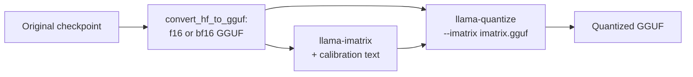

# Lição 24. Tipos de quant do GGUF

**Ligação com a missão:** O GGUF é o outro checkpoint que vão entregar a você, e os nomes dos seus tipos são uma descrição comprimida de um esquema de quantização, então lê-los corretamente é como você confere o que um arquivo "Q4" realmente é.
**Fonte principal:** [Docs: "GGUF", Hugging Face Hub](https://huggingface.co/docs/hub/gguf)
**Pré-requisitos:** [Lição 23](0023-quantized-checkpoints.md), [GGUF](../GLOSSARY.md), [Matriz de importância](../GLOSSARY.md), [Formato com escala por bloco](../GLOSSARY.md), [Bits efetivos por peso](../GLOSSARY.md)

## Aquecimento

1. ▢ O que o tamanho do grupo troca entre si?

<details markdown="1"><summary>Verificação</summary>

Grupos menores acompanham melhor a faixa local dos pesos e, portanto, perdem menos acurácia, mas cada grupo armazena a sua própria scale, o que aumenta os bits efetivos por peso (lição 6).

</details>

2. ▢ O que o round-to-nearest usa para escolher cada valor quantizado, e o que ele não usa?

<details markdown="1"><summary>Verificação</summary>

Ele usa apenas o próprio peso e a scale do seu grupo. Ele não usa dados e não faz compensação de erro (lição 9).

</details>

3. ▢ Em uma camada GPTQ de 4 bits em safetensors, qual tensor guarda a scale por grupo, e em qual dtype?

<details markdown="1"><summary>Verificação</summary>

`scales`, armazenado como F16 com uma linha por grupo de canais de entrada (lição 23).

</details>

## Saiba isto

Um arquivo GGUF reúne os tensores com os metadados do modelo, e muitos dos seus tensores usam os tipos de bloco próprios do llama.cpp. Esta lição trata de ler os nomes desses tipos. Para o arquivo como formato de runtime, incluindo por que ele pode ser mapeado em memória, veja a [folha do llama.cpp](../../inference/reference/llama-cpp.md) da trilha de inference.

### Tipos legados: Q4_0, Q8_0 e companhia

A [tabela de tipos](https://huggingface.co/docs/hub/gguf) do Hub lista os tipos legados sob o seu próprio título. Cada um é quantização round-to-nearest com blocos de 32 pesos: `Q4_0` é de 4 bits, `Q5_0` é de 5 bits, `Q8_0` é de 8 bits, com os pesos recuperados como `w = q * block_scale`. Os tipos `_1` acrescentam um mínimo de bloco, `w = q * block_scale + block_minimum`. O pull request das k-quants chama esses de "type-0" e "type-1". A tabela observa que os métodos legados "não são muito usados hoje em dia".

O custo da scale do bloco é a aritmética da lição 6, lida das structs em C do [`ggml-common.h`](https://github.com/ggml-org/llama.cpp/blob/master/ggml/src/ggml-common.h) do llama.cpp: um bloco `Q4_0` é uma scale de 2 bytes mais 32 valores de quatro bits, 18 bytes por 32 pesos, então 4.5 bits por peso. O `Q8_0` é uma scale de 2 bytes mais 32 bytes, 8.5 bits por peso.

### k-quants: super-blocks

As k-quants ([pull request #1684](https://github.com/ggml-org/llama.cpp/pull/1684)) acrescentam um segundo nível. Um super-block guarda 256 pesos, divididos em sub-blocos que têm cada um a sua própria scale, e essas scales são elas mesmas quantizadas para economizar espaço. No `Q4_K`, um super-block tem 8 sub-blocos de 32 pesos, com a scale e o mínimo de cada sub-bloco armazenados em 6 bits, e um par de valores de 16 bits que os escalam. A tabela do Hub dá `w = q * block_scale(6-bit) + block_min(6-bit)` e 4.5 bits por peso. A mesma tabela dá o `Q5_K` a 5.5 e o `Q6_K` a 6.5625, que usa 16 sub-blocos de 16 pesos com scales de 8 bits. O `Q4_K` custa os mesmos 4.5 bits que o `Q4_0`, mas os gasta de forma diferente, e as próprias medições do llama.cpp mostram a diferença: para o Llama 3 8B, o placar do README dá ao `q5_K_S` e ao `q5_0` os mesmos 5.21 GiB, com divergência KL de 0.0166 contra 0.0222 ([README de perplexity](https://github.com/ggml-org/llama.cpp/blob/master/tools/perplexity/README.md)).

### Os sufixos: misturas entre tensores

`S`, `M` e `L` significam small, medium e large, e descrevem uma receita, não outro formato de bloco. Quando o pull request os introduziu, o `Q4_K_S` usava `Q4_K` para todos os tensores, enquanto o `Q4_K_M` usava `Q6_K` para metade dos tensores `attention.wv` e `feed_forward.w2` e `Q4_K` para o resto. O `Q3_K_L` usava `Q5_K` para `attention.wv`, `attention.wo` e `feed_forward.w2`, e `Q3_K` no resto. Toda variante então também usava quantização de 6 bits para o `output.weight`. Então a mistura é entre tensores: cada tensor tem um tipo, e a receita diz quais tensores recebem o melhor. As receitas foram reajustadas desde então (o README do quantize aponta para pull requests de ajuste posteriores), então trate essas listas como a ideia, e leia os tipos de tensor do seu próprio arquivo com o [visualizador de GGUF](https://huggingface.co/docs/hub/gguf) do Hub, que mostra o nome, o shape e a precisão de cada tensor. A opção `--pure` do `llama-quantize` desliga as misturas e usa um único tipo para todo tensor.

Isso faz os bits efetivos por peso de um arquivo diferirem dos do seu tipo principal. Para o Llama 3.1 8B, o [README do quantize](https://github.com/ggml-org/llama.cpp/blob/master/tools/quantize/README.md) mede estes números do arquivo inteiro:

| Nome | Bits por tipo (tabela do Hub) | Bits por peso do arquivo inteiro | Tamanho do arquivo, GiB |
|---|---|---|---|
| Q8_0 | 8.5 (da struct) | 8.5008 | 7.95 |
| Q6_K | 6.5625 | 6.5633 | 6.14 |
| Q5_K_S, Q5_K_M | 5.5 | 5.5704, 5.7036 | 5.21, 5.33 |
| Q4_K_S, Q4_K_M | 4.5 | 4.6672, 4.8944 | 4.36, 4.58 |
| IQ4_XS | 4.25 | 4.4597 | 4.17 |
| IQ1_S | 1.56 | 2.0042 | 1.87 |
| F16 | 16 | 16.0005 | 14.96 |

### i-quants

Os tipos `IQ`, como `IQ4_XS`, `IQ3_S`, `IQ2_XXS` e `IQ1_S`, almejam as menores larguras em bits. A tabela do Hub lista custos nominais de 4.25 até 1.56 bits por peso e descreve os pesos deles como obtidos a partir de uma scale de super-block e de uma matriz de importância. O placar mostra o que o extremo inferior custa: para o Llama 3 8B, o `iq1_S` tem perplexity 60.69 e divergência KL 2.25, contra 6.23 e 0.0006 do f16. Escolher entre esses é trabalho da lição 25.

### A matriz de importância

A **matriz de importância**, ou imatrix, diz ao quantizador quais pesos mais importam. O pull request que a acrescentou ([#4861](https://github.com/ggml-org/llama.cpp/pull/4861)) a deriva de um argumento simples. A grandeza a manter pequena é o erro na saída de uma camada, `(sum_j (q_j - w_j) * a_j)^2` para pesos `w_j`, valores quantizados `q_j` e ativações `a_j`. Promediado sobre o texto de calibração e ignorando os termos cruzados, isso se reduz a ponderar o erro quadrático de cada coluna de entrada pela sua ativação quadrática média, `<a_j^2>`. A ferramenta armazena um desses números por coluna de entrada, e a quantização então minimiza um erro ponderado. O `llama-imatrix` a calcula a partir de um arquivo de texto, e o `llama-quantize` a recebe com `--imatrix`:



O [README do imatrix](https://github.com/ggml-org/llama.cpp/blob/master/tools/imatrix/README.md) diz que os dados não são coletados para `output.weight` e `token_embd.weight` por padrão, porque o README diz que tipicamente é melhor não usá-los nesses tensores. Ela muda como o mesmo número de bits é gasto, não quantos: o placar tem o `q4_K_M` em 4.58 GiB tanto sem quanto com uma imatrix. O que ela compra é menos erro no mesmo tamanho. Para o Llama 3 8B em `q4_K_M`, a perplexity cai de 6.407 para 6.383 e a divergência KL de 0.0313 para 0.0282 com uma imatrix que o README rotula de "WT 10m", construída a partir de tokens do WikiText. O mesmo README diz que não há ganho consistente em usar mais tokens.

Uma imatrix é um calibration set (lição 12), então as cautelas da lição 12 se aplicam. Aqui o texto da imatrix e o texto de avaliação vêm ambos do WikiText, o que provavelmente favorece o ganho, e uma imatrix feita de texto diferente do seu deployment pode ponderar as colunas erradas.

## Prática

1. ▢ Classifique estes em legado, k-quant e i-quant: `Q8_0`, `Q5_K_S`, `IQ4_XS`, `Q4_1`, `Q6_K`, `IQ2_S`.

<details markdown="1"><summary>Verificação</summary>

Legado: `Q8_0` e `Q4_1`, que a tabela do Hub lista sob o seu título de legados. k-quants: `Q5_K_S` e `Q6_K`, nomeados com `K`. i-quants: `IQ4_XS` e `IQ2_S`, nomeados com `IQ`. O sufixo `S` em `Q5_K_S` é um sufixo de receita e o `XS` em `IQ4_XS` faz parte do próprio nome do tipo.

</details>

2. ▢ O que significa o `M` em `Q4_K_M`?

    - a) Mistura média: alguns tensores recebem um tipo de precisão maior que outros
    - b) Precisão mista aplicada dentro dos blocos de pesos de cada tensor
    - c) Somente Metal: o arquivo roda apenas no hardware de um fornecedor
    - d) Bits mínimos: todo peso é armazenado em exatamente quatro bits

<details markdown="1"><summary>Verificação</summary>

**a)** O sufixo seleciona uma receita média, que gasta bits extras em tensores selecionados, como metade de `attention.wv` e de `feed_forward.w2` quando introduzida. (b) está errada porque cada tensor tem um tipo, e a mistura é entre tensores. (c) inventa uma restrição de hardware que nenhum sufixo carrega. (d) está errada porque o número do arquivo inteiro é 4.8944 bits por peso para o Llama 3.1 8B.

</details>

3. ▢ Preveja e depois execute. Usando os layouts de bloco do `ggml-common.h`, preveja os bits por peso de `Q4_0`, `Q8_0`, `Q4_K` e `Q6_K` e depois execute.

    ```python
    # bytes per block, from the C struct layouts in ggml-common.h (half = 2 bytes)
    layouts = {
        "Q4_0": (32, 2 + 32 // 2),
        "Q8_0": (32, 2 + 32),
        "Q4_K": (256, 2 * 2 + 12 + 256 // 2),
        "Q6_K": (256, 256 // 2 + 256 // 4 + 256 // 16 + 2),
    }
    for name, (weights, nbytes) in layouts.items():
        print(f"{name}: {nbytes} bytes per {weights} weights = {nbytes * 8 / weights} bits per weight")
    ```

<details markdown="1"><summary>Dica</summary>

Cada número é bytes por bloco vezes 8, dividido por pesos por bloco. Para o `Q4_K`, 12 bytes guardam as scales e os mínimos dos sub-blocos, e os dois valores de 2 bytes são as scales do super-block.

</details>

<details markdown="1"><summary>Verificação</summary>

Ele imprime `Q4_0: 18 bytes per 32 weights = 4.5`, `Q8_0: 34 bytes per 32 weights = 8.5`, `Q4_K: 144 bytes per 256 weights = 4.5` e `Q6_K: 210 bytes per 256 weights = 6.5625` bits por peso. Eles coincidem com o `Q4_K` e o `Q6_K` da tabela do Hub, e o `Q4_0` e o `Q4_K` custam o mesmo.

</details>

4. ▢ O README do quantize lista o Llama 3.1 8B em F16 como 14.96 GiB e 16.0005 bits por peso. Estime o tamanho de arquivo do `Q4_K_M` a 4.8944 bits por peso e o do `Q4_K_S` a 4.6672.

<details markdown="1"><summary>Verificação</summary>

O tamanho escala com os bits por peso: 14.96 x 4.8944 / 16.0005 dá cerca de 4.58 GiB para o `Q4_K_M`, e 14.96 x 4.6672 / 16.0005 dá cerca de 4.36 GiB para o `Q4_K_S`. Ambos coincidem com os números do README. Sempre dimensione um arquivo GGUF a partir do seu número de arquivo inteiro, não do 4 no seu nome.

</details>

5. ▢ O `Q4_K` custa 4.5 bits por peso, e no entanto o `Q4_K_M` mede 4.8944 para o mesmo modelo. De onde vêm os bits extras?

<details markdown="1"><summary>Verificação</summary>

De tensores que a receita armazena em um tipo de precisão maior que o `Q4_K`. A receita `M` coloca `Q6_K` em parte de `attention.wv` e de `feed_forward.w2` e, como o pull request descreve, o `output.weight` é armazenado em 6 bits em toda variante. Os bits extras vão para os tensores julgados mais sensíveis.

</details>

6. ▢ Preveja e depois execute. Um bloco de 32 pesos é arredondado para 4 bits com uma scale. Duas colunas de entrada carregam ativações 10 vezes maiores que o resto. Preveja se escolher a scale pelo erro ponderado por importância reduz o erro médio de saída em comparação com escolhê-la pelo erro simples, depois execute. Isto ilustra o princípio do pull request da imatrix, não o código real do llama.cpp.

    ```python
    import numpy as np

    rng = np.random.default_rng(0)
    block, n_blocks = 32, 2000
    scales_grid = np.linspace(0.6, 1.2, 61)  # candidate scales, relative to max|w| / 7

    # Calibration activations: two input columns carry much larger values than the rest.
    col_gain = np.ones(block)
    col_gain[[3, 17]] = 10.0
    calib = rng.normal(size=(512, block)) * col_gain
    test = rng.normal(size=(512, block)) * col_gain
    importance = (calib ** 2).mean(axis=0)  # mean squared activation per input column


    def quantize(w, scale):
        return np.clip(np.round(w / scale), -8, 7) * scale


    def best_scale(w, weights):
        base = np.abs(w).max() / 7
        errs = [np.sum(weights * (w - quantize(w, base * s)) ** 2) for s in scales_grid]
        return base * scales_grid[int(np.argmin(errs))]


    plain, weighted = [], []
    for _ in range(n_blocks):
        w = rng.normal(size=block)
        for scale, out in ((best_scale(w, np.ones(block)), plain), (best_scale(w, importance), weighted)):
            err = test @ (w - quantize(w, scale))
            out.append(np.sqrt(np.mean(err ** 2)))

    print("mean output error, plain scale search:      ", round(float(np.mean(plain)), 3))
    print("mean output error, importance-weighted scale:", round(float(np.mean(weighted)), 3))
    print("blocks where weighting helped:", int(np.sum(np.array(weighted) < np.array(plain))), "of", n_blocks)
    ```

<details markdown="1"><summary>Dica</summary>

O erro que importa é o erro na saída da camada, então um erro de arredondamento em uma coluna que encontra ativações grandes conta mais.

</details>

<details markdown="1"><summary>Verificação</summary>

A ponderação ajuda: o erro médio de saída é 1.202 com a busca de scale simples e 0.794 com a ponderada por importância, e a scale ponderada vence em 1881 de 2000 blocos. A busca ponderada aceita mais erro nas colunas comuns para manter acuradas as duas colunas muito usadas, e a saída se importa mais com essas duas. O tamanho do arquivo é idêntico nos dois casos, já que só a escolha da scale mudou.

</details>

7. ▢ Você constrói uma imatrix a partir de texto de enciclopédia em inglês, quantiza um modelo que vai escrever principalmente código e reporta um ganho de perplexity medido nesse mesmo texto de enciclopédia. O que um revisor deveria perguntar?

<details markdown="1"><summary>Verificação</summary>

Se a avaliação se parece com o deployment. A imatrix é um calibration set: ela pondera as colunas pelas ativações que o texto de enciclopédia produz, e o código pode ativar outras. Um ganho medido no domínio do próprio texto de calibração é o melhor caso, então o revisor deveria pedir um eval em tarefas de código (lição 22) e que o texto de calibração case com elas.

</details>

## Prática no mundo real

- [ ] Abra um modelo GGUF no Hugging Face Hub, escolha um arquivo `Q4_K_M`, abra o seu visualizador de tensores e liste quais tensores não são `Q4_K`. Compare com a receita acima.
- [ ] Se você tem o llama.cpp, quantize um GGUF pequeno em bf16 ou f16 para `Q4_K_S` e `Q4_K_M` com `llama-quantize` e confira que a razão dos tamanhos de arquivo coincide com a razão de bits por peso da tabela.
- [ ] Amanhã: sem consultar anotações, diga o que cada parte de `Q4_K_M` significa e o que uma matriz de importância muda e o que ela deixa inalterado.

## Para ir além

- [Medindo e Armazenando](../reference/measuring-and-storing.md)
- [Docs: "GGUF", Hugging Face Hub](https://huggingface.co/docs/hub/gguf)
- [Docs: llama.cpp quantize tool README, ggml-org](https://github.com/ggml-org/llama.cpp/blob/master/tools/quantize/README.md)
- [Docs: llama.cpp imatrix tool README, ggml-org](https://github.com/ggml-org/llama.cpp/blob/master/tools/imatrix/README.md)
- [Inferência: llama.cpp](../../inference/reference/llama-cpp.md), para o GGUF como formato de runtime
- [Recursos](../RESOURCES.md)

---

Não ficou claro? Releia a fonte principal no topo, já que esta lição a comprime e é na compressão que o entendimento escapa. Consulte o [glossário](../GLOSSARY.md) para qualquer termo que pareceu escorregadio.

Se o problema é a lição em si, e não o material, isso é um defeito: [abra uma issue](https://github.com/TokenCemetery/teach/issues).
