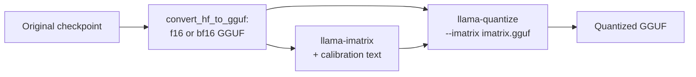

# Урок 24. Типы квантизации GGUF

**Связь с целью курса:** GGUF это другой чекпоинт, который вам вручат, а имена его типов это сжатое описание схемы квантизации, поэтому правильное чтение имени и есть способ проверить, чем на самом деле является файл «Q4».
**Первоисточник:** [Документация: "GGUF", Hugging Face Hub](https://huggingface.co/docs/hub/gguf)
**Предварительные требования:** [Урок 23](0023-quantized-checkpoints.md), [GGUF](../GLOSSARY.md), [Матрица важности](../GLOSSARY.md), [Блочно-масштабируемый формат](../GLOSSARY.md), [Эффективное число бит на вес](../GLOSSARY.md)

## Разминка

1. ▢ Какие две величины меняет друг на друга размер группы?

<details markdown="1"><summary>Проверка</summary>

Меньшие группы лучше отслеживают локальный диапазон весов и потому теряют меньше точности, но каждая группа хранит собственный масштаб, что повышает эффективное число бит на вес (урок 6).

</details>

2. ▢ Что округление к ближайшему использует для выбора каждого квантизованного значения и чего не использует?

<details markdown="1"><summary>Проверка</summary>

Оно использует только сам вес и масштаб его группы. Данных оно не использует и компенсации ошибки не делает (урок 9).

</details>

3. ▢ В каком тензоре 4-битного слоя GPTQ в safetensors лежит масштаб на группу и в каком типе?

<details markdown="1"><summary>Проверка</summary>

В `scales`, хранится как F16, по одной строке на группу входных каналов (урок 23).

</details>

## Что нужно знать

Файл GGUF объединяет тензоры с метаданными модели, и многие его тензоры используют собственные блочные типы llama.cpp. Этот урок о чтении имён этих типов. О файле как формате времени выполнения, в том числе о том, почему его можно отображать в память, см. лист [llama.cpp](../../inference/reference/llama-cpp.md) курса по инференсу.

### Старые типы: Q4_0, Q8_0 и родственные

[Таблица типов](https://huggingface.co/docs/hub/gguf) на Hub перечисляет старые типы под отдельным заголовком. Каждый из них это квантизация округлением к ближайшему блоками по 32 веса: `Q4_0` 4-битный, `Q5_0` 5-битный, `Q8_0` 8-битный, а веса восстанавливаются как `w = q * block_scale`. Типы `_1` добавляют минимум блока, `w = q * block_scale + block_minimum`. Pull request с k-квантами называет их «type-0» и «type-1». Таблица отмечает, что старые методы «в настоящее время широко не используются».

Цена масштаба блока это арифметика урока 6, прочитанная из структур на C в [`ggml-common.h`](https://github.com/ggml-org/llama.cpp/blob/master/ggml/src/ggml-common.h) llama.cpp: блок `Q4_0` это 2-байтовый масштаб плюс 32 четырёхбитных значения, 18 байт на 32 веса, то есть 4,5 бита на вес. `Q8_0` это 2-байтовый масштаб плюс 32 байта, 8,5 бита на вес.

### k-кванты: супер-блоки

k-кванты ([pull request #1684](https://github.com/ggml-org/llama.cpp/pull/1684)) добавляют второй уровень. Супер-блок содержит 256 весов, разделённых на подблоки, у каждого из которых свой масштаб, а сами эти масштабы квантизуются, чтобы сэкономить место. В `Q4_K` у супер-блока 8 подблоков по 32 веса, масштаб и минимум подблока хранятся по 6 бит, а пара 16-битных значений масштабирует их. Таблица Hub даёт `w = q * block_scale(6-bit) + block_min(6-bit)` и 4,5 бита на вес. Та же таблица даёт `Q5_K` с 5,5 и `Q6_K` с 6,5625, который использует 16 подблоков по 16 весов с 8-битными масштабами. `Q4_K` стоит те же 4,5 бита, что и `Q4_0`, но тратит их иначе, и собственные измерения llama.cpp показывают разницу: для Llama 3 8B таблица результатов в README даёт `q5_K_S` и `q5_0` одинаковые 5,21 ГиБ, с KL-дивергенцией 0,0166 против 0,0222 ([README инструмента perplexity](https://github.com/ggml-org/llama.cpp/blob/master/tools/perplexity/README.md)).

### Суффиксы: смеси по тензорам

`S`, `M` и `L` означают small, medium и large, и описывают рецепт, а не ещё один блочный формат. Когда pull request их вводил, `Q4_K_S` использовал `Q4_K` для всех тензоров, а `Q4_K_M` использовал `Q6_K` для половины тензоров `attention.wv` и `feed_forward.w2` и `Q4_K` для остальных. `Q3_K_L` использовал `Q5_K` для `attention.wv`, `attention.wo` и `feed_forward.w2` и `Q3_K` в остальных местах. Каждый вариант затем также использовал 6-битную квантизацию для `output.weight`. Так что смесь идёт по тензорам: у каждого тензора один тип, а рецепт говорит, какие тензоры получают лучший. С тех пор рецепты перенастраивали (README по quantize ссылается на более поздние pull request с настройкой), поэтому считайте эти списки идеей, а типы тензоров своего файла читайте в [просмотрщике GGUF](https://huggingface.co/docs/hub/gguf) на Hub, который показывает имя, форму и точность каждого тензора. Опция `--pure` в `llama-quantize` выключает смеси и использует один тип для каждого тензора.

Поэтому эффективное число бит на вес у файла отличается от такового у его основного типа. Для Llama 3.1 8B [README по quantize](https://github.com/ggml-org/llama.cpp/blob/master/tools/quantize/README.md) измеряет эти числа для файла целиком:

| Имя | Бит на тип (таблица Hub) | Бит на вес по файлу целиком | Размер файла, ГиБ |
|---|---|---|---|
| Q8_0 | 8,5 (из структуры) | 8,5008 | 7,95 |
| Q6_K | 6,5625 | 6,5633 | 6,14 |
| Q5_K_S, Q5_K_M | 5,5 | 5,5704, 5,7036 | 5,21, 5,33 |
| Q4_K_S, Q4_K_M | 4,5 | 4,6672, 4,8944 | 4,36, 4,58 |
| IQ4_XS | 4,25 | 4,4597 | 4,17 |
| IQ1_S | 1,56 | 2,0042 | 1,87 |
| F16 | 16 | 16,0005 | 14,96 |

### i-кванты

Типы `IQ`, такие как `IQ4_XS`, `IQ3_S`, `IQ2_XXS` и `IQ1_S`, нацелены на самые малые разрядности. Таблица Hub указывает номинальную цену от 4,25 до 1,56 бита на вес и описывает их веса как получаемые из масштаба супер-блока и матрицы важности. Таблица результатов показывает, чего стоит нижний край: для Llama 3 8B у `iq1_S` перплексия 60,69 и KL-дивергенция 2,25 против 6,23 и 0,0006 у f16. Выбор среди них это работа урока 25.

### Матрица важности

**Матрица важности**, или imatrix, говорит квантизатору, какие веса важнее всего. Pull request, добавивший её ([#4861](https://github.com/ggml-org/llama.cpp/pull/4861)), выводит её из простого довода. Величина, которую нужно держать малой, это ошибка выхода слоя, `(sum_j (q_j - w_j) * a_j)^2` для весов `w_j`, квантизованных значений `q_j` и активаций `a_j`. При усреднении по калибровочному тексту и пренебрежении перекрёстными членами это сводится к взвешиванию квадрата ошибки каждого входного столбца его средней квадратичной активацией, `<a_j^2>`. Инструмент хранит по одному такому числу на входной столбец, а квантизация затем минимизирует взвешенную ошибку. `llama-imatrix` вычисляет её из текстового файла, а `llama-quantize` принимает её через `--imatrix`:



[README по imatrix](https://github.com/ggml-org/llama.cpp/blob/master/tools/imatrix/README.md) говорит, что данные по умолчанию не собираются для `output.weight` и `token_embd.weight`, потому что, по словам README, на этих тензорах обычно лучше их не использовать. Она меняет то, как тратится то же число бит, а не сколько их: в таблице результатов `q4_K_M` занимает 4,58 ГиБ и без imatrix, и с ней. Покупает она меньшую ошибку при том же размере. Для Llama 3 8B при `q4_K_M` перплексия падает с 6,407 до 6,383, а KL-дивергенция с 0,0313 до 0,0282 с imatrix, которую README помечает «WT 10m», построенной из токенов WikiText. Тот же README говорит, что стабильного выигрыша от большего числа токенов нет.

Imatrix это калибровочный набор (урок 12), поэтому предостережения урока 12 применимы. Здесь и текст imatrix, и оценочный текст взяты из WikiText, что, вероятно, приукрашивает выигрыш, а imatrix, построенная из текста, непохожего на ваше развёртывание, может взвесить не те столбцы.

## Практика

1. ▢ Разнесите по старым типам, k-квантам и i-квантам: `Q8_0`, `Q5_K_S`, `IQ4_XS`, `Q4_1`, `Q6_K`, `IQ2_S`.

<details markdown="1"><summary>Проверка</summary>

Старые: `Q8_0` и `Q4_1`, которые таблица Hub указывает под своим заголовком старых типов. k-кванты: `Q5_K_S` и `Q6_K`, названные с `K`. i-кванты: `IQ4_XS` и `IQ2_S`, названные с `IQ`. Суффикс `S` в `Q5_K_S` это суффикс рецепта, а `XS` в `IQ4_XS` часть собственного имени типа.

</details>

2. ▢ Что означает `M` в `Q4_K_M`?

    - a) Средняя смесь: некоторые тензоры получают более точный тип, чем другие
    - b) Смешанная точность внутри блоков весов каждого отдельного тензора
    - c) Только Metal: файл работает лишь на оборудовании одного производителя
    - d) Минимум бит: каждый вес хранится ровно в четырёх битах

<details markdown="1"><summary>Проверка</summary>

**a)** Суффикс выбирает средний рецепт, который тратит дополнительные биты на избранные тензоры, например половину `attention.wv` и `feed_forward.w2` на момент введения. (b) неверно, потому что у каждого тензора один тип, а смешивание идёт по тензорам. (c) выдумывает аппаратное ограничение, которого не несёт ни один суффикс. (d) неверно, потому что число для файла целиком равно 4,8944 бита на вес для Llama 3.1 8B.

</details>

3. ▢ Предскажите, затем запустите. По раскладкам блоков в `ggml-common.h` предскажите число бит на вес у `Q4_0`, `Q8_0`, `Q4_K` и `Q6_K`, затем запустите.

    ```python
    # bytes per block, from the C struct layouts in ggml-common.h (half = 2 bytes)
    layouts = {
        "Q4_0": (32, 2 + 32 // 2),
        "Q8_0": (32, 2 + 32),
        "Q4_K": (256, 2 * 2 + 12 + 256 // 2),
        "Q6_K": (256, 256 // 2 + 256 // 4 + 256 // 16 + 2),
    }
    for name, (weights, nbytes) in layouts.items():
        print(f"{name}: {nbytes} bytes per {weights} weights = {nbytes * 8 / weights} bits per weight")
    ```

<details markdown="1"><summary>Подсказка</summary>

Каждое число это байты на блок, умноженные на 8, делённые на веса в блоке. Для `Q4_K` 12 байт хранят масштабы и минимумы подблоков, а два 2-байтовых значения это масштабы супер-блока.

</details>

<details markdown="1"><summary>Проверка</summary>

Он печатает `Q4_0: 18 bytes per 32 weights = 4.5`, `Q8_0: 34 bytes per 32 weights = 8.5`, `Q4_K: 144 bytes per 256 weights = 4.5` и `Q6_K: 210 bytes per 256 weights = 6.5625` бит на вес. Они совпадают с `Q4_K` и `Q6_K` из таблицы Hub, а `Q4_0` и `Q4_K` стоят одинаково.

</details>

4. ▢ README по quantize указывает Llama 3.1 8B в F16 как 14,96 ГиБ и 16,0005 бита на вес. Оцените размер файла `Q4_K_M` при 4,8944 бита на вес и размер `Q4_K_S` при 4,6672.

<details markdown="1"><summary>Проверка</summary>

Размер масштабируется с числом бит на вес: 14,96 x 4,8944 / 16,0005 это около 4,58 ГиБ для `Q4_K_M`, а 14,96 x 4,6672 / 16,0005 это около 4,36 ГиБ для `Q4_K_S`. Оба совпадают с цифрами README. Всегда оценивайте размер файла GGUF по числу для файла целиком, а не по цифре 4 в его имени.

</details>

5. ▢ `Q4_K` стоит 4,5 бита на вес, но `Q4_K_M` для той же модели измеряется как 4,8944. Откуда берутся лишние биты?

<details markdown="1"><summary>Проверка</summary>

Из тензоров, которые рецепт хранит в более точном типе, чем `Q4_K`. Рецепт `M` ставит `Q6_K` на часть `attention.wv` и `feed_forward.w2`, а `output.weight`, как описывает pull request, хранится в 6 битах для каждого варианта. Лишние биты идут на тензоры, признанные самыми чувствительными.

</details>

6. ▢ Предскажите, затем запустите. Блок из 32 весов округляется до 4 бит с одним масштабом. Два входных столбца несут активации в 10 раз больше остальных. Предскажите, снижает ли выбор масштаба по взвешенной по важности ошибке среднюю ошибку выхода по сравнению с выбором по обычной ошибке, затем запустите. Это иллюстрирует принцип из pull request об imatrix, а не настоящий код llama.cpp.

    ```python
    import numpy as np

    rng = np.random.default_rng(0)
    block, n_blocks = 32, 2000
    scales_grid = np.linspace(0.6, 1.2, 61)  # candidate scales, relative to max|w| / 7

    # Calibration activations: two input columns carry much larger values than the rest.
    col_gain = np.ones(block)
    col_gain[[3, 17]] = 10.0
    calib = rng.normal(size=(512, block)) * col_gain
    test = rng.normal(size=(512, block)) * col_gain
    importance = (calib ** 2).mean(axis=0)  # mean squared activation per input column


    def quantize(w, scale):
        return np.clip(np.round(w / scale), -8, 7) * scale


    def best_scale(w, weights):
        base = np.abs(w).max() / 7
        errs = [np.sum(weights * (w - quantize(w, base * s)) ** 2) for s in scales_grid]
        return base * scales_grid[int(np.argmin(errs))]


    plain, weighted = [], []
    for _ in range(n_blocks):
        w = rng.normal(size=block)
        for scale, out in ((best_scale(w, np.ones(block)), plain), (best_scale(w, importance), weighted)):
            err = test @ (w - quantize(w, scale))
            out.append(np.sqrt(np.mean(err ** 2)))

    print("mean output error, plain scale search:      ", round(float(np.mean(plain)), 3))
    print("mean output error, importance-weighted scale:", round(float(np.mean(weighted)), 3))
    print("blocks where weighting helped:", int(np.sum(np.array(weighted) < np.array(plain))), "of", n_blocks)
    ```

<details markdown="1"><summary>Подсказка</summary>

Важна ошибка выхода слоя, поэтому ошибка округления в столбце, встречающем большие активации, значит больше.

</details>

<details markdown="1"><summary>Проверка</summary>

Взвешивание помогает: средняя ошибка выхода равна 1,202 при обычном поиске масштаба и 0,794 при взвешенном по важности, а взвешенный масштаб выигрывает в 1881 из 2000 блоков. Взвешенный поиск принимает большую ошибку на обычных столбцах, чтобы сохранить точность двух сильно используемых столбцов, а выход больше заботится об этих двух. Размер файла в обоих случаях одинаков, поскольку изменился только выбор масштаба.

</details>

7. ▢ Вы строите imatrix из английского энциклопедического текста, квантизуете модель, которая будет в основном писать код, и сообщаете выигрыш по перплексии, измеренный на том же энциклопедическом тексте. О чём должен спросить ревьюер?

<details markdown="1"><summary>Проверка</summary>

Напоминает ли оценка развёртывание. Imatrix это калибровочный набор: она взвешивает столбцы по активациям, которые порождает энциклопедический текст, а код может активировать другие. Выигрыш, измеренный на области самого калибровочного текста, это лучший случай, поэтому ревьюер должен попросить оценку на задачах с кодом (урок 22) и чтобы калибровочный текст им соответствовал.

</details>

## Практика в реальной работе

- [ ] Откройте модель GGUF на Hugging Face Hub, выберите файл `Q4_K_M`, откройте его просмотрщик тензоров и перечислите, какие тензоры не `Q4_K`. Сравните с рецептом выше.
- [ ] Если у вас есть llama.cpp, квантизуйте одну небольшую GGUF в bf16 или f16 в `Q4_K_S` и `Q4_K_M` через `llama-quantize` и проверьте, что отношение размеров файлов совпадает с отношением числа бит на вес из таблицы.
- [ ] Завтра, без заметок, скажите, что означает каждая часть `Q4_K_M` и что меняет матрица важности и что оставляет неизменным.

## Что почитать дальше

- [Измерение и хранение](../reference/measuring-and-storing.md)
- [Документация: "GGUF", Hugging Face Hub](https://huggingface.co/docs/hub/gguf)
- [Документация: llama.cpp quantize tool README, ggml-org](https://github.com/ggml-org/llama.cpp/blob/master/tools/quantize/README.md)
- [Документация: llama.cpp imatrix tool README, ggml-org](https://github.com/ggml-org/llama.cpp/blob/master/tools/imatrix/README.md)
- [Инференс: llama.cpp](../../inference/reference/llama-cpp.md), о GGUF как формате времени выполнения
- [Ресурсы](../RESOURCES.md)

---

Не доходит? Перечитайте первоисточник в начале: этот урок его сжимает, а при сжатии понимание как раз и теряется. Загляните в [глоссарий](../GLOSSARY.md), если какой-то термин показался скользким.

Если неясен сам урок, а не материал, это дефект: [откройте issue](https://github.com/TokenCemetery/teach/issues).
