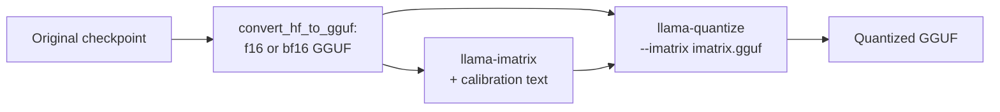

# 第 24 课：GGUF 量化类型

**使命关联:** GGUF 是你会拿到的另一种检查点，它的类型名是对一种量化方案的压缩描述，所以正确地读懂它，就是你核实一个“Q4”文件到底是什么的办法。
**主要来源:** [文档：“GGUF”，Hugging Face Hub](https://huggingface.co/docs/hub/gguf)
**前置知识:** [第 23 课](0023-quantized-checkpoints.md)、[GGUF](../GLOSSARY.md)、[重要性矩阵](../GLOSSARY.md)、[块缩放格式](../GLOSSARY.md)、[每个权重的有效位数](../GLOSSARY.md)

## 热身

1. ▢ 分组大小是在什么和什么之间做权衡？

<details markdown="1"><summary>检查</summary>

更小的分组更能跟踪权重的局部范围，所以损失的精度更少，但每个分组都要存自己的缩放因子，这会提高每个权重的有效位数（第 6 课）。

</details>

2. ▢ 就近舍入用什么来选择每个量化值？不用什么？

<details markdown="1"><summary>检查</summary>

它只用权重本身和它所在分组的缩放因子。它不用数据，也不做误差补偿（第 9 课）。

</details>

3. ▢ 在一个 4 位 GPTQ 的 safetensors 层里，哪个张量存放每组的缩放因子？用什么 dtype？

<details markdown="1"><summary>检查</summary>

`scales`，以 F16 存储，每组输入通道一行（第 23 课）。

</details>

## 要点

一个 GGUF 文件把张量与模型的元数据捆在一起，它的许多张量用的是 llama.cpp 自己的块类型。本课讲的是如何读懂这些类型的名字。关于把这种文件当作运行时格式的内容，包括它为什么可以做内存映射，请看推理系列的 [llama.cpp](../../inference/reference/llama-cpp.md) 参考表。

### 旧式类型：Q4_0、Q8_0 等

Hub 的[类型表](https://huggingface.co/docs/hub/gguf)把旧式类型列在它们自己的标题之下。每一种都是以 32 个权重为一块的就近舍入量化：`Q4_0` 是 4 位，`Q5_0` 是 5 位，`Q8_0` 是 8 位，权重按 `w = q * block_scale` 还原。`_1` 类型增加了一个块最小值，`w = q * block_scale + block_minimum`。k-quants 的拉取请求把这些称为“type-0”和“type-1”。该表指出，旧式方法“如今已不被广泛使用”。

块缩放因子的代价就是第 6 课的算术，读自 llama.cpp 的 [`ggml-common.h`](https://github.com/ggml-org/llama.cpp/blob/master/ggml/src/ggml-common.h) 里的 C 结构体：一个 `Q4_0` 块是一个 2 字节的缩放因子加 32 个四位值，每 32 个权重 18 字节，所以每个权重 4.5 位。`Q8_0` 是一个 2 字节的缩放因子加 32 字节，每个权重 8.5 位。

### k-quants：超级块

k-quants（[拉取请求 #1684](https://github.com/ggml-org/llama.cpp/pull/1684)）增加了第二层。一个超级块含 256 个权重，分成若干子块，每个子块有自己的缩放因子，而这些缩放因子本身也被量化以节省空间。在 `Q4_K` 中，一个超级块有 8 个各含 32 个权重的子块，子块的缩放因子和最小值各以 6 位存储，再由一对 16 位的值对它们做缩放。Hub 的表给出 `w = q * block_scale(6-bit) + block_min(6-bit)` 和每个权重 4.5 位。同一张表给出 `Q5_K` 为 5.5，`Q6_K` 为 6.5625，后者用 16 个各含 16 个权重的子块，带 8 位的缩放因子。`Q4_K` 与 `Q4_0` 花的位数一样，都是 4.5 位，但花法不同，llama.cpp 自己的度量显示了这个差别：对 Llama 3 8B，README 的得分榜给 `q5_K_S` 和 `q5_0` 同样的 5.21 GiB，KL 散度却分别是 0.0166 和 0.0222（[llama.cpp 困惑度 README](https://github.com/ggml-org/llama.cpp/blob/master/tools/perplexity/README.md)）。

### 后缀：跨张量的混合

`S`、`M` 和 `L` 表示小、中和大，它们描述的是一种配方，而不是另一种块格式。拉取请求引入它们的时候，`Q4_K_S` 对所有张量都用 `Q4_K`，而 `Q4_K_M` 对一半的 `attention.wv` 和 `feed_forward.w2` 张量用 `Q6_K`，其余用 `Q4_K`。`Q3_K_L` 对 `attention.wv`、`attention.wo` 和 `feed_forward.w2` 用 `Q5_K`，其他地方用 `Q3_K`。然后每个变体对 `output.weight` 也都用 6 位量化。所以混合是跨张量的：每个张量只有一种类型，配方说的是哪些张量得到更好的那种。此后配方又经过了重新调整（quantize 的 README 链接了后来的调优拉取请求），所以请把这些列表当作思路，并用 Hub 的 [GGUF 查看器](https://huggingface.co/docs/hub/gguf)读你自己文件的张量类型，它会显示每个张量的名字、形状和精度。`llama-quantize` 的 `--pure` 选项会关掉这些混合，对每个张量都用同一种类型。

这使得一个文件的每个权重的有效位数，与它主类型的不同。对 Llama 3.1 8B，[quantize README](https://github.com/ggml-org/llama.cpp/blob/master/tools/quantize/README.md) 度量了这些整个文件的数字：

| 名称 | 每种类型的位数（Hub 表） | 整个文件每个权重的位数 | 文件大小，GiB |
|---|---|---|---|
| Q8_0 | 8.5（来自结构体） | 8.5008 | 7.95 |
| Q6_K | 6.5625 | 6.5633 | 6.14 |
| Q5_K_S、Q5_K_M | 5.5 | 5.5704、5.7036 | 5.21、5.33 |
| Q4_K_S、Q4_K_M | 4.5 | 4.6672、4.8944 | 4.36、4.58 |
| IQ4_XS | 4.25 | 4.4597 | 4.17 |
| IQ1_S | 1.56 | 2.0042 | 1.87 |
| F16 | 16 | 16.0005 | 14.96 |

### i-quants

`IQ` 类型，例如 `IQ4_XS`、`IQ3_S`、`IQ2_XXS` 和 `IQ1_S`，瞄准的是最低的位宽。Hub 的表列出了从每个权重 4.25 位到 1.56 位的名义代价，并把它们的权重描述为由一个超级块缩放因子和一个重要性矩阵得到。得分榜显示了低端要付出什么：对 Llama 3 8B，`iq1_S` 的困惑度是 60.69，KL 散度是 2.25，而 f16 是 6.23 和 0.0006。在这些之中做选择，是第 25 课的事。

### 重要性矩阵

**重要性矩阵**，也就是 imatrix，告诉量化器哪些权重最重要。加入它的拉取请求（[#4861](https://github.com/ggml-org/llama.cpp/pull/4861)）从一个简单的论证推导出它。要保持很小的量，是一层输出中的误差，即 `(sum_j (q_j - w_j) * a_j)^2`，其中权重是 `w_j`，量化值是 `q_j`，激活值是 `a_j`。在校准文本上取平均，并忽略交叉项，它就化简为用每个输入列的平均平方激活值 `<a_j^2>` 给该列的平方误差加权。这个工具对每个输入列存一个这样的数，量化时就最小化加权误差。`llama-imatrix` 根据一个文本文件算出它，`llama-quantize` 用 `--imatrix` 接收它：



[imatrix README](https://github.com/ggml-org/llama.cpp/blob/master/tools/imatrix/README.md) 说，默认情况下不为 `output.weight` 和 `token_embd.weight` 收集数据，因为 README 说通常最好不要把它用在这些张量上。它改变的是同样多的位数如何花，而不是花多少：得分榜里 `q4_K_M` 无论有没有 imatrix 都是 4.58 GiB。它买到的，是同样大小下更小的误差。对 Llama 3 8B 的 `q4_K_M`，有了 README 标注为“WT 10m”的 imatrix（由 WikiText 的 token 构建），困惑度从 6.407 降到 6.383，KL 散度从 0.0313 降到 0.0282。同一份 README 说，用更多的 token 并没有一致的收益。

imatrix 就是一个校准集（第 12 课），所以第 12 课的警告同样适用。这里 imatrix 的文本和评测的文本都来自 WikiText，这很可能抬高了收益，而由与你的部署不同的文本做出来的 imatrix，可能给错误的列加权。

## 练习

1. ▢ 把这些分成旧式、k-quant 和 i-quant：`Q8_0`、`Q5_K_S`、`IQ4_XS`、`Q4_1`、`Q6_K`、`IQ2_S`。

<details markdown="1"><summary>检查</summary>

旧式：`Q8_0` 和 `Q4_1`，Hub 的表把它们列在旧式的标题之下。k-quants：`Q5_K_S` 和 `Q6_K`，名字里带 `K`。i-quants：`IQ4_XS` 和 `IQ2_S`，名字里带 `IQ`。`Q5_K_S` 里的后缀 `S` 是配方的后缀，而 `IQ4_XS` 里的 `XS` 是该类型自己名字的一部分。

</details>

2. ▢ `Q4_K_M` 里的 `M` 是什么意思？

    - a) 中等混合：有些张量得到比别的张量更高精度的类型
    - b) 混合精度：应用在每个张量自己的权重块内部
    - c) 仅限 Metal：这个文件只能在某一家厂商的硬件上运行
    - d) 最小位数：每个权重都恰好存为四位

<details markdown="1"><summary>检查</summary>

**a)** 这个后缀选的是中等配方，它把额外的位数花在选定的张量上，例如引入时的一半 `attention.wv` 和 `feed_forward.w2`。(b) 是错的，因为每个张量只有一种类型，混合是跨张量的。(c) 凭空编出了一个没有任何后缀带有的硬件限制。(d) 是错的，因为对 Llama 3.1 8B，这个文件整体的数字是每个权重 4.8944 位。

</details>

3. ▢ 先预测，再运行。根据 `ggml-common.h` 里的块布局，预测 `Q4_0`、`Q8_0`、`Q4_K` 和 `Q6_K` 每个权重的位数，然后运行。

    ```python
    # bytes per block, from the C struct layouts in ggml-common.h (half = 2 bytes)
    layouts = {
        "Q4_0": (32, 2 + 32 // 2),
        "Q8_0": (32, 2 + 32),
        "Q4_K": (256, 2 * 2 + 12 + 256 // 2),
        "Q6_K": (256, 256 // 2 + 256 // 4 + 256 // 16 + 2),
    }
    for name, (weights, nbytes) in layouts.items():
        print(f"{name}: {nbytes} bytes per {weights} weights = {nbytes * 8 / weights} bits per weight")
    ```

<details markdown="1"><summary>提示</summary>

每个数都是每块字节数乘以 8，再除以每块的权重数。对 `Q4_K`，12 字节存放子块的缩放因子和最小值，两个 2 字节的值是超级块的缩放因子。

</details>

<details markdown="1"><summary>检查</summary>

它打印出 `Q4_0: 18 bytes per 32 weights = 4.5`、`Q8_0: 34 bytes per 32 weights = 8.5`、`Q4_K: 144 bytes per 256 weights = 4.5` 和 `Q6_K: 210 bytes per 256 weights = 6.5625` 每个权重的位数。它们与 Hub 表中的 `Q4_K` 和 `Q6_K` 相符，而 `Q4_0` 和 `Q4_K` 的代价相同。

</details>

4. ▢ quantize 的 README 列出 Llama 3.1 8B 的 F16 为 14.96 GiB、每个权重 16.0005 位。估算每个权重 4.8944 位时的 `Q4_K_M` 文件大小，以及 4.6672 位时的 `Q4_K_S` 大小。

<details markdown="1"><summary>检查</summary>

大小与每个权重的位数成比例：`Q4_K_M` 是 14.96 x 4.8944 / 16.0005，约 4.58 GiB，`Q4_K_S` 是 14.96 x 4.6672 / 16.0005，约 4.36 GiB。两者都与 README 的数字相符。要根据整个文件的数字来估算 GGUF 文件的大小，而不是根据名字里的那个 4。

</details>

5. ▢ `Q4_K` 每个权重花 4.5 位，而 `Q4_K_M` 在同一个模型上度量到的是 4.8944。多出来的位数从哪里来？

<details markdown="1"><summary>检查</summary>

来自配方用比 `Q4_K` 更高精度的类型存储的那些张量。`M` 配方把 `Q6_K` 放在一部分 `attention.wv` 和 `feed_forward.w2` 上，并且如拉取请求所述，每个变体的 `output.weight` 都是以 6 位存储的。多出的位数，给了被判断为最敏感的那些张量。

</details>

6. ▢ 先预测，再运行。一块 32 个权重，用一个缩放因子舍入到 4 位。有两个输入列带着比其余大 10 倍的激活值。预测按重要性加权的误差来选缩放因子，是否比按普通误差来选，降低了平均输出误差，然后运行。这说明的是 imatrix 拉取请求中的原理，而不是 llama.cpp 的实际代码。

    ```python
    import numpy as np

    rng = np.random.default_rng(0)
    block, n_blocks = 32, 2000
    scales_grid = np.linspace(0.6, 1.2, 61)  # candidate scales, relative to max|w| / 7

    # Calibration activations: two input columns carry much larger values than the rest.
    col_gain = np.ones(block)
    col_gain[[3, 17]] = 10.0
    calib = rng.normal(size=(512, block)) * col_gain
    test = rng.normal(size=(512, block)) * col_gain
    importance = (calib ** 2).mean(axis=0)  # mean squared activation per input column


    def quantize(w, scale):
        return np.clip(np.round(w / scale), -8, 7) * scale


    def best_scale(w, weights):
        base = np.abs(w).max() / 7
        errs = [np.sum(weights * (w - quantize(w, base * s)) ** 2) for s in scales_grid]
        return base * scales_grid[int(np.argmin(errs))]


    plain, weighted = [], []
    for _ in range(n_blocks):
        w = rng.normal(size=block)
        for scale, out in ((best_scale(w, np.ones(block)), plain), (best_scale(w, importance), weighted)):
            err = test @ (w - quantize(w, scale))
            out.append(np.sqrt(np.mean(err ** 2)))

    print("mean output error, plain scale search:      ", round(float(np.mean(plain)), 3))
    print("mean output error, importance-weighted scale:", round(float(np.mean(weighted)), 3))
    print("blocks where weighting helped:", int(np.sum(np.array(weighted) < np.array(plain))), "of", n_blocks)
    ```

<details markdown="1"><summary>提示</summary>

要紧的是这一层输出中的误差，所以遇到大激活值的那一列上的舍入误差，分量更重。

</details>

<details markdown="1"><summary>检查</summary>

加权有帮助：普通缩放因子搜索的平均输出误差是 1.202，重要性加权的是 0.794，加权的缩放因子在 2000 个块中的 1881 个里胜出。加权的搜索在普通的列上多接受一些误差，来保住那两个被大量使用的列的精度，而输出更在意那两列。无论哪种做法，文件大小都完全一样，因为改变的只是缩放因子的选择。

</details>

7. ▢ 你用英文百科文本构建了一个 imatrix，量化了一个主要用来写代码的模型，并报告了在同一份百科文本上度量到的困惑度收益。评审者该问什么？

<details markdown="1"><summary>检查</summary>

评测是否与部署相似。imatrix 是一个校准集：它按百科文本产生的激活值给各列加权，而代码可能激活的是另一些列。在校准文本自己的领域上度量到的收益是最好的情形，所以评审者应当要求在代码任务上做评测（第 22 课），并要求校准文本与它们相匹配。

</details>

## 实战练习

- [ ] 打开 Hugging Face Hub 上的一个 GGUF 模型，选一个 `Q4_K_M` 文件，打开它的张量查看器，列出哪些张量不是 `Q4_K`。与上面的配方做比较。
- [ ] 如果你有 llama.cpp，用 `llama-quantize` 把一个小的 bf16 或 f16 GGUF 量化成 `Q4_K_S` 和 `Q4_K_M`，并核对文件大小之比与表中每个权重位数之比相符。
- [ ] 明天：不看笔记，说出 `Q4_K_M` 的每一部分是什么意思，以及重要性矩阵改变了什么、没改变什么。

## 延伸阅读

- [度量与存储](../reference/measuring-and-storing.md)
- [文档：“GGUF”，Hugging Face Hub](https://huggingface.co/docs/hub/gguf)
- [文档：llama.cpp quantize 工具 README，ggml-org](https://github.com/ggml-org/llama.cpp/blob/master/tools/quantize/README.md)
- [文档：llama.cpp imatrix 工具 README，ggml-org](https://github.com/ggml-org/llama.cpp/blob/master/tools/imatrix/README.md)
- [推理：llama.cpp](../../inference/reference/llama-cpp.md)，GGUF 作为运行时格式
- [资源](../RESOURCES.md)

---

没学明白？请重读顶部的主要来源，因为本课是对它的压缩，而理解正是在压缩中流失的。如果有哪个术语觉得含糊，可以查看[术语表](../GLOSSARY.md)。

如果问题出在课程本身，而不是学习材料，那就是一个缺陷：[提交 issue](https://github.com/TokenCemetery/teach/issues)。
