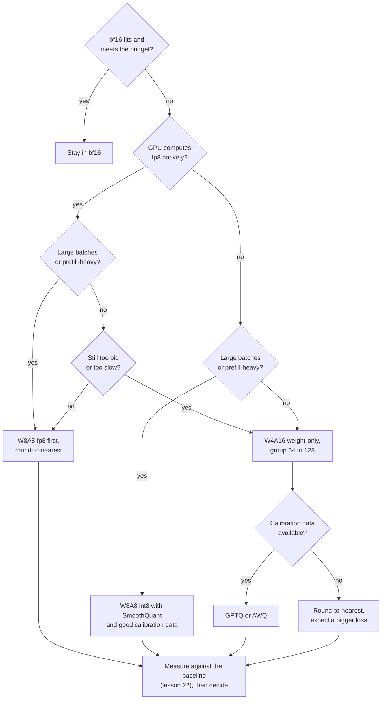

# Lección 25. Elegir un esquema

**Vínculo con la misión:** El track termina confiando en que tomes la decisión sobre una cuantización y se la expliques a otra persona. Cada lección anterior enseñó una palanca. Esta es el orden en que las accionas y la evidencia que citas para cada una.
**Fuente principal:** [Paper: "Give Me BF16 or Give Me Death? Accuracy-Performance Trade-Offs in LLM Quantization", Kurtic et al., 2024](https://arxiv.org/abs/2411.02355), secciones 4 a 6
**Requisitos previos:** [Lección 24](0024-gguf-quant-types.md), [Cuantización solo de pesos](../GLOSSARY.md), [Limitado por el ancho de banda de memoria](../GLOSSARY.md), [Limitado por cómputo](../GLOSSARY.md), [Bits efectivos por peso](../GLOSSARY.md)

## Calentamiento

1. ▢ Un esquema de 4 bits almacena un scale de 16 bits por cada grupo de 64 pesos. ¿Cuántos bits efectivos por peso son?

<details markdown="1"><summary>Comprobación</summary>

4.25. El scale añade 16 / 64 = 0.25 bits por peso a los 4 bits del valor (lecciones 1 y 6).

</details>

2. ▢ ¿Por qué la cuantización solo de pesos acelera el decode con lote 1, y por qué puede ralentizar un prefill con lote grande?

<details markdown="1"><summary>Comprobación</summary>

El decode con lote 1 está limitado por el ancho de banda de memoria, así que leer menos bytes de pesos reduce el tiempo. Un prefill con lote grande está limitado por cómputo, así que los bytes nunca fueron el límite, y el kernel sigue teniendo que descuantizar cada peso al entrar (lección 19).

</details>

3. ▢ ¿Qué necesita GPTQ que no necesita round-to-nearest, y qué puede salir mal con ello?

<details markdown="1"><summary>Comprobación</summary>

Un calibration set, del que toma información de segundo orden para gastar cada error de redondeo en los pesos aún no cuantizados. Si el conjunto no se parece al tráfico, la compensación se ajusta a las entradas equivocadas (lecciones 9, 10 y 12).

</details>

## Qué debes saber

### El orden de las preguntas

"¿Qué esquema?" no tiene respuesta hasta que se conocen cinco hechos. Pregúntalos en este orden, porque cada uno descarta opciones antes de que se pregunte el siguiente.

1. **¿Hace falta cuantizar siquiera?** Si los pesos en bf16 más la KV cache caben y se cumple el presupuesto de latencia, cuantizar no compra nada que necesites. El lado de servicio de esa decisión, el presupuesto de latencia, vive en el track de inference: consulta su hoja [Cuantización al servir](../../inference/reference/quantization-at-serve-time.md). Esta lección parte del punto en que has decidido que necesitas menos bits.
2. **¿Qué calcula el hardware de forma nativa?** Kurtic et al. estudian los formatos con soporte eficiente de kernels en vLLM: pesos y activaciones enteros de 8 bits (W8A8-INT) para las GPU NVIDIA Ampere y anteriores, y punto flotante de 8 bits (W8A8-FP) para Hopper y Ada Lovelace, además de pesos enteros de 4 bits con activaciones de 16 bits (W4A16-INT). La lección 20 explica por qué un formato sin kernel se almacena pero no se calcula.
3. **¿Cuál es la forma del lote?** El servicio limitado por el ancho de banda de memoria (lotes pequeños, decode) premia menos bytes de pesos. El servicio limitado por cómputo (lotes grandes, prefill) premia una aritmética más barata, que solo ofrece un esquema que cuantiza también las activaciones. Kurtic et al. dicen que el esquema óptimo "depende de la razón entre tokens de prefill y de decode".
4. **¿Cuál es el nivel de calidad?** Decídelo antes de mirar esquemas, como un número en tus propias tareas (lección 22), no como una sensación.
5. **¿Hay datos de calibración, o presupuesto de entrenamiento?** Round-to-nearest no necesita ninguno de los dos. GPTQ y AWQ necesitan un calibration set. El quantization-aware training necesita una ejecución de entrenamiento (lección 18), que la mayoría de los equipos no tienen.



El diagrama es un orden de intentos por defecto, no una demostración. Su última caja es la que anula a las demás: un esquema que no supera tu medición en tus tareas queda fuera, diga lo que diga un paper.

### Qué midieron Kurtic et al.

Su estudio abarca más de 500,000 evaluaciones de esquemas FP8, INT8 e INT4 en toda la familia Llama-3.1, con accuracy en benchmarks académicos y en tareas del mundo real, además del throughput de servicio en vLLM ([resumen](https://arxiv.org/abs/2411.02355)). Cuatro hallazgos sostienen la decisión:

- **Accuracy.** W8A8-FP es efectivamente sin pérdida en todos los tamaños. Un W8A8-INT bien ajustado pierde de 1 a 3 por ciento. W4A16-INT es más competitivo de lo esperado y rivaliza con 8 bits: en las tareas de Open LLM Leaderboard V1 los esquemas de 8 bits recuperan el 99.75 por ciento del promedio de bf16 y W4A16-INT el 99.36 por ciento.
- **Dónde necesita cuidado.** W8A8-INT mostró caídas de accuracy apreciables en 70B hasta que los autores aplicaron SmoothQuant, y los modelos mayores necesitaron mejores datos de calibración que los tokens aleatorios, que bastaron en 8B. Los modelos más pequeños pierden algo más en INT4.
- **Servicio síncrono** (una consulta a la vez): W4A16 es el más eficiente en costo. En 8B y 70B redujo el costo por consulta entre 2 y 3 veces y mejoró la latencia entre 1.5 y 2.5 veces frente a bf16.
- **Servicio asíncrono** (continuous batching): W8A8 domina el throughput. Sus curvas de latencia y throughput muestran a W4A16 por delante con baja latencia y a W8A8 por delante con alta latencia, y el cruce depende del tamaño del modelo, el hardware y la tarea. Para cargas mixtas, dicen que la elección depende del caso de uso.

Eso es la pregunta de la forma del lote respondida con mediciones. Coincide con el análisis de kernels que hay detrás: el paper de MARLIN muestra un kernel de pesos de 4 bits que mantiene casi la aceleración máxima de 4 veces hasta tamaños de lote de 16 a 32, y cae gradualmente a cerca de 1.5 veces en el tamaño de lote 128 a medida que el problema pasa a estar limitado por cómputo ([Frantar et al., 2024](https://arxiv.org/abs/2408.11743)).

### El argumento a favor de los pesos de 4 bits

Dettmers y Zettlemoyer ejecutaron más de 35,000 experimentos con modelos OPT, BLOOM, Pythia y GPT-2 de 19M a 176B parámetros, buscando el ancho de bits que da el mejor accuracy zero-shot para un número fijo de bits totales del modelo. Su hallazgo es que la precisión de 4 bits es casi universalmente óptima. Un modelo de 30B a 8 bits y uno de 60B a 4 bits contienen el mismo número de bits, y el de 4 bits es la mejor compra ([paper](https://arxiv.org/abs/2212.09720)). Su recomendación es usar 4 bits con un tamaño de bloque pequeño (de 64 a 128 fue lo óptimo para la mayoría de los modelos de 4 bits de su estudio) y un tipo de datos de punto flotante.

Lee lo que autoriza. Dice que cuando la memoria es el presupuesto, hay que gastarla en un modelo mayor a 4 bits y no en uno menor a 8. No dice que 4 bits sea la mejor opción cuando el presupuesto es la velocidad con lotes grandes, porque mide accuracy frente a bits totales, no throughput. Se midió en familias de modelos de la era de 2022, algo a lo que vuelve la lección 27.

### Tres escenarios

- **Un modelo de clase 30B para un usuario en una tarjeta de 24 GB.** El lote 1 está limitado por el ancho de banda de memoria, y los pesos en bf16 por sí solos son unos 60 GB. Un esquema de solo pesos de 4 bits con tamaño de grupo 128 almacena unos 4.125 bits por peso, así que unos 15.5 GB, y deja espacio para la KV cache. Dettmers y Zettlemoyer prefieren esto a un modelo menor a 8 bits. Usa GPTQ o AWQ si tienes datos de calibración, y mide frente a bf16 antes de fiarte.
- **Un trabajo offline sobre un millón de documentos en GPU Hopper.** Solo importa el throughput y los lotes son grandes, así que el trabajo está limitado por cómputo. W8A8-FP es el primer intento: Kurtic et al. lo encontraron efectivamente sin pérdida, y se construyó con round-to-nearest, scales de activaciones dinámicos por token y sin datos de calibración.
- **Una API interactiva para un modelo de 70B, unas pocas solicitudes concurrentes por réplica.** Domina el decode, que está limitado por el ancho de banda de memoria. W4A16 es el más eficiente en costo en sus resultados síncronos. Comprueba la calidad en tus propias tareas, y la velocidad con el tamaño de lote que de verdad uses.

## Práctica

1. ▢ Nombra las cinco preguntas en el orden en que las hace esta lección.

<details markdown="1"><summary>Comprobación</summary>

Si hace falta cuantizar siquiera, qué calcula el hardware de forma nativa, cuál es la forma del lote, cuál es el nivel de calidad y si hay datos de calibración o presupuesto de entrenamiento. El orden importa porque las tres primeras descartan opciones antes de aplicar el nivel de calidad a lo que queda.

</details>

2. ▢ Un equipo sirve un modelo de 8B para un trabajo por lotes offline en GPU Hopper, solo importa el throughput. ¿Qué opción favorece la evidencia?

    - a) Pesos y activaciones en FP8, usando round-to-nearest
    - b) Pesos de 4 bits, activaciones de 16 bits, usando GPTQ
    - c) Pesos de 2 bits con quantization-aware training completo
    - d) Mantener bf16 en todo, omitiendo por completo la cuantización

<details markdown="1"><summary>Comprobación</summary>

**a)** Los lotes grandes están limitados por cómputo, W8A8 domina el throughput en los resultados asíncronos, y W8A8-FP fue efectivamente sin pérdida y no necesita datos de calibración. (b) es la opción correcta para decode de baja latencia y pierde terreno con alto throughput. (c) no tiene respaldo en las fuentes de esta lección y necesita una ejecución de entrenamiento. (d) renuncia a la ganancia de throughput para la que existe el trabajo, aunque es un baseline razonable contra el que medir.

</details>

3. ▢ Predice y luego ejecuta. Un equipo tiene 24 GB para pesos. Predice el mayor número de parámetros que cabe en bf16, en int8 y en 4 bits con un scale de 16 bits por grupo de 128. Luego ejecuta esto y compara.

    ```python
    budget_gb = 24
    for name, bits in [("bf16", 16), ("int8", 8), ("4-bit, group of 128", 4 + 16 / 128)]:
        params_b = budget_gb * 8 / bits
        print(f"{name:22s} {bits:6.3f} bits  max {params_b:5.1f}B parameters")
    ```

<details markdown="1"><summary>Pista</summary>

Los parámetros son el presupuesto en bits dividido por los bits por parámetro. Cuenta el scale de grupo en la fila de 4 bits.

</details>

<details markdown="1"><summary>Comprobación</summary>

```text
bf16                   16.000 bits  max  12.0B parameters
int8                    8.000 bits  max  24.0B parameters
4-bit, group of 128     4.125 bits  max  46.5B parameters
```

Son solo los pesos, así que los límites reales son menores una vez contadas la KV cache y las activaciones. Las tres filas contienen el mismo número de bits, que es la comparación que hacen Dettmers y Zettlemoyer. Su hallazgo favorece la fila de 4 bits, si existe un modelo de ese tamaño en la familia que necesitas y el kernel es lo bastante rápido.

</details>

4. ▢ Una nota de diseño dice "Usamos W4A16 para nuestro trabajo nocturno de puntuación por lotes porque Dettmers y Zettlemoyer mostraron que 4 bits es lo óptimo". ¿Qué falla en la justificación, y qué pedirías?

<details markdown="1"><summary>Comprobación</summary>

El paper mide accuracy zero-shot frente a bits totales del modelo en familias de la era de 2022. No dice nada sobre el throughput con lotes grandes, donde Kurtic et al. encontraron a W8A8 por delante. Pide el tamaño de lote con el que corre el trabajo, un throughput medido de ambos esquemas en ese hardware y una comparación de accuracy frente a bf16 en la tarea de puntuación. La elección puede seguir siendo correcta si la memoria es la restricción que manda, pero este paper no lo demuestra.

</details>

5. ▢ Debes servir un modelo de 70B en GPU Ampere, sobre todo con tamaños de lote de 1 a 4, con un calibration set tomado de tus propios prompts. Elige un esquema y di qué medirías antes de desplegar.

<details markdown="1"><summary>Comprobación</summary>

W4A16 solo de pesos con tamaño de grupo 128, cuantizado con GPTQ o AWQ usando tu calibration set. Ampere no tiene fp8 nativo, el lote es lo bastante pequeño como para estar limitado por el ancho de banda de memoria, y los 4 bits son donde están las ganancias de memoria y de latencia de decode. Mide el modelo cuantizado frente a bf16 en tus tareas con el mismo harness (lección 22), informa de flips además de accuracy (lección 21), y mide el tiempo de decode con lotes de 1 y 4 con el kernel que vayas a desplegar, no el del paper.

</details>

## Prácticas en el mundo real

- [ ] Elige un modelo que sirvas o quieras servir. Anota su respuesta a cada una de las cinco preguntas, y dónde el plan en borrador difiere del diagrama, por qué.
- [ ] Abre la [documentación de cuantización de vLLM](https://docs.vllm.ai/en/latest/features/quantization/) y encuentra cuáles de los esquemas de esta lección soporta tu GPU. Anota los que no tienen kernel.
- [ ] Mañana: sin apuntes, vuelve a dibujar de memoria el flujo de decisión, y luego di qué pregunta harías primero para un modelo que conozcas.

## Para profundizar

- [Lista de revisión de cuantización](../reference/quantization-review-checklist.md)
- Inferencia: [Cuantización al servir](../../inference/reference/quantization-at-serve-time.md), donde el presupuesto de latencia de servicio decide cuántos bits te puedes permitir
- [Paper: "The case for 4-bit precision: k-bit Inference Scaling Laws", Dettmers and Zettlemoyer, 2022](https://arxiv.org/abs/2212.09720)
- [Paper: "MARLIN: Mixed-Precision Auto-Regressive Parallel Inference on Large Language Models", Frantar et al., 2024](https://arxiv.org/abs/2408.11743)
- [Recursos](../RESOURCES.md)

---

¿No termina de quedar claro? Vuelve a leer la fuente primaria de arriba, ya que esta lección la comprime y en la compresión es donde se escapa la comprensión. Consulta el [glosario](../GLOSSARY.md) por si algún término te resultó resbaladizo.

Si lo poco claro es la propia lección y no el material, eso es un defecto: [abre un issue](https://github.com/TokenCemetery/teach/issues).
