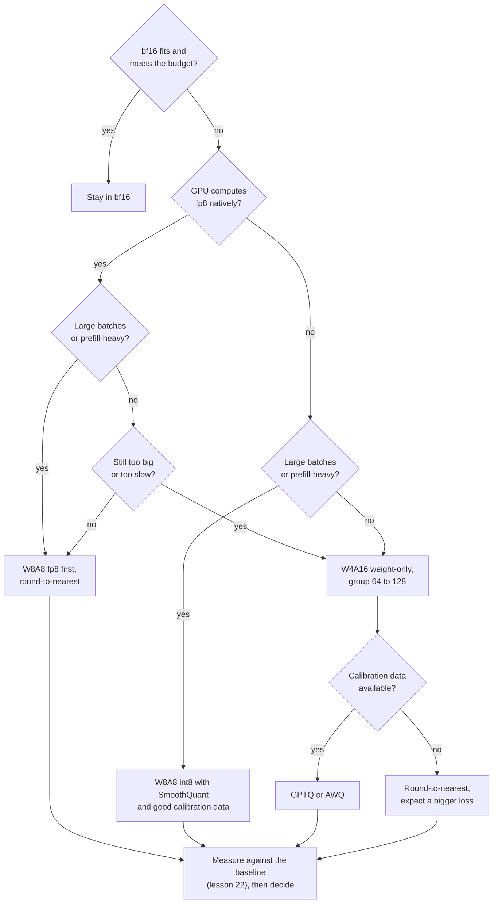

# Leçon 25. Choisir un schéma

**Lien avec la mission :** Le parcours se termine par la confiance qu'on vous accorde pour trancher sur une quantification et l'expliquer à quelqu'un d'autre. Chaque leçon précédente a enseigné un levier. Celle-ci donne l'ordre dans lequel les actionner, et les preuves à citer pour chaque action.
**Source primaire :** [Article : "Give Me BF16 or Give Me Death? Accuracy-Performance Trade-Offs in LLM Quantization", Kurtic et al., 2024](https://arxiv.org/abs/2411.02355), sections 4 à 6
**Prérequis :** [Leçon 24](0024-gguf-quant-types.md), [Quantification weight-only](../GLOSSARY.md), [Limité par la mémoire](../GLOSSARY.md), [Limité par le calcul](../GLOSSARY.md), [Bits effectifs par poids](../GLOSSARY.md)

## Échauffement

1. ▢ Un schéma en 4 bits stocke un scale de 16 bits pour chaque groupe de 64 poids. Cela fait combien de bits effectifs par poids ?

<details markdown="1"><summary>Vérifier</summary>

4.25. Le scale ajoute 16 / 64 = 0.25 bit par poids aux 4 bits de la valeur (leçons 1 et 6).

</details>

2. ▢ Pourquoi la quantification weight-only accélère-t-elle le décodage à batch 1, et pourquoi peut-elle ralentir un prefill à grand batch ?

<details markdown="1"><summary>Vérifier</summary>

Le décodage à batch 1 est limité par la mémoire, donc lire moins d'octets de poids réduit le temps. Un prefill à grand batch est limité par le calcul, donc les octets n'ont jamais été la limite, et le kernel doit encore déquantifier chaque poids à l'entrée (leçon 19).

</details>

3. ▢ De quoi GPTQ a-t-il besoin que l'arrondi au plus proche n'exige pas, et qu'est-ce qui peut mal tourner avec lui ?

<details markdown="1"><summary>Vérifier</summary>

D'un calibration set, dont il tire l'information du second ordre pour dépenser chaque erreur d'arrondi sur les poids pas encore quantifiés. Si le jeu ne ressemble pas au trafic, la compensation est ajustée aux mauvaises entrées (leçons 9, 10 et 12).

</details>

## À savoir

### L'ordre des questions

« Quel schéma ? » n'a pas de réponse tant que cinq faits ne sont pas connus. Posez-les dans cet ordre, parce que chacun écarte des options avant que le suivant soit posé.

1. **La quantification est-elle nécessaire ?** Si les poids en bf16 plus le KV cache tiennent et que le budget de latence est respecté, quantifier n'achète rien dont vous ayez besoin. Le versant serving de cette décision, le budget de latence, vit dans le parcours inférence : voir sa fiche [Quantification au moment du serving](../../inference/reference/quantization-at-serve-time.md). Cette leçon part du moment où vous avez décidé qu'il vous faut moins de bits.
2. **Que calcule nativement le matériel ?** Kurtic et al. étudient les formats avec prise en charge efficace par kernel dans vLLM : des poids et activations entiers de 8 bits (W8A8-INT) pour les GPU NVIDIA Ampere et plus anciens, et de la virgule flottante 8 bits (W8A8-FP) pour Hopper et Ada Lovelace, plus des poids entiers en 4 bits avec des activations en 16 bits (W4A16-INT). La leçon 20 dit pourquoi un format sans kernel est stocké mais pas calculé.
3. **Quelle est la forme du batch ?** Un serving limité par la mémoire (petits batchs, décodage) récompense moins d'octets de poids. Un serving limité par le calcul (grands batchs, prefill) récompense une arithmétique moins chère, que seul un schéma qui quantifie aussi les activations procure. Kurtic et al. disent que le schéma optimal « dépend du rapport entre tokens de prefill et de décodage ».
4. **Quel est le niveau de qualité exigé ?** Décidez-le avant de regarder les schémas, comme un chiffre sur vos propres tâches (leçon 22), pas comme une impression.
5. **Y a-t-il des données de calibration, ou un budget d'entraînement ?** L'arrondi au plus proche n'exige ni l'un ni l'autre. GPTQ et AWQ ont besoin d'un calibration set. Le quantization-aware training demande un run d'entraînement (leçon 18), que la plupart des équipes n'ont pas.



Le schéma est un ordre d'essais par défaut, pas une preuve. Sa dernière case est celle qui l'emporte sur les autres : un schéma qui échoue à votre mesure sur vos tâches est écarté, quoi qu'ait trouvé un article.

### Ce qu'ont mesuré Kurtic et al.

Leur étude porte sur plus de 500,000 évaluations de schémas FP8, INT8 et INT4 sur toute la famille Llama-3.1, avec la précision sur des benchmarks académiques et sur des tâches réelles, plus le débit de serving dans vLLM ([résumé](https://arxiv.org/abs/2411.02355)). Quatre constats portent la décision :

- **Précision.** Le W8A8-FP est effectivement sans perte à chaque taille. Un W8A8-INT bien réglé perd 1 à 3 pour cent. Le W4A16-INT est plus compétitif que prévu et rivalise avec le 8 bits : sur les tâches de l'Open LLM Leaderboard V1, les schémas 8 bits récupèrent 99.75 pour cent de la moyenne bf16 et le W4A16-INT 99.36 pour cent.
- **Où il faut de l'attention.** Le W8A8-INT a montré des baisses de précision notables à 70B jusqu'à ce que les auteurs appliquent SmoothQuant, et les plus grands modèles demandaient de meilleures données de calibration que des tokens aléatoires, qui suffisaient à 8B. Les plus petits modèles perdent un peu plus en INT4.
- **Serving synchrone** (une requête à la fois) : le W4A16 est le plus rentable. À 8B et 70B, il a réduit le coût par requête de 2 à 3 fois et amélioré la latence de 1.5 à 2.5 fois par rapport au bf16.
- **Serving asynchrone** (continuous batching) : le W8A8 domine le débit. Leurs courbes latence-débit montrent le W4A16 devant à faible latence et le W8A8 devant à haute latence, et le point de croisement dépend de la taille du modèle, du matériel et de la tâche. Pour les charges mixtes, ils disent que le choix dépend du cas d'usage.

C'est la question de la forme du batch répondue par des mesures. Cela correspond à l'analyse de kernel qui la sous-tend : l'article MARLIN montre un kernel à poids en 4 bits qui garde près du maximum de 4 fois d'accélération jusqu'à des tailles de batch de 16 à 32, retombant progressivement à environ 1.5 fois vers un batch de 128 quand le problème devient limité par le calcul ([Frantar et al., 2024](https://arxiv.org/abs/2408.11743)).

### Le plaidoyer pour les poids en 4 bits

Dettmers et Zettlemoyer ont mené plus de 35,000 expériences sur des modèles OPT, BLOOM, Pythia et GPT-2 de 19M à 176B paramètres, à la recherche de la largeur en bits qui donne la meilleure précision zero-shot pour un nombre total de bits de modèle fixé. Leur constat est que la précision en 4 bits est presque universellement optimale. Un modèle de 30B en 8 bits et un modèle de 60B en 4 bits contiennent le même nombre de bits, et celui en 4 bits est le meilleur achat ([article](https://arxiv.org/abs/2212.09720)). Leur recommandation est d'utiliser du 4 bits avec une petite taille de bloc (64 à 128 était optimal pour la plupart des modèles en 4 bits de leur étude) et un type de données flottant.

Lisez ce que cela autorise. Cela dit que, quand la mémoire est le budget, il faut la dépenser dans un modèle plus grand en 4 bits plutôt que dans un plus petit en 8. Cela ne dit pas que le 4 bits est le meilleur choix quand la vitesse à grand batch est le budget, parce que cela mesure la précision par rapport au total de bits, pas le débit. C'était mesuré sur des familles de modèles de 2022, ce à quoi revient la leçon 27.

### Trois scénarios

- **Un modèle de classe 30B pour un utilisateur sur une carte de 24 GB.** Le batch 1 est limité par la mémoire, et les seuls poids en bf16 font environ 60 GB. Un schéma weight-only en 4 bits avec une taille de groupe de 128 stocke environ 4.125 bits par poids, donc environ 15.5 GB, ce qui laisse de la place au KV cache. Dettmers et Zettlemoyer préfèrent cela à un modèle plus petit en 8 bits. Utilisez GPTQ ou AWQ si vous avez des données de calibration, et mesurez contre le bf16 avant de lui faire confiance.
- **Un traitement hors ligne sur un million de documents sur des GPU Hopper.** Seul le débit compte et les batchs sont grands, donc le travail est limité par le calcul. Le W8A8-FP est le premier essai : Kurtic et al. l'ont trouvé effectivement sans perte, et il a été construit avec l'arrondi au plus proche, des scales d'activation dynamiques par token et aucune donnée de calibration.
- **Une API interactive pour un modèle 70B, quelques requêtes concurrentes par réplique.** Le décodage domine et est limité par la mémoire. Le W4A16 est le plus rentable dans leurs résultats synchrones. Vérifiez la qualité sur vos propres tâches, et la vitesse à la taille de batch que vous exécutez réellement.

## Pratique

1. ▢ Nommez les cinq questions dans l'ordre où cette leçon les pose.

<details markdown="1"><summary>Vérifier</summary>

La quantification est-elle nécessaire, que calcule nativement le matériel, quelle est la forme du batch, quel est le niveau de qualité exigé, et y a-t-il des données de calibration ou un budget d'entraînement. L'ordre compte parce que les trois premières écartent des options avant que le niveau de qualité s'applique à ce qui reste.

</details>

2. ▢ Une équipe sert un modèle 8B pour un traitement hors ligne sur des GPU Hopper, débit seulement. Quel choix la preuve favorise-t-elle ?

    - a) Poids et activations FP8, avec l'arrondi au plus proche
    - b) Poids en 4 bits, activations en 16 bits, avec GPTQ
    - c) Poids en 2 bits avec un quantization-aware training complet
    - d) Garder le bf16 partout, sans aucune quantification

<details markdown="1"><summary>Vérifier</summary>

**a)** Les grands batchs sont limités par le calcul, le W8A8 domine le débit dans les résultats asynchrones, et le W8A8-FP était effectivement sans perte et n'a besoin d'aucune donnée de calibration. (b) est le bon choix pour un décodage à faible latence et perd du terrain à haut débit. (c) n'a aucun appui dans les sources de cette leçon et demande un run d'entraînement. (d) renonce au gain de débit pour lequel le traitement existe, bien que ce soit une référence légitime à mesurer.

</details>

3. ▢ Prédisez, puis exécutez. Une équipe a 24 GB pour les poids. Prédisez le plus grand nombre de paramètres qui tient en bf16, en int8, et en 4 bits avec un scale de 16 bits par groupe de 128. Exécutez ensuite ceci et comparez.

    ```python
    budget_gb = 24
    for name, bits in [("bf16", 16), ("int8", 8), ("4-bit, group of 128", 4 + 16 / 128)]:
        params_b = budget_gb * 8 / bits
        print(f"{name:22s} {bits:6.3f} bits  max {params_b:5.1f}B parameters")
    ```

<details markdown="1"><summary>Indice</summary>

Les paramètres sont le budget en bits divisé par les bits par paramètre. Comptez le scale de groupe dans la ligne 4 bits.

</details>

<details markdown="1"><summary>Vérifier</summary>

```text
bf16                   16.000 bits  max  12.0B parameters
int8                    8.000 bits  max  24.0B parameters
4-bit, group of 128     4.125 bits  max  46.5B parameters
```

Ce sont les poids seuls, donc les vraies limites sont plus basses une fois comptés le KV cache et les activations. Les trois lignes contiennent le même nombre de bits, ce qui est la comparaison que font Dettmers et Zettlemoyer. Leur constat favorise la ligne en 4 bits, si un modèle de cette taille existe dans la famille dont vous avez besoin et que le kernel est assez rapide.

</details>

4. ▢ Une note de conception dit « Nous utilisons W4A16 pour notre traitement de notation de nuit parce que Dettmers et Zettlemoyer ont montré que le 4 bits est optimal. » Qu'est-ce qui cloche dans la justification, et que demanderiez-vous ?

<details markdown="1"><summary>Vérifier</summary>

L'article mesure la précision zero-shot par rapport au total de bits du modèle sur des familles de 2022. Il ne dit rien du débit à grand batch, où Kurtic et al. ont trouvé le W8A8 devant. Demandez la taille de batch à laquelle le traitement tourne, un débit mesuré pour les deux schémas sur ce matériel, et une comparaison de précision au bf16 sur la tâche de notation. Le choix peut rester juste si la mémoire est la contrainte qui lie, mais cet article ne le montre pas.

</details>

5. ▢ Vous devez servir un modèle 70B sur des GPU Ampere, surtout avec des tailles de batch de 1 à 4, avec un calibration set tiré de vos propres prompts. Choisissez un schéma et dites ce que vous mesureriez avant de livrer.

<details markdown="1"><summary>Vérifier</summary>

W4A16 weight-only avec une taille de groupe de 128, quantifié avec GPTQ ou AWQ en utilisant votre calibration set. Ampere n'a pas de fp8 natif, le batch est assez petit pour être limité par la mémoire, et le 4 bits est là où se trouvent les gains de mémoire et de latence de décodage. Mesurez le modèle quantifié contre le bf16 sur vos tâches avec le même harness (leçon 22), rapportez les flips en plus de la précision (leçon 21), et chronométrez le décodage aux tailles de batch 1 et 4 avec le kernel que vous déploierez, pas celui de l'article.

</details>

## Exercices en situation réelle

- [ ] Choisissez un modèle que vous servez ou voulez servir. Notez sa réponse à chacune des cinq questions, et là où le plan provisoire diffère du schéma, pourquoi.
- [ ] Ouvrez la [documentation de quantification de vLLM](https://docs.vllm.ai/en/latest/features/quantization/) et trouvez lesquels des schémas de cette leçon votre GPU prend en charge. Notez ceux qui n'ont pas de kernel.
- [ ] Demain : sans notes, redessinez de mémoire le flux de décision, puis dites quelle question vous poseriez en premier pour un modèle que vous connaissez.

## Pour aller plus loin

- [Liste de contrôle de relecture d'une quantification](../reference/quantization-review-checklist.md)
- Inférence : [Quantification au moment du serving](../../inference/reference/quantization-at-serve-time.md), où le budget de latence de serving décide du nombre de bits que vous pouvez vous permettre
- [Article : "The case for 4-bit precision: k-bit Inference Scaling Laws", Dettmers et Zettlemoyer, 2022](https://arxiv.org/abs/2212.09720)
- [Article : "MARLIN: Mixed-Precision Auto-Regressive Parallel Inference on Large Language Models", Frantar et al., 2024](https://arxiv.org/abs/2408.11743)
- [Ressources](../RESOURCES.md)

---

Ça ne passe pas ? Relisez la source primaire en haut de page, car cette leçon la condense et c'est dans la condensation que la compréhension s'échappe. Consultez le [glossaire](../GLOSSARY.md) pour tout terme qui vous a paru glissant.

Si c'est la leçon elle-même qui n'est pas claire plutôt que la matière, c'est un défaut : [ouvrez une issue](https://github.com/TokenCemetery/teach/issues).
