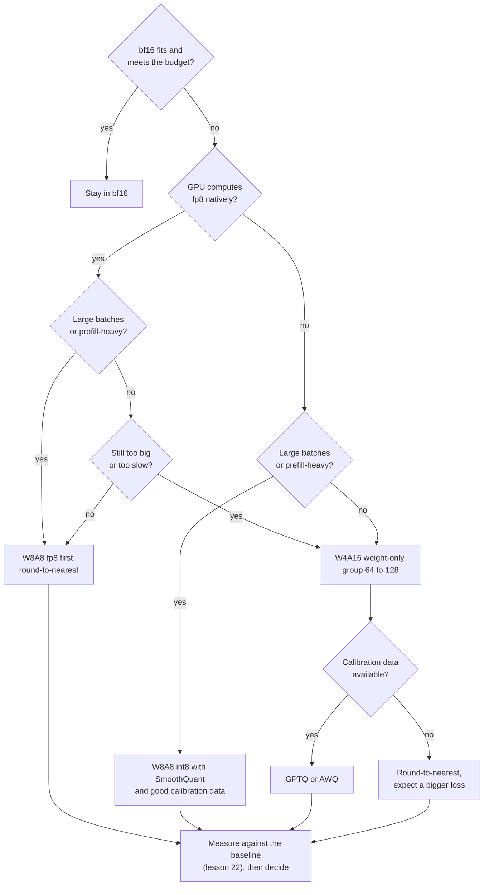

# पाठ 25. Scheme चुनना

**मिशन से संबंध:** यह track इस भरोसे के साथ ख़त्म होता है कि आप quantization पर फ़ैसला ले सकें और उसे किसी और को समझा सकें। हर पिछला पाठ एक लीवर सिखाता था। यह पाठ वह क्रम है जिसमें आप उन्हें खींचते हैं, और हर खिंचाव के लिए वह सबूत जो आप देते हैं।
**मुख्य स्रोत:** [पेपर: "Give Me BF16 or Give Me Death? Accuracy-Performance Trade-Offs in LLM Quantization", Kurtic et al., 2024](https://arxiv.org/abs/2411.02355), sections 4 से 6
**पूर्व-आवश्यकताएँ:** [पाठ 24](0024-gguf-quant-types.md), [Weight-only quantization](../GLOSSARY.md), [Memory-bound](../GLOSSARY.md), [Compute-bound](../GLOSSARY.md), [Effective bits per weight](../GLOSSARY.md)

## वार्म-अप

1. ▢ एक 4-bit scheme हर 64 weights के group के लिए एक 16-bit scale store करती है। यह प्रति weight कितने effective bits हैं?

<details markdown="1"><summary>जाँचें</summary>

4.25। Scale value के 4 bits में प्रति weight 16 / 64 = 0.25 bits जोड़ता है (पाठ 1 और 6)।

</details>

2. ▢ Weight-only quantization batch-1 decode को तेज़ क्यों करता है, और बड़े batch के prefill को धीमा क्यों कर सकता है?

<details markdown="1"><summary>जाँचें</summary>

Batch-1 decode memory-bound है, इसलिए कम weight bytes पढ़ना समय घटाता है। बड़े batch का prefill compute-bound है, इसलिए bytes कभी सीमा थे ही नहीं, और kernel को फिर भी अंदर आते हुए हर weight को dequantize करना पड़ता है (पाठ 19)।

</details>

3. ▢ GPTQ को क्या चाहिए जो round-to-nearest को नहीं चाहिए, और उसके साथ क्या ग़लत हो सकता है?

<details markdown="1"><summary>जाँचें</summary>

Calibration set, जिससे वह second-order जानकारी लेता है ताकि हर rounding error को अभी quantize न हुए weights पर ख़र्च कर सके। अगर set traffic जैसा नहीं दिखता, तो compensation ग़लत inputs पर fit हो जाता है (पाठ 9, 10 और 12)।

</details>

## यह जानें

### सवालों का क्रम

"कौन-सी scheme?" का कोई उत्तर नहीं जब तक पाँच तथ्य पता न हों। उन्हें इसी क्रम में पूछें, क्योंकि हर एक अगले के पूछे जाने से पहले विकल्प हटा देता है।

1. **क्या quantization की ज़रूरत भी है?** अगर bf16 weights और KV cache समा जाते हैं और latency का बजट पूरा होता है, तो quantizing वह कुछ नहीं ख़रीदता जिसकी आपको ज़रूरत हो। उस फ़ैसले का serving वाला पक्ष, यानी latency बजट, inference track में है: उसकी [Serve Time पर Quantization शीट](../../inference/reference/quantization-at-serve-time.md) देखें। यह पाठ उस बिंदु से शुरू होता है जहाँ आप तय कर चुके हैं कि आपको कम bits चाहिए।
2. **Hardware natively क्या compute करता है?** Kurtic et al. उन formats का अध्ययन करते हैं जिनके लिए vLLM में कुशल kernel support है: NVIDIA Ampere और पुराने GPUs के लिए 8-bit integer weights और activations (W8A8-INT), और Hopper और Ada Lovelace के लिए 8-bit floating point (W8A8-FP), साथ ही 16-bit activations के साथ 4-bit integer weights (W4A16-INT)। पाठ 20 बताता है कि kernel के बिना format store होता है पर compute नहीं होता।
3. **Batch का आकार क्या है?** Memory-bound serving (छोटे batches, decode) कम weight bytes को इनाम देती है। Compute-bound serving (बड़े batches, prefill) सस्ते arithmetic को इनाम देती है, जो सिर्फ़ वह scheme देती है जो activations को भी quantize करे। Kurtic et al. कहते हैं कि इष्टतम scheme "prefill और decode tokens के अनुपात पर निर्भर करती है"।
4. **Quality की सीमा क्या है?** Schemes देखने से पहले उसे तय करें, अपने tasks पर संख्या के रूप में (पाठ 22), अहसास के रूप में नहीं।
5. **क्या calibration data है, या training बजट?** Round-to-nearest को दोनों में से कुछ नहीं चाहिए। GPTQ और AWQ को calibration set चाहिए। Quantization-aware training को training run चाहिए (पाठ 18), जो ज़्यादातर teams के पास नहीं होता।



Diagram आज़माने का default क्रम है, प्रमाण नहीं। उसका आख़िरी box वह है जो बाक़ियों को पलट देता है: जो scheme आपके tasks पर आपकी माप में विफल हो वह बाहर है, पेपर ने कुछ भी पाया हो।

### Kurtic et al. ने क्या मापा

उनका अध्ययन पूरे Llama-3.1 परिवार पर FP8, INT8 और INT4 schemes के 500,000 से ज़्यादा evaluations में फैला है, academic benchmarks और असली दुनिया के tasks पर accuracy के साथ, और vLLM में serving throughput भी ([सार](https://arxiv.org/abs/2411.02355))। चार निष्कर्ष फ़ैसले को ढोते हैं:

- **Accuracy।** W8A8-FP हर आकार पर प्रभावी रूप से lossless है। ठीक से tune किया W8A8-INT 1 से 3 प्रतिशत खोता है। W4A16-INT अपेक्षा से ज़्यादा प्रतिस्पर्धी है और 8-bit को टक्कर देता है: Open LLM Leaderboard V1 tasks पर 8-bit schemes bf16 औसत का 99.75 प्रतिशत वापस पाती हैं और W4A16-INT 99.36 प्रतिशत।
- **जहाँ सावधानी चाहिए।** W8A8-INT ने 70B पर ध्यान देने लायक़ accuracy गिरावट दिखाई जब तक लेखकों ने SmoothQuant नहीं लगाया, और बड़े models को random tokens से बेहतर calibration data चाहिए था, जो 8B पर काफ़ी था। सबसे छोटे models INT4 पर थोड़ा ज़्यादा खोते हैं।
- **Synchronous serving** (एक समय में एक query): W4A16 सबसे किफ़ायती है। 8B और 70B पर उसने bf16 के मुक़ाबले प्रति query लागत 2 से 3 गुना घटाई और latency 1.5 से 2.5 गुना सुधारी।
- **Asynchronous serving** (continuous batching): W8A8 throughput में हावी है। उनके latency-throughput curves कम latency पर W4A16 को आगे और ऊँची latency पर W8A8 को आगे दिखाते हैं, और crossover model के आकार, hardware और task पर निर्भर करता है। मिश्रित workloads के लिए, वे कहते हैं कि चुनाव उपयोग पर निर्भर करता है।

यह batch के आकार वाले सवाल का उत्तर मापों से है। यह उसके पीछे के kernel विश्लेषण से मेल खाता है: MARLIN पेपर दिखाता है कि 4-bit-weight kernel 16 से 32 तक के batch sizes तक अधिकतम 4 गुना speed-up के क़रीब बना रहता है, और batch size 128 तक धीरे-धीरे लगभग 1.5 गुना पर गिरता है क्योंकि समस्या compute-bound हो जाती है ([Frantar et al., 2024](https://arxiv.org/abs/2408.11743))।

### 4-bit weights के पक्ष में तर्क

Dettmers और Zettlemoyer ने 19M से 176B parameters तक के OPT, BLOOM, Pythia और GPT-2 models पर 35,000 से ज़्यादा experiments चलाए, यह खोजते हुए कि model के कुल bits की तय संख्या के लिए कौन-सी bit width सबसे अच्छी zero-shot accuracy देती है। उनकी खोज है कि 4-bit precision लगभग सार्वभौम रूप से इष्टतम है। 8 bits पर 30B model और 4 bits पर 60B model bits की उतनी ही संख्या रखते हैं, और 4-bit वाला बेहतर सौदा है ([पेपर](https://arxiv.org/abs/2212.09720))। उनकी सिफ़ारिश है कि छोटे block size (उनके अध्ययन में ज़्यादातर 4-bit models के लिए 64 से 128 इष्टतम था) और float data type के साथ 4-bit इस्तेमाल करें।

पढ़ें कि वह किसकी इजाज़त देता है। वह कहता है कि जब memory बजट हो, तो उसे 8 bits पर छोटे model की जगह 4 bits पर बड़े model पर ख़र्च करें। वह यह नहीं कहता कि 4-bit सबसे अच्छा चुनाव है जब बड़े batches में गति बजट हो, क्योंकि वह accuracy को कुल bits के सामने मापता है, throughput को नहीं। उसे 2022 के दौर के model परिवारों पर मापा गया था, जिस पर पाठ 27 लौटता है।

### तीन परिदृश्य

- **24 GB card पर एक user के लिए 30B-श्रेणी का model।** Batch 1 memory-bound है, और अकेले bf16 weights लगभग 60 GB हैं। 128 के group size के साथ 4-bit weight-only scheme प्रति weight लगभग 4.125 bits store करती है, यानी लगभग 15.5 GB, KV cache के लिए जगह छोड़ते हुए। Dettmers और Zettlemoyer इसे 8 bits पर छोटे model के ऊपर पसंद करते हैं। अगर आपके पास calibration data है तो GPTQ या AWQ इस्तेमाल करें, और भरोसा करने से पहले bf16 के मुक़ाबले मापें।
- **Hopper GPUs पर दस लाख documents पर offline job।** सिर्फ़ throughput मायने रखता है और batches बड़े हैं, इसलिए काम compute-bound है। W8A8-FP पहली कोशिश है: Kurtic et al. ने उसे प्रभावी रूप से lossless पाया, और वह round-to-nearest, per-token dynamic activation scales और बिना calibration data के बना था।
- **70B model के लिए interactive API, हर replica पर कुछ एक साथ चल रहे requests।** Decode हावी है और memory-bound है। उनके synchronous नतीजों में W4A16 सबसे किफ़ायती है। Quality अपने tasks पर जाँचें, और गति उस batch size पर जिस पर आप असल में चलाते हैं।

## अभ्यास

1. ▢ इस पाठ के क्रम में पाँचों सवालों के नाम बताएँ।

<details markdown="1"><summary>जाँचें</summary>

क्या quantization की ज़रूरत भी है, hardware natively क्या compute करता है, batch का आकार क्या है, quality की सीमा क्या है, और क्या calibration data है या training बजट। क्रम मायने रखता है क्योंकि पहले तीन quality की सीमा बचे हुए पर लगाने से पहले विकल्प हटा देते हैं।

</details>

2. ▢ कोई team Hopper GPUs पर offline batch job के लिए 8B model serve करती है, सिर्फ़ throughput। सबूत कौन-सा चुनाव पसंद करता है?

    - a) FP8 weights और activations, round-to-nearest के साथ
    - b) 4-bit weights, 16-bit activations, GPTQ के साथ
    - c) पूरी quantization-aware training के साथ 2-bit weights
    - d) हर जगह bf16 रखें, quantization बिल्कुल छोड़ दें

<details markdown="1"><summary>जाँचें</summary>

**a)** बड़े batches compute-bound हैं, asynchronous नतीजों में W8A8 throughput में हावी है, और W8A8-FP प्रभावी रूप से lossless था और उसे calibration data नहीं चाहिए। (b) कम-latency decode के लिए सही चुनाव है और ऊँचे throughput पर पिछड़ता है। (c) के पक्ष में इस पाठ के स्रोतों में कोई समर्थन नहीं है और उसे training run चाहिए। (d) उस throughput फ़ायदे को छोड़ देता है जिसके लिए job है, हालाँकि वह मापने के लिए उचित baseline है।

</details>

3. ▢ पहले अनुमान लगाएँ, फिर चलाएँ। किसी team के पास weights के लिए 24 GB है। bf16, int8, और 128 के हर group पर 16-bit scale के साथ 4-bit में समाने वाली सबसे बड़ी parameter संख्या अनुमानित करें। फिर इसे चलाएँ और तुलना करें।

    ```python
    budget_gb = 24
    for name, bits in [("bf16", 16), ("int8", 8), ("4-bit, group of 128", 4 + 16 / 128)]:
        params_b = budget_gb * 8 / bits
        print(f"{name:22s} {bits:6.3f} bits  max {params_b:5.1f}B parameters")
    ```

<details markdown="1"><summary>संकेत</summary>

Parameters बजट के bits को प्रति parameter bits से भाग देने पर मिलते हैं। 4-bit वाली पंक्ति में group scale गिनें।

</details>

<details markdown="1"><summary>जाँचें</summary>

```text
bf16                   16.000 bits  max  12.0B parameters
int8                    8.000 bits  max  24.0B parameters
4-bit, group of 128     4.125 bits  max  46.5B parameters
```

ये सिर्फ़ weights हैं, इसलिए KV cache और activations गिनने पर असली सीमाएँ कम हैं। तीनों पंक्तियाँ bits की उतनी ही संख्या रखती हैं, जो वही तुलना है जो Dettmers और Zettlemoyer करते हैं। उनकी खोज 4-bit वाली पंक्ति के पक्ष में है, अगर उस आकार का model आपके चाहे परिवार में मौजूद हो और kernel काफ़ी तेज़ हो।

</details>

4. ▢ किसी design note में लिखा है "हम अपने रात के batch scoring job के लिए W4A16 इस्तेमाल करते हैं क्योंकि Dettmers और Zettlemoyer ने दिखाया कि 4-bit इष्टतम है।" उस औचित्य में क्या ग़लत है, और आप क्या माँगेंगे?

<details markdown="1"><summary>जाँचें</summary>

पेपर zero-shot accuracy को 2022 के दौर के परिवारों पर model के कुल bits के सामने मापता है। वह बड़े batches पर throughput के बारे में कुछ नहीं कहता, जहाँ Kurtic et al. ने W8A8 को आगे पाया। उस batch size की माँग करें जिस पर job चलता है, उस hardware पर दोनों schemes के लिए मापा गया throughput, और scoring task पर bf16 के मुक़ाबले accuracy की तुलना। चुनाव फिर भी सही हो सकता है अगर memory बाँधने वाली बाध्यता है, पर यह पेपर उसे नहीं दिखाता।

</details>

5. ▢ आपको Ampere GPUs पर 70B model serve करना है, ज़्यादातर batch sizes 1 से 4, अपने ही prompts से लिए calibration set के साथ। कोई scheme चुनें और बताएँ कि शिप करने से पहले आप क्या मापेंगे।

<details markdown="1"><summary>जाँचें</summary>

128 के group size के साथ W4A16 weight-only, आपके calibration set के साथ GPTQ या AWQ से quantize किया हुआ। Ampere में native fp8 नहीं है, batch इतना छोटा है कि memory-bound रहे, और 4-bit वह जगह है जहाँ memory और decode-latency के फ़ायदे हैं। Quantized model को bf16 के मुक़ाबले अपने tasks पर उसी harness से मापें (पाठ 22), accuracy के साथ flips भी बताएँ (पाठ 21), और decode का समय batch sizes 1 और 4 पर उस kernel से नापें जो आप deploy करेंगे, पेपर वाले से नहीं।

</details>

## असली दुनिया का अभ्यास

- [ ] कोई model चुनें जो आप serve करते हैं या करना चाहते हैं। पाँचों सवालों में से हर एक के उसके उत्तर लिखें, और जहाँ मसौदा योजना diagram से अलग है, वहाँ क्यों।
- [ ] [vLLM quantization दस्तावेज़](https://docs.vllm.ai/en/latest/features/quantization/) खोलें और पता करें कि इस पाठ की schemes में से आपका GPU कौन-सी support करता है। जिनके लिए kernel नहीं है उन्हें नोट करें।
- [ ] कल: बिना नोट्स के decision flow याद से दोबारा बनाएँ, फिर बताएँ कि किसी ऐसे model के लिए जिसे आप जानते हैं आप पहले कौन-सा सवाल पूछेंगे।

## आगे बढ़ने के लिए

- [Quantization Review Checklist शीट](../reference/quantization-review-checklist.md)
- [Inference: Serve Time पर Quantization](../../inference/reference/quantization-at-serve-time.md), जहाँ serving latency बजट तय करता है कि आप कितने bits वहन कर सकते हैं
- [पेपर: "The case for 4-bit precision: k-bit Inference Scaling Laws", Dettmers and Zettlemoyer, 2022](https://arxiv.org/abs/2212.09720)
- [पेपर: "MARLIN: Mixed-Precision Auto-Regressive Parallel Inference on Large Language Models", Frantar et al., 2024](https://arxiv.org/abs/2408.11743)
- [संसाधन](../RESOURCES.md)

---

बात नहीं बन रही? ऊपर दिए मुख्य स्रोत को दोबारा पढ़ें, क्योंकि यह पाठ उसे संक्षिप्त करता है और समझ संक्षेप में ही रिसती है। जो शब्द फिसलन भरा लगे, उसके लिए [शब्दावली](../GLOSSARY.md) देखें।

अगर दिक़्क़त सामग्री की नहीं बल्कि पाठ की ही है, तो वह एक खोट है: [issue खोलें](https://github.com/TokenCemetery/teach/issues)।
