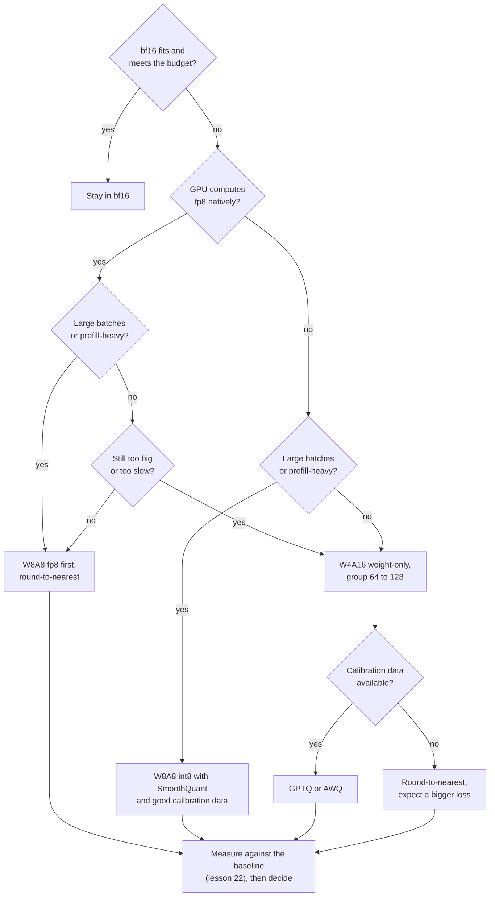

# Lesson 25. Choosing a Scheme

**Mission link:** The track ends with trusting you to make the call on a quantization and to explain it to someone else. Every earlier lesson taught one lever. This one is the order in which you pull them, and the evidence you cite for each pull.
**Primary source:** [Paper: "Give Me BF16 or Give Me Death? Accuracy-Performance Trade-Offs in LLM Quantization", Kurtic et al., 2024](https://arxiv.org/abs/2411.02355), sections 4 to 6
**Prerequisites:** [Lesson 24](0024-gguf-quant-types.md), [Weight-only quantization](../GLOSSARY.md), [Memory-bound](../GLOSSARY.md), [Compute-bound](../GLOSSARY.md), [Effective bits per weight](../GLOSSARY.md)

## Warm-up

1. ▢ A 4-bit scheme stores a 16-bit scale for every group of 64 weights. How many effective bits per weight is that?

<details markdown="1"><summary>Check</summary>

4.25. The scale adds 16 / 64 = 0.25 bits per weight to the 4 bits of the value (lessons 1 and 6).

</details>

2. ▢ Why does weight-only quantization speed up batch-1 decode, and why can it slow down a large-batch prefill?

<details markdown="1"><summary>Check</summary>

Batch-1 decode is memory-bound, so reading fewer weight bytes cuts the time. A large-batch prefill is compute-bound, so the bytes were never the limit, and the kernel still has to dequantize every weight on the way in (lesson 19).

</details>

3. ▢ What does GPTQ need that round-to-nearest does not, and what can go wrong with it?

<details markdown="1"><summary>Check</summary>

A calibration set, from which it takes second-order information to spend each rounding error on the weights not yet quantized. If the set does not look like the traffic, the compensation is fitted to the wrong inputs (lessons 9, 10 and 12).

</details>

## Know this

### The order of the questions

"Which scheme?" has no answer until five facts are known. Ask them in this order, because each one removes options before the next is asked.

1. **Is quantization needed at all?** If bf16 weights plus the KV cache fit and the latency budget is met, quantizing buys nothing you need. The serving side of that decision, the latency budget, lives in the inference track: see its [Quantization at Serve Time sheet](../../inference/reference/quantization-at-serve-time.md). This lesson starts from the point where you have decided you need fewer bits.
2. **What does the hardware compute natively?** Kurtic et al. study the formats with efficient kernel support in vLLM: 8-bit integer weights and activations (W8A8-INT) for NVIDIA Ampere and older GPUs, and 8-bit floating point (W8A8-FP) for Hopper and Ada Lovelace, plus 4-bit integer weights with 16-bit activations (W4A16-INT). Lesson 20 says why a format without a kernel is stored but not computed.
3. **What is the batch shape?** Memory-bound serving (small batches, decode) rewards fewer weight bytes. Compute-bound serving (large batches, prefill) rewards cheaper arithmetic, which only a scheme that quantizes the activations too provides. Kurtic et al. say the optimal scheme "depends on the ratio of prefill to decode tokens".
4. **What is the quality bar?** Decide it before looking at schemes, as a number on your own tasks (lesson 22), not as a feeling.
5. **Is there calibration data, or a training budget?** Round-to-nearest needs neither. GPTQ and AWQ need a calibration set. Quantization-aware training needs a training run (lesson 18), which most teams do not have.



The diagram is a default order of tries, not a proof. Its last box is the one that overrides the others: a scheme that fails your measurement on your tasks is out, whatever a paper found.

### What Kurtic et al. measured

Their study spans over 500,000 evaluations of FP8, INT8 and INT4 schemes on the whole Llama-3.1 family, with accuracy on academic benchmarks and on real-world tasks, plus serving throughput in vLLM ([abstract](https://arxiv.org/abs/2411.02355)). Four findings carry the decision:

- **Accuracy.** W8A8-FP is effectively lossless at every size. A well-tuned W8A8-INT loses 1 to 3 percent. W4A16-INT is more competitive than expected and rivals 8-bit: on the Open LLM Leaderboard V1 tasks the 8-bit schemes recover 99.75 percent of the bf16 average and W4A16-INT 99.36 percent.
- **Where it needs care.** W8A8-INT showed noticeable accuracy drops at 70B until the authors applied SmoothQuant, and larger models needed better calibration data than random tokens, which sufficed at 8B. The smallest models lose a bit more at INT4.
- **Synchronous serving** (one query at a time): W4A16 is the most cost-efficient. At 8B and 70B it cut cost per query by 2 to 3 times and improved latency by 1.5 to 2.5 times against bf16.
- **Asynchronous serving** (continuous batching): W8A8 dominates throughput. Their latency-throughput curves show W4A16 ahead at low latency and W8A8 ahead at high latency, and the crossover depends on model size, hardware and task. For mixed workloads, they say the choice depends on the use case.

That is the batch-shape question answered with measurements. It matches the kernel analysis behind it: the MARLIN paper shows a 4-bit-weight kernel holding close to the maximum 4 times speed-up up to batch sizes of 16 to 32, falling gradually to about 1.5 times by batch size 128 as the problem becomes compute-bound ([Frantar et al., 2024](https://arxiv.org/abs/2408.11743)).

### The case for 4-bit weights

Dettmers and Zettlemoyer ran more than 35,000 experiments on OPT, BLOOM, Pythia and GPT-2 models from 19M to 176B parameters, looking for the bit width that gives the best zero-shot accuracy for a fixed number of total model bits. Their finding is that 4-bit precision is almost universally optimal. A 30B model at 8 bits and a 60B model at 4 bits hold the same number of bits, and the 4-bit one is the better buy ([paper](https://arxiv.org/abs/2212.09720)). Their recommendation is to use 4-bit with a small block size (64 to 128 was optimal for most 4-bit models in their study) and a float data type.

Read what it licenses. It says that when memory is the budget, spend it on a bigger model at 4 bits rather than a smaller one at 8. It does not say 4-bit is the best choice when speed under large batches is the budget, because it measures accuracy against total bits, not throughput. It was measured on 2022-era model families, which lesson 27 returns to.

### Three scenarios

- **A 30B-class model for one user on a 24 GB card.** Batch 1 is memory-bound, and bf16 weights alone are about 60 GB. A 4-bit weight-only scheme with group size 128 stores about 4.125 bits per weight, so about 15.5 GB, leaving room for the KV cache. Dettmers and Zettlemoyer favour this over a smaller model at 8 bits. Use GPTQ or AWQ if you have calibration data, and measure against bf16 before trusting it.
- **An offline job over a million documents on Hopper GPUs.** Only throughput matters and batches are large, so the work is compute-bound. W8A8-FP is the first try: Kurtic et al. found it effectively lossless, and it was built with round-to-nearest, per-token dynamic activation scales and no calibration data.
- **An interactive API for a 70B model, a few concurrent requests per replica.** Decode dominates and is memory-bound. W4A16 is the most cost-efficient in their synchronous results. Check the quality on your own tasks, and the speed at the batch size you actually run.

## Practice

1. ▢ Name the five questions in the order this lesson asks them.

<details markdown="1"><summary>Check</summary>

Is quantization needed at all, what does the hardware compute natively, what is the batch shape, what is the quality bar, and is there calibration data or a training budget. The order matters because the first three remove options before the quality bar is applied to what is left.

</details>

2. ▢ A team serves an 8B model for an offline batch job on Hopper GPUs, throughput only. Which choice does the evidence favour?

    - a) FP8 weights and activations, using round-to-nearest
    - b) 4-bit weights, 16-bit activations, using GPTQ
    - c) 2-bit weights with full quantization-aware training
    - d) Keep bf16 everywhere, skipping quantization altogether

<details markdown="1"><summary>Check</summary>

**a)** Large batches are compute-bound, W8A8 dominates throughput in the asynchronous results, and W8A8-FP was effectively lossless and needs no calibration data. (b) is the right choice for low-latency decode and loses ground at high throughput. (c) has no support in this lesson's sources and needs a training run. (d) forgoes the throughput gain the job exists for, though it is a fair baseline to measure against.

</details>

3. ▢ Predict, then run. A team has 24 GB for weights. Predict the largest parameter count that fits in bf16, in int8, and in 4-bit with a 16-bit scale per group of 128. Then run this and compare.

    ```python
    budget_gb = 24
    for name, bits in [("bf16", 16), ("int8", 8), ("4-bit, group of 128", 4 + 16 / 128)]:
        params_b = budget_gb * 8 / bits
        print(f"{name:22s} {bits:6.3f} bits  max {params_b:5.1f}B parameters")
    ```

<details markdown="1"><summary>Hint</summary>

Parameters are the budget in bits divided by bits per parameter. Count the group scale in the 4-bit row.

</details>

<details markdown="1"><summary>Check</summary>

```text
bf16                   16.000 bits  max  12.0B parameters
int8                    8.000 bits  max  24.0B parameters
4-bit, group of 128     4.125 bits  max  46.5B parameters
```

These are the weights only, so the real limits are lower once the KV cache and activations are counted. The three rows hold the same number of bits, which is the comparison Dettmers and Zettlemoyer make. Their finding favours the 4-bit row, if a model of that size exists in the family you need and the kernel is fast enough.

</details>

4. ▢ A design note says "We use W4A16 for our nightly batch scoring job because Dettmers and Zettlemoyer showed 4-bit is optimal." What is wrong with the justification, and what would you ask for?

<details markdown="1"><summary>Check</summary>

The paper measures zero-shot accuracy against total model bits on 2022-era families. It says nothing about throughput at large batches, where Kurtic et al. found W8A8 ahead. Ask for the batch size the job runs at, a measured throughput for both schemes on that hardware, and an accuracy comparison against bf16 on the scoring task. The choice may still be right if memory is the binding constraint, but this paper does not show it.

</details>

5. ▢ You must serve a 70B model on Ampere GPUs, mostly batch sizes of 1 to 4, with a calibration set drawn from your own prompts. Choose a scheme and say what you would measure before shipping.

<details markdown="1"><summary>Check</summary>

W4A16 weight-only with group size 128, quantized with GPTQ or AWQ using your calibration set. Ampere has no native fp8, the batch is small enough to be memory-bound, and 4-bit is where the memory and decode-latency gains are. Measure the quantized model against bf16 on your tasks with the same harness (lesson 22), report flips as well as accuracy (lesson 21), and time decode at batch sizes 1 and 4 with the kernel you will deploy, not the paper's.

</details>

## Real-world reps

- [ ] Pick a model you serve or want to serve. Write down its answer to each of the five questions, and where the draft plan differs from the diagram, why.
- [ ] Open the [vLLM quantization documentation](https://docs.vllm.ai/en/latest/features/quantization/) and find which of the schemes in this lesson your GPU supports. Note the ones with no kernel.
- [ ] Tomorrow: without notes, redraw the decision flow from memory, then say which question you would ask first for a model you know.

## Going further

- [Quantization Review Checklist](../reference/quantization-review-checklist.md)
- [Inference: Quantization at Serve Time](../../inference/reference/quantization-at-serve-time.md), where the serving latency budget decides how many bits you can afford
- [Paper: "The case for 4-bit precision: k-bit Inference Scaling Laws", Dettmers and Zettlemoyer, 2022](https://arxiv.org/abs/2212.09720)
- [Paper: "MARLIN: Mixed-Precision Auto-Regressive Parallel Inference on Large Language Models", Frantar et al., 2024](https://arxiv.org/abs/2408.11743)
- [Resources](../RESOURCES.md)

---

Not landing? Reread the primary source at the top, since this lesson compresses it and compression is where understanding leaks. Check the [glossary](../GLOSSARY.md) for any term that felt slippery.

If the lesson itself is unclear rather than the material, that is a defect: [open an issue](https://github.com/TokenCemetery/teach/issues).
