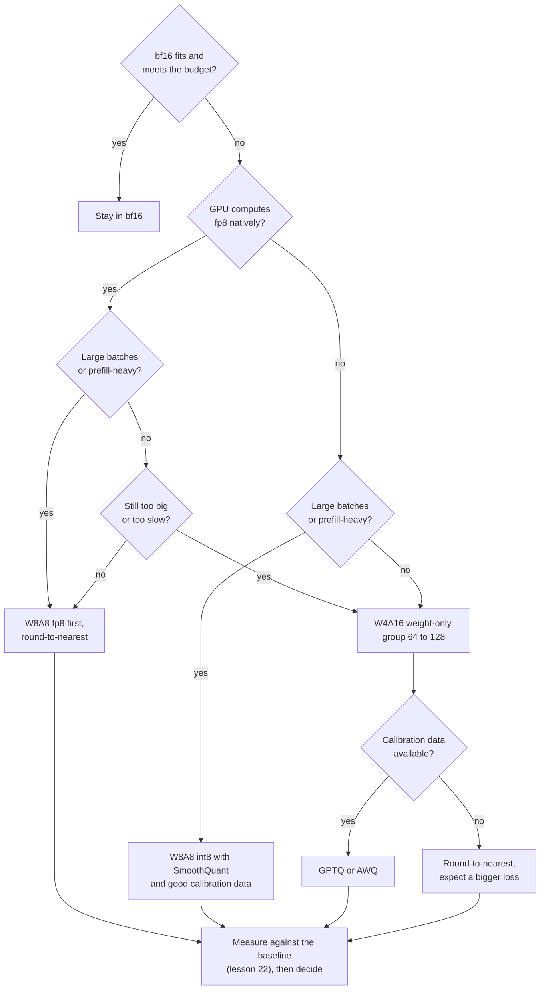

# Lição 25. Escolhendo um esquema

**Ligação com a missão:** A trilha termina confiando a você a decisão sobre uma quantização e a tarefa de explicá-la a outra pessoa. Cada lição anterior ensinou uma alavanca. Esta é a ordem em que você as puxa, e a evidência que você cita para cada puxada.
**Fonte principal:** [Artigo científico: "Give Me BF16 or Give Me Death? Accuracy-Performance Trade-Offs in LLM Quantization", Kurtic et al., 2024](https://arxiv.org/abs/2411.02355), seções 4 a 6
**Pré-requisitos:** [Lição 24](0024-gguf-quant-types.md), [Quantização somente de pesos](../GLOSSARY.md), [Limitado pela largura de banda de memória](../GLOSSARY.md), [Limitado por compute](../GLOSSARY.md), [Bits efetivos por peso](../GLOSSARY.md)

## Aquecimento

1. ▢ Um esquema de 4 bits armazena uma scale de 16 bits para cada grupo de 64 pesos. Quantos bits efetivos por peso isso dá?

<details markdown="1"><summary>Verificação</summary>

4.25. A scale acrescenta 16 / 64 = 0.25 bit por peso aos 4 bits do valor (lições 1 e 6).

</details>

2. ▢ Por que a quantização somente de pesos acelera o decode com batch 1, e por que ela pode deixar o prefill com batch grande mais lento?

<details markdown="1"><summary>Verificação</summary>

O decode com batch 1 é limitado pela largura de banda de memória, então ler menos bytes de pesos reduz o tempo. O prefill com batch grande é limitado por compute, então os bytes nunca foram o limite, e o kernel ainda precisa dequantizar cada peso na entrada (lição 19).

</details>

3. ▢ O que o GPTQ precisa que o round-to-nearest não precisa, e o que pode dar errado com isso?

<details markdown="1"><summary>Verificação</summary>

Um calibration set, do qual ele tira informação de segunda ordem para gastar cada erro de arredondamento nos pesos ainda não quantizados. Se o conjunto não se parece com o tráfego, a compensação é ajustada às entradas erradas (lições 9, 10 e 12).

</details>

## Saiba isto

### A ordem das perguntas

"Qual esquema?" não tem resposta até que cinco fatos sejam conhecidos. Pergunte-os nesta ordem, porque cada um remove opções antes de o próximo ser perguntado.

1. **A quantização é necessária, afinal?** Se os pesos em bf16 mais o KV cache cabem e o orçamento de latência é cumprido, quantizar não compra nada de que você precise. O lado de serving dessa decisão, o orçamento de latência, vive na trilha de inference: veja a sua [folha de Quantização no Serving](../../inference/reference/quantization-at-serve-time.md). Esta lição parte do ponto em que você decidiu que precisa de menos bits.
2. **O que o hardware calcula nativamente?** Kurtic et al. estudam os formatos com suporte eficiente de kernel no vLLM: pesos e ativações inteiros de 8 bits (W8A8-INT) para GPUs NVIDIA Ampere e anteriores, e ponto flutuante de 8 bits (W8A8-FP) para Hopper e Ada Lovelace, além de pesos inteiros de 4 bits com ativações de 16 bits (W4A16-INT). A lição 20 diz por que um formato sem kernel é armazenado mas não calculado.
3. **Qual é o formato do batch?** O serving limitado pela largura de banda de memória (batches pequenos, decode) recompensa menos bytes de pesos. O serving limitado por compute (batches grandes, prefill) recompensa aritmética mais barata, que só um esquema que também quantiza as ativações oferece. Kurtic et al. dizem que o esquema ótimo "depende da razão entre tokens de prefill e de decode".
4. **Qual é o nível de qualidade?** Decida-o antes de olhar os esquemas, como um número nas suas próprias tarefas (lição 22), não como uma sensação.
5. **Há dados de calibração, ou um orçamento de treinamento?** O round-to-nearest não precisa de nenhum dos dois. O GPTQ e o AWQ precisam de um calibration set. O treinamento ciente de quantização precisa de uma execução de treinamento (lição 18), que a maioria das equipes não tem.



O diagrama é uma ordem padrão de tentativas, não uma prova. A sua última caixa é a que prevalece sobre as outras: um esquema que falha na sua medição nas suas tarefas está fora, seja o que um artigo tenha encontrado.

### O que Kurtic et al. mediram

O estudo deles abrange mais de 500.000 avaliações de esquemas FP8, INT8 e INT4 em toda a família Llama-3.1, com acurácia em benchmarks acadêmicos e em tarefas do mundo real, além de throughput de serving no vLLM ([resumo](https://arxiv.org/abs/2411.02355)). Quatro achados sustentam a decisão:

- **Acurácia.** O W8A8-FP é efetivamente sem perdas em todo tamanho. Um W8A8-INT bem ajustado perde de 1 a 3 por cento. O W4A16-INT é mais competitivo do que o esperado e rivaliza com o de 8 bits: nas tarefas do Open LLM Leaderboard V1, os esquemas de 8 bits recuperam 99.75 por cento da média do bf16 e o W4A16-INT 99.36 por cento.
- **Onde exige cuidado.** O W8A8-INT mostrou quedas de acurácia perceptíveis em 70B até os autores aplicarem o SmoothQuant, e modelos maiores precisaram de dados de calibração melhores que tokens aleatórios, que bastaram em 8B. Os menores modelos perdem um pouco mais em INT4.
- **Serving síncrono** (uma consulta por vez): o W4A16 é o mais econômico. Em 8B e 70B ele reduziu o custo por consulta em 2 a 3 vezes e melhorou a latência em 1.5 a 2.5 vezes contra o bf16.
- **Serving assíncrono** (continuous batching): o W8A8 domina o throughput. As curvas de latência e throughput deles mostram o W4A16 na frente em latência baixa e o W8A8 na frente em latência alta, e o ponto de cruzamento depende de tamanho do modelo, hardware e tarefa. Para cargas mistas, eles dizem que a escolha depende do caso de uso.

Essa é a pergunta sobre o formato do batch respondida com medições. Ela coincide com a análise de kernels por trás: o artigo do MARLIN mostra um kernel de pesos de 4 bits mantendo perto do máximo de 4 vezes de aceleração até batch sizes de 16 a 32, caindo gradualmente para cerca de 1.5 vez no batch size 128 conforme o problema se torna limitado por compute ([Frantar et al., 2024](https://arxiv.org/abs/2408.11743)).

### O argumento a favor de pesos de 4 bits

Dettmers e Zettlemoyer executaram mais de 35.000 experimentos em modelos OPT, BLOOM, Pythia e GPT-2 de 19M a 176B de parâmetros, buscando a largura em bits que dá a melhor acurácia zero-shot para um número fixo de bits totais do modelo. O achado deles é que a precisão de 4 bits é quase universalmente ótima. Um modelo de 30B em 8 bits e um de 60B em 4 bits guardam o mesmo número de bits, e o de 4 bits é a melhor compra ([artigo](https://arxiv.org/abs/2212.09720)). A recomendação deles é usar 4 bits com um tamanho de bloco pequeno (64 a 128 foi o ótimo para a maioria dos modelos de 4 bits no estudo deles) e um tipo de dado float.

Leia o que isso autoriza. Diz que, quando a memória é o orçamento, gaste-a em um modelo maior em 4 bits em vez de um menor em 8. Não diz que 4 bits é a melhor escolha quando a velocidade sob batches grandes é o orçamento, porque mede acurácia contra bits totais, não throughput. Foi medido em famílias de modelos da era de 2022, a que a lição 27 volta.

### Três cenários

- **Um modelo da classe de 30B para um usuário em uma placa de 24 GB.** O batch 1 é limitado pela largura de banda de memória, e só os pesos em bf16 ocupam cerca de 60 GB. Um esquema somente de pesos de 4 bits com tamanho de grupo 128 armazena cerca de 4.125 bits por peso, então cerca de 15.5 GB, deixando espaço para o KV cache. Dettmers e Zettlemoyer favorecem isso em vez de um modelo menor em 8 bits. Use GPTQ ou AWQ se você tem dados de calibração e meça contra o bf16 antes de confiar.
- **Um job offline sobre um milhão de documentos em GPUs Hopper.** Só o throughput importa e os batches são grandes, então o trabalho é limitado por compute. O W8A8-FP é a primeira tentativa: Kurtic et al. o encontraram efetivamente sem perdas, e ele foi construído com round-to-nearest, scales de ativação dinâmicas por token e nenhum dado de calibração.
- **Uma API interativa para um modelo de 70B, algumas requisições simultâneas por réplica.** O decode domina e é limitado pela largura de banda de memória. O W4A16 é o mais econômico nos resultados síncronos deles. Confira a qualidade nas suas próprias tarefas e a velocidade no batch size que você realmente roda.

## Prática

1. ▢ Nomeie as cinco perguntas na ordem em que esta lição as faz.

<details markdown="1"><summary>Verificação</summary>

A quantização é necessária, afinal, o que o hardware calcula nativamente, qual é o formato do batch, qual é o nível de qualidade e há dados de calibração ou um orçamento de treinamento. A ordem importa porque as três primeiras removem opções antes de o nível de qualidade ser aplicado ao que sobrou.

</details>

2. ▢ Uma equipe serve um modelo de 8B para um job em lote offline em GPUs Hopper, só throughput. Qual escolha a evidência favorece?

    - a) Pesos e ativações FP8, usando round-to-nearest
    - b) Pesos de 4 bits, ativações de 16 bits, usando GPTQ
    - c) Pesos de 2 bits com treinamento ciente de quantização completo
    - d) Manter bf16 em toda parte, pulando a quantização por completo

<details markdown="1"><summary>Verificação</summary>

**a)** Batches grandes são limitados por compute, o W8A8 domina o throughput nos resultados assíncronos, e o W8A8-FP foi efetivamente sem perdas e não precisa de dados de calibração. (b) é a escolha certa para decode de baixa latência e perde terreno em throughput alto. (c) não tem apoio nas fontes desta lição e exige uma execução de treinamento. (d) abre mão do ganho de throughput para o qual o job existe, embora seja um baseline justo para medir contra.

</details>

3. ▢ Preveja e depois execute. Uma equipe tem 24 GB para pesos. Preveja a maior contagem de parâmetros que cabe em bf16, em int8 e em 4 bits com uma scale de 16 bits por grupo de 128. Depois execute isto e compare.

    ```python
    budget_gb = 24
    for name, bits in [("bf16", 16), ("int8", 8), ("4-bit, group of 128", 4 + 16 / 128)]:
        params_b = budget_gb * 8 / bits
        print(f"{name:22s} {bits:6.3f} bits  max {params_b:5.1f}B parameters")
    ```

<details markdown="1"><summary>Dica</summary>

Parâmetros são o orçamento em bits dividido por bits por parâmetro. Conte a scale do grupo na linha de 4 bits.

</details>

<details markdown="1"><summary>Verificação</summary>

```text
bf16                   16.000 bits  max  12.0B parameters
int8                    8.000 bits  max  24.0B parameters
4-bit, group of 128     4.125 bits  max  46.5B parameters
```

Estes são só os pesos, então os limites reais são menores quando o KV cache e as ativações são contados. As três linhas guardam o mesmo número de bits, que é a comparação que Dettmers e Zettlemoyer fazem. O achado deles favorece a linha de 4 bits, se existir um modelo desse tamanho na família de que você precisa e o kernel for rápido o bastante.

</details>

4. ▢ Uma nota de design diz "Usamos W4A16 para o nosso job noturno de pontuação em lote porque Dettmers e Zettlemoyer mostraram que 4 bits é ótimo." O que há de errado na justificativa, e o que você pediria?

<details markdown="1"><summary>Verificação</summary>

O artigo mede a acurácia zero-shot contra os bits totais do modelo em famílias da era de 2022. Ele não diz nada sobre throughput em batches grandes, onde Kurtic et al. encontraram o W8A8 na frente. Peça o batch size em que o job roda, um throughput medido para os dois esquemas nesse hardware e uma comparação de acurácia contra o bf16 na tarefa de pontuação. A escolha ainda pode estar certa se a memória for a restrição determinante, mas este artigo não mostra isso.

</details>

5. ▢ Você precisa servir um modelo de 70B em GPUs Ampere, principalmente com batch sizes de 1 a 4, com um calibration set tirado dos seus próprios prompts. Escolha um esquema e diga o que mediria antes de entregar.

<details markdown="1"><summary>Verificação</summary>

W4A16 somente de pesos com tamanho de grupo 128, quantizado com GPTQ ou AWQ usando o seu calibration set. A Ampere não tem fp8 nativo, o batch é pequeno o bastante para ser limitado pela largura de banda de memória, e 4 bits é onde estão os ganhos de memória e de latência de decode. Meça o modelo quantizado contra o bf16 nas suas tarefas com o mesmo harness (lição 22), reporte flips além da acurácia (lição 21) e cronometre o decode nos batch sizes 1 e 4 com o kernel que você vai implantar, não o do artigo.

</details>

## Prática no mundo real

- [ ] Escolha um modelo que você serve ou quer servir. Anote a resposta dele para cada uma das cinco perguntas e, onde o rascunho do plano difere do diagrama, por quê.
- [ ] Abra a [documentação de quantização do vLLM](https://docs.vllm.ai/en/latest/features/quantization/) e encontre quais dos esquemas desta lição a sua GPU suporta. Anote os que não têm kernel.
- [ ] Amanhã: sem consultar anotações, redesenhe o fluxo de decisão de memória, depois diga qual pergunta você faria primeiro para um modelo que você conhece.

## Para ir além

- [Checklist de Revisão de Quantização](../reference/quantization-review-checklist.md)
- [Inferência: Quantização no Serving](../../inference/reference/quantization-at-serve-time.md), onde o orçamento de latência de serving decide quantos bits você pode pagar
- [Artigo científico: "The case for 4-bit precision: k-bit Inference Scaling Laws", Dettmers e Zettlemoyer, 2022](https://arxiv.org/abs/2212.09720)
- [Artigo científico: "MARLIN: Mixed-Precision Auto-Regressive Parallel Inference on Large Language Models", Frantar et al., 2024](https://arxiv.org/abs/2408.11743)
- [Recursos](../RESOURCES.md)

---

Não ficou claro? Releia a fonte principal no topo, já que esta lição a comprime e é na compressão que o entendimento escapa. Consulte o [glossário](../GLOSSARY.md) para qualquer termo que pareceu escorregadio.

Se o problema é a lição em si, e não o material, isso é um defeito: [abra uma issue](https://github.com/TokenCemetery/teach/issues).
