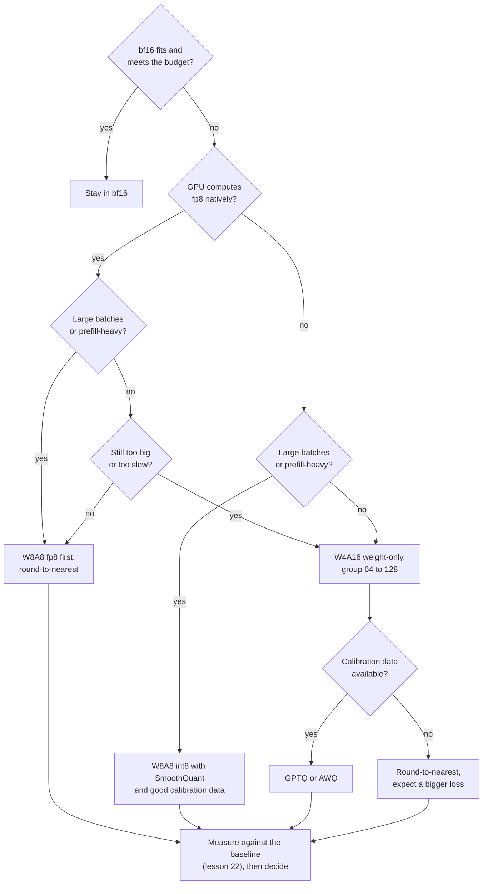

# Урок 25. Выбор схемы

**Связь с целью курса:** Курс заканчивается тем, что вам доверяют принимать решение о квантизации и объяснять его другому. Каждый предыдущий урок учил одному рычагу. Этот учит порядку, в котором их тянут, и свидетельствам, на которые ссылаются при каждом.
**Первоисточник:** [Научная статья: "Give Me BF16 or Give Me Death? Accuracy-Performance Trade-Offs in LLM Quantization", Kurtic et al., 2024](https://arxiv.org/abs/2411.02355), разделы с 4 по 6
**Предварительные требования:** [Урок 24](0024-gguf-quant-types.md), [Квантизация только весов](../GLOSSARY.md), [Ограничение памятью](../GLOSSARY.md), [Ограничение вычислениями](../GLOSSARY.md), [Эффективное число бит на вес](../GLOSSARY.md)

## Разминка

1. ▢ 4-битная схема хранит 16-битный масштаб на каждую группу из 64 весов. Сколько это эффективных бит на вес?

<details markdown="1"><summary>Проверка</summary>

4,25. Масштаб добавляет 16 / 64 = 0,25 бита на вес к 4 битам значения (уроки 1 и 6).

</details>

2. ▢ Почему квантизация только весов ускоряет декодирование при батче 1 и почему она может замедлить prefill с большим батчем?

<details markdown="1"><summary>Проверка</summary>

Декодирование при батче 1 ограничено памятью, поэтому чтение меньшего числа байт весов сокращает время. Prefill с большим батчем ограничен вычислениями, поэтому байты никогда не были пределом, а ядру всё равно приходится деквантизовать каждый вес на входе (урок 19).

</details>

3. ▢ Что нужно GPTQ, но не нужно округлению к ближайшему, и что с этим может пойти не так?

<details markdown="1"><summary>Проверка</summary>

Калибровочный набор, из которого он берёт информацию второго порядка, чтобы потратить каждую ошибку округления на ещё не квантизованные веса. Если набор не похож на трафик, компенсация подгоняется под не те входы (уроки 9, 10 и 12).

</details>

## Что нужно знать

### Порядок вопросов

У вопроса «Какая схема?» нет ответа, пока не известны пять фактов. Задавайте их в этом порядке, потому что каждый убирает варианты до того, как задан следующий.

1. **Нужна ли квантизация вообще?** Если веса в bf16 плюс KV-кеш помещаются и бюджет задержки соблюдается, квантизация не покупает ничего, что вам нужно. Часть этого решения, относящаяся к обслуживанию, бюджет задержки, находится в курсе по инференсу: см. его лист [Квантизация при обслуживании](../../inference/reference/quantization-at-serve-time.md). Этот урок начинается с момента, когда вы решили, что вам нужно меньше бит.
2. **Что оборудование вычисляет нативно?** Kurtic и соавторы изучают форматы с эффективной поддержкой ядрами в vLLM: 8-битные целочисленные веса и активации (W8A8-INT) для NVIDIA Ampere и более старых GPU и 8-битные числа с плавающей точкой (W8A8-FP) для Hopper и Ada Lovelace, плюс 4-битные целочисленные веса с 16-битными активациями (W4A16-INT). Урок 20 говорит, почему формат без ядра хранится, но не вычисляется.
3. **Какова форма батча?** Обслуживание, ограниченное памятью (малые батчи, декодирование), вознаграждает меньшее число байт весов. Обслуживание, ограниченное вычислениями (большие батчи, prefill), вознаграждает более дешёвую арифметику, которую даёт только схема, квантизующая и активации. Kurtic и соавторы говорят, что оптимальная схема «зависит от отношения токенов prefill к токенам декодирования».
4. **Какова планка качества?** Решите это до того, как смотреть на схемы, как число на собственных задачах (урок 22), а не как ощущение.
5. **Есть ли калибровочные данные или бюджет на обучение?** Округлению к ближайшему не нужно ни то, ни другое. GPTQ и AWQ нужен калибровочный набор. Обучению с учётом квантизации нужен запуск обучения (урок 18), которого у большинства команд нет.



Диаграмма это порядок проб по умолчанию, а не доказательство. Её последний блок перекрывает остальные: схема, не прошедшая ваше измерение на ваших задачах, исключается, что бы ни нашла статья.

### Что измерили Kurtic и соавторы

Их исследование охватывает более 500 000 замеров схем FP8, INT8 и INT4 на всём семействе Llama-3.1, с точностью на академических бенчмарках и на реальных задачах, плюс пропускная способность обслуживания в vLLM ([аннотация](https://arxiv.org/abs/2411.02355)). Решение несут четыре результата:

- **Точность.** W8A8-FP фактически без потерь на каждом размере. Хорошо настроенный W8A8-INT теряет 1-3%. W4A16-INT конкурентоспособнее, чем ожидалось, и соперничает с 8-битными: на задачах Open LLM Leaderboard V1 8-битные схемы восстанавливают 99,75% среднего bf16, а W4A16-INT 99,36%.
- **Где нужна осторожность.** W8A8-INT показал заметные падения точности на 70 млрд, пока авторы не применили SmoothQuant, а большим моделям нужны были калибровочные данные получше случайных токенов, которых хватало на 8 млрд. Самые малые модели теряют чуть больше в INT4.
- **Синхронное обслуживание** (по одному запросу за раз): W4A16 наиболее экономичен. На 8 и 70 млрд он сократил стоимость запроса в 2-3 раза и улучшил задержку в 1,5-2,5 раза по сравнению с bf16.
- **Асинхронное обслуживание** (непрерывная пакетная обработка): W8A8 доминирует по пропускной способности. Их кривые задержка-пропускная способность показывают, что W4A16 впереди при малой задержке, а W8A8 при большой, и точка пересечения зависит от размера модели, оборудования и задачи. Для смешанных нагрузок, по их словам, выбор зависит от случая использования.

Это вопрос о форме батча, отвеченный измерениями. Он соответствует стоящему за ним анализу ядер: статья MARLIN показывает, что ядро с 4-битными весами держит близкое к максимальному 4-кратное ускорение до размеров батча 16-32, постепенно падая примерно до 1,5 раза к размеру батча 128, когда задача становится ограниченной вычислениями ([Frantar et al., 2024](https://arxiv.org/abs/2408.11743)).

### Доводы в пользу 4-битных весов

Dettmers и Zettlemoyer провели более 35 000 экспериментов на моделях OPT, BLOOM, Pythia и GPT-2 от 19 млн до 176 млрд параметров, ища разрядность, дающую наилучшую zero-shot-точность при фиксированном общем числе бит модели. Их вывод: 4-битная точность почти универсально оптимальна. Модель на 30 млрд в 8 битах и модель на 60 млрд в 4 битах держат одинаковое число бит, и 4-битная выгоднее ([статья](https://arxiv.org/abs/2212.09720)). Их рекомендация: использовать 4 бита с малым размером блока (64-128 было оптимально для большинства 4-битных моделей в их исследовании) и тип данных с плавающей точкой.

Прочитайте, что это разрешает. Это говорит, что когда бюджет это память, тратьте её на большую модель в 4 битах, а не на меньшую в 8. Это не говорит, что 4 бита лучший выбор, когда бюджет это скорость при больших батчах, потому что измеряется точность против общего числа бит, а не пропускная способность. Это измерено на семействах моделей эпохи 2022 года, к чему возвращается урок 27.

### Три сценария

- **Модель класса 30 млрд для одного пользователя на карте на 24 ГБ.** Батч 1 ограничен памятью, а одни веса в bf16 занимают около 60 ГБ. 4-битная схема только для весов с размером группы 128 хранит около 4,125 бита на вес, то есть около 15,5 ГБ, оставляя место для KV-кеша. Dettmers и Zettlemoyer предпочитают это меньшей модели в 8 битах. Используйте GPTQ или AWQ, если у вас есть калибровочные данные, и измерьте относительно bf16, прежде чем доверять.
- **Офлайн-задача над миллионом документов на GPU Hopper.** Важна только пропускная способность, а батчи большие, поэтому работа ограничена вычислениями. W8A8-FP это первая проба: Kurtic и соавторы нашли его фактически без потерь, а построен он округлением к ближайшему, с динамическими масштабами активаций на токен и без калибровочных данных.
- **Интерактивный API для модели на 70 млрд, несколько одновременных запросов на реплику.** Доминирует декодирование, ограниченное памятью. W4A16 наиболее экономичен в их синхронных результатах. Проверьте качество на своих задачах и скорость при том размере батча, при котором вы действительно работаете.

## Практика

1. ▢ Назовите пять вопросов в порядке, в котором их задаёт этот урок.

<details markdown="1"><summary>Проверка</summary>

Нужна ли квантизация вообще, что оборудование вычисляет нативно, какова форма батча, какова планка качества и есть ли калибровочные данные или бюджет на обучение. Порядок важен, потому что первые три убирают варианты до того, как планка качества применяется к оставшимся.

</details>

2. ▢ Команда обслуживает модель на 8 млрд для офлайн-пакетной задачи на GPU Hopper, только пропускная способность. Какой выбор поддерживает свидетельство?

    - a) Веса и активации в FP8, округлением к ближайшему
    - b) 4-битные веса, 16-битные активации, через GPTQ
    - c) 2-битные веса с полным обучением с учётом квантизации
    - d) Оставить bf16 везде, вовсе пропустив квантизацию

<details markdown="1"><summary>Проверка</summary>

**a)** Большие батчи ограничены вычислениями, W8A8 доминирует по пропускной способности в асинхронных результатах, а W8A8-FP был фактически без потерь и не требует калибровочных данных. (b) это верный выбор для декодирования с малой задержкой и уступает позиции при высокой пропускной способности. (c) не имеет поддержки в источниках этого урока и требует запуска обучения. (d) отказывается от выигрыша в пропускной способности, ради которого существует задача, хотя это честная базовая модель для сравнения.

</details>

3. ▢ Предскажите, затем запустите. У команды 24 ГБ под веса. Предскажите наибольшее число параметров, которое помещается в bf16, в int8 и в 4 битах с 16-битным масштабом на группу из 128. Затем запустите и сравните.

    ```python
    budget_gb = 24
    for name, bits in [("bf16", 16), ("int8", 8), ("4-bit, group of 128", 4 + 16 / 128)]:
        params_b = budget_gb * 8 / bits
        print(f"{name:22s} {bits:6.3f} bits  max {params_b:5.1f}B parameters")
    ```

<details markdown="1"><summary>Подсказка</summary>

Параметры это бюджет в битах, делённый на биты на параметр. Учтите масштаб группы в строке с 4 битами.

</details>

<details markdown="1"><summary>Проверка</summary>

```text
bf16                   16.000 bits  max  12.0B parameters
int8                    8.000 bits  max  24.0B parameters
4-bit, group of 128     4.125 bits  max  46.5B parameters
```

Это только веса, поэтому настоящие пределы ниже, когда учтены KV-кеш и активации. Три строки держат одинаковое число бит, а это сравнение, которое делают Dettmers и Zettlemoyer. Их вывод в пользу строки с 4 битами, если модель такого размера существует в нужном вам семействе и ядро достаточно быстрое.

</details>

4. ▢ Дизайн-заметка говорит: «Мы используем W4A16 для нашей ночной пакетной задачи оценки, потому что Dettmers и Zettlemoyer показали, что 4 бита оптимальны». Что не так с обоснованием и что бы вы попросили?

<details markdown="1"><summary>Проверка</summary>

Статья измеряет zero-shot-точность против общего числа бит модели на семействах эпохи 2022 года. Она ничего не говорит о пропускной способности при больших батчах, где Kurtic и соавторы нашли W8A8 впереди. Попросите размер батча, при котором работает задача, измеренную пропускную способность обеих схем на этом оборудовании и сравнение точности с bf16 на задаче оценки. Выбор всё же может быть верным, если связывающее ограничение это память, но эта статья его не показывает.

</details>

5. ▢ Вам нужно обслуживать модель на 70 млрд на GPU Ampere, в основном размеры батча от 1 до 4, с калибровочным набором из ваших собственных промптов. Выберите схему и скажите, что вы измерили бы перед выпуском.

<details markdown="1"><summary>Проверка</summary>

W4A16 только для весов с размером группы 128, квантизованная GPTQ или AWQ с вашим калибровочным набором. У Ampere нет нативного fp8, батч достаточно мал, чтобы быть ограниченным памятью, а выигрыши по памяти и задержке декодирования лежат в 4 битах. Измерьте квантизованную модель относительно bf16 на ваших задачах с той же обвязкой (урок 22), сообщайте флипы наряду с точностью (урок 21) и замерьте декодирование при размерах батча 1 и 4 с ядром, которое будете развёртывать, а не с ядром из статьи.

</details>

## Практика в реальной работе

- [ ] Выберите модель, которую вы обслуживаете или хотите обслуживать. Запишите её ответ на каждый из пяти вопросов и, где черновой план отличается от диаграммы, почему.
- [ ] Откройте [документацию vLLM по квантизации](https://docs.vllm.ai/en/latest/features/quantization/) и найдите, какие из схем этого урока поддерживает ваш GPU. Отметьте те, у которых нет ядра.
- [ ] Завтра, без заметок, перерисуйте схему решений по памяти, затем скажите, какой вопрос вы задали бы первым для знакомой вам модели.

## Что почитать дальше

- [Чек-лист ревью квантизации](../reference/quantization-review-checklist.md)
- [Инференс: Квантизация при обслуживании](../../inference/reference/quantization-at-serve-time.md), где бюджет задержки обслуживания решает, сколько бит вы можете себе позволить
- [Научная статья: "The case for 4-bit precision: k-bit Inference Scaling Laws", Dettmers and Zettlemoyer, 2022](https://arxiv.org/abs/2212.09720)
- [Научная статья: "MARLIN: Mixed-Precision Auto-Regressive Parallel Inference on Large Language Models", Frantar et al., 2024](https://arxiv.org/abs/2408.11743)
- [Ресурсы](../RESOURCES.md)

---

Не доходит? Перечитайте первоисточник в начале: этот урок его сжимает, а при сжатии понимание как раз и теряется. Загляните в [глоссарий](../GLOSSARY.md), если какой-то термин показался скользким.

Если неясен сам урок, а не материал, это дефект: [откройте issue](https://github.com/TokenCemetery/teach/issues).
