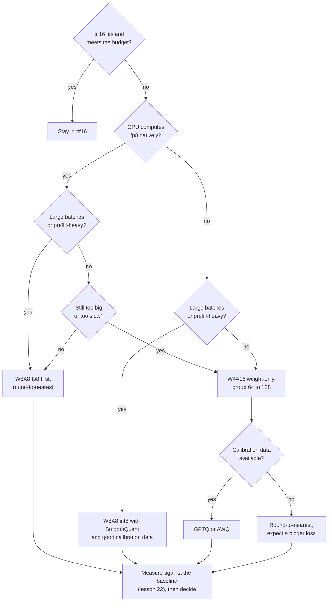

# 第 25 课：选择方案

**使命关联:** 本系列最后要信任你，能对一次量化做出判断，并向他人解释清楚。前面每一课教了一个杠杆。这一课讲的是你拉动它们的顺序，以及每一次拉动时你引用的证据。
**主要来源:** [论文：“Give Me BF16 or Give Me Death? Accuracy-Performance Trade-Offs in LLM Quantization”，Kurtic 等，2024](https://arxiv.org/abs/2411.02355)，第 4 节到第 6 节
**前置知识:** [第 24 课](0024-gguf-quant-types.md)、[仅权重量化](../GLOSSARY.md)、[受内存带宽限制](../GLOSSARY.md)、[受算力限制](../GLOSSARY.md)、[每个权重的有效位数](../GLOSSARY.md)

## 热身

1. ▢ 一个 4 位方案为每组 64 个权重存一个 16 位缩放因子。每个权重的有效位数是多少？

<details markdown="1"><summary>检查</summary>

4.25。缩放因子在这个值的 4 位之上，使每个权重多出 16 / 64 = 0.25 位（第 1 和第 6 课）。

</details>

2. ▢ 为什么仅权重量化能加快批大小为 1 的解码，却可能拖慢大批量的预填充？

<details markdown="1"><summary>检查</summary>

批大小为 1 的解码受内存带宽限制，所以读取更少的权重字节能缩短耗时。大批量的预填充受算力限制，字节从来就不是限制，而内核仍然得在读入的路上，对每个权重做反量化（第 19 课）。

</details>

3. ▢ GPTQ 需要什么，是就近舍入不需要的？它可能出什么问题？

<details markdown="1"><summary>检查</summary>

一个校准集，它从中取得二阶信息，把每一次舍入误差花在尚未量化的权重上。如果这个集合与流量不像，补偿就会拟合在错误的输入上（第 9、10 和第 12 课）。

</details>

## 要点

### 问题的顺序

“选哪种方案？”要等五个事实都弄清楚之后才有答案。按这个顺序去问，因为每一个问题，都在问下一个之前先去掉一些选项。

1. **到底需不需要量化**？如果 bf16 的权重加上 KV 缓存放得下，并且满足延迟预算，量化就买不到你需要的东西。这个决定中关于服务的那一面，也就是延迟预算，属于推理系列：见它的[服务时量化](../../inference/reference/quantization-at-serve-time.md)参考表。本课从你已经决定需要更少的位数的那一点开始。
2. **硬件原生计算什么**？Kurtic 等人研究了 vLLM 中有高效内核支持的格式：用于 NVIDIA Ampere 及更早 GPU 的 8 位整数权重和激活值（W8A8-INT），用于 Hopper 和 Ada Lovelace 的 8 位浮点（W8A8-FP），以及 4 位整数权重配 16 位激活值（W4A16-INT）。第 20 课说明了为什么没有内核的格式只能存储，不能计算。
3. **批的形态是什么**？受内存带宽限制的服务（小批量、解码）奖励更少的权重字节。受算力限制的服务（大批量、预填充）奖励更便宜的算术，而只有同时量化激活值的方案才能提供。Kurtic 等人说，最优方案“取决于预填充 token 与解码 token 之比”。
4. **质量要求是什么**？在看方案之前就定下来，作为你自己的任务上的一个数字（第 22 课），而不是一种感觉。
5. **有没有校准数据，或者训练预算**？就近舍入两者都不需要。GPTQ 和 AWQ 需要校准集。量化感知训练需要一次训练运行（第 18 课），大多数团队都没有。



这张图是一个默认的尝试顺序，不是证明。它的最后一个框，是压倒其余一切的那个：一个在你的任务上通不过你的度量的方案就出局了，不管论文发现了什么。

### Kurtic 等人度量了什么

他们的研究涵盖了在整个 Llama-3.1 系列上，对 FP8、INT8 和 INT4 方案的超过 500,000 次评测，包括学术基准和真实任务上的精度，以及 vLLM 中的服务吞吐量（[摘要](https://arxiv.org/abs/2411.02355)）。有四项发现支撑着这个决定：

- **精度**。W8A8-FP 在每个规模上实际上都是无损的。调得好的 W8A8-INT 损失 1% 到 3%。W4A16-INT 比预期更有竞争力，足以媲美 8 位：在 Open LLM Leaderboard V1 的任务上，8 位方案恢复了 bf16 平均值的 99.75%，W4A16-INT 恢复了 99.36%。
- **需要小心的地方**。W8A8-INT 在 70B 时出现了明显的精度下降，直到作者应用了 SmoothQuant，而更大的模型需要比随机 token 更好的校准数据，随机 token 对 8B 就够了。最小的模型在 INT4 时损失多一点。
- **同步服务**（一次一个查询）：W4A16 最具成本效益。在 8B 和 70B 上，与 bf16 相比，它把每个查询的成本降低了 2 到 3 倍，并把延迟改善了 1.5 到 2.5 倍。
- **异步服务**（连续批处理）：W8A8 在吞吐量上占优。他们的延迟与吞吐量曲线显示，W4A16 在低延迟时领先，W8A8 在高延迟时领先，交叉点取决于模型规模、硬件和任务。对于混合的工作负载，他们说选择取决于用例。

这就是用度量回答了批形态的问题。它与背后的内核分析相吻合：MARLIN 论文显示，4 位权重的内核在批大小最多到 16 至 32 时，保持接近 4 倍的最大加速，随着问题变得受算力限制，到批大小 128 时逐渐降到约 1.5 倍（[Frantar 等，2024](https://arxiv.org/abs/2408.11743)）。

### 支持 4 位权重的理由

Dettmers 与 Zettlemoyer 在从 19M 到 176B 参数的 OPT、BLOOM、Pythia 和 GPT-2 模型上做了超过 35,000 次实验，寻找在模型总位数固定的情况下，哪种位宽给出最好的零样本精度。他们的发现是，4 位精度几乎普遍是最优的。一个 8 位的 30B 模型，与一个 4 位的 60B 模型，含有同样多的位数，而 4 位的那个更划算（[论文](https://arxiv.org/abs/2212.09720)）。他们的建议是，使用小块大小的 4 位（在他们的研究中，64 到 128 对大多数 4 位模型是最优的）和浮点数据类型。

读一读它认可了什么。它说的是，当内存是预算时，把它花在 4 位的更大模型上，而不是 8 位的更小模型上。它没有说当大批量下的速度是预算时，4 位是最佳选择，因为它度量的是精度对总位数，而不是吞吐量。它是在 2022 年代的模型系列上度量的，第 27 课会回到这一点。

### 三个场景

- **一位用户在 24 GB 显卡上跑 30B 级别的模型**。批大小为 1 受内存带宽限制，而光 bf16 的权重就约 60 GB。分组大小为 128 的 4 位仅权重方案，每个权重存约 4.125 位，所以约 15.5 GB，给 KV 缓存留出空间。Dettmers 与 Zettlemoyer 更赞成这个，而不是 8 位的更小模型。如果你有校准数据，就用 GPTQ 或 AWQ，并在相信它之前，对照 bf16 去度量。
- **在 Hopper GPU 上对一百万份文档做离线作业**。只有吞吐量要紧，而且批很大，所以工作是受算力限制的。W8A8-FP 是第一个要试的：Kurtic 等人发现它实际上无损，而且它是用就近舍入、逐 token 动态激活值缩放因子、没有校准数据构建出来的。
- **一个 70B 模型的交互式 API，每个副本有少量并发请求**。解码占主导，并且受内存带宽限制。W4A16 在他们的同步结果里最具成本效益。请在你自己的任务上检查质量，并在你实际运行的批大小上检查速度。

## 练习

1. ▢ 按本课提问的顺序，说出这五个问题。

<details markdown="1"><summary>检查</summary>

到底需不需要量化，硬件原生计算什么，批的形态是什么，质量要求是什么，以及有没有校准数据或训练预算。顺序之所以要紧，是因为前三个问题，在把质量要求用到剩下的选项上之前，就先去掉了一些选项。

</details>

2. ▢ 一个团队在 Hopper GPU 上为一个离线批处理作业提供 8B 模型的服务，只看吞吐量。证据倾向于哪种选择？

    - a) FP8 权重和激活值，用就近舍入
    - b) 4 位权重、16 位激活值，用 GPTQ
    - c) 2 位权重，配完整的量化感知训练
    - d) 处处保持 bf16，完全不量化

<details markdown="1"><summary>检查</summary>

**a)** 大批量受算力限制，在异步结果里 W8A8 在吞吐量上占优，而 W8A8-FP 实际上无损，并且不需要校准数据。(b) 是低延迟解码的正确选择，在高吞吐量下就落后了。(c) 在本课的来源里没有任何支持，并且需要一次训练运行。(d) 放弃了这个作业存在所要追求的吞吐量收益，不过它是一个合理的、可供对照度量的基线。

</details>

3. ▢ 先预测，再运行。一个团队有 24 GB 用于权重。预测在 bf16、int8 以及每 128 个一组配 16 位缩放因子的 4 位下，分别最大能放下多少参数。然后运行并比较。

    ```python
    budget_gb = 24
    for name, bits in [("bf16", 16), ("int8", 8), ("4-bit, group of 128", 4 + 16 / 128)]:
        params_b = budget_gb * 8 / bits
        print(f"{name:22s} {bits:6.3f} bits  max {params_b:5.1f}B parameters")
    ```

<details markdown="1"><summary>提示</summary>

参数个数是以位计的预算除以每个参数的位数。在 4 位那一行里要把分组缩放因子算进去。

</details>

<details markdown="1"><summary>检查</summary>

```text
bf16                   16.000 bits  max  12.0B parameters
int8                    8.000 bits  max  24.0B parameters
4-bit, group of 128     4.125 bits  max  46.5B parameters
```

这些只是权重，所以把 KV 缓存和激活值算进去之后，真实的上限更低。这三行含有同样多的位数，这就是 Dettmers 与 Zettlemoyer 所做的比较。他们的发现倾向于 4 位那一行，前提是你需要的那个系列里存在那个大小的模型，并且内核足够快。

</details>

4. ▢ 一份设计说明写道：“我们的夜间批量打分作业用 W4A16，因为 Dettmers 与 Zettlemoyer 证明了 4 位是最优的。”这个理由错在哪里？你会要求什么？

<details markdown="1"><summary>检查</summary>

那篇论文度量的是 2022 年代模型系列上零样本精度对模型总位数的关系。它对大批量下的吞吐量只字未提，而 Kurtic 等人发现那里 W8A8 领先。要求看到作业运行时的批大小、两种方案在那种硬件上度量到的吞吐量，以及在这个打分任务上对照 bf16 的精度比较。如果内存是约束的瓶颈，这个选择可能仍然是对的，但这篇论文并没有证明它。

</details>

5. ▢ 你必须在 Ampere GPU 上为一个 70B 模型提供服务，批大小多为 1 到 4，并且有一个取自你自己提示词的校准集。选一种方案，并说出你在上线之前会度量什么。

<details markdown="1"><summary>检查</summary>

分组大小为 128 的 W4A16 仅权重，用你的校准集通过 GPTQ 或 AWQ 来量化。Ampere 没有原生 fp8，批小到受内存带宽限制，而 4 位正是内存和解码延迟收益所在。用同一个测评框架，在你的任务上对照 bf16 度量量化后的模型（第 22 课），除了准确率之外还报告翻转（第 21 课），并用你将要部署的内核，而不是论文里的，在批大小 1 和 4 下给解码计时。

</details>

## 实战练习

- [ ] 挑一个你在服务或想要服务的模型。写下它对这五个问题各自的答案，以及草拟的方案与那张图有出入的地方，并说明原因。
- [ ] 打开 [vLLM 量化文档](https://docs.vllm.ai/en/latest/features/quantization/)，找出本课中的方案里，你的 GPU 支持哪些。记下没有内核的那些。
- [ ] 明天：不看笔记，凭记忆重画决策流程，然后说出对一个你熟悉的模型，你会先问哪个问题。

## 延伸阅读

- [量化评审检查清单](../reference/quantization-review-checklist.md)
- [推理：服务时量化](../../inference/reference/quantization-at-serve-time.md)，服务延迟预算在这里决定你能负担多少位
- [论文：“The case for 4-bit precision: k-bit Inference Scaling Laws”，Dettmers 与 Zettlemoyer，2022](https://arxiv.org/abs/2212.09720)
- [论文：“MARLIN: Mixed-Precision Auto-Regressive Parallel Inference on Large Language Models”，Frantar 等，2024](https://arxiv.org/abs/2408.11743)
- [资源](../RESOURCES.md)

---

没学明白？请重读顶部的主要来源，因为本课是对它的压缩，而理解正是在压缩中流失的。如果有哪个术语觉得含糊，可以查看[术语表](../GLOSSARY.md)。

如果问题出在课程本身，而不是学习材料，那就是一个缺陷：[提交 issue](https://github.com/TokenCemetery/teach/issues)。
