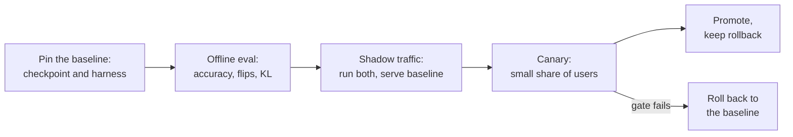

# Lección 26. Revisar una afirmación de cuantización

**Vínculo con la misión:** El track termina confiando en que tomes la decisión sobre una cuantización y se la expliques a otra persona. La mayor parte del tiempo la decisión es sobre una afirmación que hizo otra persona: "4 bits, sin pérdida de calidad". Esta lección es cómo decir qué omite esa frase, y cómo desplegar el modelo sin sorprender a quienes dependen de él.
**Fuente principal:** [Paper: "Accuracy is Not All You Need", Dutta et al., 2024](https://arxiv.org/abs/2407.09141), secciones 1 a 3
**Requisitos previos:** [Lección 25](0025-choosing-a-scheme.md), [Perplexity](../GLOSSARY.md), [Calibration set](../GLOSSARY.md), [Tamaño de grupo](../GLOSSARY.md), [Bits efectivos por peso](../GLOSSARY.md)

## Calentamiento

1. ▢ ¿Qué mide la perplexity, y por qué puede un cambio pequeño en ella convivir con muchas respuestas cambiadas?

<details markdown="1"><summary>Comprobación</summary>

Es la exponencial de la log-verosimilitud negativa promedio que el modelo da a un texto, así que promedia sobre todos los tokens. Los pequeños desplazamientos repartidos entre muchos tokens apenas mueven el promedio, mientras que las respuestas individuales cercanas a una frontera de decisión pueden aun así cambiar (lección 21).

</details>

2. ▢ ¿Qué debe mantener igual una eval honesta de cuantización entre el baseline y el modelo cuantizado?

<details markdown="1"><summary>Comprobación</summary>

El harness, las tareas, los prompts y los ajustes de muestreo, de modo que la única diferencia sean los pesos (lección 22).

</details>

3. ▢ ¿Qué le dice al cargador la configuración de cuantización de un checkpoint cuantizado, y por qué importa para el despliegue?

<details markdown="1"><summary>Comprobación</summary>

Cómo leer los tensores almacenados: el esquema, el ancho de bits, el tamaño de grupo y campos similares (lección 23). Un checkpoint sin su configuración, o con una que no coincide, no es reproducible, así que un despliegue tiene que versionarlos juntos.

</details>

## Qué debes saber

### La afirmación y sus partes

Alguien dice: "Cuantizamos a 4 bits sin pérdida de calidad". Cada parte de esa frase esconde una elección. Una revisión no dice que la afirmación sea errónea. Pide cada elección oculta, y dice qué respuestas harían que la afirmación se sostuviera.

| Parte de la afirmación | Pregunta | Por qué importa |
|---|---|---|
| "Sin pérdida" | ¿Frente a qué baseline? ¿El mismo modelo en bf16, ejecutado en el mismo harness, o un número copiado de una model card? | Kurtic et al. critican un estudio anterior de modelos de hasta 405B por omitir benchmarks abiertos y no informar de baselines de precisión completa ni siquiera en tareas académicas, lo que deja poco claro el impacto de la cuantización ([Kurtic et al., 2024](https://arxiv.org/abs/2411.02355)) |
| "Calidad" | ¿Qué tareas? ¿Opción múltiple, o generación abierta como la tuya? | En el mismo estudio, AWQ superó a GPTQ como mucho en 0.35 puntos en los benchmarks académicos pero GPTQ superó a AWQ en 2.9 puntos en el promedio del mundo real de 8B |
| "Calidad" | ¿Solo perplexity? ¿Sobre qué texto y ventana? | Un cambio de perplexity es un promedio (lección 21) |
| "Calidad" | ¿Flips? ¿Divergencia KL? | Ver más abajo |
| "4 bits" | ¿Qué tamaño de grupo, y por tanto cuántos bits efectivos por peso? | Un scale de 16 bits por grupo de 32 lo deja en 4.5 bits, por grupo de 128 en unos 4.125 (lecciones 1 y 6) |
| "4 bits" | ¿Qué calibration set, de qué tamaño, cuán cercano a tu tráfico? | Un conjunto que no coincide se ajusta a las entradas equivocadas (lección 12) |
| Cualquier afirmación de velocidad | ¿Qué hardware, qué tamaño de lote, qué kernel, frente a qué baseline? | Ver más abajo |

### Por qué el accuracy solo oculta un modelo cambiado

Dutta et al. definen un **flip** como una respuesta que cambió de correcta a incorrecta o de incorrecta a correcta entre el baseline y el modelo comprimido. Comparan seis esquemas de cuantización en siete tareas, entre ellas MMLU, HellaSwag y ARC. El accuracy de todos los esquemas estuvo a un 0 a 2 por ciento del modelo de 16 bits, y aun así todos menos uno (GPTQ con pesos de 8 bits y activaciones de 16 bits) mostraron flips grandes, de hasta el 13.6 por ciento. Su explicación es que las ganancias y las pérdidas se cancelan: el promedio se sostiene mientras muchas respuestas individuales se mueven en ambas direcciones. Donde una tarea es abierta, encontraron que los modelos comprimidos con muchos flips eran significativamente peores en MT-Bench, un benchmark de diálogo de varios turnos, y que las puntuaciones de MT-Bench se correlacionan fuertemente con los flips.

Proponen dos métricas de distancia respecto del baseline: los flips, y la divergencia KL entre las probabilidades de salida de los dos modelos sobre un dataset, e informan de que ambas se correlacionan bien. La diferencia práctica es el costo: los flips necesitan una respuesta correcta por ejemplo, mientras que la divergencia KL solo necesita las probabilidades de ambos modelos sobre el mismo texto. Sus flips excluyen las transiciones de incorrecta a incorrecta, y señalan que incluirlas subiría los números otro 20 a 40 por ciento en las tareas de opción múltiple.

### Por qué una afirmación de velocidad necesita tres respuestas más

Una aceleración es una propiedad conjunta de un esquema, un kernel, una GPU y un tamaño de lote.

- **Tamaño de lote.** MARLIN mantiene cerca de una aceleración de 4 veces para un kernel de pesos de 4 bits hasta tamaños de lote de 16 a 32, y cae a cerca de 1.5 veces en el tamaño de lote 128 ([Frantar et al., 2024](https://arxiv.org/abs/2408.11743)). Un "3 veces más rápido" medido con lote 1 no dice nada sobre el lote 64.
- **Kernel.** QServe informa de que los métodos INT4 existentes sufren una sobrecarga de tiempo de ejecución del 20 al 90 por ciento por descuantizar pesos o sumas parciales en GPU, y de que aceleran la inferencia con lotes pequeños pero no el servicio en la nube con lotes grandes ([Lin et al., 2024](https://arxiv.org/abs/2405.04532)). Los mismos pesos pueden ser rápidos o lentos según el kernel.
- **Baseline.** ¿Más rápido que bf16 en qué stack? Frente a un baseline sin optimizar casi todo parece rápido.

Una revisión que solo lista fallos está a medias. Di qué está bien y debería quedarse: un baseline sólido, un conjunto de tareas held-out, un kernel medido.

### Desplegar un modelo cuantizado del que otros dependen

Cuando una afirmación supera la revisión, el modelo aún tiene que sustituir a uno que la gente usa. Esto es proceso, no un hallazgo de un paper, así que trátalo como un procedimiento de trabajo.



- **Fija el baseline.** Nombra el checkpoint exacto en bf16 y la versión del harness con los que comparas, y sigue sirviéndolo hasta que el nuevo modelo haya pasado.
- **Compara con tráfico parecido al de producción.** Reproduce prompts reales por ambos modelos. Sin respuestas etiquetadas los flips no se pueden calcular, pero puedes comparar distribuciones de salida con la divergencia KL, o comparar salidas con las métricas de similitud que usaron Kurtic et al. (ROUGE, BERTScore y similitud de oraciones) con decodificación voraz.
- **Shadow, luego canary.** El tráfico shadow ejecuta el modelo cuantizado junto al baseline sin servirlo. Un canary sirve a una pequeña parte de los usuarios. Decide la compuerta, el umbral de cada métrica, antes de mirar los resultados (consulta la hoja [Go/No-Go](../../evals/reference/go-no-go.md)).
- **Versiona el checkpoint con su configuración.** Registra la configuración de cuantización, el tamaño de grupo, el calibration set y la versión del stack de servicio junto a los pesos (lección 23), para poder reproducir un resultado y rastrear una regresión.
- **Conserva un rollback.** El baseline sigue siendo desplegable hasta que el canary haya corrido el tiempo suficiente para ver el tráfico que te importa. Volver atrás es un cambio de configuración, no una reconstrucción.

## Práctica

1. ▢ Una entrada de blog dice: "W4A16, perplexity 5.9 frente a 5.8 de bf16, así que sin pérdida". Nombra tres cosas que faltan.

<details markdown="1"><summary>Comprobación</summary>

Tres cualesquiera de: sobre qué texto y ventana se midió la perplexity; cualquier accuracy de tareas; cualquier flip o divergencia KL; el tamaño de grupo y por tanto los bits efectivos; el calibration set; si el 5.8 se ejecutó en el mismo harness. La perplexity es un promedio y no puede mostrar respuestas que cambiaron en ambas direcciones.

</details>

2. ▢ Predice y luego ejecuta. Un baseline responde 100 preguntas y acierta 80. Un modelo cuantizado también acierta 80, pero 10 de las respuestas correctas del baseline pasaron a ser incorrectas y 10 de sus respuestas incorrectas pasaron a ser correctas. Predice el accuracy de cada uno y los flips, y luego ejecuta esto.

    ```python
    base = [1] * 80 + [0] * 20
    quant = base[:]
    for i in range(10):
        quant[i] = 0
    for i in range(80, 90):
        quant[i] = 1
    acc_base = sum(base) / len(base)
    acc_quant = sum(quant) / len(quant)
    flips = sum(b != q for b, q in zip(base, quant)) / len(base)
    print(f"baseline accuracy  {acc_base:.0%}")
    print(f"quantized accuracy {acc_quant:.0%}")
    print(f"flips              {flips:.0%}")
    ```

<details markdown="1"><summary>Pista</summary>

Cuenta cada pregunta en la que los dos modelos discrepan sobre acertar, en cualquier dirección.

</details>

<details markdown="1"><summary>Comprobación</summary>

```text
baseline accuracy  80%
quantized accuracy 80%
flips              20%
```

Accuracy idéntico, una respuesta de cada cinco cambió. Los números están construidos para el ejemplo y no son mediciones, pero la forma es la que describen Dutta et al.: accuracy igual, flips grandes.

</details>

3. ▢ Un informe dice que su modelo cuantizado es "3 veces más rápido que bf16". ¿Qué pregunta cambia más que le creas?

    - a) ¿Qué tamaño de lote, kernel y stack de baseline se midieron?
    - b) ¿Qué método de cuantización produjo los pesos de 4 bits que se cronometraron?
    - c) ¿Qué tokenizer y qué tamaño de vocabulario usa el modelo?
    - d) ¿Qué perplexity alcanzó el modelo cuantizado en Wikitext?

<details markdown="1"><summary>Comprobación</summary>

**a)** Una aceleración es una propiedad conjunta de un esquema, un kernel, una GPU y un tamaño de lote, y los resultados de MARLIN y QServe muestran que varía en grandes factores entre ellos. (b) importa para el accuracy, pero dos métodos que producen el mismo formato de 4 bits corren en el mismo kernel a la misma velocidad. (c) no cambia con la cuantización, así que no puede explicar una aceleración. (d) es una pregunta de calidad y no dice nada sobre la velocidad.

</details>

4. ▢ Revisa esta afirmación, inventada para practicar: "Cuantizamos nuestro modelo de chat de soporte de 8B a AWQ de 4 bits con 128 muestras de calibración de un dataset público de noticias en inglés. La perplexity en Wikitext subió de 6.05 a 6.14, MMLU cayó 0.4 puntos y la generación es 3.1 veces más rápida en una A100 con tamaño de lote 1. Sin pérdida de calidad, así que lo desplegamos a todos los usuarios, incluido el chat en español y portugués". Escribe las preguntas que harías, y qué está bien.

<details markdown="1"><summary>Comprobación</summary>

Preguntas: ¿Es el baseline de 6.05 el mismo modelo en el mismo harness? La perplexity y MMLU no son la calidad del chat de soporte: ¿cuál es la eval abierta, y cuáles son los flips y la KL en conversaciones reales? El calibration set son noticias en inglés mientras que el tráfico incluye chat en español y portugués (lección 12): ¿se midió la calidad en esos idiomas? ¿Qué tamaño de grupo, y por tanto cuántos bits efectivos? El 3.1 veces es con tamaño de lote 1: ¿cuál es el tamaño de lote de producción, y qué kernel y stack de baseline? Lo que está bien y vale la pena conservar: un baseline declarado, una suite de tareas junto a la perplexity, una GPU y un tamaño de lote nombrados, un pequeño cambio en MMLU. Veredicto: todavía no es una afirmación de cero pérdida, y hace falta un canary sobre el tráfico en español y portugués antes de pasar a todos los usuarios.

</details>

5. ▢ Un canary de un modelo cuantizado muestra el mismo accuracy en las tareas que el baseline, pero el 9 por ciento de las conversaciones reproducidas producen una primera respuesta distinta. ¿Promueves, vuelves atrás o esperas? ¿Qué haces a continuación?

<details markdown="1"><summary>Comprobación</summary>

Esperar, no promover solo por el accuracy. Dutta et al. muestran que un accuracy igual puede convivir con flips grandes, y que los flips siguen a la calidad de la generación libre. A continuación, clasifica las respuestas cambiadas: ¿son reformulaciones neutras, o respuestas que un revisor o un juez prefiere menos (lección 22)? Compáralo con la compuerta fijada antes de que empezara el canary. Si no se cumple la compuerta, vuelve atrás al baseline, que por eso siguió desplegado.

</details>

## Prácticas en el mundo real

- [ ] Encuentra una afirmación de que un modelo se cuantizó "sin pérdida" (una model card o una entrada de blog). Lista cuáles de las preguntas de la tabla responde y cuáles deja abiertas.
- [ ] Para un modelo que despliegas o podrías desplegar, escribe el plan de rollback en cinco líneas: qué checkpoint es el baseline, dónde vive su configuración, qué dispara el rollback, quién decide, cuánto tarda.
- [ ] Mañana: calcula los flips entre dos ejecuciones del mismo modelo con temperatura 0 sobre veinte preguntas que te importen, y anota qué te dice el número sobre tu propio piso de ruido.

## Para profundizar

- [Lista de revisión de cuantización](../reference/quantization-review-checklist.md)
- Evals: [Go/No-Go](../../evals/reference/go-no-go.md), para fijar la compuerta con honestidad antes de que empiece el canary
- [Paper: "Accuracy is Not All You Need", Dutta et al., 2024](https://arxiv.org/abs/2407.09141)
- [Paper: "QServe: W4A8KV4 Quantization and System Co-design for Efficient LLM Serving", Lin et al., 2024](https://arxiv.org/abs/2405.04532)
- [Recursos](../RESOURCES.md)

---

¿No termina de quedar claro? Vuelve a leer la fuente primaria de arriba, ya que esta lección la comprime y en la compresión es donde se escapa la comprensión. Consulta el [glosario](../GLOSSARY.md) por si algún término te resultó resbaladizo.

Si lo poco claro es la propia lección y no el material, eso es un defecto: [abre un issue](https://github.com/TokenCemetery/teach/issues).
