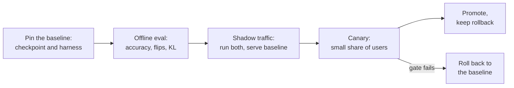

# Leçon 26. Relire une affirmation de quantification

**Lien avec la mission :** Le parcours se termine par la confiance qu'on vous accorde pour trancher sur une quantification et l'expliquer à quelqu'un d'autre. Le plus souvent, la décision porte sur une affirmation que quelqu'un d'autre a faite : « 4 bits, sans perte de qualité. » Cette leçon montre comment dire ce que cette phrase omet, et comment livrer le modèle sans surprendre ceux qui en dépendent.
**Source primaire :** [Article : "Accuracy is Not All You Need", Dutta et al., 2024](https://arxiv.org/abs/2407.09141), sections 1 à 3
**Prérequis :** [Leçon 25](0025-choosing-a-scheme.md), [Perplexity](../GLOSSARY.md), [Calibration set](../GLOSSARY.md), [Taille de groupe](../GLOSSARY.md), [Bits effectifs par poids](../GLOSSARY.md)

## Échauffement

1. ▢ Que mesure la perplexity, et pourquoi un petit changement de sa valeur peut-il côtoyer de nombreuses réponses changées ?

<details markdown="1"><summary>Vérifier</summary>

C'est l'exponentielle de la log-vraisemblance négative moyenne que le modèle donne à un texte, donc elle fait la moyenne sur chaque token. De petits décalages répartis sur de nombreux tokens font à peine bouger la moyenne, alors que des réponses individuelles proches d'une frontière de décision peuvent quand même changer (leçon 21).

</details>

2. ▢ Qu'est-ce qu'une eval de quantification honnête doit garder identique entre la référence et le modèle quantifié ?

<details markdown="1"><summary>Vérifier</summary>

Le harness, les tâches, les prompts et les réglages d'échantillonnage, pour que la seule différence soit les poids (leçon 22).

</details>

3. ▢ Qu'indique la config de quantification d'un checkpoint quantifié au chargeur, et pourquoi cela compte-t-il pour le déploiement ?

<details markdown="1"><summary>Vérifier</summary>

Comment lire les tenseurs stockés : le schéma, la largeur en bits, la taille de groupe et des champs semblables (leçon 23). Un checkpoint sans sa config, ou avec une config qui ne correspond pas, n'est pas reproductible, donc un déploiement doit les versionner ensemble.

</details>

## À savoir

### L'affirmation et ses parties

Quelqu'un dit : « Nous avons quantifié en 4 bits sans perte de qualité. » Chaque partie de cette phrase cache un choix. Une relecture ne dit pas que l'affirmation est fausse. Elle demande chaque choix caché, et dit quelles réponses feraient tenir l'affirmation.

| Partie de l'affirmation | Question | Pourquoi cela compte |
|---|---|---|
| « Sans perte » | Par rapport à quelle référence ? Le même modèle en bf16, exécuté sur le même harness, ou un chiffre copié d'une fiche de modèle ? | Kurtic et al. reprochent à une étude antérieure portant sur des modèles allant jusqu'à 405B d'omettre les benchmarks ouverts et de ne pas rapporter de références en pleine précision même pour les tâches académiques, ce qui laisse l'impact de la quantification peu clair ([Kurtic et al., 2024](https://arxiv.org/abs/2411.02355)) |
| « Qualité » | Quelles tâches ? Du choix multiple, ou de la génération ouverte comme la vôtre ? | Dans la même étude, AWQ devançait GPTQ d'au plus 0.35 point sur les benchmarks académiques mais GPTQ devançait AWQ de 2.9 points sur la moyenne réelle à 8B |
| « Qualité » | La perplexity seulement ? Sur quel texte et quelle fenêtre ? | Un changement de perplexity est une moyenne (leçon 21) |
| « Qualité » | Des flips ? La divergence KL ? | Voir ci-dessous |
| « 4 bits » | Quelle taille de groupe, donc combien de bits effectifs par poids ? | Un scale de 16 bits par groupe de 32 fait 4.5 bits, par groupe de 128 environ 4.125 (leçons 1 et 6) |
| « 4 bits » | Quel calibration set, de quelle taille, à quel point proche de votre trafic ? | Un jeu inadapté est ajusté aux mauvaises entrées (leçon 12) |
| Toute affirmation de vitesse | Sur quel matériel, quelle taille de batch, quel kernel, contre quelle référence ? | Voir ci-dessous |

### Pourquoi la seule accuracy cache un modèle changé

Dutta et al. définissent un **flip** comme une réponse qui est passée de correcte à incorrecte ou d'incorrecte à correcte entre la référence et le modèle compressé. Ils comparent six schémas de quantification sur sept tâches dont MMLU, HellaSwag et ARC. L'accuracy de chaque schéma était à 0 à 2 pour cent du modèle en 16 bits, et pourtant tous sauf un (GPTQ avec des poids en 8 bits et des activations en 16 bits) montraient de gros flips, jusqu'à 13.6 pour cent. Leur explication est que les gains et les pertes s'annulent : la moyenne tient tandis que de nombreuses réponses individuelles bougent dans les deux sens. Là où une tâche est ouverte, ils ont constaté que les modèles compressés à nombreux flips étaient nettement pires sur MT-Bench, un benchmark de dialogue multi-tours, et que les scores MT-Bench sont fortement corrélés aux flips.

Ils proposent deux métriques de distance à la référence : les flips, et la divergence KL entre les probabilités de sortie des deux modèles sur un jeu de données, et rapportent que les deux sont bien corrélées. La différence pratique est le coût : les flips demandent une bonne réponse par exemple, alors que la divergence KL n'a besoin que des probabilités des deux modèles sur le même texte. Leurs flips excluent les transitions d'incorrecte à incorrecte, et ils notent que les inclure ferait monter les chiffres de 20 à 40 pour cent de plus sur les tâches à choix multiples.

### Pourquoi une affirmation de vitesse demande trois réponses de plus

Un gain de vitesse est une propriété d'un schéma, d'un kernel, d'un GPU et d'une taille de batch ensemble.

- **Taille de batch.** MARLIN garde près de 4 fois d'accélération pour un kernel à poids en 4 bits jusqu'à des tailles de batch de 16 à 32, retombant à environ 1.5 fois vers un batch de 128 ([Frantar et al., 2024](https://arxiv.org/abs/2408.11743)). Un « 3 fois plus rapide » mesuré à batch 1 ne dit rien du batch 64.
- **Kernel.** QServe rapporte que les méthodes INT4 existantes subissent un surcoût d'exécution de 20 à 90 pour cent en déquantifiant les poids ou les sommes partielles sur GPU, et qu'elles accélèrent l'inférence à petit batch mais pas le serving cloud à grand batch ([Lin et al., 2024](https://arxiv.org/abs/2405.04532)). Les mêmes poids peuvent être rapides ou lents selon le kernel.
- **Référence.** Plus rapide que le bf16 sur quelle pile ? Face à une référence non optimisée, presque tout paraît rapide.

Une relecture qui ne liste que des défauts est à moitié faite. Dites ce qui est bon et doit rester : une bonne référence, un jeu de tâches held-out, un kernel mesuré.

### Déployer un modèle quantifié dont d'autres dépendent

Une fois qu'une affirmation survit à la relecture, le modèle doit encore remplacer un modèle que des gens utilisent. C'est du processus, pas un constat d'article, donc traitez-le comme une procédure de travail.



- **Épingler la référence.** Nommez le checkpoint bf16 exact et la version du harness avec lesquels vous comparez, et continuez à servir celui-ci jusqu'à ce que le nouveau modèle ait passé.
- **Comparer sur un trafic proche de la production.** Rejouez de vrais prompts à travers les deux modèles. Sans réponses étiquetées, les flips ne sont pas calculables, mais vous pouvez comparer les distributions de sortie avec la divergence KL, ou comparer les sorties avec les métriques de similarité qu'ont utilisées Kurtic et al. (ROUGE, BERTScore et similarité de phrases) sous décodage glouton.
- **Shadow, puis canary.** Le trafic shadow fait tourner le modèle quantifié à côté de la référence sans le servir. Un canary sert une petite part des utilisateurs. Décidez le seuil de validation, le seuil de chaque métrique, avant de regarder les résultats (voir la fiche [Go/No-Go](../../evals/reference/go-no-go.md)).
- **Versionner le checkpoint avec sa config.** Consignez la config de quantification, la taille de groupe, le calibration set et la version de la pile de serving à côté des poids (leçon 23), pour qu'un résultat soit reproductible et qu'une régression soit traçable.
- **Garder un retour arrière.** La référence reste déployable jusqu'à ce que le canary ait tourné assez longtemps pour voir le trafic qui vous importe. Revenir en arrière est un changement de config, pas une reconstruction.

## Pratique

1. ▢ Un billet de blog dit : « W4A16, perplexity 5.9 contre 5.8 pour le bf16, donc sans perte. » Nommez trois choses manquantes.

<details markdown="1"><summary>Vérifier</summary>

N'importe quelles trois parmi : sur quel texte et quelle fenêtre la perplexity a été mesurée ; toute accuracy de tâche ; tout flip ou divergence KL ; la taille de groupe et donc les bits effectifs ; le calibration set ; si le 5.8 a été exécuté sur le même harness. La perplexity est une moyenne et ne peut pas montrer des réponses qui ont changé dans les deux sens.

</details>

2. ▢ Prédisez, puis exécutez. Une référence répond à 100 questions et en réussit 80. Un modèle quantifié en réussit aussi 80, mais 10 des bonnes réponses de la référence sont devenues fausses et 10 de ses mauvaises réponses sont devenues bonnes. Prédisez l'accuracy de chacun et les flips, puis exécutez ceci.

    ```python
    base = [1] * 80 + [0] * 20
    quant = base[:]
    for i in range(10):
        quant[i] = 0
    for i in range(80, 90):
        quant[i] = 1
    acc_base = sum(base) / len(base)
    acc_quant = sum(quant) / len(quant)
    flips = sum(b != q for b, q in zip(base, quant)) / len(base)
    print(f"baseline accuracy  {acc_base:.0%}")
    print(f"quantized accuracy {acc_quant:.0%}")
    print(f"flips              {flips:.0%}")
    ```

<details markdown="1"><summary>Indice</summary>

Comptez chaque question où les deux modèles divergent sur le fait d'avoir raison, dans un sens comme dans l'autre.

</details>

<details markdown="1"><summary>Vérifier</summary>

```text
baseline accuracy  80%
quantized accuracy 80%
flips              20%
```

Accuracy identique, une réponse sur cinq a changé. Les chiffres sont construits pour l'exemple et ne sont pas des mesures, mais la forme est celle que décrivent Dutta et al. : accuracy égale, gros flips.

</details>

3. ▢ Un rapport dit que son modèle quantifié est « 3 fois plus rapide que le bf16 ». Quelle question change le plus la crédibilité que vous lui accordez ?

    - a) Quelle taille de batch, quel kernel et quelle pile de référence ont été mesurés ?
    - b) Quelle méthode de quantification a produit les poids en 4 bits chronométrés ?
    - c) Quels tokenizer et taille de vocabulaire le modèle utilise-t-il ?
    - d) Quelle perplexity le modèle quantifié a-t-il atteinte sur Wikitext ?

<details markdown="1"><summary>Vérifier</summary>

**a)** Un gain de vitesse appartient à un schéma, un kernel, un GPU et une taille de batch ensemble, et les résultats de MARLIN et de QServe montrent qu'il varie de grands facteurs entre eux. (b) compte pour la précision, mais deux méthodes qui produisent le même format 4 bits tournent sur le même kernel à la même vitesse. (c) n'est pas changé par la quantification, donc il ne peut pas expliquer un gain de vitesse. (d) est une question de qualité et ne dit rien de la vitesse.

</details>

4. ▢ Relisez cette affirmation, inventée pour l'exercice : « Nous avons quantifié notre modèle 8B de chat de support en AWQ 4 bits avec 128 échantillons de calibration tirés d'un jeu de données public d'actualités en anglais. La perplexity Wikitext est passée de 6.05 à 6.14, MMLU a baissé de 0.4 point, et la génération est 3.1 fois plus rapide sur un A100 à batch 1. Aucune perte de qualité, donc nous livrons à tous les utilisateurs, y compris le chat en espagnol et en portugais. » Écrivez les questions que vous poseriez, et ce qui est bon.

<details markdown="1"><summary>Vérifier</summary>

Questions : le 6.05 de référence est-il le même modèle sur le même harness ? La perplexity et MMLU ne sont pas la qualité d'un chat de support : quelle est l'eval ouverte, et quels sont les flips et la KL sur de vraies conversations ? Le calibration set est de l'actualité en anglais alors que le trafic inclut du chat en espagnol et en portugais (leçon 12) : la qualité a-t-elle été mesurée dans ces langues ? Quelle taille de groupe, donc combien de bits effectifs ? Les 3.1 fois sont à batch 1 : quelle est la taille de batch en production, et quels kernel et pile de référence ? Bon et à garder : une référence indiquée, une suite de tâches à côté de la perplexity, un GPU et une taille de batch nommés, un petit changement de MMLU. Verdict : pas encore une affirmation sans perte, et un canary sur le trafic en espagnol et en portugais avant tous les utilisateurs.

</details>

5. ▢ Un canary d'un modèle quantifié montre la même accuracy de tâche que la référence, mais 9 pour cent des conversations rejouées produisent une première réponse différente. Promouvez-vous, revenez-vous en arrière ou attendez-vous ? Que faites-vous ensuite ?

<details markdown="1"><summary>Vérifier</summary>

Attendre, ne pas promouvoir sur la seule accuracy. Dutta et al. montrent qu'une accuracy égale peut côtoyer de gros flips, et que les flips suivent la qualité en génération libre. Ensuite, classez les réponses changées : sont-ce des reformulations neutres, ou des réponses qu'un relecteur ou un juge préfère moins (leçon 22) ? Comparez au seuil de validation fixé avant le début du canary. Si le seuil n'est pas atteint, revenez en arrière vers la référence, ce qui est la raison pour laquelle elle est restée déployée.

</details>

## Exercices en situation réelle

- [ ] Trouvez une affirmation selon laquelle un modèle a été quantifié « sans perte » (une fiche de modèle ou un billet de blog). Listez lesquelles des questions du tableau elle traite et lesquelles elle laisse ouvertes.
- [ ] Pour un modèle que vous livrez ou pourriez livrer, écrivez le plan de retour arrière en cinq lignes : quel checkpoint est la référence, où se trouve sa config, ce qui déclenche le retour arrière, qui décide, combien de temps cela prend.
- [ ] Demain : calculez les flips entre deux exécutions du même modèle à température 0 sur vingt questions qui vous importent, et notez ce que le chiffre vous apprend de votre propre seuil de bruit.

## Pour aller plus loin

- [Liste de contrôle de relecture d'une quantification](../reference/quantization-review-checklist.md)
- Evals : [Go/No-Go](../../evals/reference/go-no-go.md), pour fixer honnêtement le seuil de validation avant le début du canary
- [Article : "Accuracy is Not All You Need", Dutta et al., 2024](https://arxiv.org/abs/2407.09141)
- [Article : "QServe: W4A8KV4 Quantization and System Co-design for Efficient LLM Serving", Lin et al., 2024](https://arxiv.org/abs/2405.04532)
- [Ressources](../RESOURCES.md)

---

Ça ne passe pas ? Relisez la source primaire en haut de page, car cette leçon la condense et c'est dans la condensation que la compréhension s'échappe. Consultez le [glossaire](../GLOSSARY.md) pour tout terme qui vous a paru glissant.

Si c'est la leçon elle-même qui n'est pas claire plutôt que la matière, c'est un défaut : [ouvrez une issue](https://github.com/TokenCemetery/teach/issues).
