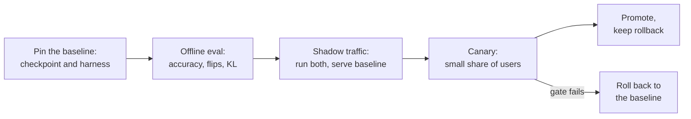

# पाठ 26. Quantization के दावे की समीक्षा

**मिशन से संबंध:** यह track इस भरोसे के साथ ख़त्म होता है कि आप quantization पर फ़ैसला ले सकें और उसे किसी और को समझा सकें। ज़्यादातर बार फ़ैसला किसी और के किए दावे पर होता है: "4-bit, quality में कोई हानि नहीं।" यह पाठ बताता है कि उस वाक्य ने क्या छोड़ा है, और model को ऐसे शिप कैसे करें कि उन लोगों को हैरानी न हो जो उस पर निर्भर हैं।
**मुख्य स्रोत:** [पेपर: "Accuracy is Not All You Need", Dutta et al., 2024](https://arxiv.org/abs/2407.09141), sections 1 से 3
**पूर्व-आवश्यकताएँ:** [पाठ 25](0025-choosing-a-scheme.md), [Perplexity](../GLOSSARY.md), [Calibration set](../GLOSSARY.md), [Group size](../GLOSSARY.md), [Effective bits per weight](../GLOSSARY.md)

## वार्म-अप

1. ▢ Perplexity क्या मापती है, और उसमें छोटा बदलाव कई बदले हुए उत्तरों के बग़ल में कैसे बैठ सकता है?

<details markdown="1"><summary>जाँचें</summary>

वह model जो औसत negative log-likelihood किसी text को देता है उसका exponential है, इसलिए वह हर token पर औसत लेती है। कई tokens में फैले छोटे बदलाव औसत को मुश्किल से हिलाते हैं, जबकि निर्णय की सीमा के पास के अलग-अलग उत्तर फिर भी बदल सकते हैं (पाठ 21)।

</details>

2. ▢ ईमानदार quantization eval को baseline और quantized model के बीच क्या एक जैसा रखना चाहिए?

<details markdown="1"><summary>जाँचें</summary>

Harness, tasks, prompts और sampling settings, ताकि अकेला अंतर weights का हो (पाठ 22)।

</details>

3. ▢ Quantized checkpoint का quantization config loader को क्या बताता है, और roll out के लिए यह क्यों मायने रखता है?

<details markdown="1"><summary>जाँचें</summary>

Store किए गए tensors को कैसे पढ़ना है: scheme, bit width, group size और ऐसे ही fields (पाठ 23)। अपने config के बिना या बेमेल config वाला checkpoint दोहराने योग्य नहीं है, इसलिए roll out को दोनों का version एक साथ रखना होगा।

</details>

## यह जानें

### दावा और उसके हिस्से

कोई कहता है: "हमने बिना quality हानि के 4-bit पर quantize किया।" उस वाक्य का हर हिस्सा एक चुनाव छिपाता है। समीक्षा यह नहीं कहती कि दावा ग़लत है। वह हर छिपे चुनाव को माँगती है, और बताती है कि कौन-से उत्तर दावे को टिकाए रखेंगे।

| दावे का हिस्सा | सवाल | यह क्यों मायने रखता है |
|---|---|---|
| "कोई हानि नहीं" | किस baseline के सामने? वही model bf16 में, उसी harness पर चलाया हुआ, या model card से नक़ल की हुई संख्या? | Kurtic et al. 405B तक के models के पहले के अध्ययन को open-ended benchmarks छोड़ने और academic tasks के लिए भी full-precision baselines बताने में विफल रहने के लिए दोषी ठहराते हैं, जिससे quantization का असर अस्पष्ट रहता है ([Kurtic et al., 2024](https://arxiv.org/abs/2411.02355)) |
| "Quality" | कौन-से tasks? Multiple choice, या आपके जैसा open-ended generation? | उसी अध्ययन में, academic benchmarks पर AWQ, GPTQ से ज़्यादा से ज़्यादा 0.35 अंक आगे था पर 8B के real-world औसत पर GPTQ, AWQ से 2.9 अंक आगे था |
| "Quality" | सिर्फ़ perplexity? किस text और window पर? | Perplexity का बदलाव औसत है (पाठ 21) |
| "Quality" | Flips? KL divergence? | नीचे देखें |
| "4-bit" | कौन-सा group size, इसलिए कितने effective bits per weight? | हर 32 के group पर 16-bit scale इसे 4.5 bits बनाता है, हर 128 पर लगभग 4.125 (पाठ 1 और 6) |
| "4-bit" | कौन-सा calibration set, कितना बड़ा, आपके traffic से कितना क़रीब? | बेमेल set ग़लत inputs पर fit हो जाता है (पाठ 12) |
| कोई भी गति का दावा | कौन-सा hardware, कौन-सा batch size, कौन-सा kernel, किस baseline के सामने? | नीचे देखें |

### सिर्फ़ accuracy बदले हुए model को क्यों छिपाती है

Dutta et al. **flip** को ऐसे उत्तर के रूप में परिभाषित करते हैं जो baseline और compressed model के बीच सही से ग़लत या ग़लत से सही में बदल गया। वे MMLU, HellaSwag और ARC समेत सात tasks पर छह quantization schemes की तुलना करते हैं। हर scheme की accuracy 16-bit model के 0 से 2 प्रतिशत के भीतर थी, फिर भी एक को छोड़कर सब (8-bit weights और 16-bit activations के साथ GPTQ) ने बड़ी flips दिखाईं, 13.6 प्रतिशत तक। उनकी व्याख्या है कि फ़ायदे और नुक़सान कट जाते हैं: औसत टिका रहता है जबकि कई अलग-अलग उत्तर दोनों दिशाओं में हिलते हैं। जहाँ task open-ended है, उन्होंने पाया कि बहुत flips वाले compressed models MT-Bench पर, जो multi-turn dialogue benchmark है, उल्लेखनीय रूप से बदतर थे, और MT-Bench scores flips से मज़बूती से जुड़े हैं।

वे baseline से दो दूरी वाले metrics प्रस्तावित करते हैं: flips, और dataset पर दोनों models की output probabilities के बीच KL divergence, और बताते हैं कि दोनों में अच्छा correlation है। व्यावहारिक फ़र्क़ लागत है: flips को हर उदाहरण पर सही उत्तर चाहिए, जबकि KL divergence को सिर्फ़ उसी text पर दोनों models की probabilities चाहिए। उनकी flips ग़लत-से-ग़लत बदलावों को बाहर रखती हैं, और वे ध्यान दिलाते हैं कि उन्हें शामिल करने से multiple-choice tasks पर संख्याएँ और 20 से 40 प्रतिशत बढ़ जातीं।

### गति के दावे को तीन और उत्तर क्यों चाहिए

Speed-up scheme, kernel, GPU और batch size की मिली-जुली विशेषता है।

- **Batch size।** MARLIN 4-bit-weight kernel के लिए 16 से 32 तक के batch sizes तक 4 गुना speed-up के क़रीब बना रहता है, और batch size 128 तक लगभग 1.5 गुना पर गिरता है ([Frantar et al., 2024](https://arxiv.org/abs/2408.11743))। Batch 1 पर मापा गया "3 गुना तेज़" batch 64 के बारे में कुछ नहीं कहता।
- **Kernel।** QServe बताता है कि मौजूदा INT4 methods GPUs पर weights या partial sums को dequantize करने से 20 से 90 प्रतिशत runtime overhead झेलते हैं, और वे कम-batch inference को तेज़ करते हैं पर बड़े-batch की cloud serving को नहीं ([Lin et al., 2024](https://arxiv.org/abs/2405.04532))। वही weights kernel के हिसाब से तेज़ या धीमे हो सकते हैं।
- **Baseline।** किस stack पर bf16 से तेज़? बिना optimize किए baseline के सामने लगभग कुछ भी तेज़ दिखता है।

जो समीक्षा सिर्फ़ ख़ामियाँ गिनाती है वह आधी हुई है। बताएँ कि क्या ठीक है और रहना चाहिए: मज़बूत baseline, held-out task set, मापा हुआ kernel।

### ऐसा quantized model roll out करना जिस पर दूसरे निर्भर हैं

जब कोई दावा समीक्षा में टिक जाए, तब भी model को उसे बदलना है जिसे लोग इस्तेमाल करते हैं। यह प्रक्रिया है, किसी पेपर की खोज नहीं, इसलिए इसे काम करने की कार्यविधि मानें।



- **Baseline को पिन करें।** उस सटीक bf16 checkpoint और harness version का नाम रखें जिससे आप तुलना करते हैं, और नया model पास होने तक उसे serve करते रहें।
- **Production जैसे traffic पर तुलना करें।** असली prompts को दोनों models से गुज़ारें। Labelled उत्तरों के बिना, flips compute नहीं हो सकतीं, पर आप output distributions की तुलना KL divergence से कर सकते हैं, या outputs की तुलना greedy decoding में उन similarity metrics से जो Kurtic et al. ने इस्तेमाल किए (ROUGE, BERTScore और sentence similarity)।
- **पहले shadow, फिर canary।** Shadow traffic quantized model को baseline के साथ चलाता है बिना उसे serve किए। Canary users के छोटे हिस्से को serve करता है। Gate, यानी हर metric की सीमा, नतीजे देखने से पहले तय करें ([go/no-go शीट](../../evals/reference/go-no-go.md) देखें)।
- **Checkpoint का version उसके config के साथ रखें।** Quantization config, group size, calibration set और serving stack का version weights के बग़ल में दर्ज करें (पाठ 23), ताकि नतीजा दोहराया जा सके और regression का पता लगाया जा सके।
- **Rollback रखें।** Baseline तब तक deploy करने योग्य रहता है जब तक canary इतना न चल ले कि वह traffic दिख जाए जिसकी आपको परवाह है। Rollback करना config बदलाव है, दोबारा बनाना नहीं।

## अभ्यास

1. ▢ एक blog post कहता है: "W4A16, perplexity bf16 के 5.8 के मुक़ाबले 5.9, इसलिए कोई हानि नहीं।" तीन छूटी चीज़ें बताएँ।

<details markdown="1"><summary>जाँचें</summary>

इनमें से कोई तीन: perplexity किस text और window पर मापी गई; कोई task accuracy; कोई flips या KL divergence; group size और इसलिए effective bits; calibration set; क्या 5.8 उसी harness पर चलाया गया था। Perplexity औसत है और उन उत्तरों को नहीं दिखा सकती जो दोनों दिशाओं में बदले।

</details>

2. ▢ पहले अनुमान लगाएँ, फिर चलाएँ। Baseline 100 सवाल हल करता है और 80 सही पाता है। Quantized model भी 80 सही पाता है, पर baseline के 10 सही उत्तर ग़लत हो गए और उसके 10 ग़लत उत्तर सही हो गए। हर एक की accuracy और flips अनुमानित करें, फिर इसे चलाएँ।

    ```python
    base = [1] * 80 + [0] * 20
    quant = base[:]
    for i in range(10):
        quant[i] = 0
    for i in range(80, 90):
        quant[i] = 1
    acc_base = sum(base) / len(base)
    acc_quant = sum(quant) / len(quant)
    flips = sum(b != q for b, q in zip(base, quant)) / len(base)
    print(f"baseline accuracy  {acc_base:.0%}")
    print(f"quantized accuracy {acc_quant:.0%}")
    print(f"flips              {flips:.0%}")
    ```

<details markdown="1"><summary>संकेत</summary>

हर वह सवाल गिनें जहाँ दोनों models सही होने के बारे में असहमत हैं, किसी भी दिशा में।

</details>

<details markdown="1"><summary>जाँचें</summary>

```text
baseline accuracy  80%
quantized accuracy 80%
flips              20%
```

एक जैसी accuracy, पाँच में से एक उत्तर बदला। संख्याएँ उदाहरण के लिए बनाई गई हैं, मापें नहीं, पर आकार वही है जो Dutta et al. बताते हैं: बराबर accuracy, बड़ी flips।

</details>

3. ▢ कोई रिपोर्ट कहती है कि उसका quantized model "bf16 से 3 गुना तेज़" है। कौन-सा सवाल इसे बदलता है कि आप उस पर यक़ीन करें?

    - a) कौन-सा batch size, kernel और baseline stack मापे गए?
    - b) किस quantization method ने वे 4-bit weights बनाए जिन्हें समय नापा गया?
    - c) Model कौन-सा tokenizer और vocabulary आकार इस्तेमाल करता है?
    - d) Quantized model ने Wikitext पर कौन-सी perplexity पाई?

<details markdown="1"><summary>जाँचें</summary>

**a)** Speed-up scheme, kernel, GPU और batch size की मिली-जुली विशेषता है, और MARLIN और QServe के नतीजे दिखाते हैं कि वह उनके बीच बड़े गुणकों से बदलती है। (b) accuracy के लिए मायने रखता है, पर वही 4-bit format बनाने वाले दो methods एक ही kernel पर एक ही गति से चलते हैं। (c) quantization से नहीं बदलता, इसलिए speed-up को नहीं समझा सकता। (d) quality का सवाल है और गति के बारे में कुछ नहीं कहता।

</details>

4. ▢ इस दावे की समीक्षा करें, जो अभ्यास के लिए गढ़ा गया है: "हमने अपने 8B support-chat model को एक सार्वजनिक अंग्रेज़ी news dataset से 128 calibration samples के साथ 4-bit AWQ पर quantize किया। Wikitext perplexity 6.05 से 6.14 पर गई, MMLU 0.4 अंक गिरा, और generation A100 पर batch size 1 पर 3.1 गुना तेज़ है। कोई quality हानि नहीं, इसलिए हम स्पेनी और पुर्तगाली chat समेत सभी users को शिप करते हैं।" वे सवाल लिखें जो आप पूछेंगे, और क्या ठीक है।

<details markdown="1"><summary>जाँचें</summary>

सवाल: क्या 6.05 baseline उसी harness पर वही model है? Perplexity और MMLU support-chat की quality नहीं हैं: open-ended eval क्या है, और असली बातचीतों पर flips और KL क्या हैं? Calibration set अंग्रेज़ी news है जबकि traffic में स्पेनी और पुर्तगाली chat शामिल है (पाठ 12): क्या quality उन भाषाओं में मापी गई? कौन-सा group size, इसलिए कितने effective bits? 3.1 गुना batch size 1 पर है: production batch size क्या है, और कौन-सा kernel और baseline stack? ठीक और रखने लायक़: बताई हुई baseline, perplexity के साथ task suite, नामित GPU और batch size, MMLU में छोटा बदलाव। निष्कर्ष: अभी "कोई हानि नहीं" का दावा नहीं है, और सभी users से पहले स्पेनी और पुर्तगाली traffic पर canary।

</details>

5. ▢ Quantized model का canary baseline जैसी ही task accuracy दिखाता है, पर replay की गई बातचीतों में से 9 प्रतिशत पहला उत्तर अलग देती हैं। आप promote करते हैं, roll back करते हैं या रुकते हैं? आगे क्या करते हैं?

<details markdown="1"><summary>जाँचें</summary>

रुकें, अकेली accuracy पर promote न करें। Dutta et al. दिखाते हैं कि बराबर accuracy बड़ी flips के बग़ल में बैठ सकती है, और flips मुक्त-रूप quality का पीछा करती हैं। आगे, बदले उत्तरों को वर्गीकृत करें: क्या वे तटस्थ शब्द-बदलाव हैं, या ऐसे उत्तर जिन्हें समीक्षक या judge कम पसंद करता है (पाठ 22)? Canary शुरू होने से पहले तय किए गए gate से तुलना करें। अगर gate पूरा नहीं होता, तो baseline पर roll back करें, जो इसीलिए deploy रहा था।

</details>

## असली दुनिया का अभ्यास

- [ ] ऐसा एक दावा खोजें कि model को "बिना हानि के" quantize किया गया (model card या blog post)। सूची बनाएँ कि table के सवालों में से वह कौन-से उत्तर देता है और कौन-से खुले छोड़ता है।
- [ ] किसी model के लिए जिसे आप शिप करते हैं या कर सकते हैं, rollback योजना पाँच पंक्तियों में लिखें: कौन-सा checkpoint baseline है, उसका config कहाँ रहता है, roll back को क्या चालू करता है, कौन तय करता है, कितना समय लगता है।
- [ ] कल: एक ही model के दो runs के बीच, temperature 0 पर, अपनी परवाह के बीस सवालों पर flips compute करें, और लिखें कि वह संख्या आपके अपने noise floor के बारे में क्या बताती है।

## आगे बढ़ने के लिए

- [Quantization Review Checklist शीट](../reference/quantization-review-checklist.md)
- [Evals: Go/No-Go](../../evals/reference/go-no-go.md), canary शुरू होने से पहले gate ईमानदारी से तय करने के लिए
- [पेपर: "Accuracy is Not All You Need", Dutta et al., 2024](https://arxiv.org/abs/2407.09141)
- [पेपर: "QServe: W4A8KV4 Quantization and System Co-design for Efficient LLM Serving", Lin et al., 2024](https://arxiv.org/abs/2405.04532)
- [संसाधन](../RESOURCES.md)

---

बात नहीं बन रही? ऊपर दिए मुख्य स्रोत को दोबारा पढ़ें, क्योंकि यह पाठ उसे संक्षिप्त करता है और समझ संक्षेप में ही रिसती है। जो शब्द फिसलन भरा लगे, उसके लिए [शब्दावली](../GLOSSARY.md) देखें।

अगर दिक़्क़त सामग्री की नहीं बल्कि पाठ की ही है, तो वह एक खोट है: [issue खोलें](https://github.com/TokenCemetery/teach/issues)।
