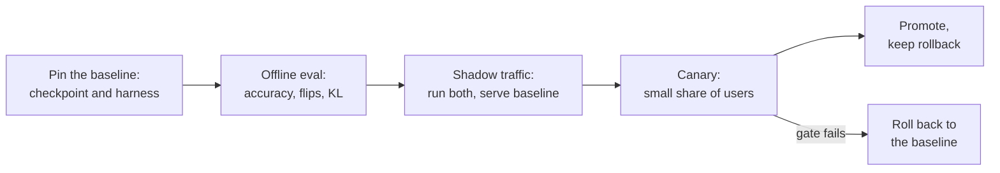

# Lesson 26. Reviewing a Quantization Claim

**Mission link:** The track ends with trusting you to make the call on a quantization and to explain it to someone else. Most of the time the call is on a claim someone else made: "4-bit, no quality loss." This lesson is how to say what that sentence leaves out, and how to ship the model without surprising the people who depend on it.
**Primary source:** [Paper: "Accuracy is Not All You Need", Dutta et al., 2024](https://arxiv.org/abs/2407.09141), sections 1 to 3
**Prerequisites:** [Lesson 25](0025-choosing-a-scheme.md), [Perplexity](../GLOSSARY.md), [Calibration set](../GLOSSARY.md), [Group size](../GLOSSARY.md), [Effective bits per weight](../GLOSSARY.md)

## Warm-up

1. ▢ What does perplexity measure, and why can a small change in it sit beside many changed answers?

<details markdown="1"><summary>Check</summary>

It is the exponential of the average negative log-likelihood the model gives a text, so it averages over every token. Small shifts spread across many tokens barely move the average, while individual answers near a decision boundary can still change (lesson 21).

</details>

2. ▢ What must an honest quantization eval hold the same between the baseline and the quantized model?

<details markdown="1"><summary>Check</summary>

The harness, the tasks, the prompts and the sampling settings, so that the only difference is the weights (lesson 22).

</details>

3. ▢ What does a quantized checkpoint's quantization config tell the loader, and why does it matter for rollout?

<details markdown="1"><summary>Check</summary>

How to read the stored tensors: the scheme, bit width, group size and similar fields (lesson 23). A checkpoint without its config, or with a mismatched one, is not reproducible, so a rollout has to version them together.

</details>

## Know this

### The claim and its parts

Someone says: "We quantized to 4-bit with no quality loss." Each part of that sentence hides a choice. A review does not say the claim is wrong. It asks for each hidden choice, and says which answers would make the claim stand.

| Part of the claim | Question | Why it matters |
|---|---|---|
| "No loss" | Against which baseline? The same model in bf16, run on the same harness, or a number copied from a model card? | Kurtic et al. fault an earlier study of models up to 405B for omitting open-ended benchmarks and failing to report full-precision baselines even for academic tasks, which leaves the impact of quantization unclear ([Kurtic et al., 2024](https://arxiv.org/abs/2411.02355)) |
| "Quality" | Which tasks? Multiple choice, or open-ended generation like yours? | In the same study, AWQ led GPTQ by at most 0.35 points on the academic benchmarks but GPTQ led AWQ by 2.9 points on the 8B real-world average |
| "Quality" | Perplexity only? On which text and window? | A perplexity change is an average (lesson 21) |
| "Quality" | Flips? KL divergence? | See below |
| "4-bit" | Which group size, so how many effective bits per weight? | A 16-bit scale per group of 32 makes it 4.5 bits, per group of 128 about 4.125 (lessons 1 and 6) |
| "4-bit" | Which calibration set, how large, how close to your traffic? | A mismatched set is fitted to the wrong inputs (lesson 12) |
| Any speed claim | Which hardware, which batch size, which kernel, against which baseline? | See below |

### Why accuracy alone hides a changed model

Dutta et al. define a **flip** as an answer that changed from correct to incorrect or from incorrect to correct between the baseline and the compressed model. They compare six quantization schemes on seven tasks including MMLU, HellaSwag and ARC. Every scheme's accuracy was within 0 to 2 percent of the 16-bit model, yet all but one (GPTQ with 8-bit weights and 16-bit activations) showed large flips, up to 13.6 percent. Their explanation is that gains and losses cancel: the average holds while many individual answers move in both directions. Where a task is open-ended, they found that compressed models with many flips were significantly worse on MT-Bench, a multi-turn dialogue benchmark, and that MT-Bench scores correlate strongly with flips.

They propose two distance metrics from the baseline: flips, and the KL divergence between the two models' output probabilities over a dataset, and report that the two correlate well. The practical difference is cost: flips need a correct answer per example, while KL divergence only needs both models' probabilities on the same text. Their flips exclude incorrect to incorrect transitions, and they note that including them would raise the numbers by another 20 to 40 percent on multiple-choice tasks.

### Why a speed claim needs three more answers

A speed-up is a property of a scheme, a kernel, a GPU and a batch size together.

- **Batch size.** MARLIN holds close to a 4 times speed-up for a 4-bit-weight kernel up to batch sizes of 16 to 32, falling to about 1.5 times by batch size 128 ([Frantar et al., 2024](https://arxiv.org/abs/2408.11743)). A "3 times faster" measured at batch 1 says nothing about batch 64.
- **Kernel.** QServe reports that existing INT4 methods suffer a 20 to 90 percent runtime overhead from dequantizing weights or partial sums on GPUs, and that they accelerate low-batch inference but not large-batch cloud serving ([Lin et al., 2024](https://arxiv.org/abs/2405.04532)). The same weights can be fast or slow depending on the kernel.
- **Baseline.** Faster than bf16 on which stack? Against an unoptimized baseline almost anything looks fast.

A review that only lists faults is half done. Say what is fine and should stay: a sound baseline, a held-out task set, a measured kernel.

### Rolling out a quantized model others depend on

Once a claim survives review, the model still has to replace one that people use. This is process, not a finding from a paper, so treat it as a working procedure.



- **Pin the baseline.** Name the exact bf16 checkpoint and harness version you compare against, and keep serving it until the new model has passed.
- **Compare on production-like traffic.** Replay real prompts through both models. Without labelled answers, flips are not computable, but you can compare output distributions with KL divergence, or compare outputs with the similarity metrics Kurtic et al. used (ROUGE, BERTScore and sentence similarity) under greedy decoding.
- **Shadow, then canary.** Shadow traffic runs the quantized model alongside the baseline without serving it. A canary serves a small share of users. Decide the gate, the threshold on each metric, before looking at results (see the [go/no-go sheet](../../evals/reference/go-no-go.md)).
- **Version the checkpoint with its config.** Record the quantization config, the group size, the calibration set and the serving stack version beside the weights (lesson 23), so a result can be reproduced and a regression traced.
- **Keep a rollback.** The baseline stays deployable until the canary has run long enough to see the traffic you care about. Rolling back is a config change, not a rebuild.

## Practice

1. ▢ A blog post says: "W4A16, perplexity 5.9 against 5.8 for bf16, so no loss." Name three things missing.

<details markdown="1"><summary>Check</summary>

Any three of: which text and window the perplexity was measured on; any task accuracy; any flips or KL divergence; the group size and so the effective bits; the calibration set; whether the 5.8 was run on the same harness. Perplexity is an average and cannot show answers that changed in both directions.

</details>

2. ▢ Predict, then run. A baseline answers 100 questions and gets 80 right. A quantized model also gets 80 right, but 10 of the baseline's correct answers became wrong and 10 of its wrong answers became right. Predict the accuracy of each and the flips, then run this.

    ```python
    base = [1] * 80 + [0] * 20
    quant = base[:]
    for i in range(10):
        quant[i] = 0
    for i in range(80, 90):
        quant[i] = 1
    acc_base = sum(base) / len(base)
    acc_quant = sum(quant) / len(quant)
    flips = sum(b != q for b, q in zip(base, quant)) / len(base)
    print(f"baseline accuracy  {acc_base:.0%}")
    print(f"quantized accuracy {acc_quant:.0%}")
    print(f"flips              {flips:.0%}")
    ```

<details markdown="1"><summary>Hint</summary>

Count each question where the two models disagree about being right, in either direction.

</details>

<details markdown="1"><summary>Check</summary>

```text
baseline accuracy  80%
quantized accuracy 80%
flips              20%
```

Identical accuracy, one answer in five changed. The numbers are built for the example and are not measurements, but the shape is the one Dutta et al. describe: equal accuracy, large flips.

</details>

3. ▢ A report says its quantized model is "3 times faster than bf16". Which question most changes whether you believe it?

    - a) Which batch size, kernel and baseline stack were measured?
    - b) Which quantization method produced the 4-bit weights being timed?
    - c) Which tokenizer and vocabulary size does the model use?
    - d) Which perplexity did the quantized model reach on Wikitext?

<details markdown="1"><summary>Check</summary>

**a)** A speed-up belongs to a scheme, kernel, GPU and batch size together, and the MARLIN and QServe results show it varies by large factors across them. (b) matters for accuracy, but two methods that produce the same 4-bit format run on the same kernel at the same speed. (c) is unchanged by quantization, so it cannot explain a speed-up. (d) is a quality question and says nothing about speed.

</details>

4. ▢ Review this claim, which is invented for practice: "We quantized our 8B support-chat model to 4-bit AWQ with 128 calibration samples from a public English news dataset. Wikitext perplexity rose from 6.05 to 6.14, MMLU fell 0.4 points, and generation is 3.1 times faster on an A100 at batch size 1. No quality loss, so we ship to all users, including Spanish and Portuguese chat." Write the questions you would ask, and what is fine.

<details markdown="1"><summary>Check</summary>

Questions: Is the 6.05 baseline the same model on the same harness? Perplexity and MMLU are not support-chat quality: what is the open-ended eval, and what are the flips and KL on real conversations? The calibration set is English news while traffic includes Spanish and Portuguese chat (lesson 12): was quality measured in those languages? Which group size, so how many effective bits? The 3.1 times is at batch size 1: what is production batch size, and which kernel and baseline stack? Fine and worth keeping: a stated baseline, a task suite alongside perplexity, a named GPU and batch size, a small MMLU change. Verdict: not a no-loss claim yet, and a canary on the Spanish and Portuguese traffic before all users.

</details>

5. ▢ A canary of a quantized model shows the same task accuracy as the baseline, but 9 percent of replayed conversations produce a different first answer. Do you promote, roll back or hold? What do you do next?

<details markdown="1"><summary>Check</summary>

Hold, do not promote on accuracy alone. Dutta et al. show equal accuracy can sit beside large flips, and that flips track free-form quality. Next, classify the changed answers: are they neutral rewordings, or answers that a reviewer or a judge prefers less (lesson 22)? Compare against the gate set before the canary started. If the gate is not met, roll back to the baseline, which is why it stayed deployed.

</details>

## Real-world reps

- [ ] Find one claim that a model was quantized "without loss" (a model card or a blog post). List which of the questions in the table it answers and which it leaves open.
- [ ] For a model you ship or could ship, write the rollback plan in five lines: which checkpoint is the baseline, where its config lives, what triggers the roll back, who decides, how long it takes.
- [ ] Tomorrow: compute flips between two runs of the same model at temperature 0 on twenty questions you care about, and write down what the number tells you about your own noise floor.

## Going further

- [Quantization Review Checklist](../reference/quantization-review-checklist.md)
- [Evals: Go/No-Go](../../evals/reference/go-no-go.md), for setting the gate honestly before the canary starts
- [Paper: "Accuracy is Not All You Need", Dutta et al., 2024](https://arxiv.org/abs/2407.09141)
- [Paper: "QServe: W4A8KV4 Quantization and System Co-design for Efficient LLM Serving", Lin et al., 2024](https://arxiv.org/abs/2405.04532)
- [Resources](../RESOURCES.md)

---

Not landing? Reread the primary source at the top, since this lesson compresses it and compression is where understanding leaks. Check the [glossary](../GLOSSARY.md) for any term that felt slippery.

If the lesson itself is unclear rather than the material, that is a defect: [open an issue](https://github.com/TokenCemetery/teach/issues).
