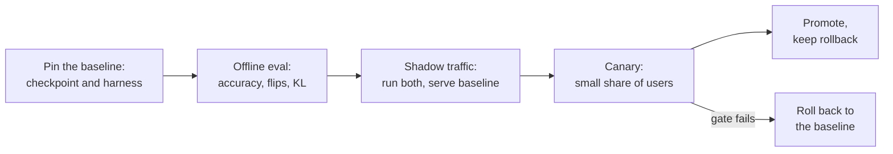

# Lição 26. Revisando uma alegação de quantização

**Ligação com a missão:** A trilha termina confiando a você a decisão sobre uma quantização e a tarefa de explicá-la a outra pessoa. Na maioria das vezes a decisão é sobre uma alegação que outra pessoa fez: "4 bits, sem perda de qualidade." Esta lição é como dizer o que essa frase deixa de fora e como entregar o modelo sem surpreender as pessoas que dependem dele.
**Fonte principal:** [Artigo científico: "Accuracy is Not All You Need", Dutta et al., 2024](https://arxiv.org/abs/2407.09141), seções 1 a 3
**Pré-requisitos:** [Lição 25](0025-choosing-a-scheme.md), [Perplexity](../GLOSSARY.md), [Calibration set](../GLOSSARY.md), [Tamanho do grupo](../GLOSSARY.md), [Bits efetivos por peso](../GLOSSARY.md)

## Aquecimento

1. ▢ O que a perplexity mede, e por que uma pequena mudança nela pode coexistir com muitas respostas mudadas?

<details markdown="1"><summary>Verificação</summary>

É a exponencial do log-likelihood negativo médio que o modelo dá a um texto, então ela promedia sobre todo token. Pequenas mudanças espalhadas por muitos tokens mal movem a média, enquanto respostas individuais perto de uma fronteira de decisão ainda podem mudar (lição 21).

</details>

2. ▢ O que um eval honesto de quantização precisa manter igual entre o baseline e o modelo quantizado?

<details markdown="1"><summary>Verificação</summary>

O harness, as tarefas, os prompts e as configurações de amostragem, de modo que a única diferença sejam os pesos (lição 22).

</details>

3. ▢ O que a configuração de quantização de um checkpoint quantizado diz ao loader, e por que isso importa para o rollout?

<details markdown="1"><summary>Verificação</summary>

Como ler os tensores armazenados: o esquema, a largura em bits, o tamanho do grupo e campos semelhantes (lição 23). Um checkpoint sem a sua configuração, ou com uma configuração incompatível, não é reproduzível, então um rollout precisa versioná-los juntos.

</details>

## Saiba isto

### A alegação e as suas partes

Alguém diz: "Quantizamos para 4 bits sem perda de qualidade." Cada parte dessa frase esconde uma escolha. Uma revisão não diz que a alegação está errada. Ela pede cada escolha escondida e diz quais respostas fariam a alegação se sustentar.

| Parte da alegação | Pergunta | Por que importa |
|---|---|---|
| "Sem perda" | Contra qual baseline? O mesmo modelo em bf16, executado no mesmo harness, ou um número copiado de um model card? | Kurtic et al. criticam um estudo anterior de modelos de até 405B por omitir benchmarks abertos e por não reportar baselines de precisão total nem para tarefas acadêmicas, o que deixa o impacto da quantização pouco claro ([Kurtic et al., 2024](https://arxiv.org/abs/2411.02355)) |
| "Qualidade" | Quais tarefas? Múltipla escolha, ou geração aberta como a sua? | No mesmo estudo, o AWQ liderou o GPTQ por no máximo 0.35 ponto nos benchmarks acadêmicos, mas o GPTQ liderou o AWQ por 2.9 pontos na média do mundo real em 8B |
| "Qualidade" | Só perplexity? Em qual texto e janela? | Uma mudança de perplexity é uma média (lição 21) |
| "Qualidade" | Flips? Divergência KL? | Veja abaixo |
| "4 bits" | Qual tamanho de grupo, ou seja, quantos bits efetivos por peso? | Uma scale de 16 bits por grupo de 32 faz 4.5 bits, por grupo de 128 cerca de 4.125 (lições 1 e 6) |
| "4 bits" | Qual calibration set, de que tamanho, e quão próximo do seu tráfego? | Um conjunto incompatível é ajustado às entradas erradas (lição 12) |
| Qualquer alegação de velocidade | Qual hardware, qual batch size, qual kernel, contra qual baseline? | Veja abaixo |

### Por que só a acurácia esconde um modelo alterado

Dutta et al. definem um **flip** como uma resposta que mudou de correta para incorreta ou de incorreta para correta entre o baseline e o modelo comprimido. Eles comparam seis esquemas de quantização em sete tarefas, incluindo MMLU, HellaSwag e ARC. A acurácia de todo esquema ficou a 0 a 2 por cento do modelo de 16 bits, e no entanto todos menos um (GPTQ com pesos de 8 bits e ativações de 16 bits) mostraram grandes flips, de até 13.6 por cento. A explicação deles é que ganhos e perdas se cancelam: a média se sustenta enquanto muitas respostas individuais se movem nos dois sentidos. Onde uma tarefa é aberta, eles descobriram que modelos comprimidos com muitos flips eram significativamente piores no MT-Bench, um benchmark de diálogo de vários turnos, e que as pontuações do MT-Bench se correlacionam fortemente com os flips.

Eles propõem duas métricas de distância em relação ao baseline: flips e a divergência KL entre as probabilidades de saída dos dois modelos sobre um dataset, e relatam que as duas se correlacionam bem. A diferença prática é o custo: flips precisam de uma resposta correta por exemplo, enquanto a divergência KL só precisa das probabilidades dos dois modelos no mesmo texto. Os flips deles excluem as transições de incorreta para incorreta, e eles observam que incluí-las elevaria os números em mais 20 a 40 por cento em tarefas de múltipla escolha.

### Por que uma alegação de velocidade precisa de mais três respostas

Um ganho de velocidade é uma propriedade de um esquema, um kernel, uma GPU e um batch size juntos.

- **Batch size.** O MARLIN mantém perto de 4 vezes de aceleração para um kernel de pesos de 4 bits até batch sizes de 16 a 32, caindo para cerca de 1.5 vez no batch size 128 ([Frantar et al., 2024](https://arxiv.org/abs/2408.11743)). Um "3 vezes mais rápido" medido no batch 1 não diz nada sobre o batch 64.
- **Kernel.** O QServe relata que os métodos INT4 existentes sofrem de 20 a 90 por cento de overhead de tempo de execução por dequantizar pesos ou somas parciais em GPUs, e que eles aceleram a inferência com batch baixo mas não o serving em nuvem com batch grande ([Lin et al., 2024](https://arxiv.org/abs/2405.04532)). Os mesmos pesos podem ser rápidos ou lentos dependendo do kernel.
- **Baseline.** Mais rápido que o bf16 em qual stack? Contra um baseline não otimizado, quase tudo parece rápido.

Uma revisão que só lista falhas está pela metade. Diga o que está bom e deve ficar: um baseline sólido, um conjunto de tarefas held-out, um kernel medido.

### Fazendo o rollout de um modelo quantizado de que outros dependem

Quando uma alegação sobrevive à revisão, o modelo ainda precisa substituir um que as pessoas usam. Isso é processo, não um achado de um artigo, então trate-o como um procedimento de trabalho.



- **Fixe o baseline.** Nomeie o checkpoint exato em bf16 e a versão do harness contra os quais você compara, e continue a servi-lo até o novo modelo ter passado.
- **Compare em tráfego parecido com produção.** Reproduza prompts reais pelos dois modelos. Sem respostas rotuladas, os flips não são calculáveis, mas você pode comparar as distribuições de saída com a divergência KL, ou comparar saídas com as métricas de similaridade que Kurtic et al. usaram (ROUGE, BERTScore e similaridade de sentenças) sob decodificação gulosa.
- **Shadow, depois canary.** O tráfego shadow roda o modelo quantizado ao lado do baseline sem servi-lo. Um canary serve uma pequena fatia dos usuários. Decida o gate, o limite em cada métrica, antes de olhar os resultados (veja a [folha de go/no-go](../../evals/reference/go-no-go.md)).
- **Versione o checkpoint com a sua configuração.** Registre a configuração de quantização, o tamanho do grupo, o calibration set e a versão da stack de serving ao lado dos pesos (lição 23), para que um resultado possa ser reproduzido e uma regressão rastreada.
- **Mantenha um rollback.** O baseline continua implantável até o canary ter rodado por tempo suficiente para ver o tráfego que importa para você. Fazer rollback é uma mudança de configuração, não um rebuild.

## Prática

1. ▢ Uma postagem de blog diz: "W4A16, perplexity 5.9 contra 5.8 do bf16, então sem perda." Nomeie três coisas que faltam.

<details markdown="1"><summary>Verificação</summary>

Quaisquer três entre: em qual texto e janela a perplexity foi medida; qualquer acurácia de tarefa; quaisquer flips ou divergência KL; o tamanho do grupo e, portanto, os bits efetivos; o calibration set; se o 5.8 foi executado no mesmo harness. A perplexity é uma média e não consegue mostrar respostas que mudaram nos dois sentidos.

</details>

2. ▢ Preveja e depois execute. Um baseline responde a 100 perguntas e acerta 80. Um modelo quantizado também acerta 80, mas 10 das respostas corretas do baseline viraram erradas e 10 das suas respostas erradas viraram certas. Preveja a acurácia de cada um e os flips, depois execute isto.

    ```python
    base = [1] * 80 + [0] * 20
    quant = base[:]
    for i in range(10):
        quant[i] = 0
    for i in range(80, 90):
        quant[i] = 1
    acc_base = sum(base) / len(base)
    acc_quant = sum(quant) / len(quant)
    flips = sum(b != q for b, q in zip(base, quant)) / len(base)
    print(f"baseline accuracy  {acc_base:.0%}")
    print(f"quantized accuracy {acc_quant:.0%}")
    print(f"flips              {flips:.0%}")
    ```

<details markdown="1"><summary>Dica</summary>

Conte cada pergunta em que os dois modelos discordam sobre estar certos, em qualquer direção.

</details>

<details markdown="1"><summary>Verificação</summary>

```text
baseline accuracy  80%
quantized accuracy 80%
flips              20%
```

Acurácia idêntica, uma resposta em cada cinco mudou. Os números são construídos para o exemplo e não são medições, mas a forma é a que Dutta et al. descrevem: acurácia igual, grandes flips.

</details>

3. ▢ Um relatório diz que o seu modelo quantizado é "3 vezes mais rápido que o bf16". Qual pergunta mais muda se você acredita nisso?

    - a) Quais batch size, kernel e stack de baseline foram medidos?
    - b) Qual método de quantização produziu os pesos de 4 bits cronometrados?
    - c) Quais tokenizer e tamanho de vocabulário o modelo usa?
    - d) Qual perplexity o modelo quantizado alcançou no Wikitext?

<details markdown="1"><summary>Verificação</summary>

**a)** Um ganho de velocidade pertence a um esquema, kernel, GPU e batch size juntos, e os resultados do MARLIN e do QServe mostram que ele varia por grandes fatores entre eles. (b) importa para a acurácia, mas dois métodos que produzem o mesmo formato de 4 bits rodam no mesmo kernel na mesma velocidade. (c) não muda com a quantização, então não pode explicar um ganho de velocidade. (d) é uma pergunta de qualidade e não diz nada sobre velocidade.

</details>

4. ▢ Revise esta alegação, que é inventada para a prática: "Quantizamos o nosso modelo de chat de suporte de 8B para AWQ de 4 bits com 128 amostras de calibração de um dataset público de notícias em inglês. A perplexity no Wikitext subiu de 6.05 para 6.14, o MMLU caiu 0.4 ponto e a geração é 3.1 vezes mais rápida em uma A100 com batch size 1. Sem perda de qualidade, então entregamos a todos os usuários, incluindo o chat em espanhol e português." Escreva as perguntas que você faria e o que está bom.

<details markdown="1"><summary>Verificação</summary>

Perguntas: o baseline de 6.05 é o mesmo modelo no mesmo harness? Perplexity e MMLU não são qualidade de chat de suporte: qual é o eval aberto, e quais são os flips e a KL em conversas reais? O calibration set é de notícias em inglês enquanto o tráfego inclui chat em espanhol e português (lição 12): a qualidade foi medida nesses idiomas? Qual tamanho de grupo, ou seja, quantos bits efetivos? Os 3.1 vezes são no batch size 1: qual é o batch size de produção, e qual kernel e stack de baseline? Bom e que vale manter: um baseline declarado, uma suíte de tarefas ao lado da perplexity, uma GPU e um batch size nomeados, uma pequena mudança no MMLU. Veredito: ainda não é uma alegação de sem perda, e um canary no tráfego em espanhol e português antes de todos os usuários.

</details>

5. ▢ Um canary de um modelo quantizado mostra a mesma acurácia de tarefa que o baseline, mas 9 por cento das conversas reproduzidas produzem uma primeira resposta diferente. Você promove, faz rollback ou espera? O que você faz em seguida?

<details markdown="1"><summary>Verificação</summary>

Espere, não promova só pela acurácia. Dutta et al. mostram que acurácia igual pode coexistir com grandes flips, e que os flips acompanham a qualidade em geração livre. Em seguida, classifique as respostas mudadas: são reformulações neutras, ou respostas de que um revisor ou um juiz gosta menos (lição 22)? Compare com o gate definido antes de o canary começar. Se o gate não for atendido, faça rollback para o baseline, que é o motivo de ele ter continuado implantado.

</details>

## Prática no mundo real

- [ ] Encontre uma alegação de que um modelo foi quantizado "sem perda" (um model card ou uma postagem de blog). Liste quais das perguntas da tabela ela responde e quais deixa em aberto.
- [ ] Para um modelo que você entrega ou poderia entregar, escreva o plano de rollback em cinco linhas: qual checkpoint é o baseline, onde a sua configuração vive, o que dispara o rollback, quem decide, quanto tempo leva.
- [ ] Amanhã: calcule os flips entre duas execuções do mesmo modelo com temperatura 0 em vinte perguntas que importam para você e anote o que o número diz sobre o seu próprio piso de ruído.

## Para ir além

- [Checklist de Revisão de Quantização](../reference/quantization-review-checklist.md)
- [Evals: Go/No-Go](../../evals/reference/go-no-go.md), para definir o gate com honestidade antes de o canary começar
- [Artigo científico: "Accuracy is Not All You Need", Dutta et al., 2024](https://arxiv.org/abs/2407.09141)
- [Artigo científico: "QServe: W4A8KV4 Quantization and System Co-design for Efficient LLM Serving", Lin et al., 2024](https://arxiv.org/abs/2405.04532)
- [Recursos](../RESOURCES.md)

---

Não ficou claro? Releia a fonte principal no topo, já que esta lição a comprime e é na compressão que o entendimento escapa. Consulte o [glossário](../GLOSSARY.md) para qualquer termo que pareceu escorregadio.

Se o problema é a lição em si, e não o material, isso é um defeito: [abra uma issue](https://github.com/TokenCemetery/teach/issues).
