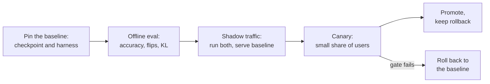

# Урок 26. Ревью заявления о квантизации

**Связь с целью курса:** Курс заканчивается тем, что вам доверяют принимать решение о квантизации и объяснять его другому. Чаще всего решение касается заявления, сделанного кем-то другим: «4 бита, без потери качества». Этот урок учит, как сказать, что это предложение опускает, и как выпустить модель, не удивив тех, кто от неё зависит.
**Первоисточник:** [Научная статья: "Accuracy is Not All You Need", Dutta et al., 2024](https://arxiv.org/abs/2407.09141), разделы с 1 по 3
**Предварительные требования:** [Урок 25](0025-choosing-a-scheme.md), [Перплексия](../GLOSSARY.md), [Калибровочный набор](../GLOSSARY.md), [Размер группы](../GLOSSARY.md), [Эффективное число бит на вес](../GLOSSARY.md)

## Разминка

1. ▢ Что измеряет перплексия и почему небольшое её изменение может соседствовать со многими изменившимися ответами?

<details markdown="1"><summary>Проверка</summary>

Это экспонента среднего отрицательного логарифма правдоподобия, которое модель даёт тексту, то есть она усредняет по каждому токену. Малые сдвиги, размазанные по многим токенам, почти не двигают среднее, тогда как отдельные ответы вблизи границы решения всё равно могут измениться (урок 21).

</details>

2. ▢ Что честная оценка квантизации должна держать одинаковым между базовой и квантизованной моделью?

<details markdown="1"><summary>Проверка</summary>

Обвязку, задачи, промпты и настройки сэмплирования, чтобы единственное различие составляли веса (урок 22).

</details>

3. ▢ Что конфигурация квантизации чекпоинта говорит загрузчику и почему это важно для выкатки?

<details markdown="1"><summary>Проверка</summary>

Как читать хранимые тензоры: схему, разрядность, размер группы и подобные поля (урок 23). Чекпоинт без конфигурации или с несовпадающей невоспроизводим, поэтому при выкатке их нужно версионировать вместе.

</details>

## Что нужно знать

### Заявление и его части

Кто-то говорит: «Мы квантизовали в 4 бита без потери качества». Каждая часть этого предложения скрывает выбор. Ревью не говорит, что заявление неверно. Оно запрашивает каждый скрытый выбор и говорит, какие ответы позволили бы заявлению устоять.

| Часть заявления | Вопрос | Почему это важно |
|---|---|---|
| «Без потерь» | Относительно какой базовой модели? Той же модели в bf16, запущенной на той же обвязке, или числа, скопированного из карточки модели? | Kurtic и соавторы упрекают более раннее исследование моделей до 405 млрд в том, что оно опускает открытые бенчмарки и не сообщает базовые уровни в полной точности даже для академических задач, из-за чего влияние квантизации остаётся неясным ([Kurtic et al., 2024](https://arxiv.org/abs/2411.02355)) |
| «Качество» | Какие задачи? С выбором ответа или открытая генерация, как у вас? | В том же исследовании AWQ опережал GPTQ не более чем на 0,35 пункта на академических бенчмарках, но GPTQ опережал AWQ на 2,9 пункта по среднему на реальных задачах для 8 млрд |
| «Качество» | Только перплексия? На каком тексте и окне? | Изменение перплексии это среднее (урок 21) |
| «Качество» | Флипы? KL-дивергенция? | См. ниже |
| «4 бита» | Какой размер группы, а значит сколько эффективных бит на вес? | 16-битный масштаб на группу из 32 делает это 4,5 бита, на группу из 128 около 4,125 (уроки 1 и 6) |
| «4 бита» | Какой калибровочный набор, насколько большой, насколько близкий к вашему трафику? | Неподходящий набор подгоняется под не те входы (урок 12) |
| Любое заявление о скорости | На каком оборудовании, при каком размере батча, с каким ядром, относительно какой базовой модели? | См. ниже |

### Почему одна точность скрывает изменившуюся модель

Dutta и соавторы определяют **флип** как ответ, изменившийся из верного в неверный или из неверного в верный между базовой и сжатой моделью. Они сравнивают шесть схем квантизации на семи задачах, включая MMLU, HellaSwag и ARC. Точность каждой схемы была в пределах 0-2% от 16-битной модели, однако у всех, кроме одной (GPTQ с 8-битными весами и 16-битными активациями), наблюдались большие флипы, до 13,6%. Их объяснение в том, что выигрыши и потери гасятся: среднее держится, пока многие отдельные ответы движутся в обе стороны. Там, где задача открытая, они обнаружили, что сжатые модели с множеством флипов значительно хуже на MT-Bench, многоходовом диалоговом бенчмарке, и что оценки MT-Bench сильно коррелируют с флипами.

Они предлагают две метрики расстояния от базовой модели: флипы и KL-дивергенцию между вероятностями выхода двух моделей по набору данных, и сообщают, что они хорошо коррелируют. Практическое различие в цене: флипам нужен правильный ответ на пример, а KL-дивергенции нужны только вероятности обеих моделей на одном тексте. Их флипы исключают переходы из неверного в неверный, и они отмечают, что их включение подняло бы числа ещё на 20-40% на задачах с выбором ответа.

### Почему заявлению о скорости нужны ещё три ответа

Ускорение это свойство схемы, ядра, GPU и размера батча вместе.

- **Размер батча.** MARLIN держит близкое к 4-кратному ускорение для ядра с 4-битными весами до размеров батча 16-32, падая примерно до 1,5 раза к размеру батча 128 ([Frantar et al., 2024](https://arxiv.org/abs/2408.11743)). «В 3 раза быстрее», измеренное при батче 1, ничего не говорит о батче 64.
- **Ядро.** QServe сообщает, что существующие методы INT4 несут накладные расходы 20-90% времени выполнения на деквантизацию весов или частичных сумм на GPU и что они ускоряют инференс с малым батчем, но не облачное обслуживание с большим батчем ([Lin et al., 2024](https://arxiv.org/abs/2405.04532)). Одни и те же веса могут быть быстрыми или медленными в зависимости от ядра.
- **Базовая модель.** Быстрее bf16 на каком стеке? На фоне неоптимизированной базовой модели почти всё выглядит быстрым.

Ревью, которое только перечисляет недостатки, сделано наполовину. Скажите, что в порядке и должно остаться: честная базовая модель, отложенный набор задач, измеренное ядро.

### Выкатка квантизованной модели, от которой зависят другие

Когда заявление пережило ревью, модель всё ещё должна заменить ту, которой пользуются люди. Это процесс, а не результат статьи, поэтому считайте его рабочей процедурой.



- **Закрепите базовую модель.** Назовите точный чекпоинт bf16 и версию обвязки, с которыми сравниваете, и продолжайте обслуживать его, пока новая модель не пройдёт.
- **Сравнивайте на трафике, похожем на производственный.** Прогоните реальные промпты через обе модели. Без размеченных ответов флипы вычислить нельзя, но можно сравнить распределения выходов по KL-дивергенции или сравнить выходы метриками сходства, которые использовали Kurtic и соавторы (ROUGE, BERTScore и сходство предложений) при жадном декодировании.
- **Сначала shadow, затем canary.** Shadow-трафик запускает квантизованную модель рядом с базовой, не отдавая её пользователям. Canary обслуживает небольшую долю пользователей. Определите шлюз, порог по каждой метрике, до того, как смотреть на результаты (см. лист [Выпускать или нет](../../evals/reference/go-no-go.md)).
- **Версионируйте чекпоинт вместе с его конфигурацией.** Запишите конфигурацию квантизации, размер группы, калибровочный набор и версию стека обслуживания рядом с весами (урок 23), чтобы результат можно было воспроизвести, а регрессию отследить.
- **Держите откат.** Базовая модель остаётся пригодной к развёртыванию, пока canary не проработает достаточно долго, чтобы увидеть интересующий вас трафик. Откат это изменение конфигурации, а не пересборка.

## Практика

1. ▢ Пост в блоге говорит: «W4A16, перплексия 5,9 против 5,8 у bf16, значит потерь нет». Назовите три отсутствующих пункта.

<details markdown="1"><summary>Проверка</summary>

Любые три из: на каком тексте и окне измерена перплексия; какая-либо точность на задачах; какие-либо флипы или KL-дивергенция; размер группы, а значит эффективные биты; калибровочный набор; была ли 5,8 получена на той же обвязке. Перплексия это среднее и не может показать ответы, изменившиеся в обе стороны.

</details>

2. ▢ Предскажите, затем запустите. Базовая модель отвечает на 100 вопросов и получает 80 верных. Квантизованная модель тоже получает 80 верных, но 10 верных ответов базовой стали неверными, а 10 её неверных ответов стали верными. Предскажите точность каждой и флипы, затем запустите.

    ```python
    base = [1] * 80 + [0] * 20
    quant = base[:]
    for i in range(10):
        quant[i] = 0
    for i in range(80, 90):
        quant[i] = 1
    acc_base = sum(base) / len(base)
    acc_quant = sum(quant) / len(quant)
    flips = sum(b != q for b, q in zip(base, quant)) / len(base)
    print(f"baseline accuracy  {acc_base:.0%}")
    print(f"quantized accuracy {acc_quant:.0%}")
    print(f"flips              {flips:.0%}")
    ```

<details markdown="1"><summary>Подсказка</summary>

Посчитайте каждый вопрос, на котором две модели расходятся в том, верно ли отвечено, в любом направлении.

</details>

<details markdown="1"><summary>Проверка</summary>

```text
baseline accuracy  80%
quantized accuracy 80%
flips              20%
```

Одинаковая точность, изменился один ответ из пяти. Числа построены для примера и не являются измерениями, но форма та, которую описывают Dutta и соавторы: равная точность, большие флипы.

</details>

3. ▢ Отчёт говорит, что его квантизованная модель «в 3 раза быстрее bf16». Какой вопрос сильнее всего меняет то, верите ли вы этому?

    - a) При каком размере батча, с каким ядром и на каком стеке базовой модели измерено?
    - b) Какой метод квантизации породил измеряемые 4-битные веса?
    - c) Какой токенизатор и размер словаря использует модель?
    - d) Какой перплексии достигла квантизованная модель на Wikitext?

<details markdown="1"><summary>Проверка</summary>

**a)** Ускорение принадлежит схеме, ядру, GPU и размеру батча вместе, а результаты MARLIN и QServe показывают, что оно меняется в разы между ними. (b) важно для точности, но два метода, порождающие один 4-битный формат, работают на одном ядре с одинаковой скоростью. (c) квантизацией не меняется, поэтому не может объяснить ускорение. (d) это вопрос о качестве и ничего не говорит о скорости.

</details>

4. ▢ Проведите ревью этого заявления, придуманного для практики: «Мы квантизовали нашу модель чата поддержки на 8 млрд в 4-битный AWQ со 128 калибровочными образцами из публичного англоязычного новостного датасета. Перплексия на Wikitext выросла с 6,05 до 6,14, MMLU упал на 0,4 пункта, а генерация в 3,1 раза быстрее на A100 при размере батча 1. Потери качества нет, поэтому выпускаем для всех пользователей, включая чат на испанском и португальском». Напишите вопросы, которые вы бы задали, и что в порядке.

<details markdown="1"><summary>Проверка</summary>

Вопросы: Базовая 6,05 это та же модель на той же обвязке? Перплексия и MMLU это не качество чата поддержки: какова открытая оценка и каковы флипы и KL на реальных диалогах? Калибровочный набор это английские новости, а трафик включает чат на испанском и португальском (урок 12): измерялось ли качество на этих языках? Какой размер группы, а значит сколько эффективных бит? Утроение достигнуто при размере батча 1: каков производственный размер батча, какое ядро и какой стек базовой модели? В порядке и стоит сохранить: заявленная базовая модель, набор задач рядом с перплексией, названные GPU и размер батча, малое изменение MMLU. Вердикт: это пока не заявление об отсутствии потерь, и нужен canary на испано- и португалоязычном трафике, прежде чем выпускать всем.

</details>

5. ▢ Canary квантизованной модели показывает ту же точность на задачах, что и базовая, но в 9% воспроизведённых диалогов первый ответ получается другим. Вы повышаете, откатываете или удерживаете? Что делаете дальше?

<details markdown="1"><summary>Проверка</summary>

Удерживаете, не повышаете только по точности. Dutta и соавторы показывают, что равная точность может соседствовать с большими флипами и что флипы отслеживают качество на свободной форме. Дальше классифицируйте изменившиеся ответы: это нейтральные переформулировки или ответы, которые ревьюер или судья оценивает ниже (урок 22)? Сравните с шлюзом, заданным до начала canary. Если шлюз не пройден, откатитесь к базовой модели, ради чего она и оставалась развёрнутой.

</details>

## Практика в реальной работе

- [ ] Найдите одно заявление о том, что модель была квантизована «без потерь» (карточка модели или пост в блоге). Перечислите, на какие вопросы из таблицы оно отвечает, а какие оставляет открытыми.
- [ ] Для модели, которую вы выпускаете или могли бы выпустить, напишите план отката в пять строк: какой чекпоинт является базовой моделью, где лежит его конфигурация, что запускает откат, кто решает, сколько времени он занимает.
- [ ] Завтра: посчитайте флипы между двумя запусками одной и той же модели при температуре 0 на двадцати важных для вас вопросах и запишите, что это число говорит о вашем собственном пороге шума.

## Что почитать дальше

- [Чек-лист ревью квантизации](../reference/quantization-review-checklist.md)
- [Эвалы: Выпускать или нет](../../evals/reference/go-no-go.md), о честной установке шлюза до начала canary
- [Научная статья: "Accuracy is Not All You Need", Dutta et al., 2024](https://arxiv.org/abs/2407.09141)
- [Научная статья: "QServe: W4A8KV4 Quantization and System Co-design for Efficient LLM Serving", Lin et al., 2024](https://arxiv.org/abs/2405.04532)
- [Ресурсы](../RESOURCES.md)

---

Не доходит? Перечитайте первоисточник в начале: этот урок его сжимает, а при сжатии понимание как раз и теряется. Загляните в [глоссарий](../GLOSSARY.md), если какой-то термин показался скользким.

Если неясен сам урок, а не материал, это дефект: [откройте issue](https://github.com/TokenCemetery/teach/issues).
