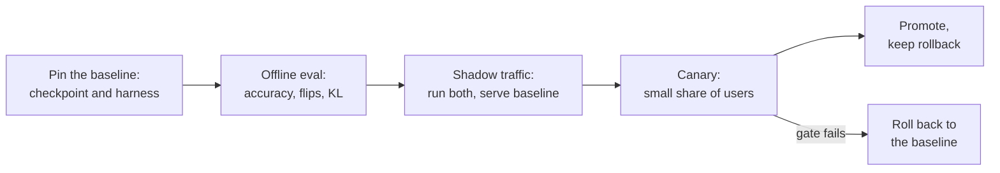

# 第 26 课：评审一项量化声明

**使命关联:** 本系列最后要信任你，能对一次量化做出判断，并向他人解释清楚。多数时候，你要判断的是别人提出的一项声明：“4 位，无质量损失。”这一课讲的是如何说出这句话漏掉了什么，以及如何在不让依赖它的人感到意外的前提下，把模型上线。
**主要来源:** [论文：“Accuracy is Not All You Need”，Dutta 等，2024](https://arxiv.org/abs/2407.09141)，第 1 节到第 3 节
**前置知识:** [第 25 课](0025-choosing-a-scheme.md)、[困惑度](../GLOSSARY.md)、[校准集](../GLOSSARY.md)、[分组大小](../GLOSSARY.md)、[每个权重的有效位数](../GLOSSARY.md)

## 热身

1. ▢ 困惑度度量什么？为什么它的一个很小的变化，可以与许多改变了的答案并存？

<details markdown="1"><summary>检查</summary>

它是模型赋予一段文本的平均负对数似然的指数，所以它对每个 token 取平均。分散在许多 token 上的小幅偏移几乎不会让平均值动，而靠近决策边界的个别答案却仍然可能改变（第 21 课）。

</details>

2. ▢ 一份诚实的量化评测，必须让基线和量化模型之间的哪些东西保持一致？

<details markdown="1"><summary>检查</summary>

测评框架、任务、提示词和采样设置，使唯一的差别就是权重（第 22 课）。

</details>

3. ▢ 量化检查点的量化配置告诉加载器什么？为什么它对上线很要紧？

<details markdown="1"><summary>检查</summary>

告诉它如何读取存储的张量：方案、位宽、分组大小和类似的字段（第 23 课）。一个没有配置的检查点，或者配置不匹配的检查点，是无法复现的，所以上线时必须把它们一起做版本管理。

</details>

## 要点

### 声明及其各个部分

有人说：“我们量化到了 4 位，没有质量损失。”这句话的每一部分，都隐藏着一个选择。评审并不是说这项声明是错的。它是去要求每一个被隐藏的选择，并说明哪些答案会让这项声明站得住脚。

| 声明的部分 | 问题 | 为什么要紧 |
|---|---|---|
| “无损失” | 对照哪个基线？是同一个模型的 bf16，在同一个测评框架上运行，还是从模型卡上抄来的一个数字？ | Kurtic 等人批评了一项早先针对最大 405B 模型的研究，它漏掉了开放式基准，甚至对学术任务也没有报告全精度基线，使量化的影响不清楚（[Kurtic 等，2024](https://arxiv.org/abs/2411.02355)） |
| “质量” | 哪些任务？是选择题，还是像你这样的开放式生成？ | 在同一项研究中，AWQ 在学术基准上最多领先 GPTQ 0.35 个点，而 GPTQ 在 8B 的真实任务平均值上领先 AWQ 2.9 个点 |
| “质量” | 只有困惑度吗？在什么文本和窗口上？ | 困惑度的变化是一个平均值（第 21 课） |
| “质量” | 翻转呢？KL 散度呢？ | 见下文 |
| “4 位” | 哪种分组大小，所以每个权重有多少有效位数？ | 每 32 个一组配一个 16 位缩放因子，就是 4.5 位，每 128 个一组则约为 4.125（第 1 和第 6 课） |
| “4 位” | 哪个校准集，多大，与你的流量有多接近？ | 不匹配的集合是拟合在错误的输入上的（第 12 课） |
| 任何速度声明 | 哪种硬件、哪个批大小、哪个内核、对照哪个基线？ | 见下文 |

### 为什么只看准确率会掩盖一个已经改变的模型

Dutta 等人把**翻转**定义为：在基线与压缩后的模型之间，一个答案从正确变成错误，或从错误变成正确。他们在包括 MMLU、HellaSwag 和 ARC 在内的七项任务上，比较了六种量化方案。每种方案的准确率都在 16 位模型的 0 到 2% 之内，但除了一种（8 位权重加 16 位激活值的 GPTQ）之外，全都出现了很大的翻转，最高达 13.6%。他们的解释是收益和损失互相抵消：平均值得以保持，而许多个别答案朝两个方向移动。在任务是开放式的情形下，他们发现，翻转很多的压缩模型，在 MT-Bench（一个多轮对话基准）上明显更差，并且 MT-Bench 的分数与翻转高度相关。

他们提出了两个对基线的距离度量：翻转，以及两个模型在一个数据集上输出概率之间的 KL 散度，并报告说两者相关性很好。实际的区别在于成本：翻转需要每个样例有一个正确答案，而 KL 散度只需要两个模型在同一段文本上的概率。他们的翻转不包括从错误到错误的转变，并指出把它们算进来，会让选择题任务上的数字再增加 20% 到 40%。

### 为什么一项速度声明还需要另外三个答案

速度提升是一种方案、一个内核、一块 GPU 和一个批大小共同的性质。

- **批大小**。MARLIN 让 4 位权重的内核在批大小最多到 16 至 32 时，保持接近 4 倍的加速，到批大小 128 时降到约 1.5 倍（[Frantar 等，2024](https://arxiv.org/abs/2408.11743)）。在批大小为 1 时度量到的“快 3 倍”，对批大小 64 什么也没说。
- **内核**。QServe 报告说，现有的 INT4 方法在 GPU 上，因为对权重或部分和做反量化，要承受 20% 到 90% 的运行时开销，它们加速小批量推理，却加速不了大批量的云端服务（[Lin 等，2024](https://arxiv.org/abs/2405.04532)）。同样的权重，取决于内核，可以快，也可以慢。
- **基线**。比 bf16 快，是在哪个技术栈上？对照一个没有优化过的基线，几乎什么都显得快。

一项只列出缺陷的评审只做了一半。还要说出什么是好的、应该保留的：一个站得住脚的基线、一个留出的任务集、一个度量过的内核。

### 上线别人所依赖的量化模型

一旦一项声明通过了评审，这个模型仍然得去取代人们正在用的那个。这是流程，不是论文里的发现，所以把它当作一种可行的做法。



- **固定基线**。写明你所对照的那个 bf16 检查点和测评框架版本的确切名称，并且在新模型通过之前，继续用它提供服务。
- **在接近生产的流量上比较**。让真实的提示词在两个模型上重放。没有带标签的答案，就算不出翻转，但你可以用 KL 散度比较输出分布，或者在贪心解码下，用 Kurtic 等人使用的相似度指标（ROUGE、BERTScore 和句子相似度）来比较输出。
- **先影子，再金丝雀**。影子流量让量化模型与基线并行运行，但不对外服务。金丝雀则让一小部分用户用上它。在看结果之前，就定好关卡，即每个指标上的阈值（见[上线与否](../../evals/reference/go-no-go.md)参考表）。
- **把检查点与它的配置一起做版本管理**。把量化配置、分组大小、校准集和服务栈的版本，与权重记录在一起（第 23 课），这样一个结果就可以复现，一次退化就可以追溯。
- **保留回滚**。基线要一直保持可部署，直到金丝雀运行得足够久，看到了你所关心的流量。回滚是一次配置改动，而不是一次重新构建。

## 练习

1. ▢ 一篇博客文章说：“W4A16，困惑度 5.9，对 bf16 的 5.8，所以没有损失。”指出缺了哪三样东西。

<details markdown="1"><summary>检查</summary>

下面任意三项：困惑度是在什么文本和窗口上度量的；任何任务准确率；任何翻转或 KL 散度；分组大小，因而有效位数；校准集；那个 5.8 是否是在同一个测评框架上运行的。困惑度是一个平均值，显示不出朝两个方向变化的答案。

</details>

2. ▢ 先预测，再运行。一个基线回答 100 道题，答对 80 道。一个量化模型也答对 80 道，但基线答对的 10 个答案变成了错的，它答错的 10 个答案变成了对的。预测各自的准确率和翻转，然后运行。

    ```python
    base = [1] * 80 + [0] * 20
    quant = base[:]
    for i in range(10):
        quant[i] = 0
    for i in range(80, 90):
        quant[i] = 1
    acc_base = sum(base) / len(base)
    acc_quant = sum(quant) / len(quant)
    flips = sum(b != q for b, q in zip(base, quant)) / len(base)
    print(f"baseline accuracy  {acc_base:.0%}")
    print(f"quantized accuracy {acc_quant:.0%}")
    print(f"flips              {flips:.0%}")
    ```

<details markdown="1"><summary>提示</summary>

数一数两个模型在对错上意见不一的每一道题，不论哪个方向。

</details>

<details markdown="1"><summary>检查</summary>

```text
baseline accuracy  80%
quantized accuracy 80%
flips              20%
```

准确率相同，每五个答案就有一个变了。这些数字是为这个例子构造的，不是度量结果，但形态正是 Dutta 等人描述的那种：准确率相等，翻转很大。

</details>

3. ▢ 一份报告说它的量化模型“比 bf16 快 3 倍”。哪一个问题最能改变你是否相信它？

    - a) 度量的是哪个批大小、内核和基线技术栈？
    - b) 被计时的 4 位权重是由哪种量化方法产生的？
    - c) 这个模型用的是哪种分词器和多大的词表？
    - d) 量化模型在 Wikitext 上达到了什么困惑度？

<details markdown="1"><summary>检查</summary>

**a)** 速度提升属于方案、内核、GPU 和批大小共同的整体，MARLIN 和 QServe 的结果表明它在这些之间的差异可达很大的倍数。(b) 对精度要紧，但产生同样 4 位格式的两种方法，在同一个内核上以同样的速度运行。(c) 不会因量化而变，所以解释不了速度提升。(d) 是质量问题，对速度什么也没说。

</details>

4. ▢ 评审下面这项声明，它是为练习而编造的：“我们把 8B 的客服对话模型量化成了 4 位 AWQ，用的是来自一个公开英文新闻数据集的 128 个校准样本。Wikitext 困惑度从 6.05 升到 6.14，MMLU 下降 0.4 个点，在 A100 上批大小为 1 时生成快了 3.1 倍。没有质量损失，所以我们上线给所有用户，包括西班牙语和葡萄牙语的对话。”写出你会问的问题，以及什么是好的。

<details markdown="1"><summary>检查</summary>

问题：6.05 的基线是同一个模型，在同一个测评框架上得到的吗？困惑度和 MMLU 不是客服对话的质量：开放式的评测是什么？在真实对话上的翻转和 KL 是多少？校准集是英文新闻，而流量里包括西班牙语和葡萄牙语的对话（第 12 课）：有没有在那些语言上度量过质量？哪种分组大小，所以有效位数是多少？3.1 倍是在批大小为 1 时：生产的批大小是多少？用的是哪个内核和基线技术栈？好的、值得保留的有：声明了基线，在困惑度之外还有任务套件，指明了 GPU 和批大小，MMLU 的变化很小。结论：还不是无损失的声明，并且在面向所有用户之前，要先在西班牙语和葡萄牙语的流量上做金丝雀。

</details>

5. ▢ 一个量化模型的金丝雀显示任务准确率与基线相同，但有 9% 重放的对话，第一个回答不同。你是推进、回滚，还是暂缓？接下来做什么？

<details markdown="1"><summary>检查</summary>

暂缓，不要只凭准确率就推进。Dutta 等人表明，相等的准确率可以与很大的翻转并存，并且翻转与自由形式的质量相关。接下来，给改变了的答案分类：它们是中性的改写，还是评审者或裁判更不喜欢的答案（第 22 课）？对照金丝雀开始之前定好的关卡来比较。如果没有达到关卡，就回滚到基线，这正是它一直保持部署的原因。

</details>

## 实战练习

- [ ] 找一项声称某个模型“无损”量化的声明（模型卡或博客文章）。列出表中的问题里，它回答了哪些，留下哪些没有回答。
- [ ] 对一个你上线过或可能上线的模型，用五行写出回滚计划：哪个检查点是基线，它的配置放在哪里，什么触发回滚，谁来决定，需要多久。
- [ ] 明天：在温度为 0 时，对同一个模型的两次运行，在你关心的二十道题上算出翻转，并写下这个数字对你自己的噪声底限说明了什么。

## 延伸阅读

- [量化评审检查清单](../reference/quantization-review-checklist.md)
- [评测：上线与否](../../evals/reference/go-no-go.md)，讲如何在金丝雀开始之前，诚实地设定关卡
- [论文：“Accuracy is Not All You Need”，Dutta 等，2024](https://arxiv.org/abs/2407.09141)
- [论文：“QServe: W4A8KV4 Quantization and System Co-design for Efficient LLM Serving”，Lin 等，2024](https://arxiv.org/abs/2405.04532)
- [资源](../RESOURCES.md)

---

没学明白？请重读顶部的主要来源，因为本课是对它的压缩，而理解正是在压缩中流失的。如果有哪个术语觉得含糊，可以查看[术语表](../GLOSSARY.md)。

如果问题出在课程本身，而不是学习材料，那就是一个缺陷：[提交 issue](https://github.com/TokenCemetery/teach/issues)。
