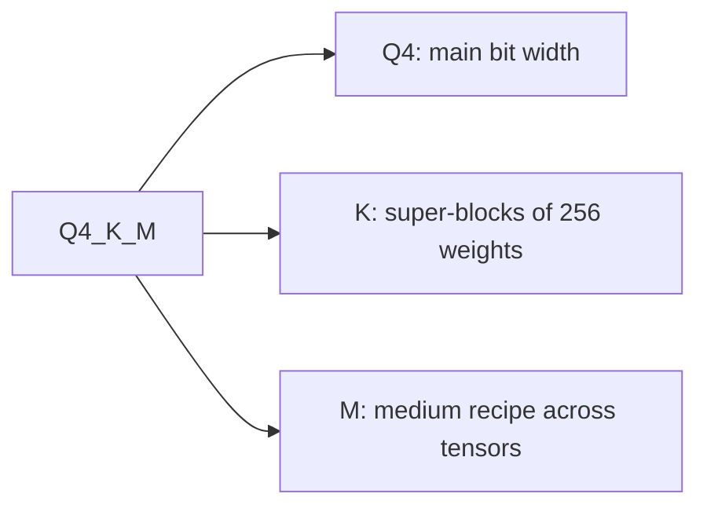

# Medir y almacenar: pérdida de calidad, checkpoints y tipos de GGUF

Las etapas 8 y 9 comprimidas para consulta. La [Lección 21](../lessons/0021-perplexity-and-its-limits.md) cubre la perplexity y los flips, la [lección 22](../lessons/0022-an-honest-quantization-eval.md) una eval honesta, la [lección 23](../lessons/0023-quantized-checkpoints.md) los checkpoints en safetensors, y la [lección 24](../lessons/0024-gguf-quant-types.md) los tipos de GGUF y la matriz de importancia.

## Qué cambia un número de perplexity

| Mando | Efecto | Regla |
|---|---|---|
| Tokenizer | Cambia el propio número | Comparar solo modelos con un mismo tokenizer |
| Texto | Cambia el número | Usar un solo texto, WikiText-2 por convención de llama.cpp |
| Stride | GPT-2 large: 19.44 con stride 1024, 16.44 con stride 512 | Misma ventana y mismo stride en ambas ejecuciones |
| Herramienta y versión | Los números de llama.cpp no son comparables con los de otros proyectos | La misma herramienta en ambas ejecuciones |

## Qué métrica responde a qué pregunta

| Métrica | Mide | Ciega a |
|---|---|---|
| Perplexity | Sorpresa promedio por token en un texto | Ganancias en algunos tokens que cancelan pérdidas en otros |
| Divergencia KL frente al baseline | Distancia entre distribuciones de salida | Si cambió alguna respuesta |
| Same top p (llama.cpp) | Posiciones en que ambos modelos ponen el mismo token principal | Cualquier cosa más allá del token principal |
| Flips | Respuestas que cambian entre correcta e incorrecta | Cambios de incorrecta a incorrecta |
| Puntuación de tarea | Accuracy o tasa de aciertos en una tarea | Flips, y el piso de ruido si no se declara |
| Chat juzgado (MT-Bench, Arena-Hard) | Calidad de la generación libre | Ruido entre ejecuciones salvo que se repita |

Números que recordar: accuracy a un 0 a 2 por ciento con flips de hasta el 13.6 por ciento (Dutta et al.); Llama 3 8B en q4_K_M tiene una perplexity un 2.8 por ciento por encima de FP16 y un same top p de 91.901 por ciento.

## Una eval honesta

| Mantener fijo | Informar | Comprobar |
|---|---|---|
| Baseline: el mismo checkpoint en 16 bits | Delta por tarea, no un promedio | El delta frente al piso de ruido |
| Harness, versión, backend | Flips a partir de muestras registradas | Una repetición del baseline y del cuantizado |
| Prompts, few-shot, chat template | Intervalo de confianza por tarea | Umbral fijado antes de la ejecución |
| Ajustes de decodificación y longitud máxima | Qué tarea pagó, por nombre | Varias clases de tarea, generativas y de contexto largo |

Ruido: dos ejecuciones del mismo modelo BF16 obtuvieron 25.1 y 26.5 en Arena-Hard (8B) y 55.8 y 58.2 (70B), con intervalos del 95 por ciento de unos 2 a 3 puntos. El error estándar de una tarea de acierto o fallo es `sqrt(p * (1 - p) / N)`. Una comparación pareada depende solo de las preguntas en las que los modelos discrepan, y fue 2.7 veces más ajustada en la simulación de la lección 22.

Kurtic et al., Llama 3.1: FP8 W8A8 efectivamente sin pérdida, INT8 W8A8 bien ajustado pierde de 1 a 3 por ciento, INT4 W4A16 competitivo con 8 bits. Una familia de modelos, recetas específicas. Su ejemplo por tarea: W4A16 en 8B tiene una recuperación promedio del 98.72 por ciento y una recuperación mínima por tarea del 96.88 por ciento (TruthfulQA).

## Disposición de safetensors

```text
| 8 bytes: N (little-endian) | N bytes: JSON header | byte buffer |
```

El encabezado asigna a cada nombre de tensor `dtype`, `shape` y `data_offsets` (relativos al búfer). Un `__metadata__` opcional contiene pares de cadenas. Lee solo el encabezado con una petición HTTP por rango: bytes 0 a 7, y luego bytes 8 a 8 + N - 1.

## Tensores en una capa cuantizada

| Esquema | Tensores por capa lineal | Notas |
|---|---|---|
| GPTQ, 4 bits, grupo 128 | `qweight` I32 `[in/8, out]`, `scales` F16 `[in/128, out]`, `qzeros` I32 `[in/128, out/8]`, `g_idx` I32 `[in]` | `g_idx` asigna canal a grupo, revuelto por act-order |
| compressed-tensors, FP8 por tensor | `weight` F8_E4M3, `weight_scale` `[1]`, `input_scale` `[1]` | Un scale por tensor |
| compressed-tensors, pack-quantized | pesos int4 o int8 empaquetados en int32 | Los scales se almacenan junto a los pesos empaquetados |

Bits efectivos de la capa GPTQ de la lección 23 (2048 por 2048, grupo 128): 4.171875, no 4.0. Si `scales` tiene `in/G` filas, el tamaño de grupo es `G`: fíate de la forma antes que de la model card.

## Qué dice `quantization_config`

| Método | `quant_method` | Claves vistas |
|---|---|---|
| GPTQ | `gptq` | `bits`, `group_size`, `desc_act`, `sym`, `damp_percent`, `true_sequential`, `static_groups` |
| AWQ | `awq` | `bits`, `group_size`, `zero_point`, `version` |
| compressed-tensors | `compressed-tensors` | `config_groups` (`weights`, `input_activations`, `targets`), `ignore`, `format`, `quantization_status` |

## Tipos de GGUF



| Familia | Nombres | Disposición | Bits por peso |
|---|---|---|---|
| Heredada | `Q4_0`, `Q5_0`, `Q8_0`; `_1` añade un mínimo | 32 pesos, un scale de 16 bits | `Q4_0` 4.5, `Q8_0` 8.5 |
| k-quant | `Q4_K`, `Q5_K`, `Q6_K` | Super-bloque de 256 pesos con sub-bloques de scales cuantizados | 4.5, 5.5, 6.5625 |
| i-quant | `IQ4_XS`, `IQ3_S`, `IQ2_XXS`, `IQ1_S` | Scale de super-bloque y matriz de importancia | 4.25, 3.44, 2.06, 1.56 |

Cifras de archivo completo para Llama 3.1 8B: `Q4_K_S` 4.6672, `Q4_K_M` 4.8944, `Q5_K_M` 5.7036, `Q6_K` 6.5633, `Q8_0` 8.5008, `IQ1_S` 2.0042 (F16 16.0005). El tamaño en GiB es aproximadamente bits por peso por parámetros dividido entre 8 y 2^30. Cuando se introdujeron los sufijos, `Q4_K_M` ponía `Q6_K` en la mitad de `attention.wv` y `feed_forward.w2`; las recetas han cambiado desde entonces, así que lee los tipos de tensores del propio archivo. `--pure` desactiva las mezclas.

## Matriz de importancia

| Paso | Idea del comando | Nota |
|---|---|---|
| Calcular | `llama-imatrix -m model.gguf -f text.txt` | Activación cuadrática media por columna de entrada |
| Aplicar | `llama-quantize --imatrix imatrix.gguf in.gguf out.gguf Q4_K_M` | No se aplica a `output.weight` por defecto |
| Efecto | `q4_K_M`, Llama 3 8B: perplexity de 6.407 a 6.383, divergencia KL de 0.0313 a 0.0282 | Mismo tamaño de archivo |

Una imatrix es un calibration set: haz que su texto coincida con el despliegue, y no evalúes con el texto del que salió.
