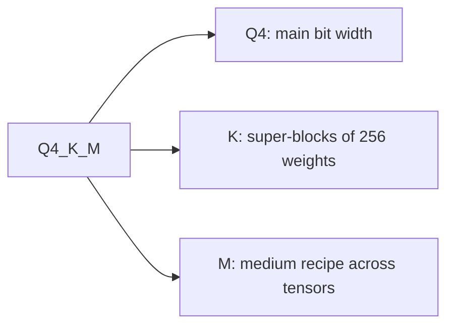

# Mesurer et stocker : perte de qualité, checkpoints et types GGUF

Les étapes 8 et 9 condensées pour la consultation. La [leçon 21](../lessons/0021-perplexity-and-its-limits.md) couvre la perplexity et les flips, la [leçon 22](../lessons/0022-an-honest-quantization-eval.md) une eval honnête, la [leçon 23](../lessons/0023-quantized-checkpoints.md) les checkpoints safetensors, et la [leçon 24](../lessons/0024-gguf-quant-types.md) les types GGUF et la matrice d'importance.

## Ce qui change un chiffre de perplexity

| Bouton | Effet | Règle |
|---|---|---|
| Tokenizer | Change le chiffre lui-même | Ne comparer que des modèles de même tokenizer |
| Texte | Change le chiffre | Utiliser un seul texte, WikiText-2 selon la convention de llama.cpp |
| Stride | GPT-2 large : 19.44 au stride 1024, 16.44 au stride 512 | Même fenêtre et même stride dans les deux exécutions |
| Outil et version | Les chiffres de llama.cpp ne sont pas comparables à ceux d'autres projets | Même outil dans les deux exécutions |

## Quelle métrique répond à quelle question

| Métrique | Mesure | Aveugle à |
|---|---|---|
| Perplexity | Surprise moyenne par token sur un texte | Les gains sur certains tokens qui annulent les pertes sur d'autres |
| Divergence KL par rapport à la référence | Distance entre les distributions de sortie | Si une réponse a changé |
| Same top p (llama.cpp) | Positions où les deux modèles classent le même token de tête | Tout ce qui dépasse le token de tête |
| Flips | Réponses qui changent entre correcte et incorrecte | Les changements d'incorrecte à incorrecte |
| Score de tâche | Accuracy ou taux de réussite sur une tâche | Les flips, et le seuil de bruit s'il n'est pas divulgué |
| Chat jugé (MT-Bench, Arena-Hard) | Qualité de génération libre | Le bruit d'une exécution à l'autre sauf répétition |

Chiffres à retenir : accuracy à 0 à 2 pour cent avec des flips allant jusqu'à 13.6 pour cent (Dutta et al.) ; Llama 3 8B en q4_K_M a une perplexity de 2.8 pour cent au-dessus du FP16 et un same top p de 91.901 pour cent.

## Une eval honnête

| À fixer | Rapporter | Vérifier |
|---|---|---|
| Référence : même checkpoint en 16 bits | Delta par tâche, pas une moyenne | Delta face au seuil de bruit |
| Harness, version, backend | Flips à partir des échantillons enregistrés | Une nouvelle exécution de la référence et du quantifié |
| Prompts, few-shot, chat template | Intervalle de confiance par tâche | Seuil fixé avant l'exécution |
| Réglages de décodage et longueur maximale | Quelle tâche a payé, nommément | Plusieurs sortes de tâches, génératives et à contexte long |

Bruit : deux exécutions du même modèle BF16 ont obtenu 25.1 et 26.5 sur Arena-Hard (8B) et 55.8 et 58.2 (70B), avec des intervalles à 95 pour cent d'environ 2 à 3 points. L'erreur standard d'une tâche juste ou faux est `sqrt(p * (1 - p) / N)`. Une comparaison appariée ne dépend que des questions où les modèles divergent, et était 2.7 fois plus serrée dans la simulation de la leçon 22.

Kurtic et al., Llama 3.1 : FP8 W8A8 effectivement sans perte, INT8 W8A8 bien réglé perd 1 à 3 pour cent, INT4 W4A16 compétitif avec le 8 bits. Une famille de modèles, des recettes précises. Leur exemple par tâche : W4A16 à 8B a une récupération moyenne de 98.72 pour cent et une récupération minimale par tâche de 96.88 pour cent (TruthfulQA).

## Agencement de safetensors

```text
| 8 bytes: N (little-endian) | N bytes: JSON header | byte buffer |
```

L'en-tête fait correspondre à chaque nom de tenseur son `dtype`, sa `shape` et ses `data_offsets` (relatifs au tampon). Le champ optionnel `__metadata__` contient des paires de chaînes. Ne lisez que l'en-tête avec une requête HTTP par plage : octets 0 à 7, puis octets 8 à 8 + N - 1.

## Tenseurs d'une couche quantifiée

| Schéma | Tenseurs par couche linéaire | Remarques |
|---|---|---|
| GPTQ, 4 bits, groupe 128 | `qweight` I32 `[in/8, out]`, `scales` F16 `[in/128, out]`, `qzeros` I32 `[in/128, out/8]`, `g_idx` I32 `[in]` | `g_idx` relie canal et groupe, brouillé par l'act-order |
| compressed-tensors, FP8 par tenseur | `weight` F8_E4M3, `weight_scale` `[1]`, `input_scale` `[1]` | Un scale par tenseur |
| compressed-tensors, pack-quantized | poids int4 ou int8 empaquetés en int32 | Les scales sont stockés à côté des poids empaquetés |

Bits effectifs de la couche GPTQ de la leçon 23 (2048 par 2048, groupe 128) : 4.171875, pas 4.0. Si `scales` a `in/G` lignes, la taille de groupe est `G` : fiez-vous à la forme plutôt qu'à la fiche de modèle.

## Ce que dit `quantization_config`

| Méthode | `quant_method` | Clés vues |
|---|---|---|
| GPTQ | `gptq` | `bits`, `group_size`, `desc_act`, `sym`, `damp_percent`, `true_sequential`, `static_groups` |
| AWQ | `awq` | `bits`, `group_size`, `zero_point`, `version` |
| compressed-tensors | `compressed-tensors` | `config_groups` (`weights`, `input_activations`, `targets`), `ignore`, `format`, `quantization_status` |

## Types GGUF



| Famille | Noms | Agencement | Bits par poids |
|---|---|---|---|
| Historique | `Q4_0`, `Q5_0`, `Q8_0` ; `_1` ajoute un minimum | 32 poids, un scale de 16 bits | `Q4_0` 4.5, `Q8_0` 8.5 |
| k-quant | `Q4_K`, `Q5_K`, `Q6_K` | Super-bloc de 256 poids en sous-blocs à scales quantifiés | 4.5, 5.5, 6.5625 |
| i-quant | `IQ4_XS`, `IQ3_S`, `IQ2_XXS`, `IQ1_S` | Scale de super-bloc et matrice d'importance | 4.25, 3.44, 2.06, 1.56 |

Chiffres sur fichier entier pour Llama 3.1 8B : `Q4_K_S` 4.6672, `Q4_K_M` 4.8944, `Q5_K_M` 5.7036, `Q6_K` 6.5633, `Q8_0` 8.5008, `IQ1_S` 2.0042 (F16 16.0005). La taille en GiB vaut à peu près les bits par poids fois les paramètres divisés par 8 et 2^30. Quand les suffixes ont été introduits, `Q4_K_M` mettait du `Q6_K` sur la moitié de `attention.wv` et `feed_forward.w2` ; les recettes ont changé depuis, donc lisez les types de tenseurs propres au fichier. `--pure` désactive les mélanges.

## Matrice d'importance

| Étape | Idée de commande | Remarque |
|---|---|---|
| Calculer | `llama-imatrix -m model.gguf -f text.txt` | Activation quadratique moyenne par colonne d'entrée |
| Appliquer | `llama-quantize --imatrix imatrix.gguf in.gguf out.gguf Q4_K_M` | Non appliquée à `output.weight` par défaut |
| Effet | `q4_K_M`, Llama 3 8B : perplexity 6.407 à 6.383, divergence KL 0.0313 à 0.0282 | Même taille de fichier |

Un imatrix est un calibration set : faites correspondre son texte au déploiement, et n'évaluez pas sur le texte dont il provient.
