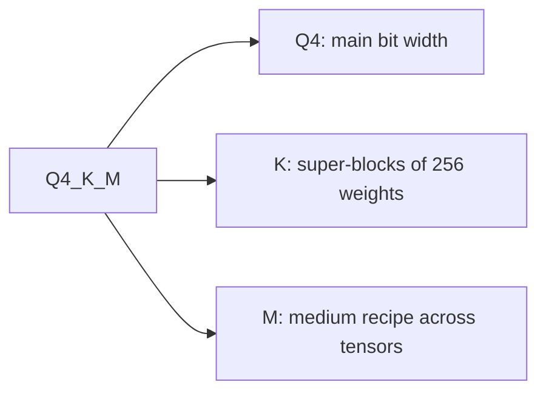

# मापना और Store करना: Quality की हानि, Checkpoints और GGUF Types

चरण 8 और 9 का संक्षेप, देखने के लिए। [पाठ 21](../lessons/0021-perplexity-and-its-limits.md) perplexity और flips बताता है, [पाठ 22](../lessons/0022-an-honest-quantization-eval.md) ईमानदार eval, [पाठ 23](../lessons/0023-quantized-checkpoints.md) safetensors checkpoints, और [पाठ 24](../lessons/0024-gguf-quant-types.md) GGUF types और importance matrix।

## Perplexity की संख्या क्या बदलता है

| Dial | असर | नियम |
|---|---|---|
| Tokenizer | संख्या ख़ुद बदल देता है | सिर्फ़ एक tokenizer वाले models की तुलना करें |
| Text | संख्या बदलता है | एक ही text इस्तेमाल करें, llama.cpp की परिपाटी से WikiText-2 |
| Stride | GPT-2 large: stride 1024 पर 19.44, stride 512 पर 16.44 | दोनों runs में वही window और stride |
| Tool और version | llama.cpp की संख्याएँ दूसरे projects की संख्याओं से तुलनीय नहीं | दोनों runs में वही tool |

## कौन-सा metric किस सवाल का जवाब देता है

| Metric | क्या मापता है | किसके प्रति अंधा |
|---|---|---|
| Perplexity | किसी text पर औसत token की हैरानी | कुछ tokens के फ़ायदों का दूसरों के नुक़सान से कट जाना |
| Baseline के मुक़ाबले KL divergence | Output distributions के बीच दूरी | क्या कोई उत्तर बदला |
| Same top p (llama.cpp) | वे positions जहाँ दोनों models एक ही top token को ऊपर रखते हैं | Top token से आगे कुछ भी |
| Flips | उत्तरों का सही और ग़लत के बीच बदलना | ग़लत से ग़लत में बदलाव |
| Task score | एक task पर accuracy या pass rate | Flips, और noise floor अगर बताया न गया हो |
| Judged chat (MT-Bench, Arena-Hard) | Free-form generation की quality | Run-to-run noise, जब तक दोहराया न जाए |

याद रखने की संख्याएँ: accuracy 0 से 2 प्रतिशत के भीतर जबकि flips 13.6 प्रतिशत तक (Dutta et al.); q4_K_M पर Llama 3 8B की perplexity FP16 से 2.8 प्रतिशत ज़्यादा और same top p 91.901 प्रतिशत।

## ईमानदार eval

| स्थिर रखें | रिपोर्ट करें | जाँचें |
|---|---|---|
| Baseline: वही checkpoint 16-bit में | प्रति task अंतर, औसत नहीं | Noise floor के मुक़ाबले अंतर |
| Harness, version, backend | Log किए samples से flips | Baseline और quantized का दोबारा run |
| Prompts, few-shot, chat template | प्रति task confidence interval | Run से पहले तय की गई सीमा |
| Decoding settings और अधिकतम लंबाई | किस task ने क़ीमत चुकाई, नाम लेकर | कई तरह के tasks, generative और long-context |

Noise: एक ही BF16 model के दो runs ने Arena-Hard (8B) पर 25.1 और 26.5 और (70B) पर 55.8 और 58.2 अंक पाए, 95 प्रतिशत intervals लगभग 2 से 3 अंक के साथ। सही-या-ग़लत वाले task की standard error `sqrt(p * (1 - p) / N)` है। जोड़ीदार तुलना सिर्फ़ उन सवालों पर निर्भर करती है जहाँ models असहमत हों, और पाठ 22 के simulation में 2.7 गुना कसी हुई थी।

Kurtic et al., Llama 3.1: FP8 W8A8 व्यावहारिक रूप से lossless, अच्छी तरह tune किया INT8 W8A8 1 से 3 प्रतिशत खोता है, INT4 W4A16 8-bit के बराबर। एक model परिवार, ख़ास recipes। उनका प्रति-task उदाहरण: 8B पर W4A16 की औसत recovery 98.72 प्रतिशत और सबसे कम task recovery 96.88 प्रतिशत (TruthfulQA)।

## Safetensors layout

```text
| 8 bytes: N (little-endian) | N bytes: JSON header | byte buffer |
```

Header हर tensor के नाम को `dtype`, `shape` और `data_offsets` (buffer के सापेक्ष) से जोड़ता है। वैकल्पिक `__metadata__` में string जोड़ियाँ होती हैं। सिर्फ़ header पढ़ें, HTTP range request से: bytes 0 से 7, फिर bytes 8 से 8 + N - 1।

## Quantized layer के tensors

| Scheme | प्रति linear layer tensors | टिप्पणी |
|---|---|---|
| GPTQ, 4-bit, group 128 | `qweight` I32 `[in/8, out]`, `scales` F16 `[in/128, out]`, `qzeros` I32 `[in/128, out/8]`, `g_idx` I32 `[in]` | `g_idx` channel को group से जोड़ता है, act-order से उलट-पुलट |
| compressed-tensors, FP8 per tensor | `weight` F8_E4M3, `weight_scale` `[1]`, `input_scale` `[1]` | प्रति tensor एक scale |
| compressed-tensors, pack-quantized | int4 या int8 weights int32 में packed | Scales packed weights के बग़ल में store होते हैं |

पाठ 23 की GPTQ layer (2048 गुणा 2048, group 128) के effective bits: 4.171875, 4.0 नहीं। अगर `scales` में `in/G` पंक्तियाँ हैं, तो group size `G` है: model card से ज़्यादा shape पर भरोसा करें।

## `quantization_config` क्या बताता है

| Method | `quant_method` | दिखने वाली keys |
|---|---|---|
| GPTQ | `gptq` | `bits`, `group_size`, `desc_act`, `sym`, `damp_percent`, `true_sequential`, `static_groups` |
| AWQ | `awq` | `bits`, `group_size`, `zero_point`, `version` |
| compressed-tensors | `compressed-tensors` | `config_groups` (`weights`, `input_activations`, `targets`), `ignore`, `format`, `quantization_status` |

## GGUF types



| परिवार | नाम | Layout | प्रति weight bits |
|---|---|---|---|
| Legacy | `Q4_0`, `Q5_0`, `Q8_0`; `_1` एक न्यूनतम जोड़ता है | 32 weights, एक 16-bit scale | `Q4_0` 4.5, `Q8_0` 8.5 |
| k-quant | `Q4_K`, `Q5_K`, `Q6_K` | 256-weight का super-block, quantized scales वाले sub-blocks का | 4.5, 5.5, 6.5625 |
| i-quant | `IQ4_XS`, `IQ3_S`, `IQ2_XXS`, `IQ1_S` | Super-block scale और importance matrix | 4.25, 3.44, 2.06, 1.56 |

Llama 3.1 8B के पूरी-file आँकड़े: `Q4_K_S` 4.6672, `Q4_K_M` 4.8944, `Q5_K_M` 5.7036, `Q6_K` 6.5633, `Q8_0` 8.5008, `IQ1_S` 2.0042 (F16 16.0005)। GiB में आकार लगभग प्रति weight bits गुणा parameters, भाग 8 और 2^30 है। जब suffixes पेश हुए, `Q4_K_M` ने `attention.wv` और `feed_forward.w2` के आधे हिस्से पर `Q6_K` रखा; recipes तब से बदले हैं, इसलिए file के अपने tensor types पढ़ें। `--pure` मिश्रण बंद कर देता है।

## Importance matrix

| चरण | Command का विचार | टिप्पणी |
|---|---|---|
| Compute | `llama-imatrix -m model.gguf -f text.txt` | प्रति input column औसत squared activation |
| लागू करें | `llama-quantize --imatrix imatrix.gguf in.gguf out.gguf Q4_K_M` | Default रूप से `output.weight` पर लागू नहीं होता |
| असर | `q4_K_M`, Llama 3 8B: perplexity 6.407 से 6.383, KL divergence 0.0313 से 0.0282 | File का आकार वही |

Imatrix एक calibration set है: उसके text को deployment से मिलाएँ, और जिस text से वह आया उस पर evaluate न करें।
