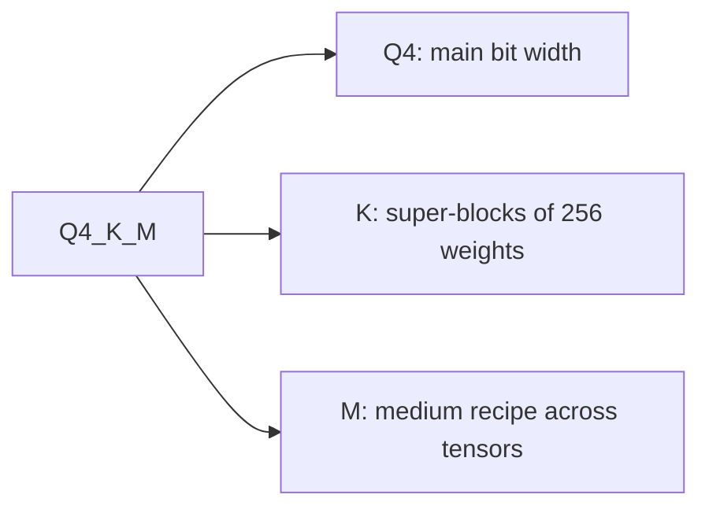

# Measuring and Storing: Quality Loss, Checkpoints and GGUF Types

Stages 8 and 9 compressed for lookup. [Lesson 21](../lessons/0021-perplexity-and-its-limits.md) covers perplexity and flips, [lesson 22](../lessons/0022-an-honest-quantization-eval.md) an honest eval, [lesson 23](../lessons/0023-quantized-checkpoints.md) safetensors checkpoints, and [lesson 24](../lessons/0024-gguf-quant-types.md) GGUF types and the importance matrix.

## What changes a perplexity number

| Dial | Effect | Rule |
|---|---|---|
| Tokenizer | Changes the number itself | Compare only models with one tokenizer |
| Text | Changes the number | Use one text, WikiText-2 by llama.cpp convention |
| Stride | GPT-2 large: 19.44 at stride 1024, 16.44 at stride 512 | Same window and stride in both runs |
| Tool and version | llama.cpp numbers are not comparable to other projects' | Same tool in both runs |

## Which metric answers which question

| Metric | Measures | Blind to |
|---|---|---|
| Perplexity | Average token surprise on a text | Gains on some tokens cancelling losses on others |
| KL divergence vs baseline | Distance between output distributions | Whether any answer changed |
| Same top p (llama.cpp) | Positions where both models rank the same top token | Anything beyond the top token |
| Flips | Answers changing between correct and incorrect | Incorrect-to-incorrect changes |
| Task score | Accuracy or pass rate on one task | Flips, and the noise floor if undisclosed |
| Judged chat (MT-Bench, Arena-Hard) | Free-form generation quality | Run-to-run noise unless repeated |

Numbers to remember: accuracy within 0 to 2 percent with flips up to 13.6 percent (Dutta et al.); Llama 3 8B at q4_K_M has perplexity 2.8 percent over FP16 and same top p of 91.901 percent.

## An honest eval

| Hold fixed | Report | Check |
|---|---|---|
| Baseline: same checkpoint in 16-bit | Per-task delta, not an average | Delta against the noise floor |
| Harness, version, backend | Flips from logged samples | A rerun of baseline and quantized |
| Prompts, few-shot, chat template | Confidence interval per task | Threshold set before the run |
| Decoding settings and maximum length | Which task paid, by name | Several task kinds, generative and long-context |

Noise: two runs of the same BF16 model scored 25.1 and 26.5 on Arena-Hard (8B) and 55.8 and 58.2 (70B), with 95 percent intervals of about 2 to 3 points. Standard error for a right-or-wrong task is `sqrt(p * (1 - p) / N)`. A paired comparison depends only on the questions where the models disagree, and was 2.7 times tighter in lesson 22's simulation.

Kurtic et al., Llama 3.1: FP8 W8A8 effectively lossless, well-tuned INT8 W8A8 loses 1 to 3 percent, INT4 W4A16 competitive with 8-bit. One model family, specific recipes. Their per-task example: W4A16 at 8B has average recovery 98.72 percent and lowest task recovery 96.88 percent (TruthfulQA).

## Safetensors layout

```text
| 8 bytes: N (little-endian) | N bytes: JSON header | byte buffer |
```

The header maps each tensor name to `dtype`, `shape` and `data_offsets` (relative to the buffer). Optional `__metadata__` holds string pairs. Read only the header with an HTTP range request: bytes 0 to 7, then bytes 8 to 8 + N - 1.

## Tensors in a quantized layer

| Scheme | Tensors per linear layer | Notes |
|---|---|---|
| GPTQ, 4-bit, group 128 | `qweight` I32 `[in/8, out]`, `scales` F16 `[in/128, out]`, `qzeros` I32 `[in/128, out/8]`, `g_idx` I32 `[in]` | `g_idx` maps channel to group, scrambled by act-order |
| compressed-tensors, FP8 per tensor | `weight` F8_E4M3, `weight_scale` `[1]`, `input_scale` `[1]` | One scale per tensor |
| compressed-tensors, pack-quantized | int4 or int8 weights packed into int32 | Scales are stored beside the packed weights |

Effective bits for the GPTQ layer in lesson 23 (2048 by 2048, group 128): 4.171875, not 4.0. If `scales` has `in/G` rows, the group size is `G`: trust the shape over the model card.

## What `quantization_config` says

| Method | `quant_method` | Keys seen |
|---|---|---|
| GPTQ | `gptq` | `bits`, `group_size`, `desc_act`, `sym`, `damp_percent`, `true_sequential`, `static_groups` |
| AWQ | `awq` | `bits`, `group_size`, `zero_point`, `version` |
| compressed-tensors | `compressed-tensors` | `config_groups` (`weights`, `input_activations`, `targets`), `ignore`, `format`, `quantization_status` |

## GGUF types



| Family | Names | Layout | Bits per weight |
|---|---|---|---|
| Legacy | `Q4_0`, `Q5_0`, `Q8_0`; `_1` adds a minimum | 32 weights, one 16-bit scale | `Q4_0` 4.5, `Q8_0` 8.5 |
| k-quant | `Q4_K`, `Q5_K`, `Q6_K` | 256-weight super-block of sub-blocks with quantized scales | 4.5, 5.5, 6.5625 |
| i-quant | `IQ4_XS`, `IQ3_S`, `IQ2_XXS`, `IQ1_S` | Super-block scale and importance matrix | 4.25, 3.44, 2.06, 1.56 |

Whole-file figures for Llama 3.1 8B: `Q4_K_S` 4.6672, `Q4_K_M` 4.8944, `Q5_K_M` 5.7036, `Q6_K` 6.5633, `Q8_0` 8.5008, `IQ1_S` 2.0042 (F16 16.0005). Size in GiB is about bits per weight times parameters divided by 8 and 2^30. When the suffixes were introduced, `Q4_K_M` put `Q6_K` on half of `attention.wv` and `feed_forward.w2`; recipes have changed since, so read the file's own tensor types. `--pure` turns mixtures off.

## Importance matrix

| Step | Command idea | Note |
|---|---|---|
| Compute | `llama-imatrix -m model.gguf -f text.txt` | Mean squared activation per input column |
| Apply | `llama-quantize --imatrix imatrix.gguf in.gguf out.gguf Q4_K_M` | Not applied to `output.weight` by default |
| Effect | `q4_K_M`, Llama 3 8B: perplexity 6.407 to 6.383, KL divergence 0.0313 to 0.0282 | Same file size |

An imatrix is a calibration set: match its text to the deployment, and do not evaluate on the text it came from.
