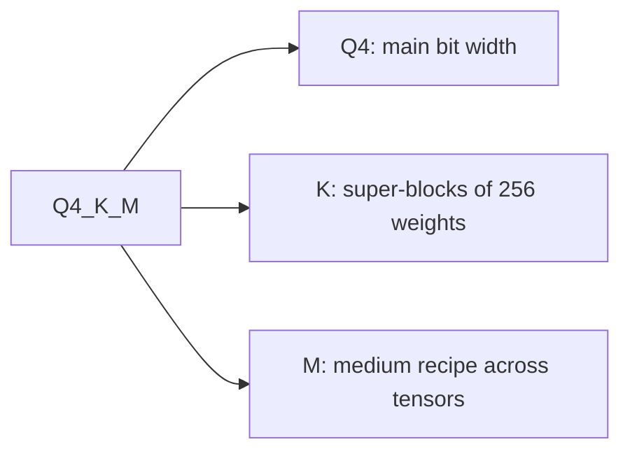

# Medindo e Armazenando: Perda de Qualidade, Checkpoints e Tipos GGUF

As etapas 8 e 9 comprimidas para consulta. A [lição 21](../lessons/0021-perplexity-and-its-limits.md) cobre a perplexity e os flips, a [lição 22](../lessons/0022-an-honest-quantization-eval.md) um eval honesto, a [lição 23](../lessons/0023-quantized-checkpoints.md) os checkpoints em safetensors e a [lição 24](../lessons/0024-gguf-quant-types.md) os tipos GGUF e a matriz de importância.

## O que muda um número de perplexity

| Botão | Efeito | Regra |
|---|---|---|
| Tokenizer | Muda o próprio número | Compare apenas modelos com o mesmo tokenizer |
| Texto | Muda o número | Use um único texto, WikiText-2 pela convenção do llama.cpp |
| Stride | GPT-2 large: 19.44 com stride 1024, 16.44 com stride 512 | Mesma janela e mesmo stride nas duas execuções |
| Ferramenta e versão | Os números do llama.cpp não são comparáveis aos de outros projetos | Mesma ferramenta nas duas execuções |

## Qual métrica responde a qual pergunta

| Métrica | Mede | É cega a |
|---|---|---|
| Perplexity | A surpresa média por token em um texto | Ganhos em alguns tokens que cancelam perdas em outros |
| Divergência KL contra o baseline | Distância entre as distribuições de saída | Se alguma resposta mudou |
| Same top p (llama.cpp) | Posições em que os dois modelos classificam o mesmo token principal | Qualquer coisa além do token principal |
| Flips | Respostas que mudam entre correta e incorreta | Mudanças de incorreta para incorreta |
| Pontuação da tarefa | Acurácia ou taxa de aprovação em uma tarefa | Flips, e o piso de ruído se não for divulgado |
| Chat avaliado por juiz (MT-Bench, Arena-Hard) | Qualidade da geração livre | Ruído entre execuções, a menos que repetido |

Números para lembrar: acurácia dentro de 0 a 2 por cento com flips de até 13.6 por cento (Dutta et al.); o Llama 3 8B em q4_K_M tem perplexity 2.8 por cento acima do FP16 e same top p de 91.901 por cento.

## Um eval honesto

| Mantenha fixo | Reporte | Confira |
|---|---|---|
| Baseline: o mesmo checkpoint em 16 bits | Delta por tarefa, não uma média | O delta contra o piso de ruído |
| Harness, versão, backend | Flips a partir de amostras registradas | Uma nova execução do baseline e do quantizado |
| Prompts, few-shot, chat template | Intervalo de confiança por tarefa | Limite definido antes da execução |
| Configurações de decodificação e comprimento máximo | Qual tarefa pagou, pelo nome | Vários tipos de tarefa, generativas e de contexto longo |

Ruído: duas execuções do mesmo modelo BF16 pontuaram 25.1 e 26.5 no Arena-Hard (8B) e 55.8 e 58.2 (70B), com intervalos de 95 por cento de cerca de 2 a 3 pontos. O erro padrão de uma tarefa de certo ou errado é `sqrt(p * (1 - p) / N)`. Uma comparação pareada depende apenas das perguntas em que os modelos discordam, e ficou 2.7 vezes mais estreita na simulação da lição 22.

Kurtic et al., Llama 3.1: FP8 W8A8 efetivamente sem perdas, INT8 W8A8 bem ajustado perde de 1 a 3 por cento, INT4 W4A16 competitivo com o de 8 bits. Uma família de modelos, receitas específicas. O exemplo por tarefa deles: W4A16 no 8B tem recuperação média de 98.72 por cento e recuperação mais baixa em uma tarefa de 96.88 por cento (TruthfulQA).

## Layout do safetensors

```text
| 8 bytes: N (little-endian) | N bytes: JSON header | byte buffer |
```

O cabeçalho mapeia o nome de cada tensor para `dtype`, `shape` e `data_offsets` (relativos ao buffer). O `__metadata__` opcional guarda pares de strings. Leia apenas o cabeçalho com uma HTTP range request: bytes 0 a 7, depois bytes 8 a 8 + N - 1.

## Tensores em uma camada quantizada

| Esquema | Tensores por camada linear | Observações |
|---|---|---|
| GPTQ, 4 bits, grupo 128 | `qweight` I32 `[in/8, out]`, `scales` F16 `[in/128, out]`, `qzeros` I32 `[in/128, out/8]`, `g_idx` I32 `[in]` | `g_idx` mapeia canal para grupo, embaralhado pelo act-order |
| compressed-tensors, FP8 por tensor | `weight` F8_E4M3, `weight_scale` `[1]`, `input_scale` `[1]` | Uma scale por tensor |
| compressed-tensors, pack-quantized | pesos int4 ou int8 empacotados em int32 | As scales são armazenadas ao lado dos pesos empacotados |

Bits efetivos da camada GPTQ da lição 23 (2048 por 2048, grupo 128): 4.171875, não 4.0. Se `scales` tem `in/G` linhas, o tamanho do grupo é `G`: confie no shape e não no model card.

## O que o `quantization_config` diz

| Método | `quant_method` | Chaves vistas |
|---|---|---|
| GPTQ | `gptq` | `bits`, `group_size`, `desc_act`, `sym`, `damp_percent`, `true_sequential`, `static_groups` |
| AWQ | `awq` | `bits`, `group_size`, `zero_point`, `version` |
| compressed-tensors | `compressed-tensors` | `config_groups` (`weights`, `input_activations`, `targets`), `ignore`, `format`, `quantization_status` |

## Tipos GGUF



| Família | Nomes | Layout | Bits por peso |
|---|---|---|---|
| Legada | `Q4_0`, `Q5_0`, `Q8_0`; `_1` acrescenta um mínimo | 32 pesos, uma scale de 16 bits | `Q4_0` 4.5, `Q8_0` 8.5 |
| k-quant | `Q4_K`, `Q5_K`, `Q6_K` | Super-block de 256 pesos com sub-blocos de scales quantizadas | 4.5, 5.5, 6.5625 |
| i-quant | `IQ4_XS`, `IQ3_S`, `IQ2_XXS`, `IQ1_S` | Scale de super-block e matriz de importância | 4.25, 3.44, 2.06, 1.56 |

Números do arquivo inteiro para o Llama 3.1 8B: `Q4_K_S` 4.6672, `Q4_K_M` 4.8944, `Q5_K_M` 5.7036, `Q6_K` 6.5633, `Q8_0` 8.5008, `IQ1_S` 2.0042 (F16 16.0005). O tamanho em GiB é aproximadamente bits por peso vezes parâmetros dividido por 8 e por 2^30. Quando os sufixos foram introduzidos, o `Q4_K_M` colocava `Q6_K` em metade do `attention.wv` e do `feed_forward.w2`; as receitas mudaram desde então, então leia os tipos de tensor do próprio arquivo. `--pure` desliga as misturas.

## Matriz de importância

| Passo | Ideia do comando | Observação |
|---|---|---|
| Calcular | `llama-imatrix -m model.gguf -f text.txt` | Ativação quadrática média por coluna de entrada |
| Aplicar | `llama-quantize --imatrix imatrix.gguf in.gguf out.gguf Q4_K_M` | Não é aplicada ao `output.weight` por padrão |
| Efeito | `q4_K_M`, Llama 3 8B: perplexity 6.407 para 6.383, divergência KL 0.0313 para 0.0282 | Mesmo tamanho de arquivo |

Uma imatrix é um calibration set: case o texto dela com o deployment e não avalie no texto de que ela veio.
