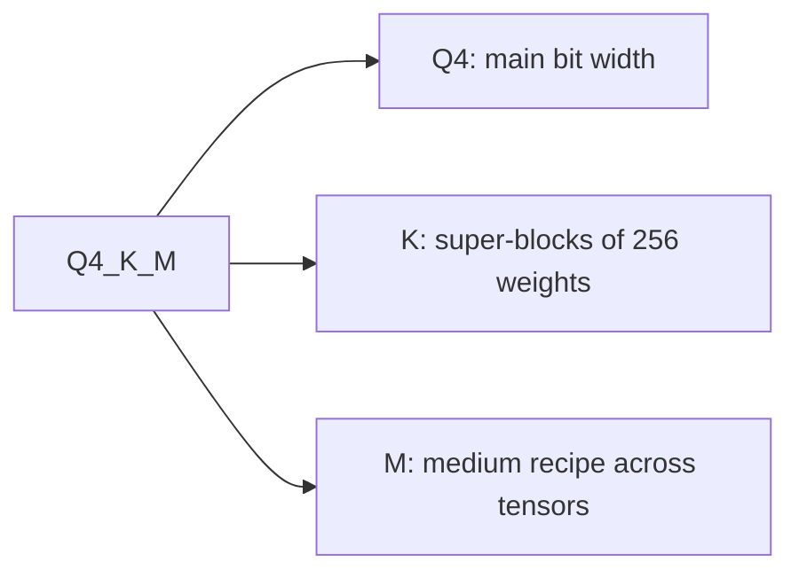

# Измерение и хранение: потеря качества, чекпоинты и типы GGUF

Этапы 8 и 9 в сжатом виде для быстрого поиска. [Урок 21](../lessons/0021-perplexity-and-its-limits.md) охватывает перплексию и флипы, [урок 22](../lessons/0022-an-honest-quantization-eval.md) честную оценку, [урок 23](../lessons/0023-quantized-checkpoints.md) чекпоинты safetensors, а [урок 24](../lessons/0024-gguf-quant-types.md) типы GGUF и матрицу важности.

## Что меняет число перплексии

| Рычаг | Эффект | Правило |
|---|---|---|
| Токенизатор | Меняет само число | Сравнивайте только модели с одним токенизатором |
| Текст | Меняет число | Используйте один текст, WikiText-2 по соглашению llama.cpp |
| Шаг | GPT-2 large: 19,44 при шаге 1024, 16,44 при шаге 512 | Одно окно и один шаг в обоих запусках |
| Инструмент и версия | Числа llama.cpp несравнимы с числами других проектов | Один инструмент в обоих запусках |

## Какая метрика отвечает на какой вопрос

| Метрика | Что измеряет | К чему слепа |
|---|---|---|
| Перплексия | Среднюю неожиданность токена на тексте | К выигрышам на одних токенах, гасящим потери на других |
| KL-дивергенция относительно базовой | Расстояние между распределениями выхода | К тому, изменился ли какой-либо ответ |
| Same top p (llama.cpp) | Позиции, где обе модели ставят на первое место один и тот же токен | К чему бы то ни было за пределами лучшего токена |
| Флипы | Ответы, меняющиеся между верным и неверным | К изменениям из неверного в неверный |
| Оценка по задаче | Точность или долю прохождения на одной задаче | К флипам и к порогу шума, если он не раскрыт |
| Оценка чата судьёй (MT-Bench, Arena-Hard) | Качество свободной генерации | К шуму между запусками, если не повторять |

Числа, которые стоит помнить: точность в пределах 0-2% при флипах до 13,6% (Dutta et al.); у Llama 3 8B при q4_K_M перплексия на 2,8% выше FP16, а same top p равно 91,901%.

## Честная оценка

| Что зафиксировать | О чём сообщать | Что проверить |
|---|---|---|
| Базовая модель: тот же чекпоинт в 16 битах | Дельту по задачам, а не среднее | Дельту относительно порога шума |
| Обвязка, версия, бэкенд | Флипы по залогированным образцам | Повторный запуск базовой и квантизованной |
| Промпты, few-shot, чат-шаблон | Доверительный интервал по каждой задаче | Порог, заданный до запуска |
| Настройки декодирования и максимальная длина | Какая задача заплатила, по имени | Несколько видов задач, генеративные и на длинный контекст |

Шум: два запуска одной и той же модели BF16 дали 25,1 и 26,5 на Arena-Hard (8 млрд) и 55,8 и 58,2 (70 млрд), с 95-процентными интервалами около 2-3 пунктов. Стандартная ошибка для задачи «верно или неверно» равна `sqrt(p * (1 - p) / N)`. Парное сравнение зависит только от вопросов, на которых модели расходятся, и было в 2,7 раза тесней в симуляции урока 22.

Kurtic et al., Llama 3.1: FP8 W8A8 фактически без потерь, хорошо настроенный INT8 W8A8 теряет 1-3%, INT4 W4A16 конкурентоспособен с 8-битными. Одно семейство моделей, конкретные рецепты. Их пример по задачам: W4A16 на 8 млрд имеет среднее восстановление 98,72% и самое низкое восстановление по задачам 96,88% (TruthfulQA).

## Раскладка safetensors

```text
| 8 bytes: N (little-endian) | N bytes: JSON header | byte buffer |
```

Заголовок отображает имя каждого тензора в `dtype`, `shape` и `data_offsets` (относительно буфера). Необязательный `__metadata__` хранит пары строк. Читайте только заголовок HTTP-запросом с диапазоном: байты 0-7, затем байты 8-(8 + N - 1).

## Тензоры в квантизованном слое

| Схема | Тензоры на линейный слой | Примечания |
|---|---|---|
| GPTQ, 4 бита, группа 128 | `qweight` I32 `[in/8, out]`, `scales` F16 `[in/128, out]`, `qzeros` I32 `[in/128, out/8]`, `g_idx` I32 `[in]` | `g_idx` отображает канал в группу, перемешан act-order |
| compressed-tensors, FP8 per-tensor | `weight` F8_E4M3, `weight_scale` `[1]`, `input_scale` `[1]` | Один масштаб на тензор |
| compressed-tensors, pack-quantized | веса int4 или int8, упакованные в int32 | Масштабы хранятся рядом с упакованными весами |

Эффективное число бит для слоя GPTQ из урока 23 (2048 на 2048, группа 128): 4,171875, а не 4,0. Если у `scales` `in/G` строк, размер группы равен `G`: верьте форме, а не карточке модели.

## Что говорит `quantization_config`

| Метод | `quant_method` | Встречающиеся ключи |
|---|---|---|
| GPTQ | `gptq` | `bits`, `group_size`, `desc_act`, `sym`, `damp_percent`, `true_sequential`, `static_groups` |
| AWQ | `awq` | `bits`, `group_size`, `zero_point`, `version` |
| compressed-tensors | `compressed-tensors` | `config_groups` (`weights`, `input_activations`, `targets`), `ignore`, `format`, `quantization_status` |

## Типы GGUF



| Семейство | Имена | Раскладка | Бит на вес |
|---|---|---|---|
| Старые | `Q4_0`, `Q5_0`, `Q8_0`; `_1` добавляет минимум | 32 веса, один 16-битный масштаб | `Q4_0` 4,5, `Q8_0` 8,5 |
| k-кванты | `Q4_K`, `Q5_K`, `Q6_K` | Супер-блок из 256 весов с подблоками с квантизованными масштабами | 4,5, 5,5, 6,5625 |
| i-кванты | `IQ4_XS`, `IQ3_S`, `IQ2_XXS`, `IQ1_S` | Масштаб супер-блока и матрица важности | 4,25, 3,44, 2,06, 1,56 |

Числа для файла целиком на Llama 3.1 8B: `Q4_K_S` 4,6672, `Q4_K_M` 4,8944, `Q5_K_M` 5,7036, `Q6_K` 6,5633, `Q8_0` 8,5008, `IQ1_S` 2,0042 (F16 16,0005). Размер в ГиБ примерно равен числу бит на вес, умноженному на параметры и делённому на 8 и 2^30. Когда суффиксы вводились, `Q4_K_M` ставил `Q6_K` на половину `attention.wv` и `feed_forward.w2`; с тех пор рецепты менялись, поэтому читайте собственные типы тензоров файла. `--pure` выключает смеси.

## Матрица важности

| Шаг | Идея команды | Примечание |
|---|---|---|
| Вычислить | `llama-imatrix -m model.gguf -f text.txt` | Средняя квадратичная активация на входной столбец |
| Применить | `llama-quantize --imatrix imatrix.gguf in.gguf out.gguf Q4_K_M` | По умолчанию не применяется к `output.weight` |
| Эффект | `q4_K_M`, Llama 3 8B: перплексия с 6,407 до 6,383, KL-дивергенция с 0,0313 до 0,0282 | Тот же размер файла |

Imatrix это калибровочный набор: подбирайте его текст под развёртывание и не оценивайте на тексте, из которого она получена.
