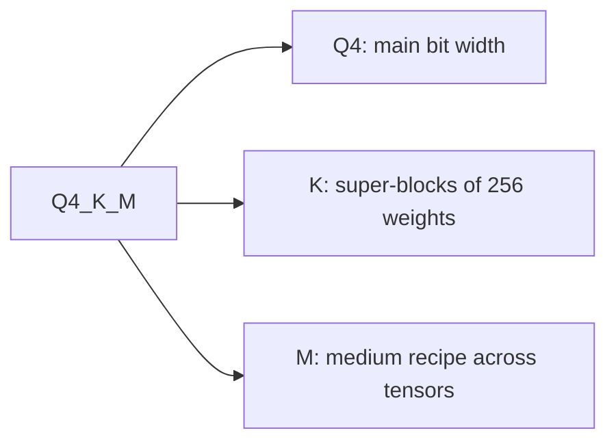

# 度量与存储：质量损失、检查点与 GGUF 类型

把第 8 和第 9 阶段压缩成便于查阅的形式。[第 21 课](../lessons/0021-perplexity-and-its-limits.md)讲困惑度和翻转，[第 22 课](../lessons/0022-an-honest-quantization-eval.md)讲一份诚实的评测，[第 23 课](../lessons/0023-quantized-checkpoints.md)讲 safetensors 检查点，[第 24 课](../lessons/0024-gguf-quant-types.md)讲 GGUF 类型和重要性矩阵。

## 什么会改变困惑度的数字

| 旋钮 | 效果 | 规则 |
|---|---|---|
| 分词器 | 改变数字本身 | 只比较使用同一种分词器的模型 |
| 文本 | 改变数字 | 用同一段文本，按 llama.cpp 的惯例是 WikiText-2 |
| 步幅 | GPT-2 large：步幅 1024 时是 19.44，步幅 512 时是 16.44 | 两次运行用同样的窗口和步幅 |
| 工具及版本 | llama.cpp 的数字与其他项目的不可比 | 两次运行用同一个工具 |

## 哪个指标回答哪个问题

| 指标 | 度量什么 | 看不见什么 |
|---|---|---|
| 困惑度 | 一段文本上每个 token 的平均意外程度 | 某些 token 上的收益抵消另一些上的损失 |
| 对基线的 KL 散度 | 输出分布之间的距离 | 是否有任何答案改变了 |
| Same top p（llama.cpp） | 两个模型把同一个头部 token 排在第一位的位置 | 头部 token 之外的一切 |
| 翻转 | 答案在正确与错误之间发生变化 | 从错误到错误的变化 |
| 任务得分 | 一个任务上的准确率或通过率 | 翻转，以及未披露的噪声底限 |
| 评判的对话（MT-Bench、Arena-Hard） | 自由形式生成的质量 | 除非重复运行，否则看不见多次运行之间的噪声 |

要记住的数字：准确率在 0 到 2% 之内，翻转最高达 13.6%（Dutta 等）；Llama 3 8B 在 q4_K_M 上困惑度比 FP16 高 2.8%，same top p 为 91.901%。

## 一份诚实的评测

| 保持不变 | 报告 | 核查 |
|---|---|---|
| 基线：同一个检查点的 16 位版本 | 逐任务的差值，而不是平均值 | 把差值与噪声底限比较 |
| 测评框架、版本、后端 | 来自记录样本的翻转 | 对基线和量化模型各重新运行一次 |
| 提示词、少样本、聊天模板 | 每个任务的置信区间 | 阈值在运行之前就定好 |
| 解码设置和最大长度 | 点名是哪个任务付出了代价 | 几种任务类型，生成类的和长上下文的 |

噪声：同一个 BF16 模型的两次运行，在 Arena-Hard 上得分是 25.1 和 26.5（8B），以及 55.8 和 58.2（70B），95% 区间约为 2 到 3 个点。对错对分任务的标准误是 `sqrt(p * (1 - p) / N)`。配对比较只取决于两个模型意见不一的那些问题，在第 22 课的模拟中紧了 2.7 倍。

Kurtic 等人，Llama 3.1：FP8 W8A8 实际上无损，调得好的 INT8 W8A8 损失 1% 到 3%，INT4 W4A16 可与 8 位竞争。一个模型系列，特定的配方。他们的逐任务例子：8B 的 W4A16 平均恢复率为 98.72%，最低的任务恢复率为 96.88%（TruthfulQA）。

## safetensors 的布局

```text
| 8 bytes: N (little-endian) | N bytes: JSON header | byte buffer |
```

头部把每个张量名映射到 `dtype`、`shape` 和 `data_offsets`（相对于缓冲区）。可选的 `__metadata__` 存放字符串键值对。用 HTTP 范围请求只读头部：字节 0 到 7，然后字节 8 到 8 + N - 1。

## 量化层中的张量

| 方案 | 每个线性层的张量 | 说明 |
|---|---|---|
| GPTQ，4 位，分组 128 | `qweight` I32 `[in/8, out]`、`scales` F16 `[in/128, out]`、`qzeros` I32 `[in/128, out/8]`、`g_idx` I32 `[in]` | `g_idx` 把通道映射到组，被 act-order 打乱 |
| compressed-tensors，FP8 逐张量 | `weight` F8_E4M3、`weight_scale` `[1]`、`input_scale` `[1]` | 每个张量一个缩放因子 |
| compressed-tensors，打包量化 | int4 或 int8 权重打包进 int32 | 缩放因子存放在打包后的权重旁边 |

第 23 课里那个 GPTQ 层（2048 乘 2048，分组 128）的有效位数：4.171875，而不是 4.0。如果 `scales` 有 `in/G` 行，分组大小就是 `G`：信形状，不要信模型卡。

## `quantization_config` 说了什么

| 方法 | `quant_method` | 见到的键 |
|---|---|---|
| GPTQ | `gptq` | `bits`、`group_size`、`desc_act`、`sym`、`damp_percent`、`true_sequential`、`static_groups` |
| AWQ | `awq` | `bits`、`group_size`、`zero_point`、`version` |
| compressed-tensors | `compressed-tensors` | `config_groups`（`weights`、`input_activations`、`targets`）、`ignore`、`format`、`quantization_status` |

## GGUF 类型



| 家族 | 名称 | 布局 | 每个权重的位数 |
|---|---|---|---|
| 旧式 | `Q4_0`、`Q5_0`、`Q8_0`；`_1` 增加一个最小值 | 32 个权重，一个 16 位缩放因子 | `Q4_0` 4.5，`Q8_0` 8.5 |
| k-quant | `Q4_K`、`Q5_K`、`Q6_K` | 256 个权重的超级块，由带量化缩放因子的子块组成 | 4.5、5.5、6.5625 |
| i-quant | `IQ4_XS`、`IQ3_S`、`IQ2_XXS`、`IQ1_S` | 超级块缩放因子和重要性矩阵 | 4.25、3.44、2.06、1.56 |

Llama 3.1 8B 整个文件的数字：`Q4_K_S` 4.6672，`Q4_K_M` 4.8944，`Q5_K_M` 5.7036，`Q6_K` 6.5633，`Q8_0` 8.5008，`IQ1_S` 2.0042（F16 为 16.0005）。以 GiB 计的大小，约为每个权重的位数乘以参数量，再除以 8 和 2^30。后缀引入的时候，`Q4_K_M` 把 `Q6_K` 放在一半的 `attention.wv` 和 `feed_forward.w2` 上；此后配方已经变了，所以要读文件自己的张量类型。`--pure` 关掉混合。

## 重要性矩阵

| 步骤 | 命令思路 | 说明 |
|---|---|---|
| 计算 | `llama-imatrix -m model.gguf -f text.txt` | 每个输入列的平均平方激活值 |
| 应用 | `llama-quantize --imatrix imatrix.gguf in.gguf out.gguf Q4_K_M` | 默认不应用于 `output.weight` |
| 效果 | `q4_K_M`，Llama 3 8B：困惑度 6.407 到 6.383，KL 散度 0.0313 到 0.0282 | 文件大小相同 |

imatrix 是一个校准集：让它的文本匹配部署场景，并且不要在它的来源文本上做评测。
