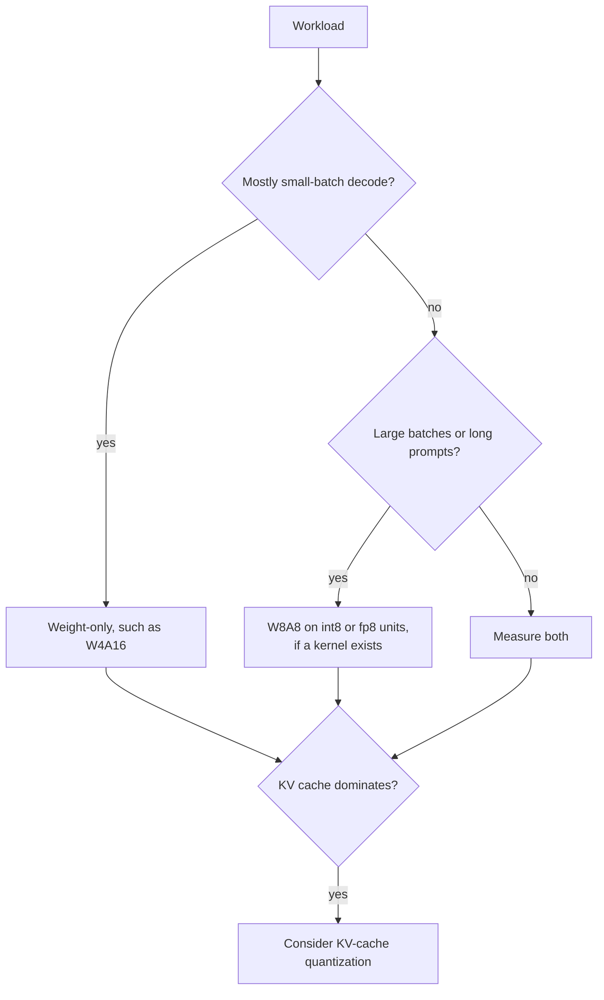

# QAT y hardware: cómo funciona el QAT, cuándo compensa y qué corre más rápido

Las etapas 6 y 7 comprimidas para consulta. La [Lección 17](../lessons/0017-fake-quantization-and-the-ste.md) cubre la fake quantization y el straight-through estimator, la [lección 18](../lessons/0018-qat-for-llms.md) el QAT para LLM, la [lección 19](../lessons/0019-what-actually-runs-faster.md) qué corre realmente más rápido, y la [lección 20](../lessons/0020-hardware-and-kernel-support.md) el hardware y el soporte de kernels.

## Fake quantization y el STE

| Pieza | Regla |
|---|---|
| Valor del forward | `x_hat = s * clamp(round(x / s), n, p)`, calculado en float sobre una copia maestra en float de los pesos |
| Gradiente de `round` | Cero casi en todas partes, así que no puede usarse tal cual |
| STE | Tratar la derivada de `round` como 1: `x + (round(x) - x).detach()` en PyTorch |
| Gradiente dentro del rango | 1 |
| Gradiente fuera del rango | 0, el clamp es plano ahí |
| Gradiente para el scale | `round(x / s) - x / s` dentro del rango, el límite de la rejilla `n` o `p` donde se recorta |

## Qué cuesta y qué recupera el QAT

| Elemento | Número | Fuente |
|---|---|---|
| Ralentización del entrenamiento, torchao, Llama3-8B, 8da4w | Cerca de un 34% más lento que el full fine-tuning | Blog de QAT de PyTorch |
| Memoria extra, con activation checkpointing | Cerca de 2.35 GB por GPU | Blog de QAT de PyTorch |
| Datos de LLM-QAT | 100,000 secuencias generadas, un solo nodo de 8 GPU | Liu et al., 2023 |
| LLaMA-30B, accuracy promedio 4-8-4 | RTN 42.5, LLM-QAT 69.9, precisión completa 71.4 | Liu et al., 2023 |
| LLaMA-30B, solo pesos de 4 bits | RTN 70.1, GPTQ 70.3, LLM-QAT 70.1 | Liu et al., 2023 |
| Llama3-8B 8da4w, torchao | 96% de la degradación de hellaswag y 68% de la degradación de perplexity en wikitext recuperados frente a PTQ | Blog de QAT de PyTorch |

Son configuraciones individuales medidas en 2023 y 2024. Trátalas como órdenes de magnitud.

## Cuándo basta la PTQ y cuándo compensa el QAT

| Situación | Por defecto |
|---|---|
| Pesos y activaciones de 8 bits | PTQ |
| Solo pesos de 4 bits, modelo grande | PTQ, luego medir |
| Solo pesos de 4 bits, modelo pequeño | Primero PTQ, QAT si la brecha restante importa |
| Activaciones o KV cache de 4 bits | QAT, o las rotaciones de la lección 15, probadas |
| 3 bits o menos | QAT más conservar las capas sensibles en mayor precisión |
| Modelo entrenado con muchos más datos | Probar PTQ pronto y esperar una brecha mayor |

QLoRA no es QAT: entrena adapters a través de un base congelado de 4 bits. Lo enseña el track de finetuning, consulta [Presupuesto de memoria](../../finetuning/reference/memory-budget.md).

## El roofline en una línea

| Cantidad | Fórmula |
|---|---|
| Tiempo de paso | `max(operations / peak, bytes / bandwidth)` |
| Ridge point | operaciones máximas por segundo divididas por el ancho de banda |
| Intensidad solo de pesos | `2 * B / bytes_per_weight`, así que `B` para bf16 y `4 * B` para int4 |
| A100 80GB (SXM) | 312 TFLOPS densos en FP16, 624 TOPS densos en INT8, 2,039 GB/s, ridge de unos 153 |
| bf16 limitado por cómputo desde | lote de unos 153 en ese chip |
| int4 solo de pesos limitado por cómputo desde | lote de unos 38 en ese chip |

El modelo ignora la descuantización, la KV cache y la ineficiencia del kernel, así que da una forma y no un número.

## Aceleraciones medidas

| Fuente | Hallazgo |
|---|---|
| MARLIN | Cerca del máximo de 4x con lote 16 a 32, decreciendo hasta 64 a 128, hasta 2.8x de extremo a extremo en vLLM |
| QServe | Los métodos INT4 existentes pierden del 20 al 90% por la descuantización en GPU |
| Kurtic et al. | W4A16 es el más eficiente en costo para uso síncrono, W8A8 para continuous batching, las cargas mixtas dependen de la razón entre prefill y decode |

## Qué esquema para qué carga de trabajo

## Nativo, solo de almacenamiento y sin kernel

| Caso | Memoria | Velocidad |
|---|---|---|
| Formato nativo y un kernel | Ahorrada | Ganancia del roofline |
| Solo de almacenamiento con un kernel solo de pesos | Ahorrada | Ganancia solo mientras está limitado por el ancho de banda de memoria |
| Sin kernel, pesos convertidos a 16 bits | Ahorrada | Sin ganancia, quizá más lento |

## Datos de hardware, documentación de proveedores con fecha

Vuelve a comprobar las fuentes antes de fiarte de cualquier fila.

| Generación | Formatos de tensor cores de baja precisión documentados |
|---|---|
| Ampere (A100) | INT8 listado, sin fila de FP8 |
| Ada | FP8 |
| Hopper | FP8 e INT8 |
| Blackwell | FP8, FP6, FP4, con MXFP4 y NVFP4 escalados en hardware |

La tabla de vLLM, tal como se obtuvo en octubre de 2026: FP8 W8A8 de Ada en adelante, ninguno en Ampere. INT8 W4A8 no tenía ninguna columna de GPU marcada.

## Preguntas que hacerle a cualquier afirmación de "es más rápido"

1. ¿Qué esquema: solo pesos, o también activaciones?
2. ¿Calcula la GPU de forma nativa en ese formato?
3. ¿Lista el motor un kernel para el esquema en esa GPU?
4. ¿Con qué tamaño de lote y longitud de prompt se midió?
5. ¿Se midió el accuracy frente a un baseline de precisión completa?
