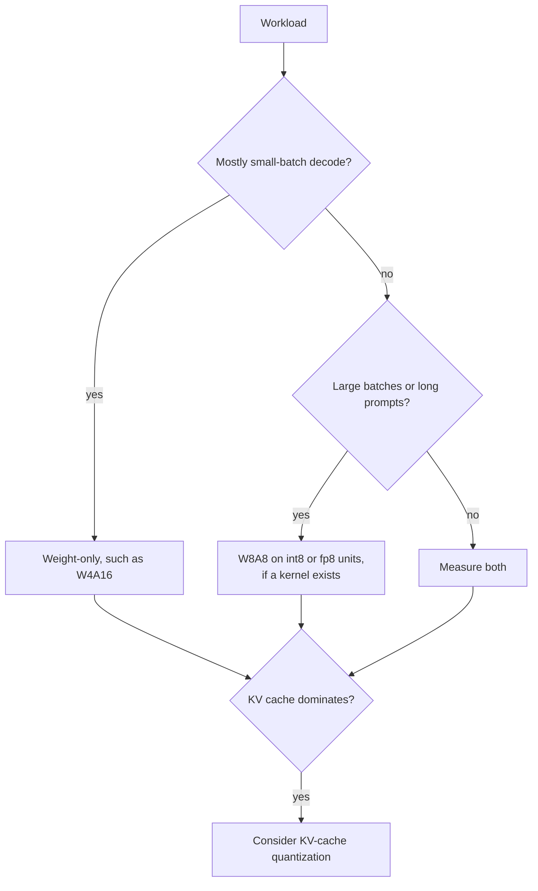

# QAT et matériel : comment fonctionne le QAT, quand il rapporte, et ce qui tourne plus vite

Les étapes 6 et 7 condensées pour la consultation. La [leçon 17](../lessons/0017-fake-quantization-and-the-ste.md) couvre la fake quantization et l'estimateur straight-through, la [leçon 18](../lessons/0018-qat-for-llms.md) le QAT pour les LLM, la [leçon 19](../lessons/0019-what-actually-runs-faster.md) ce qui tourne vraiment plus vite, et la [leçon 20](../lessons/0020-hardware-and-kernel-support.md) le matériel et la prise en charge par les kernels.

## Fake quantization et STE

| Élément | Règle |
|---|---|
| Valeur en passe avant | `x_hat = s * clamp(round(x / s), n, p)`, calculée en float sur une copie maître en float des poids |
| Gradient de `round` | Nul presque partout, donc inutilisable tel quel |
| STE | Traiter la dérivée de `round` comme 1 : `x + (round(x) - x).detach()` en PyTorch |
| Gradient à l'intérieur de la plage | 1 |
| Gradient en dehors de la plage | 0, le clamp est plat à cet endroit |
| Gradient pour le scale | `round(x / s) - x / s` dans la plage, la limite de grille `n` ou `p` là où c'est écrêté |

## Ce que le QAT coûte et récupère

| Élément | Chiffre | Source |
|---|---|---|
| Ralentissement de l'entraînement, torchao, Llama3-8B, 8da4w | Environ 34 % plus lent qu'un fine-tuning complet | Billet PyTorch sur le QAT |
| Mémoire supplémentaire, avec activation checkpointing | Environ 2.35 GB par GPU | Billet PyTorch sur le QAT |
| Données de LLM-QAT | 100,000 séquences générées, un seul nœud de 8 GPU | Liu et al., 2023 |
| LLaMA-30B, précision moyenne 4-8-4 | RTN 42.5, LLM-QAT 69.9, pleine précision 71.4 | Liu et al., 2023 |
| LLaMA-30B, poids en 4 bits seulement | RTN 70.1, GPTQ 70.3, LLM-QAT 70.1 | Liu et al., 2023 |
| Llama3-8B 8da4w, torchao | 96 % de la dégradation sur hellaswag et 68 % de la dégradation de perplexity sur wikitext récupérés par rapport au PTQ | Billet PyTorch sur le QAT |

Ce sont des configurations mesurées isolées de 2023 et 2024. Traitez-les comme des ordres de grandeur.

## Quand le PTQ suffit, et quand le QAT rapporte

| Situation | Par défaut |
|---|---|
| Poids et activations en 8 bits | PTQ |
| Poids en 4 bits seulement, grand modèle | PTQ, puis mesurer |
| Poids en 4 bits seulement, petit modèle | PTQ d'abord, QAT si l'écart restant compte |
| Activations ou KV cache en 4 bits | QAT, ou les rotations de la leçon 15, testées |
| 3 bits ou moins | QAT plus conservation des couches sensibles en plus haute précision |
| Modèle entraîné sur beaucoup plus de données | Tester tôt le PTQ et s'attendre à un écart plus grand |

QLoRA n'est pas du QAT : il entraîne des adapters à travers un modèle de base gelé en 4 bits. Le parcours de fine-tuning l'enseigne, voir [Budget mémoire](../../finetuning/reference/memory-budget.md).

## Le roofline en une ligne

| Quantité | Formule |
|---|---|
| Temps du pas | `max(operations / peak, bytes / bandwidth)` |
| Point de crête | opérations de crête par seconde divisées par la bande passante |
| Intensité weight-only | `2 * B / bytes_per_weight`, donc `B` pour le bf16 et `4 * B` pour l'int4 |
| A100 80GB (SXM) | 312 TFLOPS FP16 dense, 624 TOPS INT8 dense, 2,039 GB/s, point de crête environ 153 |
| bf16 limité par le calcul à partir de | batch environ 153 sur cette puce |
| int4 weight-only limité par le calcul à partir de | batch environ 38 sur cette puce |

Le modèle ignore la déquantification, le KV cache et l'inefficacité des kernels, donc il donne une forme et pas un chiffre.

## Gains de vitesse mesurés

| Source | Constat |
|---|---|
| MARLIN | Près du maximum de 4x à batch 16 à 32, décroissant jusqu'à 64 à 128, jusqu'à 2.8x de bout en bout dans vLLM |
| QServe | Les méthodes INT4 existantes perdent 20 à 90 % à cause de la déquantification sur GPU |
| Kurtic et al. | Le W4A16 est le plus rentable en usage synchrone, le W8A8 pour le continuous batching, les charges mixtes dépendent du rapport prefill sur décodage |

## Quel schéma pour quelle charge de travail

## Natif, stockage seul et pas de kernel

| Cas | Mémoire | Vitesse |
|---|---|---|
| Format natif et un kernel | Économisée | Gain du roofline |
| Stockage seul avec un kernel weight-only | Économisée | Gain seulement tant qu'on est limité par la mémoire |
| Pas de kernel, poids convertis en 16 bits | Économisée | Aucun gain, peut-être plus lent |

## Faits sur le matériel, documentation de fournisseurs datée

Revérifiez les sources avant de vous fier à une ligne.

| Génération | Formats de tensor cores basse précision documentés |
|---|---|
| Ampere (A100) | INT8 listé, aucune ligne FP8 |
| Ada | FP8 |
| Hopper | FP8 et INT8 |
| Blackwell | FP8, FP6, FP4, avec MXFP4 et NVFP4 mis à l'échelle en matériel |

Le tableau de vLLM, tel que récupéré en octobre 2026 : FP8 W8A8 à partir d'Ada, aucun sur Ampere. L'INT8 W4A8 n'avait aucune colonne GPU cochée.

## Questions à poser à toute affirmation « c'est plus rapide »

1. Quel schéma : weight-only, ou activations aussi ?
2. Le GPU calcule-t-il nativement dans ce format ?
3. Le moteur liste-t-il un kernel pour le schéma sur ce GPU ?
4. À quelle taille de batch et longueur de prompt cela a-t-il été mesuré ?
5. La précision a-t-elle été mesurée face à une référence en pleine précision ?
