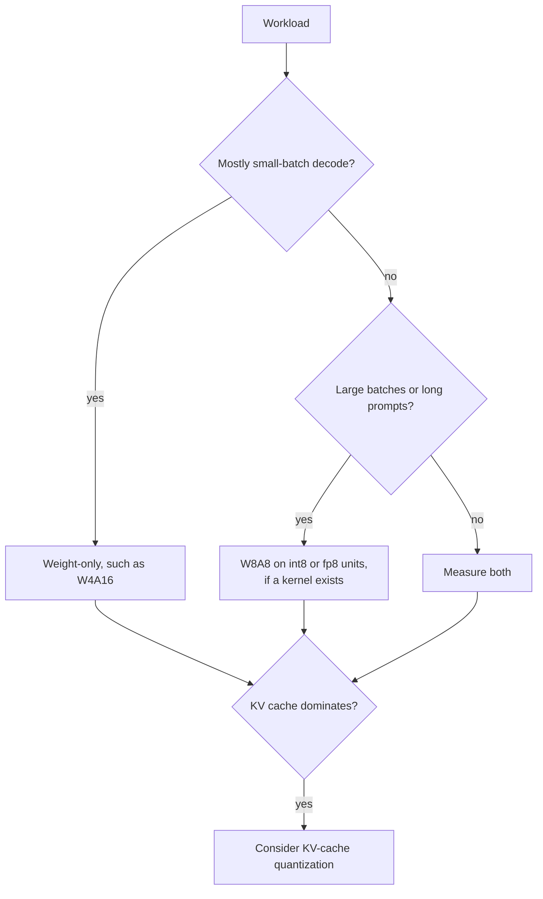

# QAT और Hardware: QAT कैसे काम करती है, कब फ़ायदा देती है, और क्या तेज़ चलता है

चरण 6 और 7 का संक्षेप, देखने के लिए। [पाठ 17](../lessons/0017-fake-quantization-and-the-ste.md) fake quantization और straight-through estimator बताता है, [पाठ 18](../lessons/0018-qat-for-llms.md) LLMs के लिए QAT, [पाठ 19](../lessons/0019-what-actually-runs-faster.md) असल में क्या तेज़ चलता है, और [पाठ 20](../lessons/0020-hardware-and-kernel-support.md) hardware और kernel support।

## Fake quantization और STE

| हिस्सा | नियम |
|---|---|
| Forward value | `x_hat = s * clamp(round(x / s), n, p)`, weights की float master copy पर float में compute होता है |
| `round` का gradient | लगभग हर जगह शून्य, इसलिए जैसा है वैसा इस्तेमाल नहीं हो सकता |
| STE | `round` के derivative को 1 मानें: PyTorch में `x + (round(x) - x).detach()` |
| Range के अंदर gradient | 1 |
| Range के बाहर gradient | 0, वहाँ clamp समतल है |
| Scale का gradient | Range के अंदर `round(x / s) - x / s`, जहाँ clip हुआ वहाँ grid की सीमा `n` या `p` |

## QAT की लागत और वह क्या वापस लाती है

| मद | संख्या | स्रोत |
|---|---|---|
| Training की धीमी रफ़्तार, torchao, Llama3-8B, 8da4w | पूरे fine-tuning से लगभग 34% धीमी | PyTorch QAT blog |
| अतिरिक्त memory, activation checkpointing के साथ | प्रति GPU लगभग 2.35 GB | PyTorch QAT blog |
| LLM-QAT data | 100,000 generate की गई sequences, एक 8-GPU node | Liu et al., 2023 |
| LLaMA-30B, 4-8-4 औसत accuracy | RTN 42.5, LLM-QAT 69.9, full precision 71.4 | Liu et al., 2023 |
| LLaMA-30B, सिर्फ़ 4-bit weights | RTN 70.1, GPTQ 70.3, LLM-QAT 70.1 | Liu et al., 2023 |
| Llama3-8B 8da4w, torchao | PTQ की तुलना में hellaswag की गिरावट का 96% और wikitext perplexity की गिरावट का 68% वापस मिला | PyTorch QAT blog |

ये 2023 और 2024 के अकेले मापे गए setups हैं। इन्हें परिमाण के अनुमान की तरह लें।

## PTQ कब काफ़ी है, और QAT कब फ़ायदा देती है

| स्थिति | Default |
|---|---|
| 8-bit weights और activations | PTQ |
| सिर्फ़ 4-bit weights, बड़ा model | PTQ, फिर मापें |
| सिर्फ़ 4-bit weights, छोटा model | पहले PTQ, बचा फ़र्क़ मायने रखे तो QAT |
| 4-bit activations या KV cache | QAT, या पाठ 15 के rotations, परखे हुए |
| 3 bits या कम | QAT, और संवेदनशील layers को ऊँची precision में रखना |
| बहुत ज़्यादा data पर train हुआ model | PTQ को जल्दी परखें और बड़े फ़र्क़ की उम्मीद रखें |

QLoRA, QAT नहीं है: यह frozen 4-bit base के आर-पार adapters train करता है। इसे finetuning track सिखाता है, [Memory Budget](../../finetuning/reference/memory-budget.md) देखें।

## Roofline एक पंक्ति में

| मात्रा | सूत्र |
|---|---|
| Step का समय | `max(operations / peak, bytes / bandwidth)` |
| Ridge point | प्रति सेकंड peak operations को bandwidth से भाग |
| Weight-only intensity | `2 * B / bytes_per_weight`, यानी bf16 के लिए `B` और int4 के लिए `4 * B` |
| A100 80GB (SXM) | 312 TFLOPS dense FP16, 624 TOPS dense INT8, 2,039 GB/s, ridge लगभग 153 |
| bf16 compute-bound होता है | उस chip पर batch लगभग 153 से |
| int4 weight-only compute-bound होता है | उस chip पर batch लगभग 38 से |

मॉडल dequantization, KV cache और kernel की अक्षमता को अनदेखा करता है, इसलिए यह आकार देता है, संख्या नहीं।

## मापे गए speed-ups

| स्रोत | निष्कर्ष |
|---|---|
| MARLIN | Batch 16 से 32 पर अधिकतम 4 गुना के क़रीब, 64 से 128 तक घटता हुआ, vLLM में end to end 2.8 गुना तक |
| QServe | मौजूदा INT4 methods GPUs पर dequantization के कारण 20 से 90% खो देते हैं |
| Kurtic et al. | Synchronous उपयोग के लिए W4A16 सबसे किफ़ायती, continuous batching के लिए W8A8, मिले-जुले load prefill और decode के अनुपात पर निर्भर |

## किस workload के लिए कौन-सी scheme

## Native, सिर्फ़ storage, और kernel नहीं

| स्थिति | Memory | Speed |
|---|---|---|
| Native format और kernel | बचती है | Roofline के अनुसार फ़ायदा |
| Weight-only kernel के साथ सिर्फ़ storage | बचती है | फ़ायदा सिर्फ़ तब तक जब तक memory-bound है |
| Kernel नहीं, weights 16 bits में बदले गए | बचती है | कोई फ़ायदा नहीं, शायद धीमा |

## Hardware के तथ्य, तारीख़ वाले vendor दस्तावेज़

किसी भी पंक्ति पर भरोसा करने से पहले स्रोत दोबारा जाँचें।

| Generation | दर्ज low-precision tensor-core formats |
|---|---|
| Ampere (A100) | INT8 दर्ज है, FP8 की पंक्ति नहीं |
| Ada | FP8 |
| Hopper | FP8 और INT8 |
| Blackwell | FP8, FP6, FP4, MXFP4 और NVFP4 hardware में scaled |

vLLM की table, अक्टूबर 2026 में fetch की गई: FP8 W8A8 Ada से ऊपर, Ampere पर नहीं। INT8 W4A8 के लिए किसी GPU column पर निशान नहीं था।

## किसी भी "यह तेज़ है" दावे से पूछने के सवाल

1. कौन-सी scheme: weight-only, या activations भी?
2. क्या GPU उस format में natively compute करता है?
3. क्या engine उस GPU पर उस scheme के लिए kernel सूचीबद्ध करता है?
4. किस batch size और prompt length पर मापा गया?
5. क्या accuracy को full-precision baseline के मुक़ाबले मापा गया?
