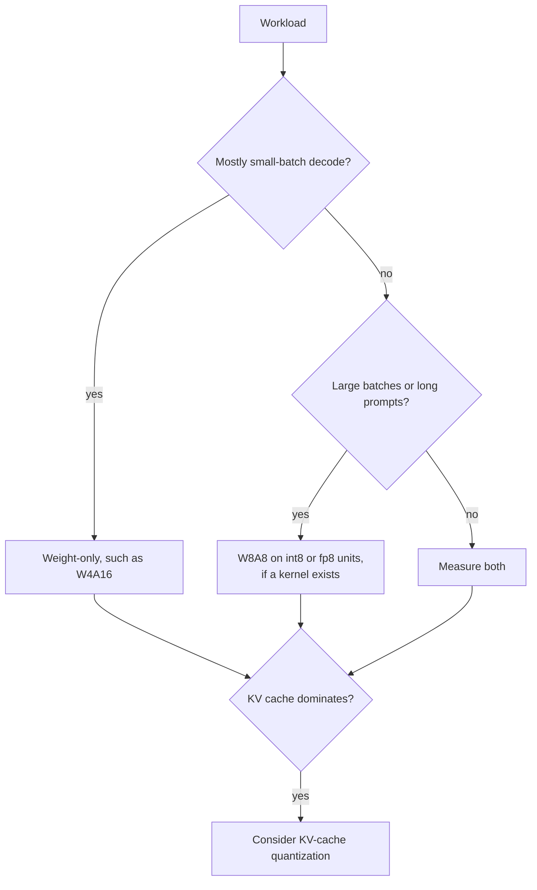

# QAT and Hardware: How QAT Works, When It Pays, and What Runs Faster

Stages 6 and 7 compressed for lookup. [Lesson 17](../lessons/0017-fake-quantization-and-the-ste.md) covers fake quantization and the straight-through estimator, [lesson 18](../lessons/0018-qat-for-llms.md) QAT for LLMs, [lesson 19](../lessons/0019-what-actually-runs-faster.md) what actually runs faster, and [lesson 20](../lessons/0020-hardware-and-kernel-support.md) hardware and kernel support.

## Fake quantization and the STE

| Piece | Rule |
|---|---|
| Forward value | `x_hat = s * clamp(round(x / s), n, p)`, computed in float on a float master copy of the weights |
| Gradient of `round` | Zero almost everywhere, so it cannot be used as is |
| STE | Treat the derivative of `round` as 1: `x + (round(x) - x).detach()` in PyTorch |
| Gradient inside the range | 1 |
| Gradient outside the range | 0, the clamp is flat there |
| Gradient for the scale | `round(x / s) - x / s` inside the range, the grid limit `n` or `p` where clipped |

## What QAT costs and recovers

| Item | Number | Source |
|---|---|---|
| Training slowdown, torchao, Llama3-8B, 8da4w | About 34% slower than full fine-tuning | PyTorch QAT blog |
| Extra memory, with activation checkpointing | About 2.35 GB per GPU | PyTorch QAT blog |
| LLM-QAT data | 100,000 generated sequences, a single 8-GPU node | Liu et al., 2023 |
| LLaMA-30B, 4-8-4 average accuracy | RTN 42.5, LLM-QAT 69.9, full precision 71.4 | Liu et al., 2023 |
| LLaMA-30B, 4-bit weights only | RTN 70.1, GPTQ 70.3, LLM-QAT 70.1 | Liu et al., 2023 |
| Llama3-8B 8da4w, torchao | 96% of hellaswag degradation and 68% of wikitext perplexity degradation recovered against PTQ | PyTorch QAT blog |

These are single measured setups from 2023 and 2024. Treat them as orders of magnitude.

## When PTQ is enough, and when QAT pays

| Situation | Default |
|---|---|
| 8-bit weights and activations | PTQ |
| 4-bit weights only, large model | PTQ, then measure |
| 4-bit weights only, small model | PTQ first, QAT if the remaining gap matters |
| 4-bit activations or KV cache | QAT, or the rotations of lesson 15, tested |
| 3 bits or fewer | QAT plus keeping sensitive layers in higher precision |
| Model trained on much more data | Test PTQ early and expect a larger gap |

QLoRA is not QAT: it trains adapters through a frozen 4-bit base. The finetuning track teaches it, see [Memory Budget](../../finetuning/reference/memory-budget.md).

## Roofline in one line

| Quantity | Formula |
|---|---|
| Step time | `max(operations / peak, bytes / bandwidth)` |
| Ridge point | peak operations per second divided by bandwidth |
| Weight-only intensity | `2 * B / bytes_per_weight`, so `B` for bf16 and `4 * B` for int4 |
| A100 80GB (SXM) | 312 TFLOPS dense FP16, 624 TOPS dense INT8, 2,039 GB/s, ridge about 153 |
| bf16 compute-bound from | batch about 153 on that chip |
| int4 weight-only compute-bound from | batch about 38 on that chip |

The model ignores dequantization, the KV cache and kernel inefficiency, so it gives a shape and not a number.

## Measured speed-ups

| Source | Finding |
|---|---|
| MARLIN | Close to the maximum 4x at batch 16 to 32, decreasing up to 64 to 128, up to 2.8x end to end in vLLM |
| QServe | Existing INT4 methods lose 20 to 90% to dequantization on GPUs |
| Kurtic et al. | W4A16 is the most cost-efficient for synchronous use, W8A8 for continuous batching, mixed loads depend on the prefill to decode ratio |

## Which scheme for which workload

## Native, storage-only, and no kernel

| Case | Memory | Speed |
|---|---|---|
| Native format and a kernel | Saved | Roofline gain |
| Storage-only with a weight-only kernel | Saved | Gain only while memory-bound |
| No kernel, weights converted to 16 bits | Saved | No gain, maybe slower |

## Hardware facts, dated vendor documentation

Re-check the sources before relying on any row.

| Generation | Documented low-precision tensor-core formats |
|---|---|
| Ampere (A100) | INT8 listed, no FP8 row |
| Ada | FP8 |
| Hopper | FP8 and INT8 |
| Blackwell | FP8, FP6, FP4, with MXFP4 and NVFP4 scaled in hardware |

vLLM's table, as fetched in October 2026: FP8 W8A8 from Ada up, none on Ampere. INT8 W4A8 had no GPU column ticked.

## Questions to ask of any "it is faster" claim

1. Which scheme: weight-only, or activations too?
2. Does the GPU compute natively in that format?
3. Does the engine list a kernel for the scheme on that GPU?
4. At which batch size and prompt length was it measured?
5. Was accuracy measured against a full-precision baseline?
