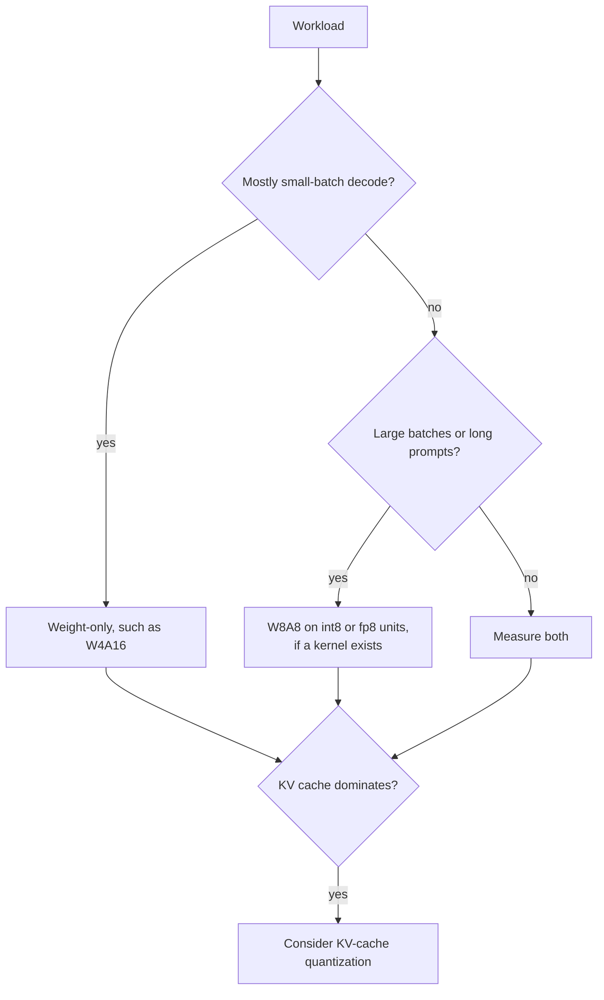

# QAT e Hardware: Como o QAT Funciona, Quando Compensa e o Que Roda Mais Rápido

As etapas 6 e 7 comprimidas para consulta. A [lição 17](../lessons/0017-fake-quantization-and-the-ste.md) cobre a quantização fake e o straight-through estimator, a [lição 18](../lessons/0018-qat-for-llms.md) o QAT para LLMs, a [lição 19](../lessons/0019-what-actually-runs-faster.md) o que realmente roda mais rápido e a [lição 20](../lessons/0020-hardware-and-kernel-support.md) o hardware e o suporte de kernel.

## Quantização fake e o STE

| Peça | Regra |
|---|---|
| Valor no forward | `x_hat = s * clamp(round(x / s), n, p)`, calculado em float sobre uma cópia master em float dos pesos |
| Gradiente de `round` | Zero quase em toda parte, então não pode ser usado como está |
| STE | Tratar a derivada de `round` como 1: `x + (round(x) - x).detach()` no PyTorch |
| Gradiente dentro da faixa | 1 |
| Gradiente fora da faixa | 0, o clamp é plano ali |
| Gradiente para a scale | `round(x / s) - x / s` dentro da faixa, o limite da grade `n` ou `p` onde houve clipping |

## O que o QAT custa e recupera

| Item | Número | Fonte |
|---|---|---|
| Lentidão do treinamento, torchao, Llama3-8B, 8da4w | Cerca de 34% mais lento que o full fine-tuning | Blog de QAT do PyTorch |
| Memória extra, com activation checkpointing | Cerca de 2.35 GB por GPU | Blog de QAT do PyTorch |
| Dados do LLM-QAT | 100.000 sequências geradas, um único nó de 8 GPUs | Liu et al., 2023 |
| LLaMA-30B, acurácia média 4-8-4 | RTN 42.5, LLM-QAT 69.9, precisão total 71.4 | Liu et al., 2023 |
| LLaMA-30B, somente pesos de 4 bits | RTN 70.1, GPTQ 70.3, LLM-QAT 70.1 | Liu et al., 2023 |
| Llama3-8B 8da4w, torchao | 96% da degradação no hellaswag e 68% da degradação de perplexity no wikitext recuperadas em relação à PTQ | Blog de QAT do PyTorch |

Estas são configurações isoladas medidas em 2023 e 2024. Trate-as como ordens de grandeza.

## Quando a PTQ basta e quando o QAT compensa

| Situação | Padrão |
|---|---|
| Pesos e ativações de 8 bits | PTQ |
| Somente pesos de 4 bits, modelo grande | PTQ, depois meça |
| Somente pesos de 4 bits, modelo pequeno | PTQ primeiro, QAT se a diferença restante importar |
| Ativações ou KV cache de 4 bits | QAT, ou as rotações da lição 15, testadas |
| 3 bits ou menos | QAT mais manter as camadas sensíveis em precisão maior |
| Modelo treinado com muito mais dados | Teste a PTQ cedo e espere uma diferença maior |

O QLoRA não é QAT: ele treina adapters através de um base congelado de 4 bits. A trilha de finetuning o ensina, veja [Orçamento de memória](../../finetuning/reference/memory-budget.md).

## Roofline em uma linha

| Grandeza | Fórmula |
|---|---|
| Tempo do passo | `max(operations / peak, bytes / bandwidth)` |
| Ridge point | operações de pico por segundo divididas pela largura de banda |
| Intensidade somente de pesos | `2 * B / bytes_per_weight`, então `B` para bf16 e `4 * B` para int4 |
| A100 80GB (SXM) | 312 TFLOPS FP16 denso, 624 TOPS INT8 denso, 2.039 GB/s, ridge cerca de 153 |
| bf16 limitado por compute a partir de | batch cerca de 153 nesse chip |
| int4 somente de pesos limitado por compute a partir de | batch cerca de 38 nesse chip |

O modelo ignora a dequantização, o KV cache e a ineficiência dos kernels, então dá uma forma e não um número.

## Ganhos de velocidade medidos

| Fonte | Achado |
|---|---|
| MARLIN | Próximo do máximo de 4x em batch 16 a 32, diminuindo até 64 a 128, até 2.8x de ponta a ponta no vLLM |
| QServe | Os métodos INT4 existentes perdem de 20 a 90% para a dequantização em GPUs |
| Kurtic et al. | W4A16 é o mais econômico para uso síncrono, W8A8 para continuous batching, cargas mistas dependem da razão entre prefill e decode |

## Qual esquema para qual carga de trabalho

## Nativo, somente de armazenamento e sem kernel

| Caso | Memória | Velocidade |
|---|---|---|
| Formato nativo e um kernel | Economizada | Ganho do roofline |
| Somente de armazenamento com um kernel somente de pesos | Economizada | Ganho só enquanto limitado pela largura de banda de memória |
| Sem kernel, pesos convertidos para 16 bits | Economizada | Sem ganho, talvez mais lento |

## Fatos de hardware, documentação de fornecedor datada

Reconfira as fontes antes de confiar em qualquer linha.

| Geração | Formatos de tensor core de baixa precisão documentados |
|---|---|
| Ampere (A100) | INT8 listado, sem linha de FP8 |
| Ada | FP8 |
| Hopper | FP8 e INT8 |
| Blackwell | FP8, FP6, FP4, com MXFP4 e NVFP4 escalados em hardware |

Tabela do vLLM, como obtida em outubro de 2026: FP8 W8A8 da Ada em diante, nenhum na Ampere. O INT8 W4A8 não tinha nenhuma coluna de GPU marcada.

## Perguntas a fazer sobre qualquer alegação de "é mais rápido"

1. Qual esquema: somente pesos, ou também ativações?
2. A GPU calcula nativamente nesse formato?
3. O motor lista um kernel para o esquema nessa GPU?
4. Em qual batch size e comprimento de prompt foi medido?
5. A acurácia foi medida contra um baseline de precisão total?
