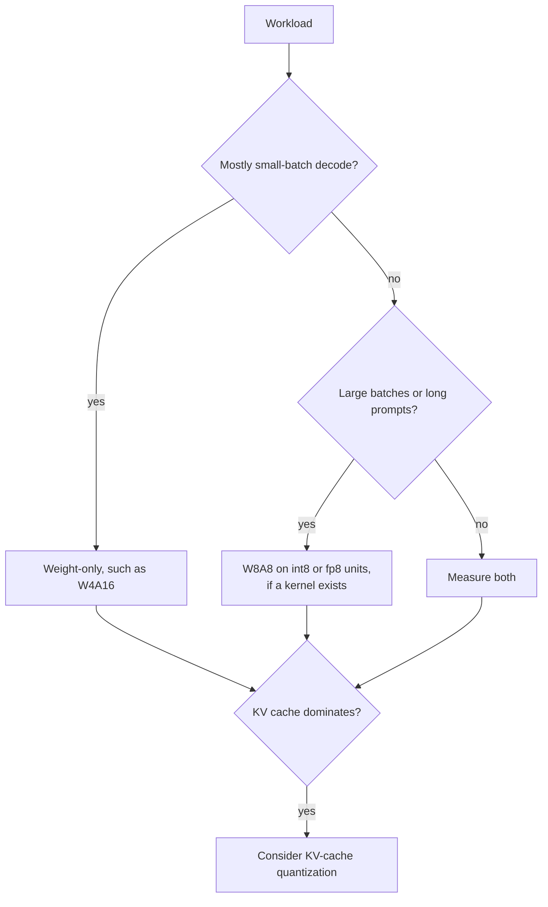

# QAT и оборудование: как работает QAT, когда он окупается и что работает быстрее

Этапы 6 и 7 в сжатом виде для быстрого поиска. [Урок 17](../lessons/0017-fake-quantization-and-the-ste.md) охватывает fake-квантизацию и straight-through estimator, [урок 18](../lessons/0018-qat-for-llms.md) QAT для LLM, [урок 19](../lessons/0019-what-actually-runs-faster.md) то, что на самом деле работает быстрее, а [урок 20](../lessons/0020-hardware-and-kernel-support.md) поддержку оборудованием и ядрами.

## Fake-квантизация и STE

| Элемент | Правило |
|---|---|
| Значение в прямом проходе | `x_hat = s * clamp(round(x / s), n, p)`, вычисляется в float на главной копии весов в float |
| Градиент `round` | Почти везде нулевой, поэтому как есть использовать нельзя |
| STE | Считать производную `round` единицей: `x + (round(x) - x).detach()` в PyTorch |
| Градиент внутри диапазона | 1 |
| Градиент вне диапазона | 0, отсечение там плоское |
| Градиент для масштаба | `round(x / s) - x / s` внутри диапазона, предел сетки `n` или `p` там, где отсечено |

## Сколько QAT стоит и что возвращает

| Пункт | Число | Источник |
|---|---|---|
| Замедление обучения, torchao, Llama3-8B, 8da4w | Примерно на 34% медленнее полного дообучения | Блог PyTorch о QAT |
| Дополнительная память, с чекпоинтингом активаций | Примерно 2,35 ГБ на GPU | Блог PyTorch о QAT |
| Данные LLM-QAT | 100 000 сгенерированных последовательностей, один узел с 8 GPU | Liu et al., 2023 |
| LLaMA-30B, средняя точность 4-8-4 | RTN 42,5, LLM-QAT 69,9, полная точность 71,4 | Liu et al., 2023 |
| LLaMA-30B, только 4-битные веса | RTN 70,1, GPTQ 70,3, LLM-QAT 70,1 | Liu et al., 2023 |
| Llama3-8B 8da4w, torchao | Возвращено 96% деградации на hellaswag и 68% деградации перплексии на wikitext относительно PTQ | Блог PyTorch о QAT |

Это отдельные измеренные постановки 2023 и 2024 годов. Считайте их порядками величины.

## Когда хватает PTQ и когда QAT окупается

| Ситуация | По умолчанию |
|---|---|
| 8-битные веса и активации | PTQ |
| Только 4-битные веса, большая модель | PTQ, затем измерить |
| Только 4-битные веса, малая модель | Сначала PTQ, QAT если оставшийся разрыв важен |
| 4-битные активации или KV-кеш | QAT или повороты из урока 15, проверенные |
| 3 бита или меньше | QAT плюс сохранение чувствительных слоёв в более высокой точности |
| Модель обучена на гораздо большем объёме данных | Проверить PTQ заранее и ожидать больший разрыв |

QLoRA это не QAT: она обучает адаптеры через замороженную 4-битную базу. Её преподаёт курс по дообучению, см. [Бюджет памяти](../../finetuning/reference/memory-budget.md).

## Roofline в одной строке

| Величина | Формула |
|---|---|
| Время шага | `max(operations / peak, bytes / bandwidth)` |
| Ridge point | пиковое число операций в секунду, делённое на пропускную способность |
| Интенсивность только для весов | `2 * B / bytes_per_weight`, то есть `B` для bf16 и `4 * B` для int4 |
| A100 80GB (SXM) | 312 TFLOPS плотного FP16, 624 TOPS плотного INT8, 2039 ГБ/с, ridge около 153 |
| bf16 ограничен вычислениями начиная с | батча около 153 на этом чипе |
| int4 только для весов ограничен вычислениями начиная с | батча около 38 на этом чипе |

Модель игнорирует деквантизацию, KV-кеш и неэффективность ядра, поэтому даёт форму, а не число.

## Измеренные ускорения

| Источник | Результат |
|---|---|
| MARLIN | Близко к максимальным 4 раза при батче 16-32, убывает до 64-128, до 2,8 раза сквозное в vLLM |
| QServe | Существующие методы INT4 теряют 20-90% на деквантизацию на GPU |
| Kurtic et al. | W4A16 наиболее экономичен для синхронного использования, W8A8 для непрерывной пакетной обработки, смешанные нагрузки зависят от отношения prefill к декодированию |

## Какая схема для какой нагрузки

## Нативный формат, только хранение и отсутствие ядра

| Случай | Память | Скорость |
|---|---|---|
| Нативный формат и ядро | Сэкономлена | Выигрыш по roofline |
| Только хранение с ядром только для весов | Сэкономлена | Выигрыш только пока ограничение в памяти |
| Нет ядра, веса преобразуются в 16 бит | Сэкономлена | Нет выигрыша, возможно медленнее |

## Факты об оборудовании, датированная документация производителей

Перепроверяйте источники, прежде чем полагаться на любую строку.

| Поколение | Документированные форматы тензорных ядер с низкой точностью |
|---|---|
| Ampere (A100) | INT8 указан, строки FP8 нет |
| Ada | FP8 |
| Hopper | FP8 и INT8 |
| Blackwell | FP8, FP6, FP4, с масштабированием MXFP4 и NVFP4 в оборудовании |

Таблица vLLM в том виде, как она была получена в октябре 2026 года: FP8 W8A8 начиная с Ada, на Ampere нет. У INT8 W4A8 не отмечен ни один столбец GPU.

## Вопросы к любому заявлению «это быстрее»

1. Какая схема: только веса или ещё и активации?
2. Вычисляет ли GPU нативно в этом формате?
3. Перечисляет ли движок ядро для схемы на этом GPU?
4. При каком размере батча и длине промпта это измерено?
5. Измерялась ли точность относительно базовой модели в полной точности?
