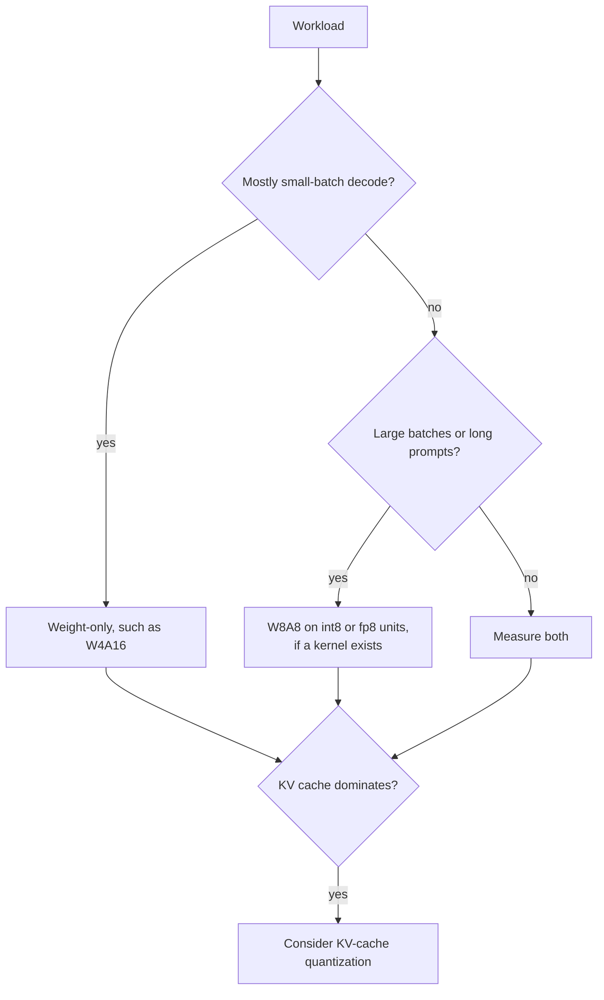

# QAT 与硬件：QAT 如何工作、何时划算，以及什么跑得更快

把第 6 和第 7 阶段压缩成便于查阅的形式。[第 17 课](../lessons/0017-fake-quantization-and-the-ste.md)讲伪量化和直通估计器，[第 18 课](../lessons/0018-qat-for-llms.md)讲面向 LLM 的 QAT，[第 19 课](../lessons/0019-what-actually-runs-faster.md)讲什么才真正跑得更快，[第 20 课](../lessons/0020-hardware-and-kernel-support.md)讲硬件与内核支持。

## 伪量化与 STE

| 部分 | 规则 |
|---|---|
| 前向的值 | `x_hat = s * clamp(round(x / s), n, p)`，在权重的浮点主副本上以浮点计算 |
| `round` 的梯度 | 几乎处处为零，所以不能直接使用 |
| STE | 把 `round` 的导数当作 1：在 PyTorch 里写成 `x + (round(x) - x).detach()` |
| 范围之内的梯度 | 1 |
| 范围之外的梯度 | 0，那里钳制是平的 |
| 缩放因子的梯度 | 范围之内是 `round(x / s) - x / s`，被截断处是网格界限 `n` 或 `p` |

## QAT 花费什么、挽回什么

| 项目 | 数字 | 来源 |
|---|---|---|
| 训练变慢，torchao，Llama3-8B，8da4w | 比全量微调慢约 34% | PyTorch QAT 博客 |
| 额外内存，开启激活检查点 | 每块 GPU 约 2.35 GB | PyTorch QAT 博客 |
| LLM-QAT 的数据 | 100,000 条生成的序列，单个 8 GPU 节点 | Liu 等，2023 |
| LLaMA-30B，4-8-4 平均准确率 | RTN 42.5，LLM-QAT 69.9，全精度 71.4 | Liu 等，2023 |
| LLaMA-30B，只有 4 位权重 | RTN 70.1，GPTQ 70.3，LLM-QAT 70.1 | Liu 等，2023 |
| Llama3-8B 8da4w，torchao | 相对于训练后量化，挽回了 hellaswag 下降的 96% 和 wikitext 困惑度下降的 68% | PyTorch QAT 博客 |

这些是 2023 和 2024 年单次度量的设置。请把它们当作数量级。

## 什么时候训练后量化就够了，什么时候 QAT 划算

| 情形 | 默认做法 |
|---|---|
| 8 位权重和激活值 | 训练后量化 |
| 只有 4 位权重，大模型 | 训练后量化，然后去度量 |
| 只有 4 位权重，小模型 | 先试训练后量化，如果剩下的差距要紧再用 QAT |
| 4 位激活值或 KV 缓存 | QAT，或者第 15 课的旋转，并加以测试 |
| 3 位或更少 | QAT，外加把敏感层保留在更高精度 |
| 用多得多的数据训练的模型 | 尽早测试训练后量化，预期差距会更大 |

QLoRA 不是 QAT：它是穿过冻结的 4 位基础模型来训练适配器。微调系列讲它，见[内存预算](../../finetuning/reference/memory-budget.md)。

## 一行说清屋顶线

| 量 | 公式 |
|---|---|
| 一步的耗时 | `max(operations / peak, bytes / bandwidth)` |
| 脊点 | 峰值运算速率除以带宽 |
| 仅权重的强度 | `2 * B / bytes_per_weight`，所以 bf16 是 `B`，int4 是 `4 * B` |
| A100 80GB（SXM） | 稠密 FP16 312 TFLOPS，稠密 INT8 624 TOPS，2,039 GB/s，脊点约 153 |
| bf16 从多大开始受算力限制 | 在那块芯片上批大小约 153 |
| int4 仅权重从多大开始受算力限制 | 在那块芯片上批大小约 38 |

这个模型忽略了反量化、KV 缓存和内核的低效，所以它给出的是形态，而不是数字。

## 度量到的加速

| 来源 | 发现 |
|---|---|
| MARLIN | 批大小 16 到 32 时接近最大的 4 倍，到 64 至 128 时递减，在 vLLM 中端到端最高 2.8 倍 |
| QServe | 现有的 INT4 方法在 GPU 上因反量化而损失 20% 到 90% |
| Kurtic 等 | 同步使用 W4A16 最具成本效益，连续批处理用 W8A8，混合负载取决于预填充与解码之比 |

## 哪种方案对应哪种工作负载

## 原生、仅存储，以及没有内核

| 情形 | 内存 | 速度 |
|---|---|---|
| 原生格式加内核 | 节省 | 屋顶线上的收益 |
| 仅存储，带仅权重内核 | 节省 | 只有受内存带宽限制时才有收益 |
| 没有内核，权重被转换成 16 位 | 节省 | 没有收益，可能更慢 |

## 硬件事实，带日期的厂商文档

在依赖任何一行之前，请重新核对来源。

| 代际 | 记载的低精度张量核心格式 |
|---|---|
| Ampere（A100） | 列出了 INT8，没有 FP8 行 |
| Ada | FP8 |
| Hopper | FP8 和 INT8 |
| Blackwell | FP8、FP6、FP4，MXFP4 和 NVFP4 的缩放由硬件完成 |

vLLM 的表，2026 年 10 月抓取：FP8 W8A8 从 Ada 起才有，Ampere 上没有。INT8 W4A8 没有勾选任何 GPU 列。

## 对任何“它更快”的说法该问的问题

1. 哪种方案：仅权重，还是激活值也量化？
2. GPU 能以那种格式原生计算吗？
3. 引擎在那块 GPU 上列出了这种方案的内核吗？
4. 是在什么批大小和提示词长度下度量的？
5. 精度是否对照全精度基线做过度量？
