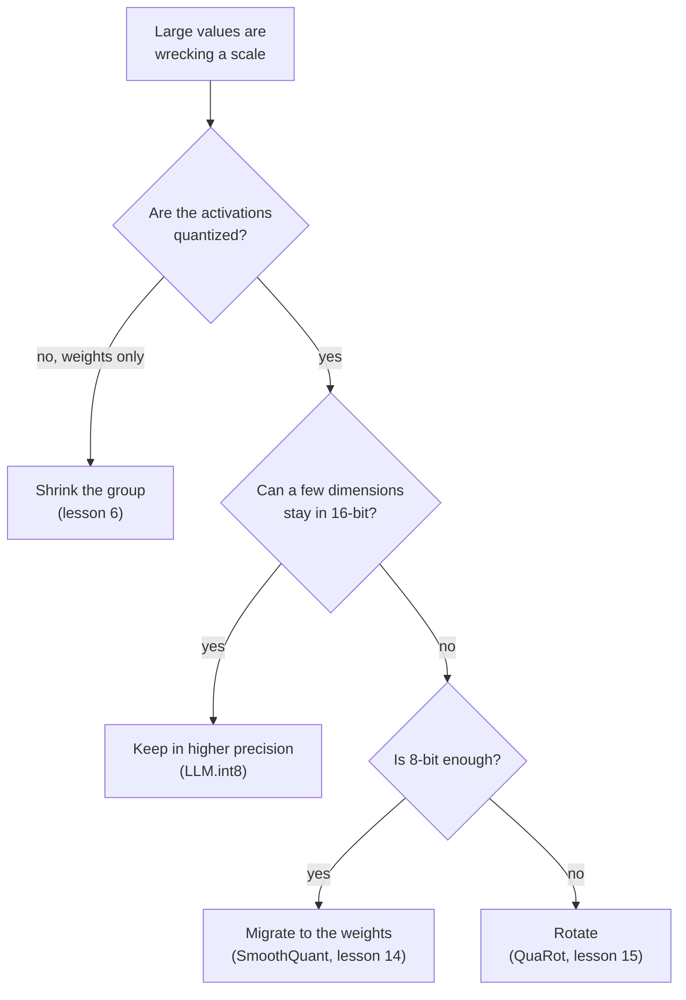

# El mapeo de cuantización: fórmulas, rango, granularidad y soluciones para outliers

Las etapas 2 y 3 comprimidas para consulta. La [Lección 4](../lessons/0004-quantize-and-dequantize.md) cubre el mapeo, la [lección 5](../lessons/0005-choosing-the-range.md) el rango, la [lección 6](../lessons/0006-granularity.md) la granularidad, la [lección 7](../lessons/0007-why-llms-have-outliers.md) por qué los LLM tienen outliers, y la [lección 8](../lessons/0008-handling-outliers.md) las soluciones.

## El mapeo

```text
x_int = clamp(round(x / s) + z, 0, 2^b - 1)      quantize
x_hat = s * (x_int - z)                          dequantize
s = (max - min) / (2^b - 1)                      min-max scale
z = round(-min / s)                              zero point, an integer
q_min = -s * z      q_max = s * (2^b - 1 - z)    grid limits
```

| Rejilla | Enteros | Zero-point | Conviene a |
|---|---|---|---|
| Simétrica con signo | -2^(b-1) a 2^(b-1) - 1 | 0 | Valores aproximadamente simétricos respecto del cero |
| Simétrica sin signo | 0 a 2^b - 1 | 0 | Valores de una sola cola, como las salidas de ReLU |
| Afín | 0 a 2^b - 1 | Entero almacenado | Valores repartidos de forma asimétrica en torno a cero |

Convención absmax para la simétrica: `s = c / (2^(b-1) - 1)`, así que int8 usa de -127 a 127 y deja sin usar -128. Nagel et al. señalan que una disposición habitual es pesos simétricos con activaciones asimétricas, lo que evita un término que depende de la entrada en el producto entero.

## Error

| Error | Dónde | Tamaño |
|---|---|---|
| Redondeo | Valor dentro de los límites de la rejilla | Como mucho `s/2` |
| Recorte | Valor fuera de los límites de la rejilla | Distancia al límite más cercano, sin cota |

- El cero debe ser exactamente representable, para que el relleno con ceros y ReLU no añadan error (Jacob et al., Nagel et al.).
- Para un mismo rango, el paso de 4 bits es 255 / 15 = 17 veces el paso de 8 bits.
- Con min-max, redondear `z` desplaza la rejilla como mucho medio paso, y todo valor en `[min, max]` sigue teniendo un error de como mucho `s/2`.

## Rango

| Método | Qué optimiza | Comportamiento |
|---|---|---|
| Min-max | Sin recorte | Sensible a los outliers: un rango grande significa un paso grande |
| Percentil | Una fracción fija recortada | Heurística simple, no está en la sección 3.1 de Nagel |
| MSE | Error cuadrático entre el tensor y el tensor cuantizado | Mejor que min-max con anchos de bits bajos, se resuelve por búsqueda o en forma cerrada |
| Entropía cruzada | Softmax de los logits | Para la última capa, donde importan más los valores mayores |

- Los pesos no suelen necesitar datos de calibración. Los rangos de activaciones suelen necesitar unos pocos batches de calibración.
- Nagel et al., pesos de ResNet18 a 4 bits: min-max 0.12 y MSE 18.82 de accuracy top-1, pero igualados a 8 bits.
- Experimento, tensor de cola pesada a 4 bits: min-max redondea a cero el 98.7 por ciento de los valores, y un rango buscado por MSE tiene cerca de una sexta parte del error. A 8 bits gana min-max y la búsqueda elige casi el rango completo.
- MSE pesa todos los valores por igual, así que para un LLM puede recortar las outlier features que importan.

## Granularidad

| Granularidad | Un scale por | ¿Encaja en un matmul entero? |
|---|---|---|
| Per-tensor | Todo el tensor | Sí, lo soportan todos los aceleradores de punto fijo |
| Per-channel (pesos) | Canal de salida | Sí: constante a lo largo del índice sumado |
| Per-token (activaciones) | Fila de las activaciones | Sí: constante a lo largo del índice sumado |
| Per-channel (activaciones) | Canal de entrada | No: varía dentro de la suma, así que hay que reescalar el acumulador |
| Per-group | `g` valores consecutivos | No en acumuladores enteros. Los kernels solo de pesos descuantizan primero |

```text
effective bits = b + (scale bits + zero point bits) / group size
```

| Tamaño de grupo | Pesos de 4 bits, scale de 16 bits |
|---|---|
| 1024 | 4.0156 |
| 256 | 4.0625 |
| 128 | 4.125 |
| 64 | 4.25 |
| 32 | 4.5 |

Dettmers y Zettlemoyer: un tamaño de bloque pequeño y el tipo de datos son lo único que encontraron que mejora el escalado a nivel de bits. Pasar de 1024 a 64 añade 0.24 bits y ayuda a Pythia de 4 bits casi tanto como un quinto bit.

## Outliers

| Patrón | Forma | Quién lo encontró | Evidencia |
|---|---|---|---|
| Outlier feature | Una dimensión, grande en la mayoría de los tokens | Dettmers et al. | Al menos 6.0, en al menos el 25 por ciento de las capas y el 6 por ciento de las posiciones. Cerca del 0.1 por ciento de las features. Ponerlas a cero sube la perplexity entre un 600 y un 1000 por ciento |
| Activación masiva | Una entrada: un token, una dimensión | Sun et al. | Por encima de 100 y unas 1,000 veces la mediana. Dimensiones fijas, en el token inicial y en delimitadores. Actúan como sesgos |

Por qué: las cabezas de atención que quieren un no-op atienden a un token delimitador con un value pequeño, lo que separa los logits y hace crecer las activaciones (Bondarenko et al., una hipótesis respaldada en BERT y en un vision transformer).

Por qué se rompe un tensor: un valor de 60 entre desviación estándar 1 da un paso de 0.47 a 8 bits, así que los valores por debajo de 0.24 se redondean a cero, y un paso de 8.6 a 4 bits, así que lo hacen los valores por debajo de 4.3.



| Solución | Mecanismo | Identidad o detalle |
|---|---|---|
| Mantener en mayor precisión | Las dimensiones con un valor de 6.0 o más pasan por un matmul de 16 bits | Más del 99.9 por ciento de los valores se quedan en 8 bits |
| Reducir el grupo | Conjuntos pequeños comparten un scale | No aísla una feature que es grande en todas las filas |
| Migrar | Dividir el canal de activación `k` por `s[k]`, multiplicar por él la fila de pesos `k` | `X W = (X / s)(s W)`: el outlier pasa a los pesos |
| Rotar | Multiplicar por una matriz ortogonal | `X W = (X Q)(Q^T W)`: reparte el outlier entre los canales |
