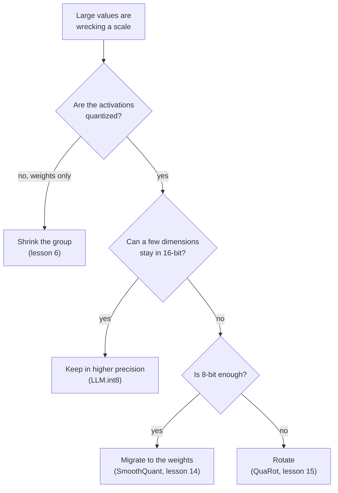

# La correspondance de quantification : formules, plage, granularité et parades aux outliers

Les étapes 2 et 3 condensées pour la consultation. La [leçon 4](../lessons/0004-quantize-and-dequantize.md) couvre la correspondance, la [leçon 5](../lessons/0005-choosing-the-range.md) la plage, la [leçon 6](../lessons/0006-granularity.md) la granularité, la [leçon 7](../lessons/0007-why-llms-have-outliers.md) pourquoi les LLM ont des outliers, et la [leçon 8](../lessons/0008-handling-outliers.md) les parades.

## La correspondance

```text
x_int = clamp(round(x / s) + z, 0, 2^b - 1)      quantize
x_hat = s * (x_int - z)                          dequantize
s = (max - min) / (2^b - 1)                      min-max scale
z = round(-min / s)                              zero point, an integer
q_min = -s * z      q_max = s * (2^b - 1 - z)    grid limits
```

| Grille | Entiers | Zero-point | Convient à |
|---|---|---|---|
| Symétrique signée | -2^(b-1) à 2^(b-1) - 1 | 0 | Valeurs à peu près symétriques autour de zéro |
| Symétrique non signée | 0 à 2^b - 1 | 0 | Valeurs d'un seul côté, comme les sorties de ReLU |
| Affine | 0 à 2^b - 1 | Entier stocké | Valeurs réparties de façon asymétrique autour de zéro |

Convention absmax pour le symétrique : `s = c / (2^(b-1) - 1)`, donc l'int8 utilise -127 à 127 et laisse -128 inutilisé. Nagel et al. notent qu'un arrangement courant est des poids symétriques avec des activations asymétriques, ce qui évite un terme dépendant de l'entrée dans le produit entier.

## Erreur

| Erreur | Où | Taille |
|---|---|---|
| Arrondi | Valeur à l'intérieur des limites de la grille | Au plus `s/2` |
| Écrêtage | Valeur en dehors des limites de la grille | Distance à la limite la plus proche, non bornée |

- Zéro doit être exactement représentable, pour que le remplissage par des zéros et ReLU n'ajoutent aucune erreur (Jacob et al., Nagel et al.).
- Pour une même plage, le pas en 4 bits vaut 255 / 15 = 17 fois le pas en 8 bits.
- Avec min-max, arrondir `z` décale la grille d'au plus un demi-pas, et chaque valeur de `[min, max]` a encore une erreur d'au plus `s/2`.

## Plage

| Méthode | Optimise | Comportement |
|---|---|---|
| Min-max | Aucun écrêtage | Sensible aux outliers : une grande plage signifie un grand pas |
| Percentile | Une fraction fixe écrêtée | Heuristique simple, pas dans la section 3.1 de Nagel |
| MSE | Erreur quadratique entre le tenseur et le tenseur quantifié | Meilleure que min-max aux faibles largeurs en bits, résolue par recherche ou en forme close |
| Entropie croisée | Softmax des logits | Pour la dernière couche, où les plus grandes valeurs comptent le plus |

- Les poids n'ont d'ordinaire pas besoin de données de calibration. Les plages d'activation ont d'ordinaire besoin de quelques batchs de calibration.
- Nagel et al., poids de ResNet18 en 4 bits : min-max 0.12 et MSE 18.82 d'accuracy top-1, mais à égalité en 8 bits.
- Expérience, tenseur à queues lourdes en 4 bits : min-max arrondit 98.7 pour cent des valeurs à zéro, et une plage cherchée par MSE a environ un sixième de l'erreur. En 8 bits, min-max gagne et la recherche choisit presque la plage complète.
- La MSE pèse toutes les valeurs à égalité, donc pour un LLM elle peut écrêter les features outlier qui comptent.

## Granularité

| Granularité | Un scale par | Compatible avec une multiplication de matrices entière ? |
|---|---|---|
| Par tenseur | Tenseur entier | Oui, pris en charge par tous les accélérateurs en virgule fixe |
| Par canal (poids) | Canal de sortie | Oui : constant sur l'indice sommé |
| Par token (activations) | Ligne des activations | Oui : constant sur l'indice sommé |
| Par canal (activations) | Canal d'entrée | Non : varie à l'intérieur de la somme, donc l'accumulateur doit être remis à l'échelle |
| Par groupe | `g` valeurs consécutives | Pas dans les accumulateurs entiers. Les kernels weight-only déquantifient d'abord |

```text
effective bits = b + (scale bits + zero point bits) / group size
```

| Taille de groupe | Poids en 4 bits, scale de 16 bits |
|---|---|
| 1024 | 4.0156 |
| 256 | 4.0625 |
| 128 | 4.125 |
| 64 | 4.25 |
| 32 | 4.5 |

Dettmers et Zettlemoyer : une petite taille de bloc et le type de données sont les seuls leviers trouvés qui améliorent la loi d'échelle au niveau du bit. Passer de 1024 à 64 ajoute 0.24 bit et aide Pythia en 4 bits à peu près autant qu'un cinquième bit.

## Outliers

| Motif | Forme | Découvert par | Preuve |
|---|---|---|---|
| Feature outlier | Une dimension, grande à la plupart des tokens | Dettmers et al. | Au moins 6.0, dans au moins 25 pour cent des couches et 6 pour cent des positions. Environ 0.1 pour cent des features. Les mettre à zéro fait monter la perplexity de 600 à 1000 pour cent |
| Activation massive | Une entrée : un token, une dimension | Sun et al. | Au-dessus de 100 et environ 1,000 fois la médiane. Dimensions fixes, au token de départ et aux délimiteurs. Jouent le rôle de biais |

Pourquoi : des têtes d'attention qui veulent un no-op portent leur attention sur un token délimiteur à petite valeur, ce qui écarte les logits et fait grandir les activations (Bondarenko et al., une hypothèse étayée sur BERT et un transformer de vision).

Pourquoi un tenseur casse : une valeur de 60 parmi un écart type de 1 donne un pas de 0.47 en 8 bits, donc les valeurs inférieures à 0.24 sont arrondies à zéro, et un pas de 8.6 en 4 bits, donc celles inférieures à 4.3 le sont.



| Parade | Mécanisme | Identité ou détail |
|---|---|---|
| Garder en plus haute précision | Les dimensions ayant une valeur de 6.0 ou plus passent par une multiplication de matrices en 16 bits | Plus de 99.9 pour cent des valeurs restent en 8 bits |
| Réduire le groupe | De petits ensembles partagent un scale | N'isole pas une feature qui est grande dans chaque ligne |
| Migrer | Diviser le canal d'activation `k` par `s[k]`, multiplier la ligne de poids `k` par lui | `X W = (X / s)(s W)` : l'outlier passe dans les poids |
| Faire pivoter | Multiplier par une matrice orthogonale | `X W = (X Q)(Q^T W)` : répartit l'outlier sur les canaux |
