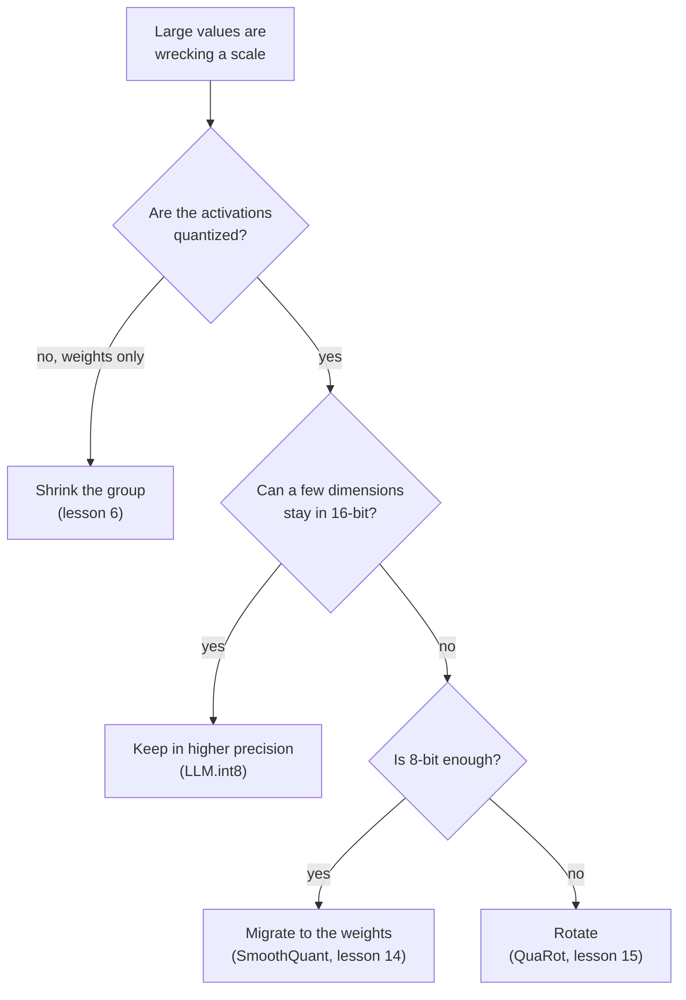

# Quantization Mapping: सूत्र, Range, Granularity और Outlier के इलाज

चरण 2 और 3 का संक्षेप, देखने के लिए। [पाठ 4](../lessons/0004-quantize-and-dequantize.md) mapping बताता है, [पाठ 5](../lessons/0005-choosing-the-range.md) range, [पाठ 6](../lessons/0006-granularity.md) granularity, [पाठ 7](../lessons/0007-why-llms-have-outliers.md) कि LLMs में outliers क्यों होते हैं, और [पाठ 8](../lessons/0008-handling-outliers.md) इलाज।

## Mapping

```text
x_int = clamp(round(x / s) + z, 0, 2^b - 1)      quantize
x_hat = s * (x_int - z)                          dequantize
s = (max - min) / (2^b - 1)                      min-max scale
z = round(-min / s)                              zero point, an integer
q_min = -s * z      q_max = s * (2^b - 1 - z)    grid limits
```

| Grid | Integers | Zero point | किसके लिए ठीक |
|---|---|---|---|
| Signed symmetric | -2^(b-1) से 2^(b-1) - 1 | 0 | शून्य के आसपास लगभग सममित values |
| Unsigned symmetric | 0 से 2^b - 1 | 0 | एक तरफ़ फैली values, जैसे ReLU के outputs |
| Affine | 0 से 2^b - 1 | Store किया हुआ integer | शून्य के आसपास असममित फैली values |

Symmetric के लिए absmax की परिपाटी: `s = c / (2^(b-1) - 1)`, इसलिए int8 -127 से 127 इस्तेमाल करता है और -128 को खाली छोड़ता है। Nagel et al. बताते हैं कि आम व्यवस्था symmetric weights के साथ asymmetric activations है, जिससे integer product में input पर निर्भर पद नहीं आता।

## Error

| Error | कहाँ | आकार |
|---|---|---|
| Rounding | Grid की सीमाओं के अंदर की value | अधिकतम `s/2` |
| Clipping | Grid की सीमाओं के बाहर की value | निकटतम सीमा तक की दूरी, असीमित |

- शून्य ठीक-ठीक represent होना चाहिए, ताकि zero padding और ReLU कोई error न जोड़ें (Jacob et al., Nagel et al.)।
- एक ही range के लिए 4-bit का step 8-bit के step का 255 / 15 = 17 गुना है।
- Min-max में `z` को round करने से grid अधिकतम आधा step खिसकती है, और `[min, max]` की हर value की error फिर भी अधिकतम `s/2` रहती है।

## Range

| Method | किसे optimize करता है | व्यवहार |
|---|---|---|
| Min-max | कोई clipping नहीं | Outliers के प्रति संवेदनशील: बड़ी range यानी बड़ा step |
| Percentile | एक तय हिस्सा clip होता है | सरल heuristic, Nagel की धारा 3.1 में नहीं |
| MSE | Tensor और quantized tensor के बीच squared error | कम bit widths पर min-max से बेहतर, search या closed form से हल होता है |
| Cross-entropy | Logits का softmax | आख़िरी layer के लिए, जहाँ सबसे बड़ी values सबसे ज़्यादा मायने रखती हैं |

- Weights को आम तौर पर calibration data नहीं चाहिए। Activation ranges को आम तौर पर कुछ calibration batches चाहिए।
- Nagel et al., ResNet18 weights 4 bits पर: min-max 0.12 और MSE 18.82 top-1 accuracy, लेकिन 8 bits पर दोनों बराबर।
- प्रयोग, भारी-पूँछ वाला tensor 4 bits पर: min-max 98.7 प्रतिशत values को शून्य पर round करता है, और MSE से search की गई range की error लगभग छठा हिस्सा है। 8 bits पर min-max जीतता है और search लगभग पूरी range चुनता है।
- MSE सभी values को बराबर तौलता है, इसलिए LLM में यह उन outlier features को clip कर सकता है जो मायने रखते हैं।

## Granularity

| Granularity | एक scale किसके लिए | Integer matmul में फिट होता है? |
|---|---|---|
| Per-tensor | पूरा tensor | हाँ, सभी fixed-point accelerators में supported |
| Per-channel (weights) | Output channel | हाँ: जोड़े जाने वाले index पर स्थिर |
| Per-token (activations) | Activations की एक पंक्ति | हाँ: जोड़े जाने वाले index पर स्थिर |
| Per-channel (activations) | Input channel | नहीं: योग के अंदर बदलता है, इसलिए accumulator को दोबारा scale करना पड़ता है |
| Per-group | `g` लगातार values | Integer accumulators में नहीं। Weight-only kernels पहले dequantize करते हैं |

```text
effective bits = b + (scale bits + zero point bits) / group size
```

| Group size | 4-bit weights, 16-bit scale |
|---|---|
| 1024 | 4.0156 |
| 256 | 4.0625 |
| 128 | 4.125 |
| 64 | 4.25 |
| 32 | 4.5 |

Dettmers और Zettlemoyer: छोटा block size और data type ही वे दो चीज़ें मिलीं जो bit-स्तर की scaling सुधारती हैं। 1024 से 64 पर जाना 0.24 bits जोड़ता है और 4-bit Pythia की उतनी ही मदद करता है जितनी पाँचवाँ bit।

## Outliers

| Pattern | आकार | किसने खोजा | प्रमाण |
|---|---|---|---|
| Outlier feature | एक dimension, ज़्यादातर tokens पर बड़ी | Dettmers et al. | कम से कम 6.0, कम से कम 25 प्रतिशत layers और 6 प्रतिशत positions में। लगभग 0.1 प्रतिशत features। इन्हें शून्य करने से perplexity 600 से 1000 प्रतिशत बढ़ती है |
| Massive activation | एक entry: एक token, एक dimension | Sun et al. | 100 से ऊपर और median का लगभग 1,000 गुना। तय dimensions, शुरुआती token और delimiters पर। Biases की तरह काम करती हैं |

क्यों: जो attention heads कुछ न करना चाहते हैं वे छोटी value वाले delimiter token पर ध्यान देते हैं, जिससे logits दूर हो जाते हैं और activations बढ़ती हैं (Bondarenko et al., BERT और एक vision transformer पर समर्थित परिकल्पना)।

Tensor क्यों टूटता है: मानक विचलन 1 के बीच 60 की एक value 8 bits पर 0.47 का step देती है, इसलिए 0.24 से छोटी values शून्य हो जाती हैं, और 4 bits पर 8.6 का step, इसलिए 4.3 से छोटी values शून्य हो जाती हैं।



| इलाज | तरीका | Identity या ब्योरा |
|---|---|---|
| ऊँची precision में रखना | 6.0 या ज़्यादा value वाले dimensions 16-bit matmul से गुज़रते हैं | 99.9 प्रतिशत से ज़्यादा values 8-bit रहती हैं |
| Group छोटा करना | छोटे सेट एक scale साझा करते हैं | उस feature को अलग नहीं करता जो हर पंक्ति में बड़ा है |
| Migrate करना | Activation channel `k` को `s[k]` से भाग दें, weight row `k` को उससे गुणा करें | `X W = (X / s)(s W)`: outlier weights में चला जाता है |
| Rotate करना | Orthogonal matrix से गुणा | `X W = (X Q)(Q^T W)`: outlier को channels में फैला देता है |
