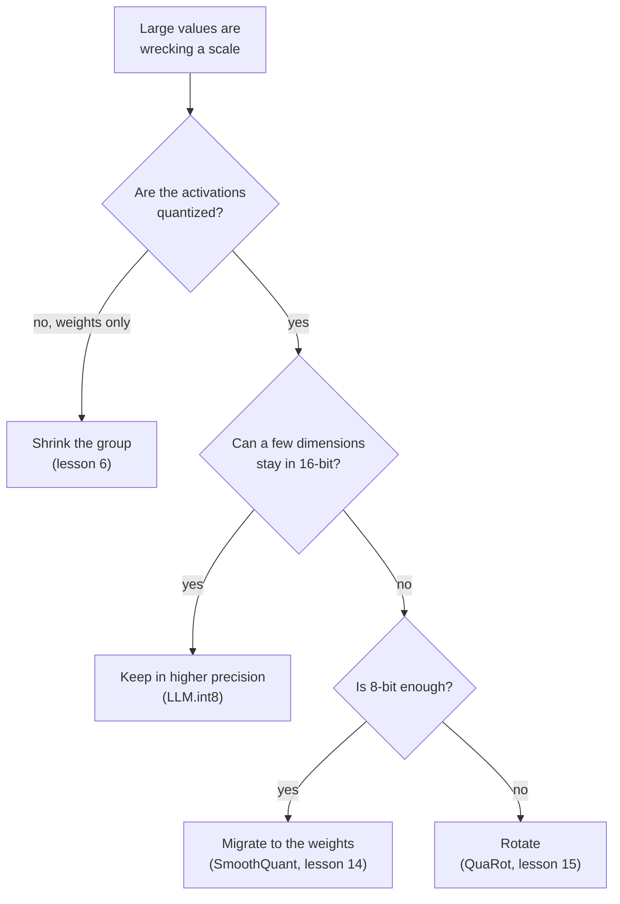

# The Quantization Mapping: Formulas, Range, Granularity and Outlier Fixes

Stages 2 and 3 compressed for lookup. [Lesson 4](../lessons/0004-quantize-and-dequantize.md) covers the mapping, [lesson 5](../lessons/0005-choosing-the-range.md) the range, [lesson 6](../lessons/0006-granularity.md) granularity, [lesson 7](../lessons/0007-why-llms-have-outliers.md) why LLMs have outliers, and [lesson 8](../lessons/0008-handling-outliers.md) the fixes.

## The mapping

```text
x_int = clamp(round(x / s) + z, 0, 2^b - 1)      quantize
x_hat = s * (x_int - z)                          dequantize
s = (max - min) / (2^b - 1)                      min-max scale
z = round(-min / s)                              zero point, an integer
q_min = -s * z      q_max = s * (2^b - 1 - z)    grid limits
```

| Grid | Integers | Zero point | Suits |
|---|---|---|---|
| Signed symmetric | -2^(b-1) to 2^(b-1) - 1 | 0 | Values roughly symmetric about zero |
| Unsigned symmetric | 0 to 2^b - 1 | 0 | One-tailed values, such as ReLU outputs |
| Affine | 0 to 2^b - 1 | Stored integer | Values spread asymmetrically around zero |

Absmax convention for symmetric: `s = c / (2^(b-1) - 1)`, so int8 uses -127 to 127 and leaves -128 unused. Nagel et al. note that a common arrangement is symmetric weights with asymmetric activations, which avoids an input-dependent term in the integer product.

## Error

| Error | Where | Size |
|---|---|---|
| Rounding | Value inside the grid limits | At most `s/2` |
| Clipping | Value outside the grid limits | Distance to the nearest limit, unbounded |

- Zero must be exactly representable, so zero padding and ReLU add no error (Jacob et al., Nagel et al.).
- For one range, the 4-bit step is 255 / 15 = 17 times the 8-bit step.
- With min-max, rounding `z` shifts the grid by at most half a step, and every value in `[min, max]` still has error at most `s/2`.

## Range

| Method | Optimizes | Behaviour |
|---|---|---|
| Min-max | No clipping | Sensitive to outliers: a large range means a large step |
| Percentile | A fixed fraction clipped | Simple heuristic, not in Nagel section 3.1 |
| MSE | Squared error between tensor and quantized tensor | Better than min-max at low bit widths, solved by search or closed form |
| Cross-entropy | Softmax of the logits | For the final layer, where the largest values matter most |

- Weights usually need no calibration data. Activation ranges usually need a few calibration batches.
- Nagel et al., ResNet18 weights at 4 bits: min-max 0.12 and MSE 18.82 top-1 accuracy, but level at 8 bits.
- Experiment, heavy-tailed tensor at 4 bits: min-max rounds 98.7 percent of values to zero, and an MSE-searched range has about one sixth the error. At 8 bits min-max wins and the search picks nearly the full range.
- MSE weighs all values equally, so for an LLM it can clip the outlier features that matter.

## Granularity

| Granularity | One scale per | Fits an integer matmul? |
|---|---|---|
| Per-tensor | Whole tensor | Yes, supported by all fixed-point accelerators |
| Per-channel (weights) | Output channel | Yes: constant across the summed index |
| Per-token (activations) | Row of the activations | Yes: constant across the summed index |
| Per-channel (activations) | Input channel | No: varies inside the sum, so the accumulator must be rescaled |
| Per-group | `g` consecutive values | Not in integer accumulators. Weight-only kernels dequantize first |

```text
effective bits = b + (scale bits + zero point bits) / group size
```

| Group size | 4-bit weights, 16-bit scale |
|---|---|
| 1024 | 4.0156 |
| 256 | 4.0625 |
| 128 | 4.125 |
| 64 | 4.25 |
| 32 | 4.5 |

Dettmers and Zettlemoyer: a small block size and the data type are the only things found that improve bit-level scaling. Going from 1024 to 64 adds 0.24 bits and helps 4-bit Pythia about as much as a fifth bit.

## Outliers

| Pattern | Shape | Found by | Evidence |
|---|---|---|---|
| Outlier feature | A dimension, large at most tokens | Dettmers et al. | At least 6.0, in at least 25 percent of layers and 6 percent of positions. About 0.1 percent of features. Zeroing them raises perplexity 600 to 1000 percent |
| Massive activation | One entry: one token, one dimension | Sun et al. | Above 100 and about 1,000 times the median. Fixed dimensions, at the starting token and delimiters. Act like biases |

Why: attention heads that want a no-op attend to a delimiter token with a small value, which pushes logits apart and grows activations (Bondarenko et al., a hypothesis supported on BERT and a vision transformer).

Why a tensor breaks: one value of 60 among standard deviation 1 gives a step of 0.47 at 8 bits, so values below 0.24 round to zero, and a step of 8.6 at 4 bits, so values below 4.3 do.



| Fix | Mechanism | Identity or detail |
|---|---|---|
| Keep in higher precision | Dimensions with a value of 6.0 or more go through a 16-bit matmul | Over 99.9 percent of values stay 8-bit |
| Shrink the group | Small sets share a scale | Does not isolate a feature that is large in every row |
| Migrate | Divide activation channel `k` by `s[k]`, multiply weight row `k` by it | `X W = (X / s)(s W)`: the outlier moves into the weights |
| Rotate | Multiply by an orthogonal matrix | `X W = (X Q)(Q^T W)`: spreads the outlier across channels |
