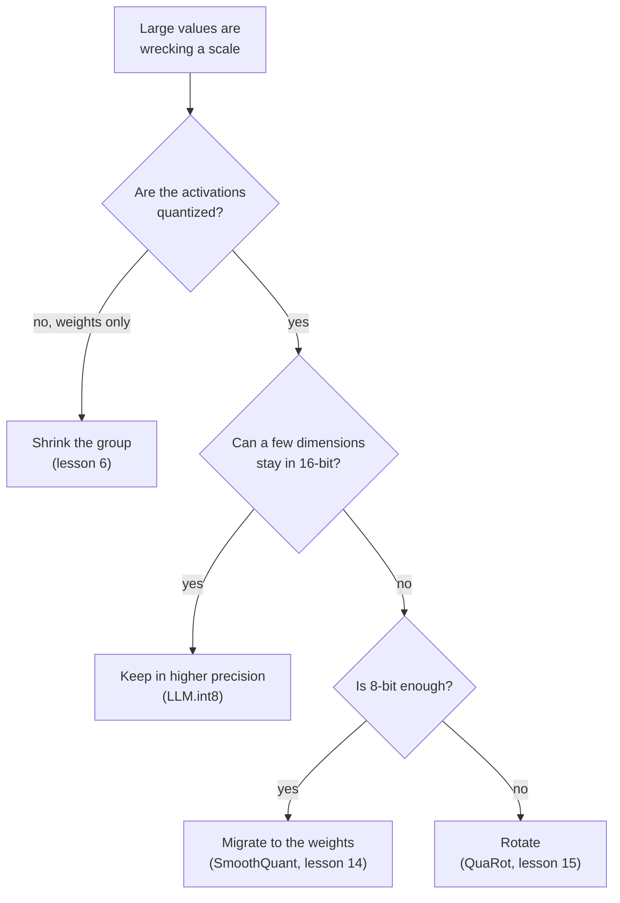

# O Mapeamento de Quantização: Fórmulas, Faixa, Granularidade e Correções de Outliers

As etapas 2 e 3 comprimidas para consulta. A [lição 4](../lessons/0004-quantize-and-dequantize.md) cobre o mapeamento, a [lição 5](../lessons/0005-choosing-the-range.md) a faixa, a [lição 6](../lessons/0006-granularity.md) a granularidade, a [lição 7](../lessons/0007-why-llms-have-outliers.md) por que os LLMs têm outliers e a [lição 8](../lessons/0008-handling-outliers.md) as correções.

## O mapeamento

```text
x_int = clamp(round(x / s) + z, 0, 2^b - 1)      quantize
x_hat = s * (x_int - z)                          dequantize
s = (max - min) / (2^b - 1)                      min-max scale
z = round(-min / s)                              zero point, an integer
q_min = -s * z      q_max = s * (2^b - 1 - z)    grid limits
```

| Grade | Inteiros | Zero-point | Serve para |
|---|---|---|---|
| Simétrica com sinal | -2^(b-1) a 2^(b-1) - 1 | 0 | Valores aproximadamente simétricos em torno do zero |
| Simétrica sem sinal | 0 a 2^b - 1 | 0 | Valores de uma só cauda, como saídas de ReLU |
| Afim | 0 a 2^b - 1 | Inteiro armazenado | Valores distribuídos de forma assimétrica em torno do zero |

Convenção absmax para a simétrica: `s = c / (2^(b-1) - 1)`, então o int8 usa de -127 a 127 e deixa o -128 sem uso. Nagel et al. observam que um arranjo comum é pesos simétricos com ativações assimétricas, o que evita um termo dependente da entrada no produto de inteiros.

## Erro

| Erro | Onde | Tamanho |
|---|---|---|
| Arredondamento | Valor dentro dos limites da grade | No máximo `s/2` |
| Clipping | Valor fora dos limites da grade | Distância até o limite mais próximo, ilimitada |

- O zero precisa ser exatamente representável, então o zero padding e o ReLU não acrescentam erro (Jacob et al., Nagel et al.).
- Para uma mesma faixa, o passo de 4 bits é 255 / 15 = 17 vezes o passo de 8 bits.
- Com min-max, arredondar `z` desloca a grade em no máximo meio passo, e todo valor em `[min, max]` ainda tem erro de no máximo `s/2`.

## Faixa

| Método | Otimiza | Comportamento |
|---|---|---|
| Min-max | Nenhum clipping | Sensível a outliers: uma faixa grande significa um passo grande |
| Percentil | Uma fração fixa sofre clipping | Heurística simples, não está na seção 3.1 de Nagel |
| MSE | Erro quadrático entre o tensor e o tensor quantizado | Melhor que o min-max em larguras em bits baixas, resolvido por busca ou em forma fechada |
| Cross-entropy | Softmax dos logits | Para a camada final, onde os maiores valores mais importam |

- Os pesos normalmente não precisam de dados de calibração. As faixas de ativação normalmente precisam de alguns batches de calibração.
- Nagel et al., pesos da ResNet18 em 4 bits: min-max 0.12 e MSE 18.82 de acurácia top-1, mas equivalentes em 8 bits.
- Experimento, tensor de cauda pesada em 4 bits: o min-max arredonda 98.7 por cento dos valores para zero, e uma faixa buscada por MSE tem cerca de um sexto do erro. Em 8 bits o min-max vence e a busca escolhe quase a faixa inteira.
- O MSE pesa todos os valores igualmente, então em um LLM ele pode aplicar clipping às features outliers que importam.

## Granularidade

| Granularidade | Uma scale por | Cabe em um matmul de inteiros? |
|---|---|---|
| Per-tensor | Tensor inteiro | Sim, suportada por todos os aceleradores de ponto fixo |
| Per-channel (pesos) | Canal de saída | Sim: constante ao longo do índice somado |
| Per-token (ativações) | Linha das ativações | Sim: constante ao longo do índice somado |
| Per-channel (ativações) | Canal de entrada | Não: varia dentro da soma, então o acumulador precisa ser reescalado |
| Per-group | `g` valores consecutivos | Não em acumuladores de inteiros. Kernels somente de pesos dequantizam primeiro |

```text
effective bits = b + (scale bits + zero point bits) / group size
```

| Tamanho do grupo | Pesos de 4 bits, scale de 16 bits |
|---|---|
| 1024 | 4.0156 |
| 256 | 4.0625 |
| 128 | 4.125 |
| 64 | 4.25 |
| 32 | 4.5 |

Dettmers e Zettlemoyer: um tamanho de bloco pequeno e o tipo de dado são as únicas coisas encontradas que melhoram o scaling em nível de bits. Ir de 1024 para 64 acrescenta 0.24 bit e ajuda o Pythia de 4 bits aproximadamente tanto quanto um quinto bit.

## Outliers

| Padrão | Forma | Encontrado por | Evidência |
|---|---|---|---|
| Feature outlier | Uma dimensão, grande na maioria dos tokens | Dettmers et al. | Pelo menos 6.0, em pelo menos 25 por cento das camadas e 6 por cento das posições. Cerca de 0.1 por cento das features. Zerá-las aumenta a perplexity de 600 a 1000 por cento |
| Ativação massiva | Uma entrada: um token, uma dimensão | Sun et al. | Acima de 100 e cerca de 1.000 vezes a mediana. Dimensões fixas, no token inicial e em delimitadores. Agem como biases |

Por quê: cabeças de atenção que querem um no-op atendem a um token delimitador com um value pequeno, o que afasta os logits e faz as ativações crescerem (Bondarenko et al., uma hipótese sustentada no BERT e em um vision transformer).

Por que um tensor quebra: um valor de 60 em meio a um desvio padrão de 1 dá um passo de 0.47 em 8 bits, então valores abaixo de 0.24 arredondam para zero, e um passo de 8.6 em 4 bits, então valores abaixo de 4.3 arredondam.



| Correção | Mecanismo | Identidade ou detalhe |
|---|---|---|
| Manter em precisão maior | Dimensões com um valor de 6.0 ou mais passam por um matmul de 16 bits | Mais de 99.9 por cento dos valores continuam em 8 bits |
| Diminuir o grupo | Conjuntos pequenos compartilham uma scale | Não isola uma feature que é grande em toda linha |
| Migrar | Dividir o canal de ativação `k` por `s[k]`, multiplicar a linha `k` dos pesos por ele | `X W = (X / s)(s W)`: o outlier se move para os pesos |
| Rotacionar | Multiplicar por uma matriz ortogonal | `X W = (X Q)(Q^T W)`: espalha o outlier pelos canais |
