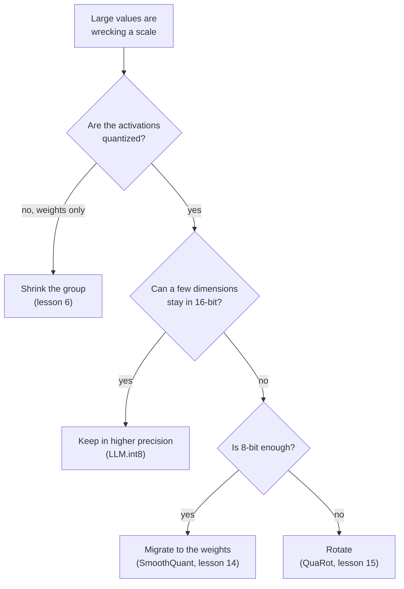

# Отображение квантизации: формулы, диапазон, гранулярность и способы борьбы с выбросами

Этапы 2 и 3 в сжатом виде для быстрого поиска. [Урок 4](../lessons/0004-quantize-and-dequantize.md) охватывает отображение, [урок 5](../lessons/0005-choosing-the-range.md) диапазон, [урок 6](../lessons/0006-granularity.md) гранулярность, [урок 7](../lessons/0007-why-llms-have-outliers.md) то, почему у LLM есть выбросы, а [урок 8](../lessons/0008-handling-outliers.md) способы борьбы с ними.

## Отображение

```text
x_int = clamp(round(x / s) + z, 0, 2^b - 1)      quantize
x_hat = s * (x_int - z)                          dequantize
s = (max - min) / (2^b - 1)                      min-max scale
z = round(-min / s)                              zero point, an integer
q_min = -s * z      q_max = s * (2^b - 1 - z)    grid limits
```

| Сетка | Целые числа | Нулевая точка | Подходит для |
|---|---|---|---|
| Знаковая симметричная | от -2^(b-1) до 2^(b-1) - 1 | 0 | Значения примерно симметричны относительно нуля |
| Беззнаковая симметричная | от 0 до 2^b - 1 | 0 | Односторонние значения, например выходы ReLU |
| Аффинная | от 0 до 2^b - 1 | Хранимое целое | Значения, асимметрично распределённые вокруг нуля |

Соглашение absmax для симметричной: `s = c / (2^(b-1) - 1)`, так что int8 использует от -127 до 127 и оставляет -128 неиспользованным. Nagel и соавторы отмечают, что распространённое сочетание это симметричные веса с асимметричными активациями, что избавляет от зависящего от входа слагаемого в целочисленном произведении.

## Ошибка

| Ошибка | Где | Размер |
|---|---|---|
| Округления | Значение внутри пределов сетки | Не более `s/2` |
| Отсечения | Значение вне пределов сетки | Расстояние до ближайшего предела, неограниченная |

- Ноль должен представляться точно, чтобы дополнение нулями и ReLU не добавляли ошибки (Jacob et al., Nagel et al.).
- При одном диапазоне 4-битный шаг равен 255 / 15 = 17 шагам 8-битного.
- При min-max округление `z` сдвигает сетку не более чем на полшага, и у каждого значения в `[min, max]` ошибка по-прежнему не больше `s/2`.

## Диапазон

| Метод | Что оптимизирует | Поведение |
|---|---|---|
| Min-max | Отсутствие отсечения | Чувствителен к выбросам: большой диапазон означает большой шаг |
| Перцентиль | Фиксированную долю отсекаемых значений | Простая эвристика, не из раздела 3.1 Nagel |
| MSE | Квадрат ошибки между тензором и квантизованным тензором | Лучше min-max при малой разрядности, решается поиском или в замкнутой форме |
| Кросс-энтропия | Softmax логитов | Для последнего слоя, где важнее всего наибольшие значения |

- Весам обычно не нужны калибровочные данные. Диапазонам активаций обычно нужно несколько калибровочных батчей.
- Nagel и соавторы, веса ResNet18 в 4 битах: min-max даёт 0,12, а MSE 18,82 по top-1-точности, но на 8 битах они на одном уровне.
- Эксперимент, тензор с тяжёлыми хвостами в 4 битах: min-max округляет 98,7% значений до нуля, а диапазон, найденный поиском по MSE, даёт примерно в шесть раз меньшую ошибку. В 8 битах min-max выигрывает, а поиск выбирает почти полный диапазон.
- MSE взвешивает все значения одинаково, поэтому для LLM он может отсечь признаки-выбросы, которые важны.

## Гранулярность

| Гранулярность | Один масштаб на | Подходит целочисленному умножению матриц? |
|---|---|---|
| Per-tensor | Весь тензор | Да, поддерживается всеми ускорителями с фиксированной точкой |
| Per-channel (веса) | Выходной канал | Да: постоянен по индексу суммирования |
| Per-token (активации) | Строку активаций | Да: постоянен по индексу суммирования |
| Per-channel (активации) | Входной канал | Нет: меняется внутри суммы, поэтому аккумулятор нужно перемасштабировать |
| Per-group | `g` подряд идущих значений | Не в целочисленных аккумуляторах. Ядра только для весов сначала деквантизуют |

```text
effective bits = b + (scale bits + zero point bits) / group size
```

| Размер группы | 4-битные веса, 16-битный масштаб |
|---|---|
| 1024 | 4,0156 |
| 256 | 4,0625 |
| 128 | 4,125 |
| 64 | 4,25 |
| 32 | 4,5 |

Dettmers и Zettlemoyer: малый размер блока и тип данных это единственное, что нашлось для улучшения масштабирования на уровне бит. Переход от 1024 к 64 добавляет 0,24 бита и помогает 4-битной Pythia примерно так же, как пятый бит.

## Выбросы

| Паттерн | Форма | Найден в | Свидетельство |
|---|---|---|---|
| Признак-выброс | Измерение, большое на большинстве токенов | Dettmers et al. | Не менее 6,0, не менее чем в 25% слоёв и 6% позиций. Около 0,1% признаков. Обнуление поднимает перплексию на 600-1000% |
| Массивная активация | Одна запись: один токен, одно измерение | Sun et al. | Выше 100 и примерно в 1000 раз больше медианы. Фиксированные измерения, на стартовом токене и разделителях. Действуют как смещения |

Почему: головы внимания, которым нужен no-op, обращают внимание на токен-разделитель с малым значением, что раздвигает логиты и увеличивает активации (Bondarenko et al., гипотеза, подкреплённая на BERT и зрительном трансформере).

Почему тензор ломается: одно значение 60 среди стандартного отклонения 1 даёт шаг 0,47 в 8 битах, так что значения ниже 0,24 округляются до нуля, и шаг 8,6 в 4 битах, так что значения ниже 4,3 округляются до нуля.



| Способ | Механизм | Тождество или деталь |
|---|---|---|
| Оставить в более высокой точности | Измерения со значением 6,0 или больше идут через 16-битное умножение матриц | Более 99,9% значений остаются 8-битными |
| Уменьшить группу | Малые множества делят масштаб | Не изолирует признак, большой в каждой строке |
| Перенести | Разделить канал активации `k` на `s[k]`, умножить на него строку весов `k` | `X W = (X / s)(s W)`: выброс переходит в веса |
| Повернуть | Умножить на ортогональную матрицу | `X W = (X Q)(Q^T W)`: рассеивает выброс по каналам |
