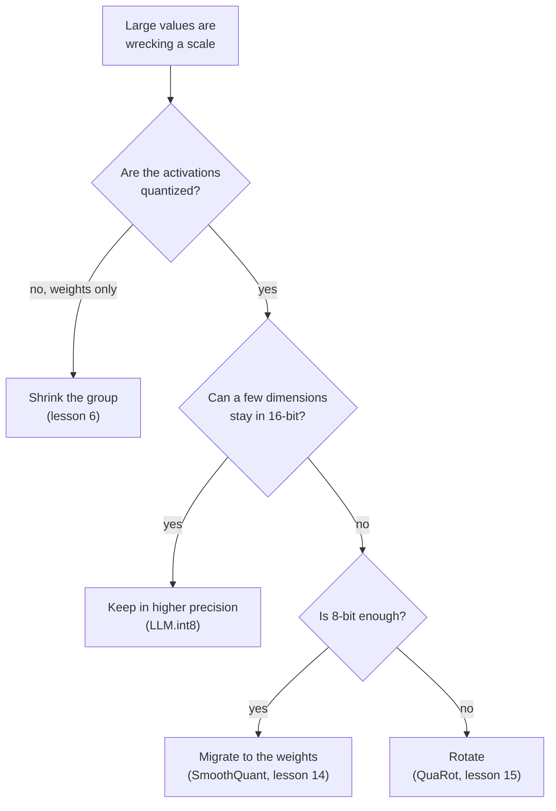

# 量化映射：公式、范围、量化粒度与离群值修复

把第 2 和第 3 阶段压缩成便于查阅的形式。[第 4 课](../lessons/0004-quantize-and-dequantize.md)讲映射，[第 5 课](../lessons/0005-choosing-the-range.md)讲范围，[第 6 课](../lessons/0006-granularity.md)讲量化粒度，[第 7 课](../lessons/0007-why-llms-have-outliers.md)讲 LLM 为什么有离群值，[第 8 课](../lessons/0008-handling-outliers.md)讲修复办法。

## 映射

```text
x_int = clamp(round(x / s) + z, 0, 2^b - 1)      quantize
x_hat = s * (x_int - z)                          dequantize
s = (max - min) / (2^b - 1)                      min-max scale
z = round(-min / s)                              zero point, an integer
q_min = -s * z      q_max = s * (2^b - 1 - z)    grid limits
```

| 网格 | 整数 | 零点 | 适用于 |
|---|---|---|---|
| 有符号对称 | -2^(b-1) 到 2^(b-1) - 1 | 0 | 大致关于零对称的值 |
| 无符号对称 | 0 到 2^b - 1 | 0 | 单侧的值，例如 ReLU 的输出 |
| 仿射 | 0 到 2^b - 1 | 存储的整数 | 围绕零不对称分布的值 |

对称量化的 absmax 约定：`s = c / (2^(b-1) - 1)`，所以 int8 用 -127 到 127，不用 -128。Nagel 等人指出，常见的搭配是对称的权重配非对称的激活值，这样能避免整数乘积中出现一个依赖输入的项。

## 误差

| 误差 | 出现在哪里 | 大小 |
|---|---|---|
| 舍入 | 网格界限之内的值 | 最多 `s/2` |
| 截断 | 网格界限之外的值 | 到最近界限的距离，没有上界 |

- 零必须能被精确表示，这样零填充和 ReLU 就不会增加误差（Jacob 等，Nagel 等）。
- 对同一个范围，4 位的步长是 8 位的 255 / 15 = 17 倍。
- 用最小最大值法时，舍入 `z` 最多让网格偏移半个步长，`[min, max]` 之内的每个值，误差仍然最多是 `s/2`。

## 范围

| 方法 | 优化什么 | 表现 |
|---|---|---|
| 最小最大值 | 没有截断 | 对离群值敏感：范围大意味着步长大 |
| 百分位数 | 固定比例被截断 | 简单的启发式做法，不在 Nagel 第 3.1 节中 |
| MSE | 张量与量化后张量之间的平方误差 | 在低位宽下比最小最大值法好，通过搜索或闭式求解 |
| 交叉熵 | logit 的 softmax | 用于最后一层，那里最大的值最要紧 |

- 权重通常不需要校准数据。激活值的范围通常需要几批校准数据。
- Nagel 等人，ResNet18 的权重在 4 位时：最小最大值法 top-1 准确率为 0.12，MSE 法为 18.82，但在 8 位时持平。
- 实验，4 位下的重尾张量：最小最大值法把 98.7% 的值舍入成零，而 MSE 搜索出来的范围，误差约为六分之一。在 8 位时最小最大值法胜出，搜索选的是几乎完整的范围。
- MSE 对所有值一视同仁，所以对 LLM 来说，它可能把要紧的离群特征截断。

## 量化粒度

| 量化粒度 | 每多少个一个缩放因子 | 适合整数矩阵乘法吗？ |
|---|---|---|
| 逐张量 | 整个张量 | 适合，所有定点加速器都支持 |
| 逐通道（权重） | 输出通道 | 适合：在被求和的下标上是常数 |
| 逐 token（激活值） | 激活值的一行 | 适合：在被求和的下标上是常数 |
| 逐通道（激活值） | 输入通道 | 不适合：在求和内部就变了，所以累加器必须重新缩放 |
| 逐组 | `g` 个连续的值 | 整数累加器里不行。仅权重量化的内核先做反量化 |

```text
effective bits = b + (scale bits + zero point bits) / group size
```

| 分组大小 | 4 位权重，16 位缩放因子 |
|---|---|
| 1024 | 4.0156 |
| 256 | 4.0625 |
| 128 | 4.125 |
| 64 | 4.25 |
| 32 | 4.5 |

Dettmers 与 Zettlemoyer：小的块大小和数据类型，是发现的仅有的两样能改进位级缩放的东西。从 1024 降到 64，增加 0.24 位，对 4 位 Pythia 的帮助，与多加第五位差不多。

## 离群值

| 模式 | 形态 | 发现者 | 证据 |
|---|---|---|---|
| 离群特征 | 一个维度，在大多数 token 上都很大 | Dettmers 等 | 至少 6.0，出现在至少 25% 的层和 6% 的位置上。约占特征的 0.1%。把它们置零，困惑度上升 600% 到 1000% |
| 巨大激活值 | 一个条目：一个 token，一个维度 | Sun 等 | 大于 100，约为中位数的 1,000 倍。位于固定的维度上，出现在起始 token 和分隔符上。作用像偏置 |

原因：想要“什么也不做”的注意力头，会去关注一个值很小的分隔符 token，这把 logit 推开，使激活值变大（Bondarenko 等，一个在 BERT 和一个视觉 Transformer 上得到支持的假设）。

为什么张量会出问题：在标准差为 1 的值中有一个 60 的值，在 8 位时步长是 0.47，所以小于 0.24 的值舍入成零，在 4 位时步长是 8.6，所以小于 4.3 的值舍入成零。



| 修复办法 | 机制 | 恒等式或细节 |
|---|---|---|
| 保留在更高精度 | 含有 6.0 或更大值的维度走 16 位矩阵乘法 | 超过 99.9% 的值保持 8 位 |
| 缩小分组 | 小的集合共用一个缩放因子 | 隔离不了在每一行都很大的特征 |
| 迁移 | 把激活值的通道 `k` 除以 `s[k]`，把权重的第 `k` 行乘以它 | `X W = (X / s)(s W)`：离群值移进了权重里 |
| 旋转 | 乘以一个正交矩阵 | `X W = (X Q)(Q^T W)`：把离群值分散到各个通道上 |
