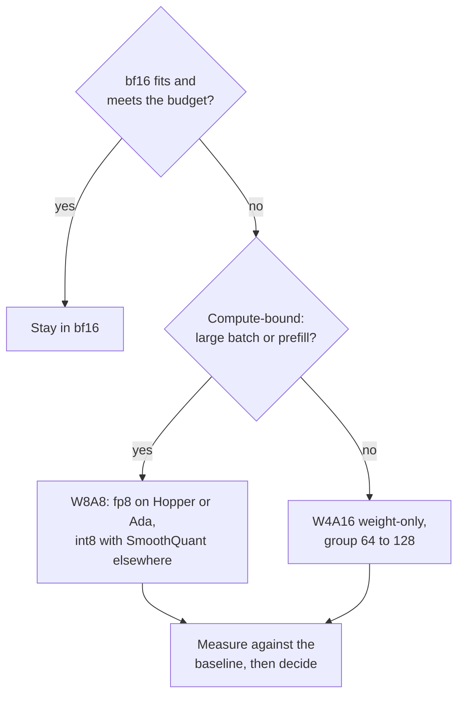

# Lista de revisión de cuantización: elegir, revisar y dudar

La etapa 10 comprimida para consulta. La [Lección 25](../lessons/0025-choosing-a-scheme.md) cubre cómo elegir un esquema, la [lección 26](../lessons/0026-reviewing-a-quantization-claim.md) cubre cómo revisar una afirmación y desplegar un modelo cuantizado, y la [lección 27](../lessons/0027-when-the-usual-answer-is-wrong.md) cubre cuándo la respuesta habitual es incorrecta y cómo zanjar una disputa desde la fuente.

## Elegir un esquema

Pregunta en este orden. Cada pregunta descarta opciones antes de la siguiente.

| # | Pregunta | Si sí | Si no |
|---|---|---|---|
| 1 | ¿bf16 cabe con la KV cache y cumple el presupuesto de latencia? | Quédate en bf16 (presupuesto de servicio: [Cuantización al servir](../../inference/reference/quantization-at-serve-time.md)) | Continúa |
| 2 | ¿La GPU calcula fp8 de forma nativa (Hopper, Ada Lovelace)? | W8A8 fp8 es el primer intento | int8 W8A8 en Ampere y anteriores, o W4A16 |
| 3 | ¿Lotes grandes o con mucho prefill (limitado por cómputo)? | W8A8 | W4A16 solo de pesos, grupo 64 a 128 |
| 4 | ¿El nivel de calidad está escrito como un número en tus tareas? | Aplícalo a lo que queda | Escríbelo primero |
| 5 | ¿Hay datos de calibración? | GPTQ o AWQ | Round-to-nearest, espera una pérdida mayor |

## Qué dice la evidencia, y sus límites

| Hallazgo | Fuente | Límite |
|---|---|---|
| W8A8-FP efectivamente sin pérdida en todos los tamaños | Kurtic et al., Llama 3.1 | Una familia, recetas ajustadas |
| W8A8-INT bien ajustado pierde de 1 a 3 por ciento, necesitó SmoothQuant en 70B | Kurtic et al. | Necesita mejores datos de calibración en tamaños mayores |
| W4A16 recupera el 99.36 por ciento del promedio de bf16 en Leaderboard V1 | Kurtic et al. | Los modelos más pequeños pierden más |
| W4A16 eficiente en costo para servicio síncrono, W8A8 para asíncrono | Kurtic et al. | El cruce depende del tamaño, el hardware y la tarea |
| 4 bits casi universalmente óptimo para el total de bits del modelo, tamaño de bloque pequeño | Dettmers y Zettlemoyer | Familias de 2022, accuracy zero-shot, no throughput |
| Kernel de 4 bits cerca de 4 veces más rápido hasta lote 16 a 32, cerca de 1.5 veces en 128 | MARLIN | Un kernel, una clase de GPU |

## Preguntas para la afirmación de otra persona

| Parte de la afirmación | Pregunta |
|---|---|
| "Sin pérdida" | ¿Frente a qué baseline, el mismo modelo en bf16 en el mismo harness? |
| "Calidad" | ¿Qué tareas? ¿Abiertas como la tuya, o solo de opción múltiple? |
| "Calidad" | ¿Solo perplexity? ¿Sobre qué texto y ventana? |
| "Calidad" | ¿Flips? ¿Divergencia KL? El accuracy puede coincidir mientras hasta el 13.6 por ciento de las respuestas hacen flip (Dutta et al.) |
| "4 bits" | ¿Qué tamaño de grupo, y por tanto cuántos bits efectivos por peso? |
| "4 bits" | ¿Qué calibration set, de qué tamaño, cuán cercano a tu tráfico? |
| Velocidad | ¿Qué hardware, tamaño de lote, kernel y stack de baseline? |

Di también qué está bien y debería quedarse. Una revisión que solo lista fallos está a medias.

## Desplegar un modelo cuantizado

| Paso | Qué hacer |
|---|---|
| Fijar el baseline | Nombra el checkpoint en bf16 y la versión del harness, sigue sirviéndolo |
| Eval offline | Accuracy, flips y KL frente al baseline |
| Tráfico parecido al de producción | Reproduce prompts reales por ambos; KL o similitud de salidas si no hay etiquetas |
| Shadow, luego canary | Corre junto al baseline, luego una pequeña parte de los usuarios, con la compuerta fijada de antemano |
| Versionar | Checkpoint, configuración de cuantización, tamaño de grupo, calibration set y versión del stack de servicio juntos |
| Rollback | El baseline sigue siendo desplegable hasta que el canary haya visto el tráfico que te importa |

## Cuándo la respuesta habitual es incorrecta

| Respuesta habitual | Es incorrecta cuando | Fuente |
|---|---|---|
| Pesos de 4 bits | El modelo está muy entrenado: la degradación de PTQ crece con los tokens de entrenamiento por parámetro | Kumar et al. (ajustado en modelos de hasta 1.7B) |
| Pesos de 4 bits | El modelo es pequeño: 93.5 por ciento de recuperación para Qwen-1.5B frente a 98 a 99 por ciento para los mayores | Kurtic et al. |
| Pesos de 4 bits | El servicio está limitado por cómputo: las ganancias de solo pesos se reducen al crecer el tamaño de lote | MARLIN, QServe, Kurtic et al. |
| 4 bits para memoria | fp8 es nativo y la memoria cabe: W8A8-FP es el primer intento de menor riesgo | Kurtic et al. |
| El contexto largo se rompe | La recuperación en RULER fue de al menos el 98 por ciento en todos los formatos, 405B no se ejecutó, KV cache no estudiada | Kurtic et al. |
| AWQ supera a GPTQ | Tareas del mundo real, GPTQ ajustado: GPTQ ganó por 2.9 puntos en 8B, AWQ ganó como mucho por 0.35 en académicas | Kurtic et al. |

## Zanjar una disputa desde la fuente

1. Encuentra el paper, no la entrada que lo cita.
2. Comprueba los modelos, los tamaños y el año.
3. Comprueba qué se midió frente a lo que se afirmó.
4. Lee la configuración que hay detrás de la tabla: tamaño de grupo, recorte, calibration set, tareas.
5. Compara la diferencia con el ruido entre ejecuciones.
6. Ejecútalo en tus propias tareas.
