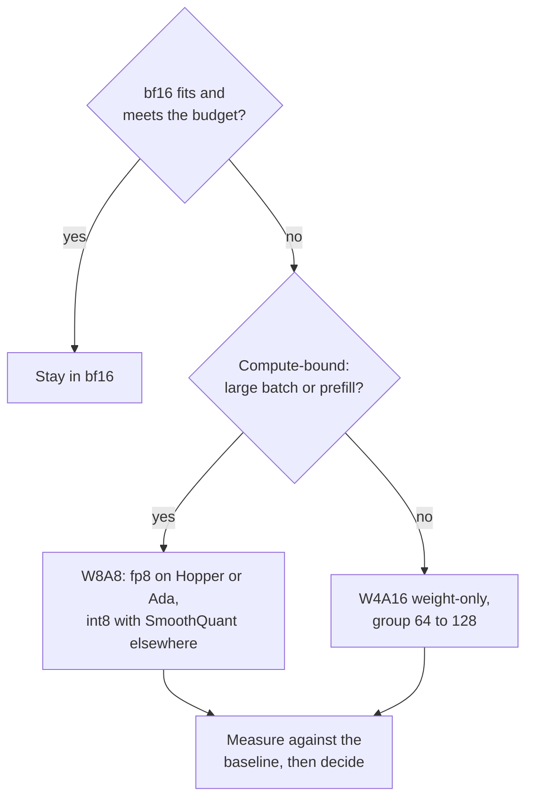

# Liste de contrôle de relecture d'une quantification : choisir, relire et douter

L'étape 10 condensée pour la consultation. La [leçon 25](../lessons/0025-choosing-a-scheme.md) couvre le choix d'un schéma, la [leçon 26](../lessons/0026-reviewing-a-quantization-claim.md) la relecture d'une affirmation et le déploiement d'un modèle quantifié, et la [leçon 27](../lessons/0027-when-the-usual-answer-is-wrong.md) quand la réponse habituelle est fausse et comment trancher un différend à partir de la source.

## Choisir un schéma

Posez les questions dans cet ordre. Chacune écarte des options avant la suivante.

| # | Question | Si oui | Si non |
|---|---|---|---|
| 1 | Le bf16 tient-il avec le KV cache et respecte-t-il le budget de latence ? | Rester en bf16 (budget de serving : [Quantification au moment du serving](../../inference/reference/quantization-at-serve-time.md)) | Continuer |
| 2 | Le GPU calcule-t-il nativement en fp8 (Hopper, Ada Lovelace) ? | W8A8 fp8 est le premier essai | W8A8 int8 sur Ampere et plus ancien, ou W4A16 |
| 3 | Grands batchs ou prefill dominant (limité par le calcul) ? | W8A8 | W4A16 weight-only, groupe 64 à 128 |
| 4 | Niveau de qualité écrit comme un chiffre sur vos tâches ? | L'appliquer à ce qui reste | L'écrire d'abord |
| 5 | Données de calibration disponibles ? | GPTQ ou AWQ | Arrondi au plus proche, s'attendre à une perte plus grande |

## Ce que dit la preuve, et ses limites

| Constat | Source | Limite |
|---|---|---|
| W8A8-FP effectivement sans perte à chaque taille | Kurtic et al., Llama 3.1 | Une famille, recettes réglées |
| W8A8-INT bien réglé perd 1 à 3 pour cent, a demandé SmoothQuant à 70B | Kurtic et al. | Demande de meilleures données de calibration aux plus grandes tailles |
| W4A16 récupère 99.36 pour cent de la moyenne bf16 sur Leaderboard V1 | Kurtic et al. | Les plus petits modèles perdent plus |
| W4A16 rentable pour le serving synchrone, W8A8 pour l'asynchrone | Kurtic et al. | Le croisement dépend de la taille, du matériel, de la tâche |
| 4 bits presque universellement optimal pour le total de bits du modèle, petite taille de bloc | Dettmers et Zettlemoyer | Familles de 2022, précision zero-shot, pas le débit |
| Kernel 4 bits proche de 4 fois plus rapide jusqu'à batch 16 à 32, environ 1.5 fois à 128 | MARLIN | Un kernel, une classe de GPU |

## Questions pour l'affirmation de quelqu'un d'autre

| Partie de l'affirmation | Demander |
|---|---|
| « Sans perte » | Par rapport à quelle référence, le même modèle en bf16 sur le même harness ? |
| « Qualité » | Quelles tâches ? Ouvertes comme les vôtres, ou seulement à choix multiples ? |
| « Qualité » | La perplexity seulement ? Sur quel texte et quelle fenêtre ? |
| « Qualité » | Des flips ? La divergence KL ? L'accuracy peut concorder alors que jusqu'à 13.6 pour cent des réponses flippent (Dutta et al.) |
| « 4 bits » | Quelle taille de groupe, donc combien de bits effectifs par poids ? |
| « 4 bits » | Quel calibration set, de quelle taille, à quel point proche de votre trafic ? |
| Vitesse | Quel matériel, quelle taille de batch, quel kernel et quelle pile de référence ? |

Dites aussi ce qui est bon et doit rester. Une relecture qui ne liste que des défauts est à moitié faite.

## Déployer un modèle quantifié

| Étape | Que faire |
|---|---|
| Épingler la référence | Nommer le checkpoint bf16 et la version du harness, continuer à le servir |
| Eval hors ligne | Accuracy, flips et KL par rapport à la référence |
| Trafic proche de la production | Rejouer de vrais prompts à travers les deux ; KL ou similarité de sortie s'il n'y a pas d'étiquettes |
| Shadow, puis canary | Tourner à côté de la référence, puis une petite part des utilisateurs, avec le seuil de validation fixé au préalable |
| Version | Checkpoint, config de quantification, taille de groupe, calibration set, version de la pile de serving ensemble |
| Retour arrière | La référence reste déployable jusqu'à ce que le canary ait vu le trafic qui vous importe |

## Quand la réponse habituelle est fausse

| Réponse habituelle | Fausse quand | Source |
|---|---|---|
| Poids en 4 bits | Le modèle est très entraîné : la dégradation du PTQ croît avec les tokens d'entraînement par paramètre | Kumar et al. (ajusté sur des modèles allant jusqu'à 1.7B) |
| Poids en 4 bits | Le modèle est petit : 93.5 pour cent de récupération pour Qwen-1.5B contre 98 à 99 pour cent pour de plus grands | Kurtic et al. |
| Poids en 4 bits | Le serving est limité par le calcul : les gains du weight-only diminuent quand la taille de batch grandit | MARLIN, QServe, Kurtic et al. |
| 4 bits pour la mémoire | Le fp8 est natif et la mémoire tient : W8A8-FP est le premier essai à moindre risque | Kurtic et al. |
| Le contexte long casse | La récupération RULER était d'au moins 98 pour cent pour tous les formats, 405B non exécuté, KV cache non étudié | Kurtic et al. |
| AWQ bat GPTQ | Tâches réelles, GPTQ réglé : GPTQ devançait de 2.9 points à 8B, AWQ devançait d'au plus 0.35 sur l'académique | Kurtic et al. |

## Trancher un différend à partir de la source

1. Trouvez l'article, pas le billet qui le cite.
2. Vérifiez les modèles, les tailles et l'année.
3. Vérifiez ce qui a été mesuré par rapport à ce qui a été affirmé.
4. Lisez la configuration derrière le tableau : taille de groupe, écrêtage, calibration set, tâches.
5. Comparez l'écart au bruit d'une exécution à l'autre.
6. Exécutez-le sur vos propres tâches.
